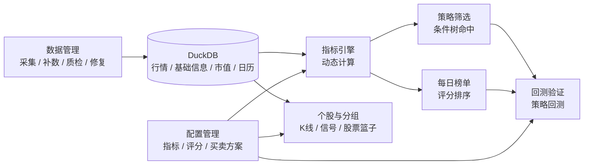

# 复盘啦 · A股趋势龙头选股 / 打分 / 回测系统

本地单用户、**EOD（收盘后）** 的 A 股趋势龙头研究系统，面向每天收盘后做复盘、筛选、验证和跟踪的个人研究场景。它不是一个只给出"黑盒推荐"的工具，而是把数据、条件、评分、买卖规则和历史验证串成一条能检查、能复盘、能迭代的工作流。

系统希望解决三个实际问题：

| 研究问题 | 系统怎么支持 | 最终产出 |
|----------|--------------|----------|
| 今天哪些股票更像趋势龙头？ | 每日榜单按评分方案对全市场排序，并展示分项得分 | Top 榜单、评级、分项解释 |
| 一个选股思路到底能不能用？ | 策略筛选保存条件树，再接入回测验证 | 候选池、净值曲线、逐笔成交 |
| 数据和结论是否可信？ | 数据管理提供采集、补数、质检、修复、体检闭环 | 数据质量分、问题台账、修复记录 |

一条完整使用闭环是：**收盘后更新数据 → 处理质量问题 → 查看每日榜单 → 用筛选/配置调整思路 → 回测验证 → 把重点股票放入分组持续跟踪**。全程强调可解释、可回测、防未来函数。

> 仅供个人研究，不构成投资建议。数据源为公开免费接口（新浪 / 东财 / baostock），覆盖近 5 年、主板 / 创业板 / 科创板（不含北交所）。

系统当前的三条设计主线：

| 主线 | 含义 |
|------|------|
| <span style="color:#2563eb">●</span> **统一基座** | 技术指标是唯一"原子定义"，买卖方案、评分规则、策略筛选全部引用它组合而来；指标动态实时计算 + 单次运行内存缓存，不落预计算表。 |
| <span style="color:#7c3aed">●</span> **配置化** | 怎么买怎么卖、评分用哪些指标多少权重，全在页面配置、存为方案、可版本化，**改策略不改代码**。 |
| <span style="color:#16a34a">●</span> **闭环化** | 数据问题在「数据管理」页内解决（同步 / 补数 / 质检 / 修复）；筛选 → 买卖方案 → 回测 → 评分验证形成可操作闭环。 |

**阅读标识**：<span style="color:#dc2626">●</span> 高风险 / <span style="color:#f59e0b">●</span> 中风险 / <span style="color:#16a34a">●</span> 低风险 / <span style="color:#2563eb">●</span> 信息提示。

---

## 目录

- [1. 架构总览](#1-架构总览)
- [2. 功能模块与技术文档](#2-功能模块与技术文档)
- [3. 目录结构](#3-目录结构)
- [4. 技术栈](#4-技术栈)
- [5. 服务与脚本操作](#5-服务与脚本操作)
- [6. 开发契约（不可破坏）](#6-开发契约不可破坏)
- [7. 开发历程与关联文档](#7-开发历程与关联文档)

---

## 1. 架构总览

单进程全栈：FastAPI 提供 REST 接口并在生产期托管前端构建产物（`frontend/dist`），数据落在嵌入式 DuckDB 单文件。无外部数据库 / 中间件依赖。

```
┌─────────────────────────── 浏览器 (Vue3 SPA) ───────────────────────────┐
│  榜单 / 筛选 / 回测 / 个股 / 配置管理 / 数据管理                          │
└───────────────────────────────┬─────────────────────────────────────────┘
                                 │ REST  /api/**
┌───────────────────────────────▼─────────────────────────────────────────┐
│  FastAPI (backend/api)         路由层：薄，只做参数校验与响应包装         │
├───────────────────────────────────────────────────────────────────────── ┤
│  services        编排层：入库 / 筛选打分 / 回测 / 一键日常 / 异步任务     │
│  screening · scoring · signals · backtest · indicators   领域引擎         │
│  datasource      数据源适配（akshare / baostock，限流·重试·超时·兜底）    │
│  dataquality     入库清洗 + 四层质检 + 修复闭环                           │
│  storage         DuckDB 连接 / DDL / 点时安全仓库（防未来·防幸存者总闸门）│
│  scheduler       APScheduler 定时调度（任务可在「数据管理」页配置）        │
└───────────────────────────────┬─────────────────────────────────────────┘
                                 │
                        data/ai_stocks.duckdb （嵌入式列存）
```

**核心数据流（每日收盘后）**：增量更新日线（含逐只补总市值）→ 入库清洗 + 四层质检 → 动态算指标 → 按默认评分方案出榜单。

---

## 2. 功能模块与技术文档

系统按"数据先可靠、方案可配置、结果可验证"组织成六个业务模块。README 负责说明**从哪里进、做什么、和谁关联**；每个模块的详细说明书放在 [`docs/architecture/`](docs/architecture/)。

| 模块 | 页面入口 | 主要 API | 你在这里完成什么 | 详细说明书 |
|------|----------|----------|------|----------|
| 📈 **每日榜单** | `BoardView` | `/api/board/*` | 按选定**评分方案**全市场排序（0–100 综合分 + 评级 + 分项达标分） | [screening-and-board.md](docs/architecture/screening-and-board.md) |
| 🧮 **策略筛选** | `ScreenView` | `/api/screen*`, `/api/profiles` | 统一条件构建器（AND/OR 树，叶子可选指标条件或表达式，同一份 AST）；方案可存 + 版本回看 | [screening-and-board.md](docs/architecture/screening-and-board.md) |
| 🧪 **回测验证** | `BacktestView` | `/api/backtest/*` | ①策略回测：净值/绩效/逐笔成交（含卖出原因）；②评分验证：分层命中率与超额命中率 | [backtest.md](docs/architecture/backtest.md) |
| 🔍 **个股与分组** | `StocksView` / `StockDetailView` | `/api/stocks/*`, `/api/stock-groups` | 列表（服务端排序/分页，含退市股）；详情（K 线 + 指标快照 + 当前买卖方案信号）；股票分组篮子 | [stocks-and-groups.md](docs/architecture/stocks-and-groups.md) |
| ⚙️ **配置管理** | `ConfigView` | `/api/indicators`, `/api/trade-profiles`, `/api/score-profiles` | 三大定义：技术指标（注册表）/ 买卖方案（买入+卖出+兜底）/ 评分规则（阈值打分+动态权重） | [config-definitions.md](docs/architecture/config-definitions.md) |
| 🗄️ **数据管理** | `views/data/{Overview,Ingest,Quality,Schedule}` | `/api/data/*` | 采集闭环 4 子页：概览 / 同步补数 / 质检修复 / 定时调度 | [data-management.md](docs/architecture/data-management.md) |

> 横切的基础设施（点时安全仓库、异步任务底座、定时调度、配置生效、服务部署、前端布局规范）见 [platform.md](docs/architecture/platform.md)。

### 2.1 模块关系图



### 2.2 常用工作流

| 场景 | 推荐路径 | 结果 |
|------|----------|------|
| 首次搭建本地库 | `backfill` → `delisted --enrich` → `valuation` → `rebuild-price-factors` → `verify-data` | 近 5 年行情、退市股、总市值、复权口径与体检报告齐全 |
| 每天收盘后更新 | 数据管理 → 同步补数 → 一键日常，或 `python -m backend.cli daily` | 最新行情入库、总市值补齐、质检台账更新 |
| 发现榜单异常 | 数据管理 → 概览/质量定位缺口 → 修复 → 回榜单重新打开对应日期 | 评分快照会被标记失效，下次打开自动重算 |
| 新建选股思路 | 配置管理建指标/评分/买卖方案 → 策略筛选试条件 → 每日榜单看排序 | 得到可保存、可版本回看的一组方案 |
| 验证策略能否交易 | 策略筛选 + 评分方案 + 买卖方案 → 回测验证 | 净值、回撤、逐笔成交、卖出原因、分层命中率 |
| 跟踪一批股票 | 个股查询跨页勾选 → 存为分组 → 详情页连续翻看 | 分组篮子、组内涨幅、K线与买卖信号联动 |

---

## 3. 目录结构

```
backend/
  api/            REST 路由（薄层）：board / stocks / screen / backtest / config
                  / indicators / score_profiles / trade_profiles / stock_groups
                  / data_tasks / data_admin / health
  services/       编排层：ingest（入库）· screen_score（筛选打分）· backtest
                  · pipeline（一键日常 DailyPipeline）· async_task（异步任务底座）
                  · data_report / data_verify / data_sources
  datasource/     数据源适配（akshare / baostock；限流·重试·超时·兜底·溯源）
  storage/        DuckDB 连接 / DDL / 点时安全仓库 / 配置覆盖层 / 数据目录
  dataquality/    入库清洗 + 四层质检（checker）
  indicators/     指标引擎（后向算子 / param_hash / 动态计算）
  screening/      条件 AST + 表达式 DSL 沙箱 + 筛选引擎
  scoring/        阈值打分 + 动态权重评分模型 + 评分快照
  signals/        买卖信号（由买卖方案推导）
  backtest/       前向收益 / 信号质量 / 撮合 Broker / 事件驱动引擎 / 绩效
  groups/         股票分组（篮子）
  scheduler/      APScheduler 定时调度
  config/         settings 加载与校验（pydantic-settings）
  common/         日志等通用工具
  cli.py          命令行入口        main.py  FastAPI 应用装配 + 前端托管
  tests/          后端单测（pytest）

frontend/         Vue3 + TS + Element Plus + ECharts，构建产物 frontend/dist 由后端托管
docs/architecture/ 各模块技术文档（核心技术 / 业务架构 / 业务流程 / 风险事项）
config/           settings.yaml —— 所有阈值/权重/参数（改参不改码）
data/             ai_stocks.duckdb（DuckDB 数据文件）+ exports（导出）
docs/             需求 / 系统设计 / 任务清单 / 演进过程文档 / 前端布局规范（见 §7）
start.sh          后端启停脚本（dev/prod，见 §5.1）
```

---

## 4. 技术栈

- **后端**：Python 3.11+（本机 3.12）/ FastAPI / Uvicorn / DuckDB（嵌入式列存）/ pandas + numpy / APScheduler / pydantic-settings
- **前端**：Vue 3 + TypeScript + Element Plus + ECharts + Pinia + Vue Router + Vite
- **数据源**：AKShare（新浪 / 东财系）+ baostock（退市股历史、复权因子兜底）
- 依赖清单见 [`requirements.txt`](requirements.txt) / [`pyproject.toml`](pyproject.toml)

---

## 5. 服务与脚本操作

本项目有两种运行方式：

| 模式 | 适用场景 | 访问地址 | 进程形态 |
|------|----------|----------|----------|
| 开发模式 | 日常开发、前端热更新、调试 API | 前端 `http://localhost:5173` | 前端 Vite + 后端 FastAPI 两个进程 |
| 生产/集成模式 | 单端口访问、演示、局域网访问 | 后端 `http://<机器IP>:8000` | 后端托管 `frontend/dist` |

### 5.1 开发模式启动（前后端联动）

后端与前端是**两个独立进程**，各自热更、互不重启。前端经 Vite 代理把 `/api` 转发到后端，调试时**访问前端端口**。

```bash
./start.sh                      # 后端 8000，热重载（= python -m backend.cli serve --reload，nohup 脱离会话）
cd frontend && npm run dev      # 前端 5173，HMR（首次先 npm install）
```

| 角色 | 命令 | 监听 | 对外? | 热更 |
|------|------|------|-------|------|
| 后端 | `./start.sh`（dev，默认） | `127.0.0.1:8000` | ❌ 仅本机 | watchfiles 自动重启 |
| 前端 | `npm run dev` | `0.0.0.0:5173` | ✅ 局域网 | Vite HMR |

- 唯一对外入口是前端 5173；后端 8000 只对本机，由 Vite 代理 `/api` 回 `127.0.0.1:8000`。
- 开发期改前端**不要** `npm run build`（那是生产产物、不带 HMR）。
- 日志在 `logs/backend.log`，`./start.sh logs` 跟踪、`./start.sh status` 查状态（`/health=200` 即就绪）。

**启动检查顺序**：

1. `./start.sh status` 看后端进程、端口和 `/api/health`。
2. `./start.sh logs` 看数据库初始化、调度器启动、报错堆栈。
3. 浏览器打开 `http://localhost:5173`，前端报 API 错误时优先确认 Vite 代理是否仍指向 `127.0.0.1:8000`。
4. 如果 DuckDB 被 CLI 或旧服务占用，先 `./start.sh stop`，确认没有其它写库进程后再启动。

### 5.2 生产 / 集成模式

```bash
cd frontend && npm run build && cd ..   # 产物进 frontend/dist
./start.sh prod                         # 后端绑 0.0.0.0:8000 托管 dist
```

生产/集成模式下只有一个入口：`http://localhost:8000` 或 `http://<机器IP>:8000`。注意本系统没有登录鉴权，`prod` 绑定 `0.0.0.0` 后不要直接暴露到公网。

### 5.3 首次准备数据（依赖有序）

```bash
pip install -r requirements.txt
cd frontend && npm install && cd ..

python -m backend.cli backfill           # 全市场近 5 年日线全量回填（支持断点续跑）
python -m backend.cli delisted --enrich  # 退市股历史 + 上市/退市日（防幸存者偏差）
python -m backend.cli valuation          # 总市值 / 总股本
python -m backend.cli rebuild-price-factors  # 干净复权因子 / pre_close / 涨跌停标记
python -m backend.cli verify-data        # 数据正确性 + 完整性核查
```

首次准备的依赖关系如下，顺序不要反：


| 命令 | 大致作用 | 什么时候重跑 |
|------|----------|--------------|
| `backfill` | 全市场近 5 年日线回填，支持断点续跑 | 新库初始化、历史行情缺大段 |
| `delisted --enrich` | 补退市股历史和上市/退市日 | 新库初始化、怀疑幸存者偏差 |
| `valuation` | 按单只股票补总市值/总股本 | 新库初始化、新上市股票缺总市值 |
| `valuation --fill-gaps` | 针对已有库的总市值缺口逐段回补 | 质检提示 `mv_gap` 洪泛或历史缺口 |
| `rebuild-price-factors` | 不联网，重建清洗复权因子、`pre_close`、涨跌停标记 | 重采行情、发现复权跳变、初始化后 |
| `verify-data` | 只读体检，输出 PASS/FAIL | 初始化后、重大补数后、回测前 |

### 5.4 一键日常流程

```bash
python -m backend.cli daily              # 增量更新行情(含逐只补市值) → 数据质检 →（可选）数据体检
```

也可在「数据管理 → 定时调度」页配置定时任务（`update`/`verify`/`checkup` 等，按 cron/每日触发，仅交易日）。

日常流程等价于页面里的"数据管理闭环"：


如果只是看榜单，不需要每天手工预生成榜单；数据变更后系统会把相关评分快照标记为 stale，打开对应日期榜单时自动重算。

### 5.5 服务管理（`start.sh`）与 CLI 命令

| `start.sh` 子命令 | 作用 |
|------|------|
| `./start.sh` / `dev` | 开发模式（热重载，默认） |
| `prod` | 生产模式 |
| `stop` / `restart` / `status` / `logs` | 停止 / 重启 / 状态+`/health` / 跟踪日志 |

| CLI（`python -m backend.cli <cmd>`） | 作用 |
|------|------|
| `serve` / `health` | 启动 Web / 本地自检 |
| `backfill` / `update` | 日线全量回填 / 增量更新 |
| `delisted` / `valuation` | 退市股历史 / 总市值·总股本（`valuation --fill-gaps` 一次性回补缺口） |
| `rebuild-price-factors` / `refetch-daily` | 重算复权清洗因子（不联网）/ 重拉日线覆盖（恢复源因子） |
| `indicators` / `rank` / `screen` | 算指标 / 出榜单 / 跑筛选方案 |
| `backtest --kind signal\|strategy` / `robust` | 信号质量·策略回测 / 稳健性测试 |
| `check-data` / `verify-data` | 完整性体检 / 正确性核查 |
| `daily` | 一键日常流程 |

### 5.6 数据管理页面操作速查

| 页面 | 主要用途 | 典型操作 |
|------|----------|----------|
| 数据概览 | 看数据新鲜度、质量分、缺口、数据字典 | 进入后先看风险摘要，点击风险跳到质量或榜单 |
| 同步补数 | 发起异步采集/补数任务，看实时日志 | 一键日常、指定日期补采、指定股票补采、续跑/终止任务 |
| 数据质量 | 质检台账、修复、忽略、结构体检 | 先筛高危 open 问题，批量修复后复检 |
| 定时调度 | 配置自动更新、质检、体检 | 建每日收盘后 update，再建定期 verify/checkup |

写库任务全局互斥：采集、补数、修复、重算等同一时间只能跑一个。遇到 409 说明已有写任务在执行，去任务列表看进度，完成后再提交。

### 5.7 测试

```bash
python -m pytest backend/tests/ -q       # 后端单测（先停掉占用 DuckDB 的服务）
```

### 5.8 常见问题

| 现象 | 优先检查 |
|------|----------|
| 前端页面空白或 API 404 | 开发期是否访问了 `5173`；生产期是否已 `npm run build` |
| 后端启动失败 | `logs/backend.log`；DuckDB 文件是否被另一个进程占用 |
| 写任务提交失败 409 | 数据管理任务列表是否已有 running/pending 写任务 |
| 榜单不是最新 | 数据是否已更新到最新交易日；打开最新交易日榜单会按需重算快照 |
| 质检大量 `mv_gap` | 先跑 `python -m backend.cli valuation --fill-gaps` 清历史缺口 |
| 回测很慢或超时 | 缩短区间/降低 TopN/减少表达式筛选；当前回测 API 仍是同步执行 |

---

## 6. 开发契约（不可破坏）

> 系统命脉与扩展边界。新增/修改功能前务必先读；细节见各模块技术文档与 [platform.md](docs/architecture/platform.md)。

- **防未来函数**：指标/均线一律后向计算；选股只用 ≤T 数据，回测 T 日选股、**T+1 开盘成交**；平台突破用 `shift(1)` 防自指（AST 单测拦截 `shift(负)`）。
- **防幸存者偏差**：universe 点时构造，含"当时存活、后来退市"的票；退市股历史已入库。
- **撮合不失真**：涨跌停价按板块 / ST 计算，开盘封死不可成交、停牌顺延、退市强平；计佣金 / 印花 / 过户 / 方向性滑点。
- **复权一致**：前向收益与回测记账统一**后复权(hfq)**；可成交性判定用**原始价**。源因子 `adj_factor` 用于 K 线前复权，`pre_close` 走独立清洗因子，复权查询统一走 `COALESCE(adj_factor_clean, adj_factor)`。
- **base rate**：分层命中率必减同期全市场无条件命中率得超额，并附样本量。
- **统一基座**：技术指标是唯一原子定义，买卖/评分/筛选全部引用它组合，不在下游硬编码字段。
- **分层职责**：`api/` 只做参数校验与响应包装，业务逻辑放 `services/` 与领域引擎；一切读写经 `storage` 点时安全仓库；长耗时操作走 `async_task` 异步任务底座 + 进度。
- **配置即时生效**：阈值/权重/参数集中在 [`config/settings.yaml`](config/settings.yaml)，Web 表单改的进 `app_config` 覆盖层；改参不写进代码。

---

## 7. 开发历程与关联文档

系统由"趋势龙头选股与回测底座"起步，逐步收敛为当前"统一基座 + 配置化 + 闭环化"的形态；数据管理模块经历了从基础采集到"四层质检 + 修复闭环 + 逐只补市值"的完善。以下 [`docs/`](docs/) 下文档记录了需求、设计与各阶段演进过程，**作为历史与设计依据保留**（当前系统实况以 §2 各模块技术文档为准）：

| 文档 | 内容 |
|------|------|
| 《需求文档 — 趋势龙头选股与回测系统》 | 初始业务需求 |
| 《系统设计文档(SDD) — 趋势龙头选股与回测系统》 | 总体架构与正确性约定设计 |
| 《任务清单 — 趋势龙头选股与回测系统》 | 里程碑任务分解 |
| 《重构 — 需求设计任务》 | 统一基座 / 配置化 / 废观察池等关键决策与模块明细 |
| 《数据管理模块完善 — 需求设计任务》 | 数据管理重构（异步任务底座 / 评分快照 / 四层质检）需求 |
| [《前端布局自适应规范》](docs/前端布局自适应规范.md) | 布局两层自适应 + 列表交互标准（前端开发契约） |

> 说明：`docs/` 为过程性设计文档，可能与最新实现存在差异；模块当前实况请以 [`docs/architecture/`](docs/architecture/) 下技术文档为准。
