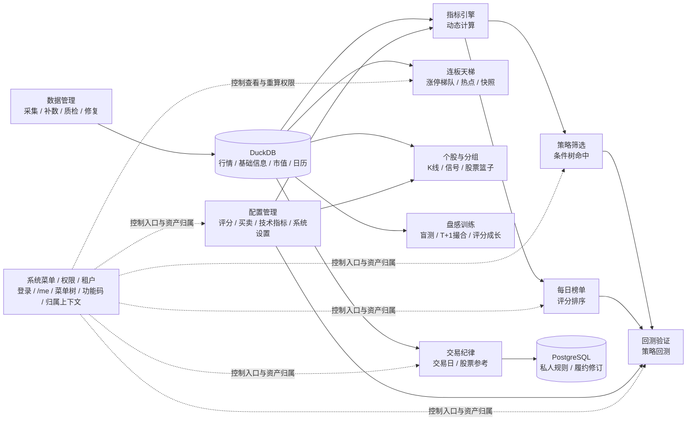
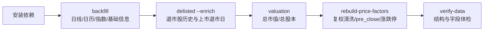

# 复盘啦 · A股趋势龙头选股 / 打分 / 回测系统

**EOD（收盘后）** 的 A 股趋势龙头研究系统，面向每天收盘后做复盘、筛选、验证和跟踪的研究场景；系统已具备多租户 RBAC、账号登录和用户资产隔离能力，正持续向公网 SaaS 形态演进。它不是一个只给出"黑盒推荐"的工具，而是把数据、条件、评分、买卖规则和历史验证串成一条能检查、能复盘、能迭代的工作流。

系统希望解决三个实际问题：

| 研究问题 | 系统怎么支持 | 最终产出 |
|----------|--------------|----------|
| 今天哪些股票更像趋势龙头？ | 每日榜单按评分方案对全市场排序，并展示分项得分 | Top 榜单、评级、分项解释 |
| 一个选股思路到底能不能用？ | 策略筛选保存条件树，再接入回测验证 | 候选池、净值曲线、逐笔成交 |
| 数据和结论是否可信？ | 数据管理提供采集、补数、质检、修复、体检闭环 | 数据质量分、问题台账、修复记录 |

一条完整使用闭环是：**收盘后更新数据 → 处理质量问题 → 查看每日榜单 → 用筛选/配置调整思路 → 回测验证 → 把重点股票放入分组持续跟踪**。全程强调可解释、可回测、防未来函数。

> 仅供个人研究，不构成投资建议。数据源为公开免费接口（新浪 / 东财 / baostock），覆盖近 5 年、主板 / 创业板 / 科创板（不含北交所）。

系统当前的三条设计主线：

| 主线 | 含义 |
|------|------|
| <span style="color:#2563eb">●</span> **统一基座** | 技术指标是唯一"原子定义"，买卖方案、评分规则、策略筛选全部引用它组合而来；指标动态实时计算 + 单次运行内存缓存，不落预计算表。 |
| <span style="color:#7c3aed">●</span> **配置化** | 怎么买怎么卖、评分用哪些指标多少权重，全在页面配置、存为方案、可版本化，**改策略不改代码**。 |
| <span style="color:#16a34a">●</span> **闭环化** | 数据问题在「数据管理」页内解决（同步 / 补数 / 质检 / 修复）；筛选 → 买卖方案 → 回测 → 评分验证形成可操作闭环。 |

**阅读标识**：<span style="color:#dc2626">●</span> 高风险 / <span style="color:#f59e0b">●</span> 中风险 / <span style="color:#16a34a">●</span> 低风险 / <span style="color:#2563eb">●</span> 信息提示。

---

## 目录

- [1. 架构总览](#1-架构总览)
- [2. 功能模块与技术文档](#2-功能模块与技术文档)
- [3. 目录结构](#3-目录结构)
- [4. 技术栈](#4-技术栈)
- [5. 服务与脚本操作](#5-服务与脚本操作)
- [6. 开发契约（不可破坏）](#6-开发契约不可破坏)
- [7. 当前文档入口](#7-当前文档入口)

---

## 1. 架构总览

全栈：FastAPI 提供 REST 接口并在生产期托管前端构建产物（`frontend/dist`）。**持久层为混合架构**：行情/参考数据留嵌入式 DuckDB 单文件（只读分析），用户资产、系统菜单、角色权限、平台配置落 PostgreSQL（并发写、按 `tenant_id`+`owner_user_id` 隔离），Redis 作 token 黑名单、权限缓存、验证码和限流等短状态库。

认证与授权以后端为事实源：`AuthMiddleware` 对非白名单 `/api/**` 默认拒绝，JWT 只承载身份和权限版本，`/api/auth/me` 返回用户、租户、角色、授权菜单树和功能码；接口用 `require_perm` / `require_system` / `require_system_perm` 做精确授权，前端侧栏、路由守卫和按钮级 `v-permission` 只消费后端结果。多租户数据归属由请求上下文注入到仓库和服务层，前端不决定资产归属；评分、筛选、买卖方案和回测记录支持 `private / tenant / public` 可见性，公开资产只读可见，方案类资产可复制为自己的 private（含指定历史版本），公开回测记录可复用参数重跑且发布范围不能超过引用方案可见范围；方案收窄可见性时会保留历史结果并同步收窄关联回测。技术架构见 [system-rbac-tenant.md](agent-works/architecture/system-rbac-tenant.md)，需求与落地记录见 [agent-works/multi-tenant-rbac/](agent-works/multi-tenant-rbac/)。

```
┌─────────────────────────── 浏览器 (Vue3 SPA) ───────────────────────────┐
│  榜单 / 筛选 / 回测 / 个股 / 盘感训练 / 系统管理(配置·布局) / 数据管理     │
└───────────────────────────────┬─────────────────────────────────────────┘
                                 │ REST  /api/**
┌───────────────────────────────▼─────────────────────────────────────────┐
│  FastAPI (backend/api)         路由层：薄，只做参数校验与响应包装         │
├───────────────────────────────────────────────────────────────────────── ┤
│  auth            JWT / AuthContext / 菜单与功能码解析 / 权限版本失效      │
│  services        编排层：入库 / 筛选打分 / 回测 / 系统管理 / 异步任务      │
│  screening · scoring · signals · backtest · indicators   领域引擎         │
│  datasource      数据源适配（akshare / baostock，限流·重试·超时·兜底）    │
│  dataquality     入库清洗 + 四层质检 + 修复闭环                           │
│  storage         双库访问层：行情 DuckDB(点时安全) + 资产/RBAC/配置 PG    │
│  scheduler       APScheduler 定时调度（任务可在「数据管理」页配置）        │
└───────────────────────────────┬─────────────────────────────────────────┘
                                 │
        行情 data/ai_stocks.duckdb (嵌入式列存,只读分析)  ·  PostgreSQL
        (sys_* 权限表 + 用户方案/分组/回测/训练/快照/配置)  ·  Redis(短状态)
```

**核心数据流（每日收盘后）**：增量更新日线（含补最新交易日总市值；历史市值缺口另跑 `valuation --fill-gaps` 回补）→ 入库清洗 + 四层质检 → 动态算指标 → 按默认评分方案出榜单。

---

## 2. 功能模块与技术文档

系统按"数据先可靠、方案可配置、结果可验证"组织成下列业务模块。README 负责说明**从哪里进、做什么、和谁关联**；详细文档优先看 [`agent-works/architecture/`](agent-works/architecture/) 与对应功能目录。

| 模块 | 页面入口 | 主要 API | 你在这里完成什么 | 详细文档 |
|------|----------|----------|------|----------|
| 📈 **每日榜单** | `BoardView` | `/api/board/*` | 按用户可见**评分方案**全市场排序（自己的方案、租户公开、全体公开、平台内置预设；0–100 综合分 + 评级 + 分项达标分） | [screening-and-board.md](agent-works/architecture/screening-and-board.md) |
| 🪜 **连板天梯** | `LimitLadderView`（`/limit-ladder`） | `/api/limit-ladder/*` | 按交易日查看收盘涨停梯队、固定窗口活跃度和走势相关热点；进入个股分析/详情，system 可发起单日重算 | [limit-ladder.md](agent-works/architecture/limit-ladder.md) |
| 🧮 **策略筛选** | `ScreenView` | `/api/screen*`, `/api/profiles` | 统一条件构建器（AND/OR 树，叶子可选指标条件或表达式，同一份 AST）；方案可存、版本回看、按权限公开和复制 | [screening-and-board.md](agent-works/architecture/screening-and-board.md) |
| 🧪 **回测验证** | `BacktestView` | `/api/backtest/*` | ①策略回测：净值/绩效/逐笔成交（含卖出原因）；②评分验证：分层命中率与超额命中率；历史记录可按权限公开，公开记录可复用参数重跑 | [backtest.md](agent-works/architecture/backtest.md) |
| ✅ **交易纪律** | `TradeDisciplineView`（`/trade-discipline`） | `/api/trade-discipline/*` | 维护私人交易规则和不可变版本，按真实交易日完成履约打卡、操作记录、历史修订；用户中心支持查看待办和快捷无操作履约 | [trade-discipline.md](agent-works/architecture/trade-discipline.md) |
| 🔍 **个股与分组** | `StocksView` / `StockDetailView` | `/api/stocks/*`, `/api/stock-groups` | 服务端排序分页与跨页分组；查询页可在共享工作台中做多股走势对比和 K 线分析；详情页提供指标快照、买卖方案信号与连续翻看 | [stocks-and-groups.md](agent-works/architecture/stocks-and-groups.md) |
| 🧭 **走势板块关联** | `StocksView` / `BoardView` / `ScreenView` / `ScheduleView` | `/api/stocks/*`, `/api/board/run`, `/api/screen/run`, `/api/data/*` | 在累计行业/概念候选中按市场中性化相关性选出当前冠军；页面统一展示相关度、有效样本和截止日，管理员通过任务与调度维护结果 | [stock-board-correlation.md](agent-works/architecture/stock-board-correlation.md) |
| ⚙️ **配置管理** | `ConfigView`（`/system/config/{score,trade,tech,system}`） | `/api/indicators`, `/api/trade-profiles`, `/api/score-profiles` | 四个子页：评分规则（可公开/复制/版本回看）/ 买卖指标（买入+卖出+兜底，可公开/复制）/ 技术指标（注册表）/ 系统设置（数据源、回测成本、认证与审计白名单） | [config-definitions.md](agent-works/architecture/config-definitions.md) |
| 🎨 **布局配置** | `views/layout/{Presets,Pages,Components}`（`/system/layout/*`） | `/api/layout/*` | 可配置布局系统的产品化工作台 3 子页：预设管理（全局风格 token / 预设×组件默认 / 响应式默认）、页面布局（左预览右配置 + `default→preset→page→user` 四层来源追踪）、系统组件（组件能力目录 + 字段开放策略 + 页面 slot 自动继承覆盖） | [DESIGN.md](DESIGN.md) |
| 🔐 **系统菜单 / 权限 / 租户** | `views/system/{UserManage,RoleManage,MenuResource,TenantManage}` | `/api/auth/*`, `/api/users`, `/api/roles`, `/api/menus`, `/api/resources`, `/api/tenants` | 登录会话、用户域、角色授权、菜单树、功能点和租户启停；接口、菜单、按钮同源授权 | [system-rbac-tenant.md](agent-works/architecture/system-rbac-tenant.md) |
| 🗄️ **数据管理** | `views/data/{Overview,Ingest,Quality,Schedule}` | `/api/data/*` | 采集闭环 4 子页：概览 / 数据采集 / 质检修复 / 定时调度；个股采集统一提供七类安全方案 | [data-management.md](agent-works/architecture/data-management.md) |
| 🧩 **板块行情与采集** | `SectorsView` / `SectorDetailView` / `views/data/*` | `/api/sectors/*`, `/api/data/*` | 板块工作台支持概念/行业查询、连续指数对比、资金流和成分股钻取；数据管理承接字典/成分/指数/资金流采集、周频控制和专项质检修复 | [board-collection.md](agent-works/architecture/board-collection.md) |
| 🎮 **盘感训练** | `TrainingView` | `/api/training/*` | 盲测随机个股 + 逐日揭示 K 线（含 MACD）+ T+1 真实撮合买卖；一局产出评分/评级/资金曲线，结算揭晓板块；跨局成长轨迹 | [market-sense-training.md](agent-works/architecture/market-sense-training.md) |

> `/system/*` 是系统管理域，包含配置管理、布局配置、用户、角色、菜单/功能点和租户。评分规则与买卖指标是业务可授权子页；技术指标、系统设置、角色、菜单/功能点、租户和全局布局配置保持 system-only；用户管理可按 `user:*` 功能码授权给租户管理员，但服务层仍把非 system 用户限制在本租户。
> 横切的基础设施（点时安全仓库、异步任务底座、定时调度、配置生效、服务部署、前端布局规范）见 [platform.md](agent-works/architecture/platform.md)；环境变量、变量文件、YAML 基线和数据库覆盖层见 [environment-configuration.md](agent-works/architecture/environment-configuration.md)。

### 2.1 模块关系图



### 2.2 常用工作流

| 场景 | 推荐路径 | 结果 |
|------|----------|------|
| 首次搭建本地库 | `backfill` → `delisted --enrich` → `valuation` → `rebuild-price-factors` → `verify-data` | 近 5 年行情、退市股、总市值、复权口径与体检报告齐全 |
| 每天收盘后更新 | 数据管理 → 数据采集 → 个股采集 → 日常同步，或 `python -m backend.cli daily` | 最新行情入库、总市值补齐；CLI `daily` 还会继续执行质检 |
| 复盘当日涨停梯队 | 最新行情 → 连板天梯 → 查看热点/板位 → 选择股票分析 → 进入个股或板块详情 | 当日不可变涨停快照、窗口活跃度、走势相关热点和可恢复的详情上下文 |
| 发现榜单异常 | 数据管理 → 概览/质量定位缺口 → 修复 → 回榜单重新打开对应日期 | 评分快照会被标记失效，下次打开按可见方案自动重算 |
| 新建选股思路 | 配置管理 → 评分规则/买卖指标建方案 → 策略筛选试条件 → 每日榜单看排序 | 得到可保存、可版本回看、可按权限公开的评分方案 |
| 验证策略能否交易 | 策略筛选 + 评分方案 + 买卖方案 → 回测验证 | 净值、回撤、逐笔成交、卖出原因、分层命中率 |
| 跟踪一批股票 | 个股查询跨页勾选 → 工作台走势对比/K 线分析 → 存为分组 → 详情页连续翻看 | 统一交易日相对走势、分组篮子、组内涨幅与买卖信号 |
| 练盘感 / 验手感 | 盘感训练 → 配置窗口/资金 → 盲测随机股逐日买卖 → 结算看评级与成长曲线 | 成交明细、资金曲线、评分、身份揭晓、跨局成长轨迹 |
| 记录交易纪律 | 交易纪律 → 维护并发布规则 → 按交易日打卡 → 历史查看或修正 | 私人规则版本、履约结论、操作事实和不可变修订链 |

---

## 3. 目录结构

```
backend/
  auth/           登录鉴权与授权上下文：JWT / AuthMiddleware / require_perm / perm_ver / 菜单资源解析
  api/            REST 路由（薄层）：auth / users / roles / menus / resources / tenants
                  / board / stocks / screen / backtest / config
                  / indicators / score_profiles / trade_profiles / stock_groups
                  / data_tasks / data_admin / health / training / layout / trade_discipline
  services/       编排层：ingest（入库）· screen_score（筛选打分）· backtest
                  · pipeline（一键日常 DailyPipeline）· async_task（异步任务底座）
                  · auth_service / user_admin / role_admin / menu_admin / tenant_admin
                  · data_report / data_verify / data_sources · training（盘感训练）
                  · trade_discipline（规则版本 / 履约打卡 / 历史修订）
  datasource/     数据源适配（akshare / baostock / ths_board 同花顺板块直连；限流·重试·超时·兜底·溯源）
  storage/        DuckDB 连接 / DDL / 点时安全仓库 / PG DDL / RBAC 仓库 / 资产归属仓库
                  / 配置覆盖层 / 布局配置(layout_config) / 数据目录
  dataquality/    入库清洗 + 四层质检（checker）
  indicators/     指标引擎（后向算子 / param_hash / 动态计算）
  screening/      条件 AST + 表达式 DSL 沙箱 + 筛选引擎
  scoring/        阈值打分 + 动态权重评分模型 + 评分快照
  signals/        买卖信号（由买卖方案推导）
  backtest/       前向收益 / 信号质量 / 撮合 Broker / 事件驱动引擎 / 绩效
  groups/         股票分组（篮子）
  scheduler/      APScheduler 定时调度
  config/         settings 加载与校验（pydantic-settings）
  common/         日志等通用工具
  cli.py          命令行入口        main.py  FastAPI 应用装配 + 前端托管
  tests/          后端单测（pytest）

frontend/         Vue3 + TS + Element Plus + ECharts，构建产物 frontend/dist 由后端托管
  src/stores/auth.ts      登录态、/me 菜单树、功能码与租户信息
  src/utils/permission.ts 路由与按钮权限纯逻辑
  src/directives/permission.ts  v-permission 按钮级授权
  src/views/system/       用户 / 角色 / 菜单功能点 / 租户管理页
  src/layout/     可配置布局底座：页面外壳 LayoutHost / 布局 schema / 组件目录 / 校验器 / 契约测试
  src/views/layout/  布局配置工作台：预设管理 / 页面布局 / 系统组件
agent-works/architecture/ 各模块技术文档（核心技术 / 业务架构 / 业务流程 / 风险事项）
agent-works/market-sense-training/ 盘感训练模块需求 / 开发计划 / 开发留痕 / DDL 归档
agent-works/trading-discipline-checkin/ 交易纪律需求 / 开发计划 / 人工复核 SQL / 页面原型
agent-works/configurable-layout-system/ 布局系统底座需求 / 新页面开发模板 page-template.md
agent-works/layout-config-productization/ 布局配置产品化需求 / 开发计划 / 字段策略 DDL
config/           settings.yaml —— 所有阈值/权重/参数（改参不改码）
data/             ai_stocks.duckdb（DuckDB 数据文件）+ exports（导出）
agent-works/initialization/ 需求 / 系统设计 / 任务清单 / 演进过程文档
DESIGN.md         前端设计与布局规范（地图/索引；强制规则在 frontend/src/layout 代码）
agent-works/configurable-layout-system/page-template.md
                  新页面开发模板与页面设计闭环清单
start.sh          后端启停脚本（dev/prod，见 §5.1）
```

---

## 4. 技术栈

- **后端**：Python 3.11+（本机 3.12）/ FastAPI / Uvicorn / pandas + numpy / APScheduler / pydantic-settings
- **持久层**：DuckDB（行情，嵌入式列存）+ PostgreSQL ≥14（用户资产/平台配置，psycopg3 同步）+ Redis ≥6（短状态）；后端启动期三库连通性自检
- **前端**：Vue 3 + TypeScript + Element Plus + ECharts + Pinia + Vue Router + Vite
- **数据源**：AKShare（新浪 / 东财系）+ baostock（退市股历史、复权因子兜底）
- 依赖清单见 [`requirements.txt`](requirements.txt) / [`pyproject.toml`](pyproject.toml)

---

## 5. 服务与脚本操作

本项目有两种运行方式：

| 模式 | 适用场景 | 访问地址 | 进程形态 |
|------|----------|----------|----------|
| 开发模式 | 日常开发、前端热更新、调试 API | 前端 `http://localhost:5173` | 前端 Vite + 后端 FastAPI 两个进程 |
| 生产/集成模式 | 单端口访问、演示、局域网访问 | 后端 `http://<机器IP>:8000` | 后端托管 `frontend/dist` |

> **前置依赖**：后端启动前 **PostgreSQL 与 Redis 须先运行**（启动期三库连通性自检，任一不通即失败）。本机开发：`brew services start postgresql@16 redis`，并建 PG 库/角色 `ai_stocks`。环境变量、变量文件、连接密钥、YAML 基线与数据库覆盖层的完整口径见 [environment-configuration.md](agent-works/architecture/environment-configuration.md)。存量从旧 DuckDB 升级：`python -m backend.cli migrate-rbac`（先 dry-run，再 `--apply`）。

### 5.1 开发模式启动（前后端联动）

后端与前端是**两个独立进程**，各自热更、互不重启。前端经 Vite 代理把 `/api` 转发到后端，调试时**访问前端端口**。

```bash
cp .env.local.example .env.local
# 按 environment-configuration.md 填写本机后端启动变量
./start.sh                      # 后端 8000，热重载（= python -m backend.cli serve --reload，nohup 脱离会话）
./start-web.sh                  # 前端 5173，HMR（nohup 脱离会话，首次先 npm install）
```

本地账号分两类，避免权限测试混用：

| 账号体系 | 用途 | 密码来源 | 维护方式 |
|----------|------|----------|----------|
| `admin` | `default` 租户平台系统管理员，用于初始化、系统级运维和最高权限验收 | 按 [environment-configuration.md](agent-works/architecture/environment-configuration.md) 的管理员初始密码规则维护 | 后端启动 seed/校准；已有密码不会被环境变量覆盖 |
| `debug_*` | RBAC 页面和接口权限验收账号，用于验证普通用户、租户管理员、最小权限、无权限等场景 | 按 [test-users.md](agent-works/multi-tenant-rbac/test-users.md) 和环境配置文档维护 | 明确 `AI_STOCKS_ENV=dev|test|local` 后用 `./start.sh dev-users` 创建/校准，`--list` 查看 |

固定调试账号清单和使用规则见 [test-users.md](agent-works/multi-tenant-rbac/test-users.md)。页面或接口权限验收应按场景选择最小权限 `debug_*` 账号，不要默认用 `admin` 覆盖权限态、空权限态或 fail-closed 场景。

两个脚本的服务生命周期接口一致：`dev`(默认) / `stop` / `restart` / `status` / `logs`。后端另提供受环境守卫的 `dev-users` 与 E2E 内部 `e2e-user` 动作，确保与服务统一加载 `.env.local`。后端日志 `logs/backend.log`，前端日志 `logs/frontend.log`。

| 角色 | 命令 | 监听 | 对外? | 热更 |
|------|------|------|-------|------|
| 后端 | `./start.sh`（dev，默认） | `127.0.0.1:8000` | ❌ 仅本机 | watchfiles 自动重启 |
| 前端 | `./start-web.sh` | `0.0.0.0:5173` | ✅ 局域网 | Vite HMR |

- 唯一对外入口是前端 5173；后端 8000 只对本机，由 Vite 代理 `/api` 回 `127.0.0.1:8000`。
- 开发期改前端**不要** `npm run build`（那是生产产物、不带 HMR）。
- 日志在 `logs/backend.log`，`./start.sh logs` 跟踪、`./start.sh status` 查状态（`/health=200` 即就绪）。
- 自动化验证（AI 截图/交互核查）走**专用端口 5181**，不占用日常的 5173。两个前端实例可并存，同样由 Vite 代理 `/api` 回 8000。Claude Code 的 preview 工具配置在 `.claude/launch.json`，与日常开发的 `start.sh`/`start-web.sh` 互不相关。

**启动检查顺序**：

1. `./start.sh status` 看后端进程、端口和 `/api/health`。
2. `./start.sh logs` 看数据库初始化、调度器启动、报错堆栈。
3. 浏览器打开 `http://localhost:5173`，前端报 API 错误时优先确认 Vite 代理是否仍指向 `127.0.0.1:8000`。
4. 如果 DuckDB 被 CLI 或旧服务占用，先 `./start.sh stop`，确认没有其它写库进程后再启动。

### 5.2 生产 / 集成模式

```bash
cd frontend && npm run build && cd ..   # 产物进 frontend/dist
./start.sh prod                         # 后端绑 0.0.0.0:8000 托管 dist
```

生产/集成模式下只有一个入口：`http://localhost:8000` 或 `http://<机器IP>:8000`。系统已具备登录鉴权、细粒度 RBAC、系统菜单、租户管理、存量业务路由资源码、基线共享读和评分/筛选/买卖/回测资产可见性；启动前必须按 [environment-configuration.md](agent-works/architecture/environment-configuration.md) 完成密钥、管理员初始密码和 PG/Redis 连接配置。**注**：注册邮箱验证码已支持真实 SMTP 投递（`backend/common/mailer.py`），但仓库基线默认关闭（`mail.enabled=false` → 仅写 dev 日志），公网放量前需按 `environment-configuration.md` 用 `AI_STOCKS_SMTP_*` 开启并配好发信账号；公网部署仍应配合反向代理与 TLS。

### 5.3 首次准备数据（依赖有序）

```bash
pip install -r requirements.txt
cd frontend && npm install && cd ..

python -m backend.cli backfill           # 全市场近 5 年日线全量回填（支持断点续跑）
python -m backend.cli delisted --enrich  # 退市股历史 + 上市/退市日（防幸存者偏差）
python -m backend.cli valuation          # 总市值 / 总股本
python -m backend.cli rebuild-price-factors  # 干净复权因子 / pre_close / 涨跌停标记
python -m backend.cli verify-data        # 数据正确性 + 完整性核查
```

首次准备的依赖关系如下，顺序不要反：



| 命令 | 大致作用 | 什么时候重跑 |
|------|----------|--------------|
| `backfill` | 全市场近 5 年日线回填，支持断点续跑 | 新库初始化、历史行情缺大段 |
| `delisted --enrich` | 补退市股历史和上市/退市日 | 新库初始化、怀疑幸存者偏差 |
| `valuation` | 按单只股票补总市值/总股本 | 新库初始化、新上市股票缺总市值 |
| `valuation --fill-gaps` | 针对已有库的总市值缺口逐段回补 | 质检出现大量 `mv_gap` 或历史缺口时 |
| `rebuild-price-factors` | 不联网，重建清洗复权因子、`pre_close`、涨跌停标记 | 重采行情、发现复权跳变、初始化后 |
| `verify-data` | 只读体检，输出 PASS/FAIL | 初始化后、重大补数后、回测前 |

### 5.4 一键日常流程

```bash
python -m backend.cli daily              # 增量更新行情(补最新交易日总市值) → 数据质检 →（可选）数据体检
python -m backend.cli valuation --fill-gaps   # 一次性回补历史 total_mv 缺口（增量只保最新交易日，历史缺口走这里）
```

也可在「数据管理 → 任务调度」页配置任务（个股采集统一使用 `stock_ingest`，另有 `verify`/`checkup`/`audit_cleanup` 等）：既可按 cron/每日/每周/每月触发，也可在指定上游任务成功、失败或完成后延迟触发；依赖任务支持有次数上限的固定延迟自身重试。数据类时间任务通常仅交易日，审计清理不受交易日限制。旧 `update/backfill/ingest_date` 调度继续执行，编辑保存时转换为统一模型。

日常流程等价于页面里的"数据管理闭环"：


如果只是看榜单，不需要每天手工预生成榜单；数据变更后系统会把相关评分快照标记为 stale，打开对应日期榜单时自动重算。

### 5.5 服务管理（`start.sh`）与 CLI 命令

| `start.sh` 子命令 | 作用 |
|------|------|
| `./start.sh` / `dev` | 开发模式（热重载，默认） |
| `prod` | 生产模式 |
| `stop` / `restart` / `status` / `logs` | 停止 / 重启 / 状态+`/health` / 跟踪日志 |

| CLI（`python -m backend.cli <cmd>`） | 作用 |
|------|------|
| `serve` / `health` | 启动 Web / 本地自检 |
| `backfill` / `update` | 日线全量回填 / 增量更新 |
| `delisted` / `valuation` | 退市股历史 / 总市值·总股本（`valuation --fill-gaps` 一次性回补缺口） |
| `rebuild-price-factors` / `refetch-daily` | 重算复权清洗因子（不联网）/ 重拉日线覆盖（恢复源因子） |
| `indicators` / `rank` / `screen` | 算指标 / 出榜单 / 跑筛选方案 |
| `backtest --kind signal\|strategy` / `robust` | 信号质量·策略回测 / 稳健性测试 |
| `check-data` / `verify-data` | 完整性体检 / 正确性核查 |
| `daily` | 一键日常流程 |

Web 与 CLI 共用同一采集服务和行情口径。Web 是常用运维入口，CLI 保留为应急和批处理入口：

| Web「个股采集」方案 | `stock_ingest.recipe` | CLI 对应能力 |
|------|------|------|
| 日常同步 | `daily_update` | `update`（完整日常流水线用 `daily`） |
| 历史行情补全 | `history_backfill` | `backfill` |
| 日期区间重采 | `range_refetch` | `refetch-daily` / 指定日期采集 |
| 市值历史补采 | `valuation_history` | `valuation` |
| 市值缺口修复 | `valuation_gaps` | `valuation --fill-gaps` |
| 基础资料刷新 | `basic_refresh` | `delisted --enrich` 的基础资料阶段 |
| 退市股历史补全 | `delisted_history` | `delisted --enrich` |

### 5.6 数据管理页面操作速查

| 页面 | 主要用途 | 典型操作 |
|------|----------|----------|
| 数据概览 | 看数据新鲜度、质量分、缺口、数据字典 | 进入后先看风险摘要，点击风险跳到质量或榜单 |
| 数据采集 | 发起异步采集/补数任务，看实时日志 | 在一个「个股采集」入口选择七类方案与全市场/指定股票范围，并续跑、重试或终止任务 |
| 数据质量 | 质检台账、修复、忽略、结构体检 | 先筛高危 open 问题，批量修复后复检 |
| 定时调度 | 配置自动更新、质检、体检、审计清理 | 建每日收盘后「个股采集·日常同步」，再建定期 verify/checkup；审计清理默认每天 03:30 |

写库任务全局互斥：采集、补数、修复、重算等同一时间只能跑一个。遇到 409 说明已有写任务在执行，去任务列表看进度，完成后再提交。

终止为协作式（到下一只/下一问题的检查点停下，已完成部分保留，状态转"可续跑"）；续跑沿用该任务**原定目标日**（增量更新不会因隔天续跑而漂到今天），并跳过已完成的日历/指数等前置，从断点继续。CLI 的 `backfill`/`update`/`refetch-daily` 与任务中心同源，实时输出阶段进度。

### 5.7 测试

```bash
python -m pytest backend/tests/ -q       # 后端单测（先停掉占用 DuckDB 的服务）
```

### 5.8 常见问题

| 现象 | 优先检查 |
|------|----------|
| 前端页面空白或 API 404 | 开发期是否访问了 `5173`；生产期是否已 `npm run build` |
| 后端启动失败 | `logs/backend.log`；DuckDB 文件是否被另一个进程占用 |
| 写任务提交失败 409 | 数据管理任务列表是否已有 running/pending 写任务 |
| 榜单不是最新 | 数据是否已更新到最新交易日；打开最新交易日榜单会按需重算快照 |
| 质检大量 `mv_gap` | 先跑 `python -m backend.cli valuation --fill-gaps` 清历史缺口 |
| 回测很慢或超时 | 缩短区间/降低 TopN/减少表达式筛选；当前回测 API 仍是同步执行 |

---

## 6. 开发契约（不可破坏）

> 系统命脉与扩展边界。新增/修改功能前务必先读；细节见各模块技术文档与 [platform.md](agent-works/architecture/platform.md)。

- **防未来函数**：指标/均线一律后向计算；选股只用 ≤T 数据，回测 T 日选股、**T+1 开盘成交**；平台突破用 `shift(1)` 防自指（AST 单测拦截 `shift(负)`）。
- **防幸存者偏差**：universe 点时构造，含"当时存活、后来退市"的票；退市股历史已入库。
- **撮合不失真**：涨跌停价按板块 / ST 计算，开盘封死不可成交、停牌顺延、退市强平；计佣金 / 印花 / 过户 / 方向性滑点。
- **复权一致**：前向收益与回测记账统一**后复权(hfq)**；可成交性判定用**原始价**。源因子 `adj_factor` 用于 K 线前复权，`pre_close` 走独立清洗因子，复权查询统一走 `COALESCE(adj_factor_clean, adj_factor)`。
- **base rate**：分层命中率必减同期全市场无条件命中率得超额，并附样本量。
- **统一基座**：技术指标是唯一原子定义，买卖/评分/筛选全部引用它组合，不在下游硬编码字段。
- **分层职责**：`api/` 只做参数校验与响应包装，业务逻辑放 `services/` 与领域引擎；一切读写经 `storage` 点时安全仓库；长耗时操作走 `async_task` 异步任务底座 + 进度。
- **配置即时生效**：环境变量、变量文件、YAML 基线、PG `app_config` 覆盖层与生效优先级统一见 [environment-configuration.md](agent-works/architecture/environment-configuration.md)；新增运行期参数不得硬编码。
- **默认股票范围要标明入口**：训练随机池走 `MarketRepository.get_universe_asof` 的股票池硬过滤；榜单、筛选、买卖预览和回测候选排序主要走当日 `wide_snapshot` 并叠加 ST/方案/成交约束，不得把训练股票池规则误写成全系统默认。
- **权限默认拒绝**：新增受控 `/api/**` 先过 `AuthMiddleware`，再挂精确 `require_perm` 或 system 守卫；不要只靠前端菜单、按钮或隐藏路由做安全控制。
- **租户归属不可前端决定**：用户资产读写必须从请求上下文取 `tenant_id` 和 `owner_user_id`，除明确 system 管理接口外，不接受前端传入归属字段决定数据范围。

---

## 7. 当前文档入口

| 文档 | 内容 |
|------|------|
| [`agent-works/architecture/`](agent-works/architecture/) | 各业务模块当前技术说明、业务流程和风险边界 |
| [AGENTS.md](AGENTS.md) | AI 协作入口与仓库级稳定约束 |
| [CLAUDE.md](CLAUDE.md) | Claude Code 薄入口，指向 AGENTS 与 Claude 项目记忆 |
| [system-rbac-tenant.md](agent-works/architecture/system-rbac-tenant.md) | 登录鉴权、系统菜单、细粒度权限、多租户资产隔离和公开资产可见性的当前技术架构 |
| [environment-configuration.md](agent-works/architecture/environment-configuration.md) | 环境变量、变量文件、YAML 基线、PG/DuckDB `app_config` 边界和配置生效规则 |
| [stock-board-correlation.md](agent-works/architecture/stock-board-correlation.md) | 行业/概念走势冠军的算法口径、有效样本含义、任务落表、页面读取和风险边界 |
| [limit-ladder.md](agent-works/architecture/limit-ladder.md) | 连板天梯的涨停/ST 口径、快照 v2、任务协调、页面/API、权限、部署与风险边界 |
| [multi-tenant-rbac](agent-works/multi-tenant-rbac/) | 系统菜单、权限、多租户相关需求与落地记录 |
| [DESIGN.md — 前端设计与布局规范](DESIGN.md) | 前端布局事实源与页面开发契约：可配置布局系统、页面设计闭环、组件/布局维护矩阵、设置抽屉规范；强制规则归 `frontend/src/layout` + 契约测试 |
| [page-template.md — 新页面开发模板](agent-works/configurable-layout-system/page-template.md) | AI/开发者新建或改造页面时复制使用的页面设计块、维护矩阵、7 个原型骨架和验收清单 |

规范类文档只表达当前事实和操作入口。其他过程性材料不能覆盖上述当前事实源。
