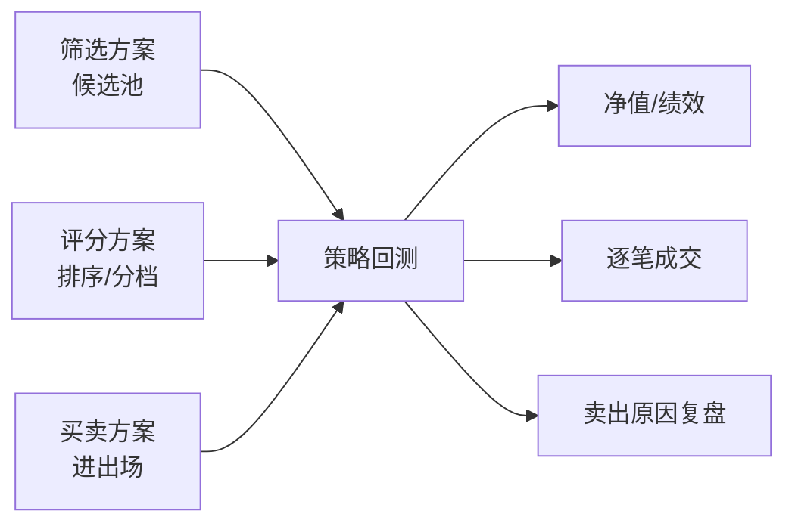

# 回测

> 用历史数据验证「选股+买卖」策略与「评分」预测力的事件驱动回测引擎：在杜绝未来函数、撮合不失真、复权一致的前提下，产出净值曲线/绩效/逐笔成交，并以「分层命中率减全市场 base rate」量化评分的真实超额能力。

● 输入方案　● 历史验证　● 结果复盘　● 风险约束

## 核心技术

**事件驱动引擎（逐日先卖后买）**。`backend/backtest/engine.py:223` `BacktestEngine.run` 按交易日逐日循环：执行日 `D` 成交的是信号日 `D-1` 做出的决策——`engine.py:315` `sig = days[i-1]`，`T` 日选股/卖出判定、`T+1` 开盘成交。每日四步：①评估并执行卖出（`engine.py:319`）②选股+买入（`engine.py:377`）③估值（`engine.py:428`）④记账资金曲线。卖出在买入之前，先释放仓位再填新仓。

**撮合 Broker 与成本模型**。`backend/backtest/broker.py` 是防撮合失真的核心：
- 可成交性按传入的 `pct` 判定。`limit_prices`（`broker.py:20`）用 `Decimal(..., ROUND_HALF_UP)` 按 `pre_close×(1±pct)` 取到分算涨跌停价；`can_buy_at_open`（`broker.py:27`）要求开盘价严格低于涨停价（开盘即封涨停买不到），`can_sell_at_open`（`broker.py:33`）要求开盘价严格高于跌停价（封死跌停卖不出）。`pct` 在 `engine._load_prices` 中按交易日生成：普通票取 `stock_basic.price_limit_pct`（主板 0.10 / 科创创业 0.20）；当前名称含 `ST` 的主板票在 2026-07-06 前取 0.05、2026-07-06 起取 0.10，创业板/科创板 ST 仍取 0.20。注意这是“当前名称 ST”近似，不是历史点时 ST；且策略候选池/评分截面默认已排除 ST，只有持仓顺延、显式包含或历史数据遗留时才会实际用到 ST 撮合。
- 停牌（执行日无 bar）不可成交，触发卖出但封死/停牌 → 加入 `pending_sells` 顺延到下一可交易日（`engine.py:354-356`）。
- 整手取整：买入按 100 股整手 floor，现金不足时逐步缩减 `lot_size`（`broker.py:99-109`）。
- 方向性滑点：买入价上浮 `×(1+slippage)`、卖出价下浮 `×(1-slippage)`（`broker.py:95`/`broker.py:134`）。
- 费用：佣金双边（费率/最低值取大）+ 印花税（仅卖）+ 过户费（`broker.py:79-88`）。默认参数见 `backend/config/settings.py:106`（佣金率 0.00025/最低 5 元、印花税 0.001、过户费 0.00001、滑点 0.002）。

**复权一致：后复权记账 + 原始价判可成交性**。`engine.py:60-62` 用 `COALESCE(adj_factor_clean, adj_factor)` 算 `open_hfq`/`close_hfq`，成交/估值/净值/收益率统一在后复权（hfq）基准下进行——hfq 单调、无需 rebase；而涨跌停可成交性用**原始** `open`/`pre_close` 判定（`engine.py:354`/`engine.py:415`），因为涨跌停是按原始价 round 到分的市场规则。

**前向收益（hfq、无未来函数）**。`backend/backtest/forward.py` `compute_forward_returns` 回答「信号后 N 日内最高摸到多少涨幅」：入场价取信号日**下一根可得 bar** 的 hfq 开盘价（`forward.py:94` `shift(-1)`，停牌自然顺延到复牌首日，与撮合一致），窗口 `[T+1..T+N]` 内 hfq high 的反向滚动最大（`forward.py:99`）。比值消去公共复权基准故等于真实复权收益；`adj_factor` 是历史已知值，用未来 N 日价格是「评估」而非「信号生成」，无未来函数。右沿数据不足完整 N 日窗口的信号标 `eval_<N>=False`（按市场日历判定，`forward.py:108-113`），默认从命中率中排除以免低估。

**评分验证的分层超额 / base rate**。`backend/backtest/signal.py` `SignalAnalyzer.analyze`：区间逐日全市场打分→分档（主升浪核心/龙头候选/观察），对每个 `(code, 信号日)` 算前向最大涨幅，`base_rate(N,X)` = 同期**全部已评分票**的无条件命中率（`signal.py:104`），各分档命中率减 base rate 即**超额命中率**（`signal.py:124`），并附样本量 `n` 与 `reliable`（`n≥min_samples`，默认 30，`signal.py:126`）。base rate 必算——牛市里随便选都高命中，唯有超额能反映模型真实能力。base rate 口径含退市股（全市场截面派生），防幸存者偏差。

**防未来机制（贯穿）**。① `T` 日决策、`T+1` 成交（`engine.py:315`）；② 卖出旧式信号 `below_ma` 用后向滚动均线（`engine.py:67-71`）；③ 筛选表达式预计算虽用 `≤date_end` 全序列，但每个调仓日只读该日及之前的布尔值（`precompute.py:8`）；④ 前向收益仅用于事后评估，不回流进信号。

**稳健性测试**。`backend/backtest/robustness.py` 复用 `BacktestService.run_strategy(persist=False)` 不污染历史：`param_sweep` 固定其它参数扫单参数多取值看绩效是否平滑（`robustness.py:33`）；`in_out_sample` 区间一分为二做样本内外切分防过拟合（`robustness.py:42`）；同期基准（默认中证 500）即天然对照组，超额即相对全市场的优势。

**性能优化**。① 筛选表达式批量预计算 `HitPrecomputer`（`backend/backtest/precompute.py`）：把 AST 的 expr 叶子在全历史一次性算成 `(code,date)->bool` 查找表（O(股) 次而非 O(股×日) 次），仅对尺度不变的相对条件成立，含绝对价比较的 expr 不适用（`precompute.py:10`）。② 策略回测与分层分析共享同一 `IndicatorEngine` 实例，区间指标快照只算一遍（`engine.py:40`、`backtest_service.py:155`）。

## 业务架构

回测分两条路径（API `kind` 区分，见 `backend/api/backtest.py:33`）：

**① 策略回测（`kind=strategy`）**——`BacktestEngine.run`。输入：筛选方案（候选池）+ 评分方案（排序）+ 买卖方案（买/卖/兜底）+ 本金/TopN/调仓周期/行业上限/基准。流程产出净值曲线、绩效、逐笔成交（含 `exit_reason` 与部分命中时的 `exit_detail` 命中指标标签）。当前回测页要求新运行明确选择评分方案和买卖方案；后端仍保留未传买卖方案时的旧式信号兼容能力，用于读取旧历史或内部调用。同时附带同区间的分层分析（`backtest_service.py:170`）。

**② 评分验证（`kind=score_check`，旧值 `signal` 兼容）**——`SignalAnalyzer.analyze`。输入：评分方案 + 持有期（horizons）+ 涨幅阈值（thresholds）。输出分层命中率与超额命中率，纯向量化、与卖出规则解耦，不涉及撮合/资金。

两条路径都引用三类方案：筛选方案（`screen_profile`）、评分方案（`score_profile`）、买卖方案（`trade_profile`），运行时可接收 opaque `profile_ref` 并按 `private / tenant / public` 可见性解析真实 owner，解析各自 `version` 后参与去重签名（`backtest_service.py:61`）。使用他人公开方案运行时，结果仍写当前执行者归属。

**编排服务** `backend/services/backtest_service.py` `BacktestService`：`run_strategy`/`run_signal` 跑回测算绩效+分层并落库；`prepare` 在运行前算签名（全条件指纹：日期+三方案及版本+所有数值参数，`backtest_service.py:57`）并查同条件已完成历史，供前端弹框选择「加载历史/重跑覆盖」；落库采用覆盖语义——同签名旧记录先 purge 保证每个条件组合历史唯一（`backtest_service.py:101`）。`backtest_run` 支持 `private / tenant / public` 可见性，公开记录对 viewer 只读；发布到租户前会校验参数引用的筛选/评分/买卖方案至少租户可见，发布到全体前会校验三类依赖均全体公开，并把历史 params 与 `backtest_run` 三类 profile 列从 legacy id 规范化为真实 owner 的 opaque `profile_ref`，同步刷新 signature 且清理同 owner 下其他等价签名记录，同时从公开 params 清除仅供审计留痕的 `source_run_ref`，避免 viewer 复用时命中自己的同名私有方案，并保持同条件历史唯一且不泄漏不可见来源 run 标识。发布校验会为三类方案获取统一资产可见性锁；方案收窄可见性使用同一锁并在事务内把引用它且范围更大的回测同步降为 tenant/private，保留结果数据，消除并发发布窗口。历史列表对已规范化的筛选/评分/买卖 opaque ref 批量读取方案名称和版本，避免逐行 `get_visible()`；详情读取 `backtest_metrics/equity/trade` 时按 run 的真实 `tenant_id + owner_user_id` 查询，不用 viewer 归属猜测从表。

**涉及表**（`backend/storage/pg_ddl.py`；`ddl.py` 为迁移保留的旧 DuckDB 定义）：
- `backtest_run`（`:344`）：任务，含 kind/三方案 id 及 version/signature/区间/params(JSON)/status/visibility/published_at/published_by。
- `backtest_trade`（`:367`）：逐笔成交，含 entry/exit 价（hfq 含滑点）、`exit_reason`、`exit_detail`、收益率/盈亏/持有日、买入时分档与排名（grade/entry_score/entry_rank/entry_pick_rank/entry_pool）。
- `backtest_equity`（`:392`）：逐日净值（equity/cash/position_value/n_positions/drawdown/benchmark_equity）。
- `backtest_metrics`（`:407`）：一行一 run 的绩效（total/annual return、max_drawdown、sharpe/calmar/sortino、win_rate、profit_factor 等，`backend/backtest/metrics.py`）+ 分层命中率 JSON（`hit_rate_by_grade`）。

**API**（`backend/api/backtest.py`）：`POST /run`（同步执行并落库）、`POST /prepare`（查重）、`POST /robust`（稳健性，不落历史）、`GET /runs`（按 kind 和 `source=mine|tenant|public` 列可见历史）、`GET /runs/{run_ref}`（详情）、`POST /runs/{run_ref}/visibility`（owner 发布/收回，仅 `done` 可公开，且公开范围不能超过引用方案可见范围）、`DELETE /runs/{run_ref}`（owner-only）。前端 `frontend/src/views/BacktestView.vue` 按 kind 分别加载历史、不混展，跑前先 `prepare` 弹框；评分/选股/买卖方案下拉统一展示名称、版本和归属标签，技术 ref/id 仅作为 value 传递；新运行要求选择评分方案，策略回测还要求选择买卖方案；任一运行参数或临时方案变化都会使旧结果和历史归属失效。历史区页头「回测记录」只加载本人 `source=mine` 且限最近 100 条用于精确选择，首屏不默认选中或载入，用户可以主动选择记录或直接手动配置；租户公开/全体公开记录统一由「浏览公开回测」抽屉承接；删除本人历史记录会清除结果和来源、保留当前表单参数并回到未选择态，不自动载入下一条；只有非 owner 只读公开记录显示“复用参数”入口，用于明确切换为 viewer 自己的重跑并记录复用审计。回测结果区统一呈现初始空态、首次加载态、失败可重试态和有结果态，已有结果刷新时保留原结果。

## 页面使用说明书

回测页用于把"看起来合理的方案"放回历史交易规则里验证。它分两类：策略回测验证是否能交易赚钱，评分验证验证评分分档是否有预测力。

### 1. 策略回测

| 参数 | 含义 | 影响 |
|------|------|------|
| 回测区间 | 开始/结束日期 | 越长越慢，但样本更稳定 |
| 筛选方案 | 候选池条件 | 决定每天哪些股票有资格进入买入池 |
| 评分方案 | 候选池排序 | 决定 TopN 排名和分档 |
| 买卖方案 | 买入确认、卖出条件、止盈止损、持仓天数 | 决定实际成交与退出 |
| 初始资金 | 回测本金 | 影响仓位金额，不改变收益率口径 |
| TopN | 每次最多持仓/买入数量 | 影响集中度和换手 |
| 调仓周期 | 每隔几天重新选股 | 影响交易频率 |
| 行业上限 | 同行业最多持仓比例 | 降低行业集中风险 |
| 基准 | 超额收益对照 | 用于绩效比较 |

**策略回测默认硬性规则**：

| 阶段 | 默认规则 |
|------|----------|
| 评分候选截面 | 每个信号日取当日 `wide_snapshot`，即当日有日线且指标快照可计算的股票；评分排名强制排除当前名称含 `ST` 的股票 |
| 筛选方案 | 如果选择筛选方案，则在评分候选中再与筛选命中取交集；不选择时不额外限制候选池 |
| 买入条件 | 如果选择买卖方案，则候选还必须命中买入条件树；买卖方案本身不保存独立股票池 |
| 默认不做 | 不套用训练股票池的板块、上市天数、流通市值、一字涨停过滤；这些需要写进筛选方案或买入条件 |
| 成交约束 | `T` 日决策、`T+1` 开盘成交；买入遇开盘涨停、卖出遇开盘跌停、停牌或无 bar 均不可成交，卖出会顺延；同日已卖股票不回补买入 |
| 持仓约束 | TopN 控制最大持仓/买入数量，行业上限控制同业集中度；区间末仍持仓会强平 |

评分验证 `score_check` 不模拟买卖，只对每日全市场评分截面做分层命中率统计，默认同样以已评分股票为样本并扣同期 base rate。

**策略回测输出怎么看**：

| 输出 | 说明 | 判断重点 |
|------|------|----------|
| 净值曲线 | 组合权益随时间变化 | 是否靠少数阶段拉动、是否长期跑赢基准 |
| 绩效指标 | 收益、年化、最大回撤、夏普、胜率等 | 收益与回撤是否匹配 |
| 逐笔成交 | 买入/卖出日期、价格、收益、卖出原因 | 卖出原因是否符合方案预期 |
| 分层分析 | 同区间评分分档命中率 | 策略收益是否有评分预测力支撑 |
| 历史公开 | owner 可公开已完成记录，viewer 可只读查看并复用参数 | 复盘优秀参数组合，但不修改原 owner 记录 |

### 2. 评分验证

评分验证不模拟交易，只回答"高分股票在未来 N 日内更容易达到某个涨幅吗"。

| 参数 | 含义 |
|------|------|
| 评分方案 | 要验证的打分模型 |
| 持有期 horizons | 如 5/10/20 日，看未来窗口内最高涨幅 |
| 涨幅阈值 thresholds | 如 5%/10%/20%，定义命中 |
| 样本区间 | 用于逐日全市场打分和统计 |

**重点看超额命中率**：分档命中率必须减去同期全市场 base rate。牛市里所有股票都容易涨，只有超额为正且样本量足够，才说明评分有增量价值。

### 3. 历史结果与重跑

回测运行前会按日期、三类方案及版本、TopN、成本等参数生成签名：

- 签名已存在：前端提示加载历史或覆盖重跑。
- 覆盖重跑：同签名旧结果先清理，再落新结果。
- 修改任一方案内容后版本号变化，历史结果不会被误认为同一次回测。

### 4. 与其它模块的关联关系

| 上游模块 | 回测如何使用 |
|----------|--------------|
| 数据管理 | 提供行情、交易日历、退市股、复权清洗、涨跌停标记 |
| 配置管理 | 提供评分方案、买卖方案、成本参数 |
| 策略筛选 | 提供候选池方案 |
| 每日榜单 | 与回测共享评分口径，可把榜单思路放回历史验证 |
| 个股与分组 | 可用逐笔成交里的股票回详情页复盘 K线和信号 |

### 5. 回测前检查清单

| 检查项 | 为什么 |
|--------|--------|
| 数据最新且无关键缺口 | 避免指标断档和成交日缺失 |
| 退市股已补 | 避免只用幸存股票高估收益 |
| 复权清洗已重建 | 避免收益率和均线异常 |
| 方案版本确认 | 保证历史结果可复现 |
| 成本参数确认 | 佣金、印花税、滑点会显著影响高换手策略 |

## 业务流程

**跑一次策略回测**：
1. 前端组织参数（区间/筛选+评分+买卖方案 ref 或旧 id/TopN/本金/调仓周期/止盈止损/行业上限/基准）→ `POST /prepare` 查同条件历史；命中则提示「加载/覆盖」。公开资产必须优先传 `profile_ref`，避免跨 owner 复用退化为当前 owner 私有 id。
2. `POST /run` → `run_strategy`/`run_signal`：按可见性解析筛选/评分/买卖方案版本、算签名、purge 同签名旧记录、写 `running`。公开回测“复用参数”会额外传 `source_run_ref`，该字段只用于运行时 params 留痕和 `asset_reuse` 审计，不参与签名；策略回测和评分验证/信号分析成功落库后都会记录复用审计。发布公开 run 时，服务端会按 run 真实 owner 解析历史 params 里的 opaque ref 或 legacy id，阻断引用私有方案的公开发布，把可公开依赖写回为 owner opaque ref，清除 `source_run_ref`，并按规范化后的 signature 清理其他等价记录。
3. `BacktestEngine.run`：预载行情（向前缓冲 ma_period 个交易日算均线，`engine.py:266`）；构建逐日评分榜 + 买/卖树命中（`_decision_data`，`engine.py:176`）；可选筛选方案通过 `ProfileRepo.get_visible(..., include_owner=True)` 解析后交给 `HitPrecomputer` 做命中预计算。
4. 逐日循环：信号日 `D-1` 评估卖出（卖树命中/止盈/止损/到期）→ 执行日 `D` 开盘撮合（涨跌停/停牌检查，不可成交则顺延）→ 选股（信号日截面按评分降序，过候选池+买树+行业上限）→ `D` 开盘买入（整手+滑点+费用）→ `D` 收盘估值记净值。
5. 区间末对仍持仓者按最后可得价强平（`exit_reason=区间末强平/停牌·退市强平`，`engine.py:444`），不悬空。
6. `compute_metrics` 算绩效 + 同区间 `SignalAnalyzer` 算分层 → 落 `backtest_equity`/`backtest_trade`/`backtest_metrics`，写 `done`。

**跑一次评分验证**：
1. `POST /run`（kind=score_check）→ `run_signal`。
2. `SignalAnalyzer.analyze`：区间逐日全市场打分（`_score_range`，方案表达式型指标跨区间向量化补列）→ `compute_forward_returns` 算各 horizon 前向最大涨幅 → 按 `(code, signal_date)` inner join。
3. 算 base rate（全部已评分票）→ 各分档命中率减 base rate 得超额 + 样本量 + reliable 标记。
4. 结果 JSON 落 `backtest_metrics.hit_rate_by_grade`，写 `done`；前端渲染分层命中率表（行=各档+base rate，列=N×X）。

## 风险事项

| 等级 | 风险点 | 影响 | 建议 |
|------|--------|------|------|
| ● 高 | 回测 API 仍为同步执行（`backend/api/backtest.py:7`） | 长区间/大 universe 下 HTTP 可能超时，并发回测会受 DuckDB 单写锁影响 | 长区间先缩小样本验证；后续应改异步任务 + 进度轮询 |
| ● 高 | ST 点时状态缺失 | 回测按当前名称含 ST 近似套用交易日规则（主板 ST 2026-07-06 前 5%、之后 10%），但候选池/评分默认排除当前 ST；无法还原“历史当日是否 ST”，历史 ST/摘帽阶段可能偏差 | 后续建设 `stock_st_status(code, trade_date, is_st)` 并统一候选池、涨跌停、回测撮合读取点时状态 |
| ● 中 | 同一指标 key 在评分项+买卖树中只取首次参数（`engine.py:100`） | 多参数同 key 方案可能静默取错参数 | 同一方案内避免同 key 多参数混用，必要时拆自定义指标 |
| ● 中 | `HitPrecomputer` 不适合绝对价比较 expr（`precompute.py:10`） | 如 `C>50` 这类条件可能得到错误命中 | 表达式预计算前增加运行期校验；当前用约定规避 |
| ● 中 | 开盘可成交性只近似涨跌停，不建模盘中流动性 | 大额或冷门股可能高估可成交规模 | 对冷门股策略降低仓位假设，后续加入成交量约束 |
| ● 中 | 信号质量分档固定为三档（`signal.py:28`） | 自定义评分方案的新分档名不会进入分层统计 | 自定义方案沿用既有分档，或扩展分层配置 |
| ● 低 | 前向收益使用窗口内最高价 | 命中率代表"最高摸到"，不等于可实现收益 | 只用于评分预测力比较，不作为收益预期 |
| ● 低 | 年化按 242 个交易日、无风险利率默认 0（`metrics.py:14`） | 极短区间年化/夏普统计意义有限 | 短区间重点看逐笔、回撤和样本量 |
| ● 低 | 止盈/止损/到期按信号日 close 判定，次日开盘成交（`engine.py:329`） | 触发价与成交价存在一日跳空偏差 | 属真实交易约束，复盘时结合逐笔成交看 |
