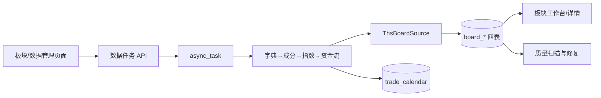

# 板块数据采集模块架构

## 文档范围与结论摘要

本文说明同花顺概念/行业板块的字典、成分、指数日线和资金流从采集、落库、续跑到质检修复的闭环。数据由专属 `ThsBoardSource` 获取，独立于个股行情源，供板块工作台、详情页和数据管理模块使用。

本文维护板块采集协议、日期归属、质量修复及消费接口；不展开个股采集或界面视觉规则。板块采集实现变化时同步本文及对应测试，通用请求配置更新 [环境配置架构](environment-configuration.md)，采集管理总入口更新 [数据管理](data-management.md)，不在本文保存当次运行或验收流水。

核心结论：

- 完整任务按“字典 → 成分 → 指数 → 资金流”执行；各阶段保留独立 checkpoint。
- 正常更新按每个板块自身的最新指数水位增量补齐。
- 交易日历给出候选开市日，板块指数源端就绪探测决定本轮能否采到当天；未就绪会整体回退到上一开市日。
- 资金流源不返回可靠业务日期，也不支持指定历史日期。快照归属按北京时间和交易日历校验：交易日 09:15 前允许上一交易日，09:15 至 15:30 禁止写入，15:30 起允许当日；非交易日允许最近开市日。其他历史日和未来日拒绝写入。
- 页面按板块行情日期读取同日资金流；未来日期或其他日期快照不能替代目标日数据。

个股 EOD 采集见 [stock-collection.md](stock-collection.md)，数据管理总览见 [data-management.md](data-management.md)。

## 模块定位与职责边界

本模块负责维护概念/行业板块字典、累积成分关系、板块指数日线和五个周期的资金流快照，并在登录墙、空壳页、发布延迟和局部失败下提供可恢复采集与质量修复。

本模块不负责个股行情、估值、ST 点时事实和交易日历的基础采集；不使用详情页的另一种资金流口径填充排行榜净流入；不删除历史成分或构造严格的历史时点成分快照；不为源端不支持的历史资金流日期做回溯补采；也不自动重算全部下游结果。

## 核心技术与实现机制

### 数据源与反爬

`backend/datasource/ths_board.py` 直连同花顺三个站点能力：

| 来源 | 用途 | 关键约束 |
|---|---|---|
| `q.10jqka.com.cn` | 板块字典、成分详情 AJAX | 路径分页；深页可能触发登录墙 |
| `data.10jqka.com.cn` | 多周期资金流排行 | 可能返回 HTTP 200 空壳页；排序参数影响覆盖 |
| `d.10jqka.com.cn` | 板块指数日线 | 历史覆盖受源端可用年份限制 |

详情 AJAX 的反爬 `v` 值由请求侧执行 `ths.js` 动态生成，401 时刷新并重试。可选登录 Cookie 用于解除深页登录墙，优先级为：

1. `AI_STOCKS_THS_COOKIE`；
2. `AI_STOCKS_THS_COOKIE_FILE` 指向的受控文件；
3. 页面加密配置 `ths_board.login_cookie`。

页面配置只回显是否已设置；PG 保存加密值，审计不保存明文。Cookie 中旧 `v` 会被动态值覆盖。配置变化后，新建的数据源实例生效。

请求控制复用公共 `request_policy("ths_board")`：默认继承系统通用参数，保留的旧显式覆盖继续优先，频率取通用上限与板块最小间隔的更严格值。每个资金流分页、指数年度请求中的网络失败、401 刷新及空响应共用包含首次的尝试预算与指数退避；空响应补取由 `_http_get` 校验回调承接，质检修复不再在外层整段重采。请求及退避等待消费任务取消检查，取消不能降级为普通年份/分页失败。配置继承和生效边界见 [环境与配置](environment-configuration.md#行情请求参数与来源能力)。

资金流分页在预算耗尽仍为空时跳过当前页但继续后续页；指数年度响应在目标区间没有有效行时按同一预算补取，仍无数据则保留缺口，网络失败则保留失败年份，不能仅因任务执行完毕关闭质量问题。带与不带排序参数的结果按代码取并集。无法获得稳定路径代码且名称无法匹配字典的行不伪造代码，而是写入质量问题。

### 四类数据与持久化

| 表 | 主键 | 语义 |
|---|---|---|
| `board_dict` | `board_code` | 板块代码、名称、类型、源端 clid、能力标记和成分快照元信息 |
| `board_member` | `(board_code, code)` | 板块与股票的累积多对多关系 |
| `board_bar` | `(board_code, trade_date)` | 板块指数原始日线，不套用个股复权链 |
| `board_fund_flow` | `(board_code, snapshot_date, period)` | 即时、3日、5日、10日、20日资金流快照 |

`board_code` 使用同花顺真实路径代码；成分股票代码补交易所后缀，与 `stock_basic.code` 对齐。

### 采集模式和日期收敛

| 模式 | 字典 | 成分 | 指数 | 资金流 |
|---|---|---|---|---|
| `update` | 全量 upsert | 默认按刷新间隔执行 | 各板块从自身最新水位之后增量补到本轮目标日 | 五周期刷新 |
| `backfill` | 全量 upsert | 强制完整刷新 | 按源端可用历史范围回填 | 五周期刷新 |

所有指数采集共用 `backend/services/eod_dates.py` 的收盘时间边界，源端多返回的未收盘或请求区间外记录不能落库。正常完整更新先用交易日历得到候选截止日；北京时间 15:30 前的自动增量先回退到上一开市日，避免空范围或已完成指数续跑时绕过探测而误用今天。其他时段，如果今天是开市日且任务为全量更新，编排器抽样请求目标日板块指数；已发布比例不足时，将本轮指数与资金流共同回退到上一开市日。历史回填和窄窗口修复尊重调用方范围，不走全量就绪探测。

资金流源本身没有可信数据日期，因此：

- 完整增量任务使用本轮板块指数实际截止日作为 `snapshot_date`；
- 只执行 `fund` 时，默认使用 `board_bar` 的全局最大交易日；
- 库内尚无板块指数或完整历史回填时，由资金流服务解析当前可采的已收盘交易日；
- 只有显式强制当日时使用当前自然日。

这些日期仅作为候选锚点；资金流服务仍执行实时源日期门禁：

| 北京时间与日历状态 | 可采快照日 |
|---|---|
| 开市日 00:00 至 09:15 前 | 严格早于今天的最近开市日，覆盖凌晨、周一和节后盘前 |
| 开市日 09:15 至 15:30 前 | 拒绝写入，防止集合竞价、盘中或尚未稳定的收盘值冒充 EOD |
| 开市日 15:30 起 | 当日 |
| 周末、节假日等非开市日 | 不晚于今天的最近开市日 |

09:15 使用开盘集合竞价起点作为保守禁采边界（[上交所交易时间](https://one.sse.com.cn/onething/gptz/)），并非源端承诺的刷新时刻。交易日历只存开市日时，只有当天位于已覆盖区间内才可据缺行判为休市；缺少覆盖证据或此前开市日时明确拒绝，不以自然日兜底。请求返回后再次校验，跨越禁采边界或快照归属日变化的批次不得落库。默认日期同样走该解析；显式日期必须精确匹配可采日，不能自动改写历史问题的目标日。

### 成分、完整性与刷新间隔

成分采用只进不出模型：完整快照保留源端返回总数到 `member_count`，但写入
`board_member` 前按项目股票池过滤，只接收主板、创业板和科创板代码，北交所等范围外
成员只计入源端总数与排除统计，不形成项目成员关系。完整快照只插入新的项目内关系，
不删除旧关系。这能保留历史出现过的成员，但不能等同于逐日成分快照。

板块详情读取累计关系时还必须内连接 `stock_basic`，按所选行情截面的上市日、退市日和
`first_seen_date` 过滤；基础档案未就绪、北交所、尚未上市或已退市成员不得进入详情分页、
分页总数和 ST 状态查询。`member_count` 继续表示最近完整源快照原始返回数，详情列表的
`total` 表示当前截面可展示的项目内累计成员数，两者是明确区分的口径。

登录墙、翻页失败或 401 导致 `complete=false` 时，整板成分快照不落库，旧数据保留，并记录 `board_member_incomplete`。默认只刷新从未成功采集或已超过 `member_update_interval_days` 的板块；历史回填、指定板块、质量修复和显式强制成分会绕过间隔。

### checkpoint、终止与部分失败

四个阶段分别记录字典类型、板块代码、指数板块代码和带范围签名的资金流工作单元。续跑时 checkpoint 与当前目标范围求交，避免更换板块子集后误跳过。旧版全量资金流 checkpoint 可迁移到当前范围签名。

协作式终止异常会穿透各阶段，任务进入可续跑的 `interrupted`，不会被普通异常处理吞掉。单步骤或单板块失败不回滚已成功工作单元；任务标记部分失败并保留 checkpoint。

## 架构组成与调用关系

| 层级 | 主要实现 | 职责 |
|---|---|---|
| 页面 | `SectorsView`、`SectorDetailView`、`views/data/*` | 展示板块数据，发起采集、调度和修复 |
| API | `backend/api/data_tasks.py`、板块查询 API | 任务入口、状态查询和板块只读接口 |
| 任务编排 | `backend/services/async_task.py` | 写任务互斥、状态、日志、终止、续跑和修复分派 |
| 板块编排 | `backend/services/ingest.py`、`board_ingest.py` | 四阶段执行、日期收敛、进度和统计 |
| 数据源 | `backend/datasource/ths_board.py` | 反爬、登录态、分页、解析、重试和完整性标记 |
| 存储与质量 | `backend/storage/`、`backend/services/data_report.py` | 表结构、upsert、质量扫描、修复后复检 |

## 使用与运行方式

系统管理员可在“数据管理 → 数据采集”选择板块任务的模式和步骤，也可在“定时调度”保存相同任务。任务由 `POST /api/data/tasks` 创建，通过任务详情和日志查看实际区间、源端回退、成功数与失败项。

常用 CLI 入口由 `backend/cli.py` 提供；初始化使用 backfill，日常运行使用 update。需要强制刷新全部成分时显式启用对应参数，不能依赖默认周期间隔。

同花顺登录 Cookie 应通过页面加密设置、环境变量或受控文件提供，不写入 YAML、日志、任务参数或版本库。失效时通常表现为深页字典减少、成分 `complete=false` 增多，应更新凭证后重跑未完成项。

## 核心流程与状态变化

### 完整更新

1. 刷新概念/行业字典，并补入具有真实代码的资金流独有板块。
2. 按刷新间隔采集成分；不完整快照拒绝落库。
3. 按统一收盘边界解析候选截止日，冻结 `board_target_end`；仅收盘后目标为当日时执行源端就绪探测，一键日常流程还受共享目标上界限制。
4. 每个板块按自身水位补指数日线，统计实际覆盖到截止日的板块数；`bar_done_codes` 只在 `bar_target_end` 与 `bar_scope`（代码、类型、起始日、增量模式）均相同时跳过，旧记录没有日期时重采。源端回退后同步冻结实际截止日，跨日续跑不漂移。
5. 以指数实际截止日作为候选快照日，经实时源日期与 EOD 门禁校验后写入五周期资金流；不符合则明确失败，不倒填历史日期。
6. 汇总各阶段结果；存在失败则保留 checkpoint 供续跑。

### 只采资金流

1. 不执行板块指数源端就绪探测。
2. 读取 `board_bar` 最大交易日作为默认快照日期。
3. 新任务仅查询不晚于本轮已收盘目标的板块行情；没有行情时由资金流服务按上表解析快照日。续跑和日常流程优先保留冻结目标。强制当日只允许已收盘开市日，仍不能绕过资金流日期门禁。
4. 先校验当前日历、采集时间窗及候选快照日；通过后按板块类型与周期批量拉取、匹配代码并 upsert。日志记录实际快照日。`fund_done_keys` 只有在 `fund_snapshot_date` 相同且采集范围匹配时才能用于跳过；跨快照日或旧 checkpoint 未登记日期时重新采集。

### 查询与质量判定

板块指数质检以 `daily_bar` 的全局最新交易日为基准，只枚举该日及之前的近端开市日；周末、节假日或延后复检不会要求板块存在当天自然日的指数。SQL 聚合与 LEFT JOIN 返回的空日期（pandas `NaT`）按缺失处理，不进入日期比较，也不作为已有指数或完整成分快照的证据。

从未入库指数的板块无法确定成立日或数据起点，只生成 `board_index_gap` 并尝试恢复最新日，不为整个近端窗口生成逐日缺口。已有指数的板块以最早指数日期为起点，之前的缺失不报；起点之后的开市日缺失仍生成 `board_index_gap_daily`。

板块详情先确定行情截面日期，再读取同一个 `snapshot_date` 的资金流。日志中“匹配成功”只说明源行已映射并写库，不代表写入日期与页面截面相同。

质量扫描以当前基准交易日逐板块检查五个周期是否存在同日快照。其他日期，即使更晚，也不能覆盖缺失；修复任务必须携带问题的 `trade_date`，先核验源能力与快照归属，符合条件才写入并按同日条件复检；历史缺口保持真实未解决。

结构体检 E 组除结构、数值和能力标记硬检查外，还展示“板块指数覆盖至最新行情日”和“板块资金流目标日五周期齐全”的只读覆盖提醒，附板块名称、代码和缺失日期/周期。两者与普通质检共用 `DataIntegrityReport.board_coverage_issues()`，不能用“历史至少有一行”证明当前可用。结构体检不写质量台账；人为忽略问题也不会改变实际覆盖，覆盖不足仍显示提醒，恢复处置继续使用普通质检。

覆盖提醒使用短摘要及可展开的逐板块明细；报告输出保留 `items` 中的代码、名称、基准日、最新指数日或缺失周期，以及处置状态。忽略状态复用通用规则的对象/单次范围，体检不修改忽略规则；摘要区分待处理与已忽略，未生成台账时明示未入账。点击板块名关闭报告并按代码、问题类型和对应状态定位本页台账，同时清除无关严重度筛选；显式选择已忽略/已解决状态时，不再受隐藏已办偏好过滤。旧报告无 `items` 时仍可展开长说明。

年度指数接口返回 404、备用入口无行情时，不能靠重复重试补出真实数据。保留已入库历史和未解决缺口，不据单次或连续空响应自动删除板块、修改能力标记或推断永久下线。

### 质量问题与修复动作

| issue_type | 含义 | 修复动作 |
|---|---|---|
| `board_index_gap` | 最新指数水位落后 | 从板块自身下一开市日补到执行时最新日 |
| `board_index_gap_daily` | 近期某开市日存在内部缺口 | 按该日窄窗口重采 |
| `board_index_invalid` | OHLC、价格或量额非法 | 按异常日窄窗口重采 |
| `board_member_incomplete` | 成分快照不完整或从未完整形成 | 强制重采成分 |
| `board_fund_unmatched` | 源数据无法映射稳定板块代码 | 重采并再次映射 |
| `board_fund_missing` | 板块在基准日缺少一个或多个周期 | 按问题日期和缺失周期定向重采 |
| `board_fund_stale` | 某资金流周期整体落后基准日 | 按问题日期重采该周期全源 |

指数和资金流的滞后数按 `(最新数据日, 基准日]` 内真实开市日计算，统一标注“个交易日”，不计自然日差。资金流各周期分别登记交易日滞后数；日历覆盖不足时显示待核验，仍保留滞后问题。旧台账详情在质量列表读取时兼容转换显示，忽略状态和原始记录不变。

扫描型问题在事务内收敛：仍存在的问题复用 open id 并刷新 detail，消失的问题转为 resolved。修复任务创建后问题进入 `fixing` 并绑定任务；成功后复检，失败则保留可诊断状态。

普通批次采集结束后，编排服务按本次板块范围调用同一质检扫描，旧问题经事实检查后收敛，不能仅因请求成功关闭。类型限制及 limit 子集沿用实际对象范围，源级资金流滞后仅在全量检查时收敛；统一入口和失败边界见 [数据管理](data-management.md)。板块指数和资金流恢复前先按原问题口径复检：目标数据已经补齐则跳过源端请求，关闭本条并重扫关联问题；仍缺失或非法才定向重采。若关联扫描失败，本条已经复检通过的结果保留，同时明确提示其他板块的旧问题状态可能未更新，需要重新质检。

## 数据、权限与配置

板块四表位于 DuckDB；任务、任务日志、调度、运行状态和运行期配置位于 PostgreSQL。双库不做跨库 JOIN，服务层分别读取后合并。

板块任务属于数据管理 system-only 能力，创建、查询、终止和续跑受 `data-task:manage` 守卫；质量修复和调度使用各自系统权限。板块只读页面按其业务权限开放。

板块请求由真实HTTP发送层统一控制来源网络并发、频率、冷却和响应读取容量；语义空壳重取、401刷新与传输重试共用逐页/年度预算，耗尽后不重新放大。板块请求继承通用超时、最多尝试次数和退避，专属最小起始间隔与通用频率取更严格限制；旧显式覆盖继续生效，可在系统配置清空后恢复继承。同花顺板块会话串行，401刷新也计入总尝试次数。`ths_board` 继续维护成分更新间隔和加密登录Cookie；股票分钟接口不使用板块Cookie。环境/文件凭证优先于页面配置，密钥和Cookie不得进入仓库。网络规则与来源健康见[统一配置入口](environment-configuration.md#行情请求参数与来源能力)，DuckDB写任务互斥保持不变。

## 上下游依赖与影响范围

上游依赖同花顺页面结构、反爬脚本、登录态和个股交易日历。页面 DOM、路径、字段单位、分页规则或资金流口径变化都可能造成静默覆盖下降，因此不能只依据 HTTP 200 判断成功。

下游包括板块列表与详情、走势对比、资金流展示、个股板块关系、板块强度、评分筛选和回测研究。修改 `board_bar`、成分关系或资金流日期后，应检查相关缓存、关联结果和派生快照是否需要失效或重算。

## 验证与测试入口

| 验证对象 | 入口 |
|---|---|
| 数据源解析、空壳重试和分页完整性 | `backend/tests/test_board_ingest.py` 及板块数据源专项测试 |
| 四阶段编排、日期收敛和 checkpoint | `backend/tests/test_board_ingest.py` |
| 质量扫描、同日资金流和修复透传 | `backend/tests/test_data_mgmt_b.py` |
| 板块查询 API 与页面读取口径 | 板块 API 测试与前端板块定向测试 |
| 表结构与字段契约 | `python -m backend.cli verify-data`、`verify-catalog` |

涉及 DuckDB 的测试必须先按 [AGENTS.md](../../AGENTS.md) 停止后台服务，结束后恢复原运行状态。结构文档还应执行架构文档校验脚本。

## 风险、限制与待确认项

- 登录 Cookie 是会话凭证，会过期并受异地登录影响；无登录态仍可采集，但深页字典和大板块成分可能不完整。
- 资金流排行榜只覆盖其自身板块集合，不能用详情页不同口径的数值混填缺失项。
- 资金流无法按历史日期回溯；禁止把当前源快照改标到不属于当前可采日的旧 `snapshot_date`。盘前只接受上一真实交易日；盘中请求及更早历史日回填明确失败，保留缺口，不补造数据。源端仍不提供可独立核验的业务日期，时间窗不能替代源端日期证据。
- 成分只进不出适合候选累计与当前关系展示，不适合严格点时回测。若未来需要历史成分，必须新增带有效期或快照日的数据模型。
- 免费源可能分批发布当日板块指数。收盘时间门禁不保证源端已经就绪；收盘后强制当日仍可能缺少部分板块，须结合实际覆盖和质检判断。
- 任务日志里的匹配数、写入数、指数截止日和资金流快照日需要联合判断，单一“成功”状态不足以证明页面目标日期已有数据。
