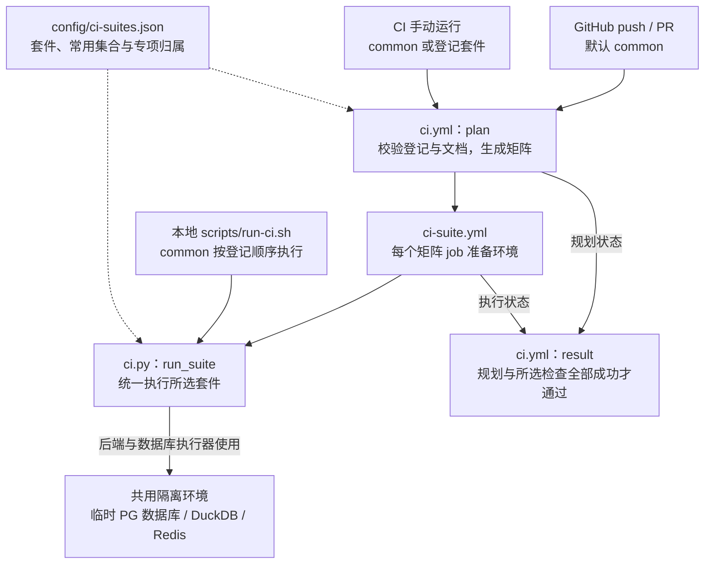

# CI 编排与持续维护

## 用途与范围

- 读者与技术问题：开发者在这里维护常用 CI、专项 CI、调用方式、执行环境、失败判据，以及新增测试和套件的接入规则。此处也维护独立数据库 gate 的资源隔离与执行协议；数据库结构、seed、升级与恢复的验收语义归[数据库专题](database-lifecycle.md)，本地按改动选验证归[开发验证规范](../testing/guide.md)。
- 依据范围与当前结论：执行事实由 `.github/workflows/ci.yml`、`ci-suite.yml`、`backend/devtools/ci.py`、`isolated_environment.py`、`ci_pytest_plugin.py` 及 `config/ci-suites.json` 定义。CI 检查代码，不部署或升级业务实例；远端运行和分支规则须在 GitHub 实际确认。

## 技术全景与边界

- 输入输出与调用者：push（包含直接推主分支）或 PR 自动选择 `common`；GitHub 手动运行与本地脚本可选择同一登记表中的具体套件，输出各项结果和总状态。
- 组成与关系：登记表是套件分类、常用集合和专项例外的唯一事实源；规划器生成矩阵，可复用 workflow 按矩阵准备环境并调用本地同一执行器；Pytest 插件分流专项并拒绝不完整执行。旧前端、数据库 workflow 保留为手动/可复用薄入口，不重复监听 push/PR。
- 共用依赖与事实源：Python 3.12，前端 Node.js 22 与锁文件；数据库初始化语义由[数据库专题](database-lifecycle.md)维护。后端依赖从 `requirements-ci.txt` 安装，测试工具固定 pytest 8.4.2、httpx 0.28.1；质量门禁依赖由 `requirements-quality.txt` 固定。MiniRacer 的发行包为 `mini-racer`，导入名仍为 `py_mini_racer`。下表是登记表的生成块，使用 `scripts/run-ci.sh docs --write` 更新，常用 CI 会校验一致性。

  <!-- ci-inventory:start -->
  | 套件 | 类别 | 常用入口自动调用 | 覆盖 |
  | --- | --- | --- | --- |
  | `quality` | quality | 是 | 后端 Ruff 默认规则与全部 GitHub workflow 语法检查 |
  | `frontend` | frontend | 是 | 前端设计静态、全量离线 Vitest、类型及生产构建；拒绝不完整执行 |
  | `backend` | backend | 是 | 隔离三库中的后端业务、权限及任务回归；新增测试默认加入 |
  | `database` | database | 是 | 现有数据库新装、旧库升级、结构及初始化数据契约 |
  | `backend-scale` | backend | 否 | 显式规模参数下的分时、估值与质量修复规模回归 |

  | 专项文件或用例 | 归属 | 原因 |
  | --- | --- | --- |
  | `backend/tests/test_database_lifecycle.py` | `database` | 由数据库门禁提供独立管理连接与严格执行策略 |
  | `backend/tests/test_api.py` | `manual-market` | 遗留真实行情冒烟，要求已采集行情及前端产物；不作为空库代码回归 |
  | `backend/tests/test_intraday_scale.py` | `backend-scale` | 仅在显式规模参数下执行 |
  | `backend/tests/test_intraday_parallel.py::test_repair_commits_quality_and_progress_before_full_market_finishes[5000]` | `backend-scale` | 全市场规模参数 |
  | `backend/tests/test_intraday_performance.py::test_fixed_response_repair_cost[1000]` | `backend-scale` | 千股规模参数 |
  | `backend/tests/test_valuation_batch.py::test_latest_batch_scale_keeps_every_target_and_reported_evidence` | `backend-scale` | 显式估值补采规模参数 |
  | `backend/tests/test_quality_repair_scale.py::test_full_history_repair_scale[capital_gap]` | `backend-scale` | 显式全历史股本修复规模参数 |
  | `backend/tests/test_quality_repair_scale.py::test_full_history_repair_scale[history_data_gap]` | `backend-scale` | 显式全历史行情缺口修复规模参数 |
  | `backend/tests/test_schedule_downstream.py::test_multi_upstream_runtime_migration_round_trip[duckdb]` | `not-applicable` | 该迁移只支持 PG schema；同一测试的 postgres 参数仍在常用回归执行 |
  <!-- ci-inventory:end -->

统一 CI 主入口与本地入口的调用关系如下。实线表示调用或标注的状态汇总，虚线表示登记配置供给；本地执行结果直接作为脚本退出码返回。

## 核心机制

### 机制：常用与专项的统一调用

- 目标与入口：默认入口为 `scripts/run-ci.sh run`；具体执行 `scripts/run-ci.sh run backend`、`run database` 或 `run frontend`。`PYTHON` 可指定已安装项目依赖的解释器，脚本默认 `python3`，不加载 `.env.local`。
- 处理与结果：`ci.yml` 在规划阶段执行文档/登记检查，`plan common` 只选 `common=true` 的套件，以矩阵并行调用 `ci-suite.yml`。总状态 `result` 用 `always()` 收集结果，规划、任一套件失败/取消均失败。本地常用入口顺序执行相同套件，首个失败停止。
- 数据、权限与状态：GitHub 只授予仓库读取权限，后端/数据库 job 使用自己的 PG 服务，前端与质量 job 不启动 PG/Redis。同分支旧 CI 可取消。`result` 的常用状态命名为 `CI common result`，单套件状态为 `CI suite <套件> result`，手动专项不能替代完整常用状态。直接推主分支后失败不会自动回退代码；分支必过状态须在 GitHub 核对并绑定完整常用状态，代码不自动修改远端设置。
- 配置与扩展：手动运行 `CI` 时 `suite` 填 `common` 或登记名，不使用容易漏维护的固定选项列表。`backend-scale` 必须显式填写 `scale_stocks=100..5000`；本地示例：`scripts/run-ci.sh run backend-scale --scale-stocks 1000`。规模模式只选择登记的规模用例，不重跑整套常用测试；其中两个既有参数用例仍固定为 1000/5000 股，输入数量只控制读取环境参数的用例。
- 失败与资源边界：未知套件、失效登记、过期文档直接失败。GitHub 每个检查最多 30 分钟，不用自动重试掩盖断言失败；前端 JSON 报告、后端 JUnit 与隔离 PG/Redis 诊断日志归档 7 天。每次执行的临时诊断统一写入 Git 忽略的 `.local/tmp/ai-agent/ci-{unique}/`，入口输出实际目录；退出后保留供排错或上传，可按临时产物清理，不作为长期依赖。
- 局部风险与复核：常用 CI 包含全量前端离线测试与生产构建；浏览器 E2E、真实来源核验、依赖漏洞审计、覆盖率门槛及大规模性能达标判定仍属专项或待接入能力，不能由常用通过推断这些已验收。

### 机制：前端完整回归与构建

- 目标与入口：统一执行器调用 `npm --prefix frontend run ci`；`frontend/scripts/run-ci.mjs` 复用正式 `build` 脚本和 `test:ci` 测试协议。`npm run check` 与 `test:contracts` 继续用于本地共享设计快检，不作为完整 CI 的第二次重复执行。
- 处理与结果：正式 build 先执行设计静态检查、`vue-tsc` 和 Vite 构建，各一次；构建目标为本轮独立目录，不覆盖 `frontend/dist`。随后 `vitest.ci.config.ts` 继承主 Vitest 配置的 `src/**/*.{test,spec}.ts`，包括布局、组件、指令、页面、API、store、router、工具和 composable 中的现有测试。
- 数据、权限与状态：前端测试使用确定性材料，不依赖在线后端、真实行情或业务数据库。需要真实浏览器或业务存储的检查按专项准入单独编排；不能因普通测试夹具不完整就跳过。
- 配置与扩展：新增普通前端测试只需进入主配置的命名和目录范围，无逐文件白名单。CI 显式禁止 `only` 和空集合，不接受额外筛选参数，测试重试为 0，工作进程最多 2 个。类型、构建与离线测试都由同一入口执行。
- 失败与资源边界：执行器核对 JSON 报告成功标志、用例总数、通过数及逐项状态，失败、skip/todo、空集合、缺失或不完整报告均失败。报告写入独立目录，构建产物在成功和失败后均清理；退出码由统一总入口传播。
- 局部风险与复核：`frontend-ci-collection.spec.ts` 在独立夹具中真实调用 package 脚本和 CI 配置，证明深层业务测试自动接入，并验证失败、skip/todo、only、空集合与筛选参数负例。单元测试和构建仍不能替代真实浏览器交互、页面几何及真实业务闭环验收。

### 机制：常用静态质量检查

- 目标与入口：`quality` 是登记表中的常用套件，执行 `ci_quality.run_quality()`；本地和 GitHub 复用同一入口。
- 处理与结果：先通过当前 Python 执行 `ruff check backend`，再检查 `.github/workflows/` 中全部 YAML 工作流。Ruff 使用项目当前默认规则，不额外放宽或全局排除；actionlint 校验工作流结构和表达式，不隐式依赖可选 ShellCheck/Pyflakes。
- 数据、权限与状态：检查只读取受控源码与工作流，不访问业务存储；工具下载仅访问官方固定版本发布资源。
- 配置与扩展：Ruff 固定版本由 `requirements-quality.txt` 维护，后端 CI 依赖复用该文件；actionlint 版本由 `ci_quality.ACTIONLINT_VERSION` 维护，安装时核对官方 SHA-256 清单，只提取预期可执行文件并原子写入 `.local/ci-tools/` 缓存，运行前核对版本。
- 失败与资源边界：工具缺失且无法准备、校验和或版本不符、空工作流集合、Ruff 或 actionlint 非零退出均失败；Ruff 失败后不继续执行工作流检查，不把不可执行状态当作通过。
- 局部风险与复核：`test_ci_quality.py` 覆盖失败传播、全部工作流收集、空集合、下载校验和及安全提取；它不替代依赖漏洞或密钥泄漏扫描。

### 机制：后端与数据库的共用隔离环境

- 目标与入口：`run_backend()` 与 `database_gate.run_gate()` 共用 `isolated_environment.isolated_storage_environment()`。`gate_server()` 默认启动独立 PG 集群；显式管理连接 `AI_STOCKS_DB_GATE_ADMIN_DSN` 只供执行器和数据库夹具创建/删除随机测试库，不能作为业务客户端连接。
- 处理与结果：共用上下文创建随机 PG 数据库、只监听 Unix socket 的临时 Redis、临时 DuckDB 路径及 YAML，在子进程导入配置前设置全部默认目标。普通 `PostgresClient()`、`get_pg_client()`、`get_client()` 和公共 `pg` / `redis_cli` 夹具均落在这些临时资源。后端套件先调用正式 `initialize_database()` 再运行业务回归；数据库套件保留空库、新装和升级夹具各自的前置状态。
- 数据、权限与状态：子进程剥离全部继承的 `AI_STOCKS_*`、`ENV` 和 `PYTEST_*`，再生成测试身份、密码、配置加密密钥和连接；关闭邮件发送，移除本机 E2E/来源凭据。测试可修改全局配置，因为目标是可销毁的独立库。临时 PG/Redis 生命周期归执行器所有，不停止或重启日常后端。
- 配置与扩展：后端与数据库执行均需要 `redis-server`，以及本机 `initdb/pg_ctl` 或显式测试管理连接。普通 `backend/tests/test_*.py` 自动发现、默认进入 `backend`；文件级专项在导入前排除，参数级专项在收集后按精确 nodeid 分流。专项表中的 nodeid 失效会失败，避免改名后静默丢覆盖；不要用宽泛文件名匹配排除新业务。
- 失败与资源边界：PG/Redis 缺失、初始化失败或清理失败直接失败；复用 `database_gate_plugin` 的严格结果判定，任何未预先分流的 skip/xfail/xpass、空集合或外部取消选择都失败。插件加载和继承的 `-k/-m/--lf` 被清除。退出关闭子进程、连接、随机 PG 库及临时目录；Redis 不开放 TCP、不持久化。
- 局部风险与复核：登记的 `manual-market` 为遗留 `test_api.py`，需要已准备的真实行情和前端产物，当前没有可自动调用的专项 CI；按本地服务保护要求准备后单独运行，不能把常用 CI 通过解释为这组已通过。`not-applicable` 仅排除 PG 迁移用例的 DuckDB 参数，其 PG 参数仍常用必跑。普通手动 pytest 的离线 skip 行为不因此改变。

### 机制：数据库专项复用

- 目标与入口：`scripts/run-ci.sh run database` 最终调用已有 `database_gate.run_gate()`；`./start.sh database gate` 继续有效，两者不刷新结构契约。
- 处理与结果：执行数据库专题规定的新装、冻结旧库升级、重跑、数据保留、负例、故障回滚及真实 CLI/目录验收；具体通过条件和结构维护步骤由该专题定义。
- 数据、权限与状态：业务数据库不作为门禁目标；不把隔离新装成功当成某个业务实例已升级。刷新机器契约仍是显式 `database gate --refresh-contract`，CI 不执行刷新。
- 配置与扩展：数据库相关变更沿数据库接入流程扩展 `test_database_lifecycle.py`，或把新增测试文件登记到 `database`。`gate_test_paths()` 消费同一登记表并执行这些文件；常用后端在导入前分流，常用 CI 调用数据库专项。执行器统一加载 `backend.tests.database_fixtures`：`databases` 提供每例未初始化的独立双库，`installed` 提供正式初始化后的双库。新装、升级或故障回滚测试按前置状态选择这两个夹具；普通客户端回归可复用公共夹具，仍受共用默认隔离保护。用例不得显式指定业务 DSN 或业务文件路径。Python 用例不能登记到前端执行器，文件级和用例级专项不得重叠。
- 失败与资源边界：资源管理和严格结果判定沿用上述共用协议；需要 PG >=14，GitHub 使用 PG 16。新文件接入必须验证真实执行和临时目标，失败后也要清理，不只检查登记表中存在路径。
- 局部风险与复核：线上权限、容量、备份及实际存量数据库验收仍由部署维护和 `database check` 承接。

## 接入、扩展与变更影响

- 消费与接入方式：首次运行先安装 `requirements-ci.txt`、前端执行 `npm ci`，本机准备 `initdb/pg_ctl/redis-server`。可用 `scripts/run-ci.sh plan` 查看常用集合、`scripts/run-ci.sh check` 检查登记与文档。参数不透传给任意 shell 命令，套件名须经登记校验。
- 扩展与兼容边界：新增普通后端测试自动收集；新增专项例外登记精确文件/nodeid、归属和原因，执行对应专项与常用分流回归。新增套件登记 `kind/common/description`，同类执行器可复用，新增执行器类型须同步 `registry()`、`run_suite()` 与 `ci-suite.yml` 的依赖准备。之后执行 `docs --write`，校验会阻止忘记同步文档；不由 CI 自动提交代码、修改断言、刷新契约或创建新调度。
- 依赖及消费方影响：套件登记变化同时影响本地默认集合、远端矩阵与生成表；修改触发器/可复用 workflow 时运行工作流语法检查，修改插件必须覆盖失败、跳过、空集合、取消选择及专项分流负例。CI 规则变更只在本文维护机制正文，AGENTS、README、验证规范和系统架构保留导航。

新增测试或调整 CI 时，按以下顺序完成维护：

1. 按改动风险在开发验证规范选择测试；普通后端测试按默认发现接入，数据库生命周期测试按上述夹具选择前置状态，专项例外再登记归属与原因。普通前端测试按主 Vitest 配置自动接入完整 CI；快检范围仍由 `vitest.contracts.config.ts` 管理。扩大或调整采集范围必须通过相应采集正反例证明真实执行，不能只检查文件存在；夹具退出时清理，不连接在线后端或数据库。
2. 修改 `config/ci-suites.json` 后执行 `scripts/run-ci.sh docs --write` 和 `scripts/run-ci.sh check`。生成命令只更新套件/例外表，机制正文由修改者随实现维护；不能用生成表格代替解释新的依赖、隔离或失败行为。
3. 执行受影响套件；归属变化同时验证常用分流与专项实际执行，执行器变化复核 `test_ci.py`，数据库语义变化继续完成数据库专题要求的 gate。必要检查不通过时修原因，不改断言或例外来掩盖失败。
4. 交付实际范围、结果和未验证项。远端状态及分支规则以 GitHub 实际证据为准；本地通过不能代替远端运行。

## 验证入口与已知限制

| 验证或风险事项 | 条件与入口 | 证据状态及位置 | 结果或影响 | 后续处理 |
| --- | --- | --- | --- | --- |
| 常用及专项编排 | `scripts/run-ci.sh plan/check/run` | 执行器、登记与 workflow | 同一分类驱动本地和远端 | 每次交付记录实际运行范围与结果 |
| 自动接入与失败关闭 | `test_ci.py` | 规划、环境清洗、生成块、专项分流及 Pytest 负例 | 防止漏接入或跳过冒充成功 | 变更机制时定向回归 |
| 数据库生命周期 | `scripts/run-ci.sh run database` | 既有数据库门禁 | 验证代码安装与升级契约 | 实际实例另验收 |
| GitHub 执行及分支规则 | 推送后查看 Actions 与仓库设置 | 本地运行不能替代远端证据 | 服务镜像、权限和平台可能影响执行 | 首次推送后确认各矩阵及总状态 |
| 前端与静态质量 | `run frontend`、`run quality` | 完整前端配置、报告判定、构建、Ruff、actionlint | 自动发现和实际执行均须有证据 | 执行器及收集范围变化时验证正反例 |
| 本阶段覆盖边界 | E2E、真实行情、依赖安全、覆盖率门槛及重型规模专项 | 本文套件表与专项例外表 | 不能以常用通过推断这些已验收 | 按后续阶段及专项准入接入 |
