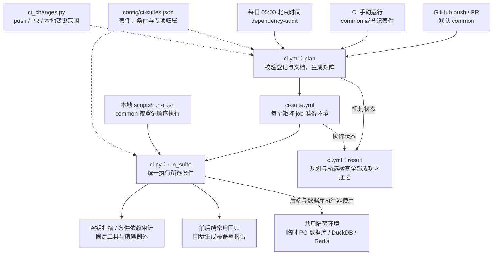

# CI 编排与持续维护

## 用途与范围

- 读者与技术问题：开发者在这里维护常用 CI、专项 CI、调用方式、执行环境、失败判据，以及新增测试和套件的接入规则。此处也维护独立数据库 gate 的资源隔离与执行协议；数据库结构、seed、升级与恢复的验收语义归[数据库专题](database-lifecycle.md)，本地按改动选验证归[开发验证规范](../testing/guide.md)。
- 依据范围与当前结论：执行事实由 `.github/workflows/ci.yml`、`ci-suite.yml`、`backend/devtools/ci.py`、`ci_changes.py`、`ci_dependencies.py`、`ci_secrets.py`、`ci_coverage.py`、`isolated_environment.py`、`ci_pytest_plugin.py` 及 `config/ci-suites.json` 定义。CI 检查代码，不部署或升级业务实例；远端运行和分支规则须在 GitHub 实际确认。

## 技术全景与边界

- 输入输出与调用者：push（包含直接推主分支）或 PR 自动选择 `common`，其中依赖审计按变更条件调用；每日北京时间 05:00 选择 `dependency-audit`。GitHub 手动运行与本地脚本可选择同一登记表中的具体套件，输出各项结果和总状态。
- 组成与关系：登记表是套件分类、常用集合和专项例外的唯一事实源；规划器生成矩阵，可复用 workflow 按矩阵准备环境并调用本地同一执行器；Pytest 插件分流专项并拒绝不完整执行。旧前端、数据库 workflow 保留为手动/可复用薄入口，不重复监听 push/PR。
- 共用依赖与事实源：Python 3.12，前端 Node.js 22.12+ 与 npm 锁文件；数据库初始化语义由[数据库专题](database-lifecycle.md)维护。Python CI 从带 SHA-256 的 `requirements-ci.lock` 安装，源入口为 `requirements-ci.txt` 及其递归 include；测试工具固定 pytest 9.0.3、httpx 0.28.1，质量 job 单独安装同源固定 Ruff 的 `requirements-quality.txt`。MiniRacer 的发行包为 `mini-racer`，导入名仍为 `py_mini_racer`。下表是登记表的生成块，使用 `scripts/run-ci.sh docs --write` 更新，常用 CI 会校验一致性。

  <!-- ci-inventory:start -->
  | 套件 | 类别 | 常用入口自动调用 | 覆盖 |
  | --- | --- | --- | --- |
  | `secrets` | secrets | 是 | 受控源码及本次提交范围的密钥扫描；精确固定材料例外到期阻断 |
  | `quality` | quality | 是 | 后端 Ruff 默认规则与全部 GitHub workflow 语法检查 |
  | `frontend` | frontend | 是 | 前端设计静态、全量离线 Vitest、类型及生产构建；拒绝不完整执行 |
  | `backend` | backend | 是 | 隔离三库中的后端业务、权限及任务回归；新增测试默认加入 |
  | `database` | database | 是 | 现有数据库新装、旧库升级、结构及初始化数据契约 |
  | `dependency-audit` | audit | 依赖变更时；范围未知时保守执行 | Python CI 锁与 npm 锁的全部依赖漏洞审计；每日及手动可独立调用 |
  | `backend-scale` | backend | 否 | 显式规模参数下的分时、估值与质量修复规模回归 |
  | `secrets-history` | secrets | 否 | 显式扫描全部已获取 Git 历史；首次历史基线及事件调查专项 |

  | 专项文件或用例 | 归属 | 原因 |
  | --- | --- | --- |
  | `backend/tests/test_database_lifecycle.py` | `database` | 由数据库门禁提供独立管理连接与严格执行策略 |
  | `backend/tests/test_api.py` | `manual-market` | 遗留真实行情冒烟，要求已采集行情及前端产物；不作为空库代码回归 |
  | `backend/tests/test_intraday_scale.py` | `backend-scale` | 仅在显式规模参数下执行 |
  | `backend/tests/test_intraday_parallel.py::test_repair_commits_quality_and_progress_before_full_market_finishes[5000]` | `backend-scale` | 全市场规模参数 |
  | `backend/tests/test_intraday_performance.py::test_fixed_response_repair_cost[1000]` | `backend-scale` | 千股规模参数 |
  | `backend/tests/test_valuation_batch.py::test_latest_batch_scale_keeps_every_target_and_reported_evidence` | `backend-scale` | 显式估值补采规模参数 |
  | `backend/tests/test_quality_repair_scale.py::test_full_history_repair_scale[capital_gap]` | `backend-scale` | 显式全历史股本修复规模参数 |
  | `backend/tests/test_quality_repair_scale.py::test_full_history_repair_scale[history_data_gap]` | `backend-scale` | 显式全历史行情缺口修复规模参数 |
  | `backend/tests/test_schedule_downstream.py::test_multi_upstream_runtime_migration_round_trip[duckdb]` | `not-applicable` | 该迁移只支持 PG schema；同一测试的 postgres 参数仍在常用回归执行 |
  <!-- ci-inventory:end -->

统一 CI 主入口与本地入口的调用关系如下。实线表示调用或标注的状态汇总，虚线表示登记配置供给；本地执行结果直接作为脚本退出码返回。

## 核心机制

### 机制：常用与专项的统一调用

- 目标与入口：默认入口为 `scripts/run-ci.sh run`；具体执行 `scripts/run-ci.sh run backend`、`run database` 或 `run frontend`。`PYTHON` 可指定已安装项目依赖的解释器，脚本默认 `python3`，不加载 `.env.local`。
- 处理与结果：`ci.yml` 在规划阶段执行文档/登记和锁源指纹检查，`plan common` 选择 `common=true` 且满足调用条件的套件，以矩阵并行调用 `ci-suite.yml`。依赖条件详见下文；手动指定套件始终执行。总状态 `result` 用 `always()` 收集结果，规划、任一套件失败/取消均失败。本地常用入口顺序执行相同套件，首个失败停止。
- 数据、权限与状态：GitHub 只授予仓库读取权限，仅后端/数据库 job 使用 PG/Redis，其他 job 不启动业务存储。同分支旧 CI 可取消。`result` 的常用状态命名为 `CI common result`，手动单套件与每日审计状态为 `CI suite <套件> result`，专项不能替代完整常用状态。直接推主分支后失败不会自动回退代码；分支必过状态须在 GitHub 核对并绑定完整常用状态，代码不自动修改远端设置。
- 配置与扩展：手动运行 `CI` 时 `suite` 填 `common` 或登记名，不使用容易漏维护的固定选项列表。`backend-scale` 必须显式填写 `scale_stocks=100..5000`；本地示例：`scripts/run-ci.sh run backend-scale --scale-stocks 1000`。规模模式只选择登记的规模用例，不重跑整套常用测试；其中两个既有参数用例仍固定为 1000/5000 股，输入数量只控制读取环境参数的用例。
- 失败与资源边界：未知套件、失效登记、过期文档/锁直接失败。GitHub 每个检查最多 30 分钟，不用自动重试掩盖断言失败；前端 JSON、Python JUnit、覆盖率、安全报告与隔离存储日志归档 7 天。每次执行的临时诊断统一写入 Git 忽略的 `.local/tmp/ai-agent/ci-{unique}/`，入口输出实际目录；退出后保留供排错或上传，可按临时产物清理，不作为长期依赖。
- 局部风险与复核：常用 CI 包含全量前端离线测试、生产构建、安全扫描及覆盖率测量；浏览器 E2E、真实来源核验、覆盖率百分比门槛及大规模性能达标判定仍属专项或待接入能力，不能由常用通过推断这些已验收。

### 机制：前端完整回归与构建

- 目标与入口：统一执行器调用 `npm --prefix frontend run ci`；`frontend/scripts/run-ci.mjs` 复用正式 `build` 脚本和 `test:ci` 测试协议。`npm run check` 与 `test:contracts` 继续用于本地共享设计快检，不作为完整 CI 的第二次重复执行。
- 处理与结果：正式 build 先执行设计静态检查、`vue-tsc` 和 Vite 构建，各一次；构建目标为本轮独立目录，不覆盖 `frontend/dist`。随后 `vitest.ci.config.ts` 继承主 Vitest 配置的 `src/**/*.{test,spec}.ts`，包括布局、组件、指令、页面、API、store、router、工具和 composable 中的现有测试。
- 数据、权限与状态：前端测试使用确定性材料，不依赖在线后端、真实行情或业务数据库。需要真实浏览器或业务存储的检查按专项准入单独编排；不能因普通测试夹具不完整就跳过。
- 配置与扩展：新增普通前端测试只需进入主配置的命名和目录范围，无逐文件白名单。CI 显式禁止 `only` 和空集合，不接受额外筛选参数，测试重试为 0，工作进程最多 2 个。类型、构建与离线测试都由同一入口执行。
- 失败与资源边界：执行器核对 JSON 报告成功标志、用例总数、通过数及逐项状态，失败、skip/todo、空集合、缺失或不完整报告均失败。报告写入独立目录，构建产物在成功和失败后均清理；退出码由统一总入口传播。
- 局部风险与复核：`frontend-ci-collection.spec.ts` 在独立夹具中真实调用 package 脚本和 CI 配置，证明深层业务测试自动接入，并验证失败、skip/todo、only、空集合与筛选参数负例。全树静态集成用例需解析生产源码；Linux Actions 双工作进程与 V8 采集下组合扫描实测约 84 秒，按共享 `fullSourceAudit.ts` 使用 120 秒有界预算，仅由显式扫描完整生产源码树的用例使用。普通单测维持默认时限，断言、违规反例和扫描对象不变；此预算不作为业务性能达标阈值。单元测试和构建仍不能替代真实浏览器交互、页面几何及真实业务闭环验收。

### 机制：常用静态质量检查

- 目标与入口：`quality` 是登记表中的常用套件，执行 `ci_quality.run_quality()`；本地和 GitHub 复用同一入口。
- 处理与结果：先通过当前 Python 执行 `ruff check backend`，再检查 `.github/workflows/` 中全部 YAML 工作流。Ruff 使用项目当前默认规则，不额外放宽或全局排除；actionlint 校验工作流结构和表达式，不隐式依赖可选 ShellCheck/Pyflakes。
- 数据、权限与状态：检查只读取受控源码与工作流，不访问业务存储；工具下载仅访问官方固定版本发布资源。
- 配置与扩展：Ruff 固定版本由 `requirements-quality.txt` 维护，后端 CI 锁复用该文件；actionlint 和 Gitleaks 的固定版本统一在 `ci_tools.TOOLS` 维护，共用官方 SHA-256 核验、安全提取及原子缓存安装，运行前核对版本。
- 失败与资源边界：工具缺失且无法准备、校验和或版本不符、空工作流集合、Ruff 或 actionlint 非零退出均失败；Ruff 失败后不继续执行工作流检查，不把不可执行状态当作通过。
- 局部风险与复核：`test_ci_quality.py` 覆盖失败传播、全部工作流收集、空集合、下载校验和及安全提取；它不替代依赖漏洞或密钥泄漏扫描。

### 机制：密钥扫描与精确例外

- 目标与入口：常用 `secrets` 调用 `ci_secrets.run_secrets()`；`run secrets-history` 显式检查已获取的全部 Git 历史，供首次历史基线和事件调查使用，不混入每次常用扫描。
- 处理与结果：通过 `git ls-files` 收集受控文件和未被忽略的新文件，复制到独立快照后执行固定 Gitleaks 默认规则；符号链接只扫描链接文本，不读取外部目标。随后扫描已识别的提交范围，能拦截提交后又删除的材料。范围未知时扫描当前提交，完整历史仍须专项；Actions 使用完整 checkout。
- 数据、权限与状态：忽略个人环境、业务库和依赖缓存，测试目录正常扫描。扫描显式覆盖自定义配置/忽略文件，不接受散落的 `gitleaks:allow`。日志与 JSON 报告通过 `--redact=100` 脱敏；临时源码快照在正常/异常退出后删除，不上传源码副本。
- 配置与扩展：唯一例外登记为 `config/ci-security-exceptions.json`，每项绑定精确路径、规则 ID、命中原始行的 SHA-256、原因及 UTC 到期日期。目前仅登记固定离线测试材料。内容变化、规则变化、到期、重复或失效登记均须重新审查，不自动续期，不排除整个测试目录。
- 失败与资源边界：新发现、无效/过期例外、工具异常、超时、空受控集合或缺失报告均失败。扫描器用独立发现退出码区分工具错误；处理脱敏报告中的发现并应用精确例外后才决定总结果，禁止把工具失败当成无泄漏。
- 局部风险与复核：真实探针必须证明深层新增测试文件及范围内新增后删除的密钥均阻断，报告不包含探针值。模式扫描不能保证识别所有未知凭据；实际密钥泄漏需要轮换和事件处置，删除文件不能消除历史暴露。

### 机制：可重现依赖与条件审计

- 目标与入口：`ci_dependencies.py` 维护 CI 锁和审计，`dependency-audit` 复用同一登记、规划器和执行器。push、PR 的 common 在依赖变化时调用；每日和手动显式选择该套件，不运行全套 common。
- 处理与结果：`ci_changes.py` 读取 push 的 before/after 或 PR 共同祖先与 head，校验提交对象；比较时覆盖删除、重命名两侧及本地未提交/新文件。命中登记中的 `dependency_paths` 时审计，范围缺失、新分支零 SHA、浅克隆缺对象时保守审计。本地可传 `--base <完整SHA> --head <完整SHA>`；不传时完整常用包含审计。
- 数据、权限与状态：`requirements-ci.lock` 固定 Python 3.12 的跨平台发行版本和 SHA-256；Actions 后端/数据库/审计均用 `pip install --require-hashes -r requirements-ci.lock`。执行回归前按当前平台核对实际安装版本。pip-audit 审计同一锁的版本，并核对报告集合；npm audit 读取 `frontend/package-lock.json`，包含开发依赖并显式访问官方 npm 审计接口。私有镜像或代理不支持审计时，可为本轮进程将 `NPM_CONFIG_USERCONFIG`、`NPM_CONFIG_GLOBALCONFIG` 指向两个不同的独立空文件，并按网络实际条件移除失效代理；不修改全局 npm 配置，查询仍失败则阻断。只查询，不调用自动修复。
- 配置与扩展：`scripts/run-ci.sh lock` 使用固定 uv 递归编译源清单，默认保留已锁版本；定向升级用 `lock --upgrade-package <包名>==<已核实版本>`。源指纹递归覆盖 include，修改任何源清单而未重建锁会在规划阶段失败。前端的 js-beautify 下 glob/editorconfig 定向 overrides 修复传递漏洞，受 Node 22.12+ 约束；上游解除旧范围后再评估移除，并执行完整回归。
- 失败与资源边界：全部严重级别的已知漏洞、查询失败、工具失败、未审计项、报告缺失及 Python 审计集合漂移均阻断；不使用全局忽略、自动升级或只扫描生产依赖来减少告警。每个审计进程最多 300 秒，不把网络不可达解释为零漏洞。
- 局部风险与复核：公开漏洞数据库会变化，依赖不变也可能使每日审计失败；应核实公告、选择修复版本并验证兼容性。平台相关依赖按当前平台测量，不能把 macOS 本地通过当成 Linux Actions 已验证。工具升级或清单规则变化须覆盖真实漏洞/错误报告及变更识别正反例。

### 机制：随常用回归输出覆盖率

- 目标与入口：前端 CI 用匹配 Vitest 的 V8 provider，后端及 CI 数据库门禁显式加载 pytest-cov；复用本轮测试执行，不为报告再跑第二遍。
- 处理与结果：前端输出 JSON 明细、summary 和 LCOV；Python 的后端与数据库套件分别输出 JSON、XML 和终端摘要，比较基线须保持套件和平台一致，不相加百分比。前端 `coverage.include` 包含未导入的业务 TS/Vue 文件，Python 测量 `backend`；测试与声明文件不计业务覆盖率。报告均保存在本轮独立目录。
- 数据、权限与状态：覆盖率只观察离线/隔离回归，不连接真实业务环境，不改变既有断言、跳过策略或专项分流。Python 测量本轮 pytest 进程，未对所有派生 CLI/进程池声称完整测量。
- 配置与扩展：前端范围在 `vitest.ci.config.ts`，Python 公共配置在 `pyproject.toml`，参数和报告验收由 `ci_coverage.py` 共用。新增普通业务文件自动进入相应分母；基线先用于定位关键模块缺口，不设置全仓库统一百分比硬门槛。
- 失败与资源边界：测试失败继续失败；测试通过但报告缺失、损坏或测量集合为空也失败。覆盖率数据文件写入独立目录；前端生产 dist 仍按原机制清理，诊断报告归档。
- 局部风险与复核：覆盖率百分比不代表断言有效性，也不替代权限、业务、浏览器和真实来源验收。后续模块门槛须依据测量、业务风险和测试补齐情况单独决定，不能通过缩小分母达标。

### 机制：后端与数据库的共用隔离环境

- 目标与入口：`run_backend()` 与 `database_gate.run_gate()` 共用 `isolated_environment.isolated_storage_environment()`。`gate_server()` 默认启动独立 PG 集群；显式管理连接 `AI_STOCKS_DB_GATE_ADMIN_DSN` 只供执行器和数据库夹具创建/删除随机测试库，不能作为业务客户端连接。
- 处理与结果：共用上下文创建随机 PG 数据库、只监听 Unix socket 的临时 Redis、临时 DuckDB 路径及 YAML，在子进程导入配置前设置全部默认目标。普通 `PostgresClient()`、`get_pg_client()`、`get_client()` 和公共 `pg` / `redis_cli` 夹具均落在这些临时资源。后端套件先调用正式 `initialize_database()` 再运行业务回归；数据库套件保留空库、新装和升级夹具各自的前置状态。
- 数据、权限与状态：子进程剥离全部继承的 `AI_STOCKS_*`、`ENV` 和 `PYTEST_*`，再生成测试身份、密码、配置加密密钥和连接；关闭邮件发送，移除本机 E2E/来源凭据。测试可修改全局配置，因为目标是可销毁的独立库。临时 PG/Redis 生命周期归执行器所有，不停止或重启日常后端。
- 配置与扩展：后端与数据库执行均需要 `redis-server`，以及本机 `initdb/pg_ctl` 或显式测试管理连接。普通 `backend/tests/test_*.py` 自动发现、默认进入 `backend`；文件级专项在导入前排除，参数级专项在收集后按精确 nodeid 分流。专项表中的 nodeid 失效会失败，避免改名后静默丢覆盖；不要用宽泛文件名匹配排除新业务。
- 失败与资源边界：PG/Redis 缺失、初始化失败或清理失败直接失败；复用 `database_gate_plugin` 的严格结果判定，任何未预先分流的 skip/xfail/xpass、空集合或外部取消选择都失败。插件加载和继承的 `-k/-m/--lf` 被清除。退出关闭子进程、连接、随机 PG 库及临时目录；Redis 不开放 TCP、不持久化。
- 局部风险与复核：调度时间回归使用明确的北京时间与来源时区材料，跨任务并发回归等待可观察的槽位就绪，不把主机墙钟或进程启动速度当作业务预期；改变时间边界时还须在 UTC 等非北京时间进程中复验，业务时间语义见[任务运行态](task-runtime.md)。登记的 `manual-market` 为遗留 `test_api.py`，需要已准备的真实行情和前端产物，当前没有可自动调用的专项 CI；按本地服务保护要求准备后单独运行，不能把常用 CI 通过解释为这组已通过。`not-applicable` 仅排除 PG 迁移用例的 DuckDB 参数，其 PG 参数仍常用必跑。普通手动 pytest 的离线 skip 行为不因此改变。

### 机制：数据库专项复用

- 目标与入口：`scripts/run-ci.sh run database` 最终调用已有 `database_gate.run_gate()`；`./start.sh database gate` 继续有效，两者不刷新结构契约。
- 处理与结果：执行数据库专题规定的新装、冻结旧库升级、重跑、数据保留、负例、故障回滚及真实 CLI/目录验收；具体通过条件和结构维护步骤由该专题定义。
- 数据、权限与状态：业务数据库不作为门禁目标；不把隔离新装成功当成某个业务实例已升级。刷新机器契约仍是显式 `database gate --refresh-contract`，CI 不执行刷新。
- 配置与扩展：数据库相关变更沿数据库接入流程扩展 `test_database_lifecycle.py`，或把新增测试文件登记到 `database`。`gate_test_paths()` 消费同一登记表并执行这些文件；常用后端在导入前分流，常用 CI 调用数据库专项。执行器统一加载 `backend.tests.database_fixtures`：`databases` 提供每例未初始化的独立双库，`installed` 提供正式初始化后的双库。新装、升级或故障回滚测试按前置状态选择这两个夹具；普通客户端回归可复用公共夹具，仍受共用默认隔离保护。用例不得显式指定业务 DSN 或业务文件路径。Python 用例不能登记到前端执行器，文件级和用例级专项不得重叠。
- 失败与资源边界：资源管理和严格结果判定沿用上述共用协议；需要 PG >=14，GitHub 使用 PG 16。新文件接入必须验证真实执行和临时目标，失败后也要清理，不只检查登记表中存在路径。
- 局部风险与复核：线上权限、容量、备份及实际存量数据库验收仍由部署维护和 `database check` 承接。

## 接入、扩展与变更影响

- 消费与接入方式：首次运行先执行 `python -m pip install --require-hashes -r requirements-ci.lock`、前端执行 `npm ci`，本机准备 `initdb/pg_ctl/redis-server`，Node 使用 22.12+。可用 `scripts/run-ci.sh plan` 查看当次常用集合、`scripts/run-ci.sh check` 检查登记、文档与锁指纹。首次生成锁前可单独安装 `uv==0.13.8`；源码变更后先重建锁再按锁安装。参数不透传给任意 shell 命令，套件名须经登记校验。
- 扩展与兼容边界：新增普通后端测试自动收集；新增专项例外登记精确文件/nodeid、归属和原因，执行对应专项与常用分流回归。新增套件登记 `kind/common/description`，同类执行器可复用，新增执行器类型须同步 `registry()`、`run_suite()` 与 `ci-suite.yml` 的依赖准备。之后执行 `docs --write`，校验会阻止忘记同步文档；不由 CI 自动提交代码、修改断言、刷新契约或创建新调度。
- 依赖及消费方影响：套件登记变化同时影响本地默认集合、远端矩阵与生成表；修改触发器/可复用 workflow 时运行工作流语法检查，修改插件必须覆盖失败、跳过、空集合、取消选择及专项分流负例。CI 规则变更只在本文维护机制正文，AGENTS、README、验证规范和系统架构保留导航。

新增测试或调整 CI 时，按以下顺序完成维护：

1. 按改动风险在开发验证规范选择测试；普通后端测试按默认发现接入，数据库生命周期测试按上述夹具选择前置状态，专项例外再登记归属与原因。普通前端测试按主 Vitest 配置自动接入完整 CI；快检范围仍由 `vitest.contracts.config.ts` 管理。扩大或调整采集范围必须通过相应采集正反例证明真实执行，不能只检查文件存在；夹具退出时清理，不连接在线后端或数据库。
2. 修改 `config/ci-suites.json` 后执行 `scripts/run-ci.sh docs --write` 和 `scripts/run-ci.sh check`。生成命令只更新套件/例外表，机制正文由修改者随实现维护；不能用生成表格代替解释新的依赖、隔离或失败行为。
   修改 Python 源清单时同时执行 `lock`、按锁安装并审计；修改 npm 清单或补丁时同步锁文件、验证正式 `npm ci`。密钥扫描例外只能在核实固定材料及调用边界后精确登记，必须给出原因和复核期限；不得让 CI 自动增补或续期。
3. 执行受影响套件；归属变化同时验证常用分流与专项实际执行，执行器变化复核 `test_ci.py`，数据库语义变化继续完成数据库专题要求的 gate。必要检查不通过时修原因，不改断言或例外来掩盖失败。
4. 交付实际范围、结果和未验证项。远端状态及分支规则以 GitHub 实际证据为准；本地通过不能代替远端运行。

远端 push / PR 入口验收还须核对：

1. 分别记录 `push`、`pull_request` 的运行链接、源提交及实际被测提交，确认运行对应当前分支/PR；不能用旧提交或另一事件的绿色状态替代。
2. 将实际矩阵与同一规划器的结果对照：依赖变化或范围未知时包含审计；可确认的纯文档变更不调用依赖审计，其余常用套件仍执行。新分支 push 的零 before SHA 属于未知范围，不能据此漏审计。
3. 逐项核对所选套件、`CI common result` 与诊断产物，确认测试无失败/未登记跳过、覆盖率报告非空，审计查询真实完成。分支必过规则还须在仓库设置中读取实际绑定名称；通过一次运行不代表已配置合并拦截。

## 验证入口与已知限制

| 验证或风险事项 | 条件与入口 | 证据状态及位置 | 结果或影响 | 后续处理 |
| --- | --- | --- | --- | --- |
| 常用及专项编排 | `scripts/run-ci.sh plan/check/run` | 执行器、登记与 workflow | 同一分类驱动本地和远端 | 每次交付记录实际运行范围与结果 |
| 自动接入与失败关闭 | `test_ci.py` | 规划、环境清洗、生成块、专项分流及 Pytest 负例 | 防止漏接入或跳过冒充成功 | 变更机制时定向回归 |
| 数据库生命周期 | `scripts/run-ci.sh run database` | 既有数据库门禁 | 验证代码安装与升级契约 | 实际实例另验收 |
| GitHub 执行及分支规则 | 推送后查看 Actions 与仓库设置 | 本地运行不能替代远端证据 | 服务镜像、权限和平台可能影响执行 | 首次推送后确认各矩阵及总状态 |
| 前端与静态质量 | `run frontend`、`run quality` | 完整前端配置、报告判定、构建、Ruff、actionlint | 自动发现和实际执行均须有证据 | 执行器及收集范围变化时验证正反例 |
| 安全与锁漂移 | `run secrets`、`run dependency-audit`、`check` | 脱敏扫描/审计报告、`test_ci_security.py` | 新发现、查询失败、过期例外和清单漂移均阻断 | 定向修复后复验；每日重新查询依赖漏洞 |
| 覆盖率度量 | `run frontend/backend/database` | 本轮 JSON / LCOV / XML | 有效非空报告必须生成，百分比先作基线 | 按关键模块缺口补用例后再决定门槛 |
| TestClient 兼容性 | Python CI 锁中的 Starlette / httpx | 当前回归可用；Starlette 提示 TestClient 的 httpx 支持弃用 | 警告保持可见，不作为测试失败或跳过处理 | 后续升级测试工具时核实 httpx2 迁移并回归客户端契约 |
| 本阶段覆盖边界 | E2E、真实行情、覆盖率百分比门槛及重型规模专项 | 本文套件表与专项例外表 | 不能以常用通过推断这些已验收 | 按后续阶段及专项准入接入 |
