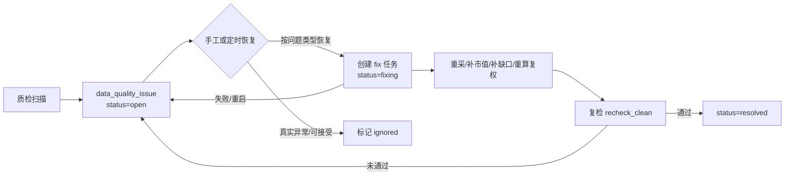

# 数据管理

> 把"公开免费数据源"转成"可解释、可回测、防未来"的本地数据底座：采集入库 → 清洗复权 → 个股四层与指数/板块独立质检 → 修复闭环 → 调度运维，全在「数据管理」页内闭环。

<span style="color:#2563eb">●</span> 采集　<span style="color:#7c3aed">●</span> 质检　<span style="color:#16a34a">●</span> 修复　<span style="color:#dc2626">●</span> 高风险

## 核心技术

### 数据源适配（`backend/datasource/`）
- 主源 **AKShare**（新浪日线/指数/日历/股票列表 + 东财单只估值 `stock_value_em`）、备源 **baostock**（退市股历史、复权因子兜底）。能力按 `capabilities` 声明，编排层 `IngestionService._source_for(capability)` 按能力选源（主源支持→主源，否则备源），不硬编码"谁负责什么"。
- 统一封装**限流**（`rate_limited`，按生效配置 `rate_limit_per_sec`）、**重试**（`with_retry`，指数退避）、**超时**（模块级注入 requests 默认超时）、**兜底**（主源取空→备源）、**溯源**（`data_source_provenance` 记录每段数据来自哪个源）。

### 入库清洗与复权口径（`backend/dataquality/checker.py`、`storage/repository.py`）
- **L1 入库闸门** `sanitize_bars`：收盘价空/≤0 的行直接丢弃（记 `null_close`）；开高低缺失/≤0 用收盘价回填（记 `ohl_repaired`）；零成交量补 0。坏行入库即拦截/标记，不进下游。
- **复权口径分离**（关键正确性约定）：源因子 `adj_factor` 仅用于 K 线前复权；`pre_close`（涨跌停判定基准）走**独立清洗因子**；去抖列 `adj_factor_clean` 是复权查询的统一口径（`COALESCE(adj_factor_clean, adj_factor)`）。`rebuild-price-factors` 全序列重算这三者，不联网、不改源 `adj_factor`。
- **涨跌停与 ST 标记口径**：`daily_bar.limit_status` / `is_one_word` 由 `add_markers` 用原始 `pre_close` 按 A 股分位价格计算，涨停价 = `Decimal(pre_close × (1 + pct), ROUND_HALF_UP)` 到分，跌停价同理；当前入库标记的 `pct` 只用板块限制（主板 10%、创业板/科创板 20%），不把“当前名称含 ST”倒灌为历史 5%，避免把股票非 ST 历史阶段的 5%~10% 正常涨跌误标为涨跌停。`daily_bar.is_st` 仍按当前名称含 `ST` 写入，供默认股票池过滤；它不是点时 ST 时间线。回测撮合另按交易日规则处理 ST 比例：主板 ST 2026-07-06 前 5%、之后 10%，创业板/科创板 ST 20%。

### 市值口径（`daily_metrics` 表，仅 `code, trade_date, float_mv, total_mv` 四列）
- **流通市值 `float_mv`**：新浪日线自带时变流通股本 `outstanding_share`→`float_share`，日线入库时同步算 `float_mv = close × float_share`（[ingest.py:228](../../backend/services/ingest.py)）。随行情天然齐全、永远当前。
- **总市值 `total_mv`**：唯一来源东财单只估值 `stock_value_em`（[akshare_source.py:339](../../backend/datasource/akshare_source.py)）。**无全市场快照可用**（东财全市场现货接口在本环境被封），故全部走**单只逐票取数**，与日线逐只采同量级。
- `total_share/float_share` 存 `stock_basic`（最新快照），不进 `daily_metrics`（避免日线粒度膨胀）。

### total_mv 的四个采集入口（统一走单只 `_valuation_one`，口径一致，[ingest.py](../../backend/services/ingest.py)）
| 入口 | 方法 | 场景 | 范围 |
|------|------|------|------|
| 日常补最新日 | `ingest_valuation_latest()` | 增量更新收尾 | 对"当日有日线但 total_mv 仍空"的在市股逐只取**最新一天** |
| 历史补采（新票） | `ingest_valuation()` | 新上市/新入库 | **整股从没采过 total_mv** 的票补全历史（跳过已有 total_mv 的票） |
| 一次性回补 | `ingest_valuation_gaps()` (`cli valuation --fill-gaps`) | 清存量缺口 | 逐(code,缺失区间)驱动，不受整股跳过限制 |
| 缺口收口 | `reconcile_gaps()` 内顺带 | 补回行情天 | 补回的天顺带补市值 |

> **total_mv 增量语义（重要）**：`update` 收尾只保证**最新交易日**的 total_mv 新鲜；**历史中间缺口不归 update 管**——日线入库每行写 `float_mv`、`total_mv=None`（[ingest.py](../../backend/services/ingest.py)），历史 total_mv 缺口由 `ingest_valuation_gaps`/`valuation --fill-gaps`（或质量页补修）一次性清。所以"跑完增量更新，质检 `mv_gap` 仍显示历史缺口"属**正常**，需补修/`--fill-gaps` 收敛。

`_valuation_one` 只写 `daily_bar` 已有交易日（杜绝游离行）；`total_mv` 覆盖写、`float_mv` 仅空缺回填（日线已写的更准值不覆盖）；最新总/流通股本写回 `stock_basic`。

### 个股四层与指数/板块独立质检（`backend/services/data_report.py`、`dataquality/checker.py`）
统一口径 `_coverage_frame`（全市场一次扫描 + 数据变更签名内存缓存），概览/逐股/质检三处共用同一份，保证数字一致。

| 层 | issue_type | 判定 | 粒度 |
|----|-----------|------|------|
| L1 入库闸门 | `null_close` / `ohl_repaired` | 采集时即时记录 | 逐(code,日) |
| L2 字段契约 | `mv_missing` | 整股从没采过 total_mv/float_mv | 整股 |
| | `mv_gap` | 近 90 交易日逐日市值字段缺口（`total_mv`/`float_mv` 任一为空或缺行） | code 聚合（detail 写区间）|
| L3 正确性 | `abnormal_change` | `\|涨跌\|>板块上限+0.5%` | 逐(code,日) |
| | `adj_jump` | 相邻日前复权价跳变>50% | 逐(code,日) |
| L4 覆盖鲜活 | `data_gap` / `stale` | 近 90 交易日内部缺口/尾部滞后（扣已确认停牌） | 整股 |

市场指数不混入个股 L1-L4 评分，但使用同一 `data_quality_issue` 台账和修复状态机。对当前配置的每只基准指数分别检查：`market_index_gap` 表示未追平全局最新交易日，`market_index_gap_daily` 表示近端某个开市日缺失，`market_index_invalid` 表示非开市日数据、OHLC 非正/越界或成交量额为负。数据目录的 `index_bar` 鲜活度同样要求每只已配置指数都不落后，不再被全表单个最新值掩盖。

- **幂等**：每次质检按 `(issue_type, code, trade_date)` 原地收敛自动问题（个股 L2/L3/L4、市场指数和板块）；仍存在的问题复用 id，本轮消失的问题转为 `resolved`，新问题才新增，反复运行不堆积。
- **事务边界**：全市场问题计算在事务外完成，每条 SQL 结束即释放共享 DuckDB 连接锁；仅最终台账收敛使用短事务。计算失败不改旧台账，落库前会重读生效中的忽略规则，防止覆盖计算期间的人工操作；任务状态与日志查询可在扫描 SQL 间隙继续响应。
- **`mv_gap` 不设上限**：命中多少在市股就写多少条（按 code 聚合），与概览 L2 实时口径完全一致——台账不再静默；缺口大时（如新交易日大面积未补）台账会一次出现大量 `mv_gap`，跑 `valuation --fill-gaps` 或一键恢复后随之清零。
- **通用忽略范围**：所有问题均可选择“仅忽略本次”或“整体忽略”；质量页支持按问题类型、严重度或对象筛选，将范围内全部 `open` 问题批量按所选范围标记正常，默认推荐“仅忽略本次”。前者抑制当前持续事件，完整扫描或成功采集确认异常消失后自动失效；后者按筛选结果中每个稳定业务对象与问题类型持续抑制，直到质量页逐项执行“恢复监控”。无代码的资金流源级问题使用稳定来源标识，未匹配名称使用板块类型与原始名称标识，避免互相误伤。历史 `ignored` 按升级前各类型的精确/整体口径迁移。

### 数据体检（`backend/services/data_verify.py`，与质检互补）
`DataVerifier` 做**结构/正确性/字段契约**逐行核查（孤儿行、键对齐、日历一致、OHLC 序、复权因子、整列字段缺失、在市股逐行市值无缺失），只读不写台账，结果以 PASS/FAIL 报告呈现（`run_structured`）。市场指数的配置覆盖、日历/OHLC 合法性和鲜活缺口已由可写台账的指数质检统一承担，避免只报 FAIL 却无法修复。板块四表（`board_dict/board_member/board_bar/board_fund_flow`）同纳入体检（E 组）：孤儿板块、指数日历一致、OHLC/量额合法、枚举取值（board_type/period）、`has_bar/has_members/has_fund_flow` 能力标记与实际数据双向一致；板块缺口/新鲜度仍归质检台账+修复闭环，体检不重复。可选联网交叉验证（实时重拉对比原价/前复权价），仅 CLI 用。复权因子核查口径与业务一致：`COALESCE(adj_factor_clean, adj_factor)`，源 `adj_factor` 允许 NULL（仅审计，akshare 个别除权日源因子缺失时 clean 已回填前段因子）。

### 异步任务执行模型（终止 / 续跑 / 三类采集差异，[async_task.py](../../backend/services/async_task.py)、[ingest.py](../../backend/services/ingest.py)）

所有写库任务跑在 `async_task` 底座上：写任务全局互斥（同时只允许一个），状态 `pending→running→done/failed/interrupted`。

- **协作式终止**：`cancel` 写入持久化的 `cancel_requested_at` 并设置进程内取消标记，执行器在每只股票/每个问题或业务阶段之间的检查点 `check_cancel()` 命中后抛 `TaskCancelled` → 状态转 `interrupted`。行情并发采集只维持不超过配置并发数的有界在途窗口，不预提交全市场队列；终止时取消未开始项，并只等待当前少量在途工作单元安全退出。数据源限流与重试退避也轮询同一取消标记，因此不会在取消后继续等待下一轮重试；网络请求本身不能强杀，最迟在当前请求返回或超时后进入安全收尾，全部在途线程退出后任务才转终态，杜绝终态之后仍有孤儿线程写库。是否可续跑由 `TASK_CAPABILITIES` 决定；不可续跑任务会明确提示重新完整执行。容错兜底块（缺口收口、补市值这类 `except` 隔离失败的尾部阶段）必须让 `TaskCancelled` 穿透，不得当成"子阶段失败"吞掉——否则终止会被吃掉、任务跑完变 `done`。
- **续跑幂等**：`resume` 读 `result.checkpoint` 重新拉起。续跑不是"跳到中断的阶段"，而是从任务入口重进、各阶段按幂等跳过已完成项（`update`/`ingest_date` 按 checkpoint `done_codes`，`backfill` 按库内 `min(trade_date)` 覆盖判断，补市值按库内 `total_mv` 非空）。日历/指数/基础信息等前置用 `prep_done`/`target_end` 标记，续跑时跳过（已于首跑幂等入库）。
- **并发续跑安全**：新浪日线内部使用 MiniRacer 解码；续跑可能跳过会串行初始化该运行时的日历/指数前置，因此日线适配器必须在进入并发请求前通过进程级锁完成一次性 V8 预热并保留上下文。禁止依赖“首次任务碰巧先调用过某个 AKShare 接口”，否则多个工作线程同时首次初始化会触发不可捕获的原生 FATAL，使服务子进程退出而 checkpoint 留在 `running`；应用重启后由 `reconcile` 标成 `interrupted`，完成项仍可续跑。
- **受控停服安全**：健康端点公开且只公开 `pending/running` 任务数量。会切换后端进程的 E2E/夹具脚本必须先通过 `./start.sh assert-idle` 或 `stop-if-idle` 校验；健康状态或任务数量无法可信读取、或者仍有活跃任务时一律 fail-closed，不得停止服务。`./start.sh restart` 对健康服务执行相同检查，仅在服务已不可用时允许恢复性重启。脚本只有在成功接管后端后才能在退出清理中停服，避免前置检查失败反而触发清理陷阱中断业务任务。

行情采集的三类旧任务共用"日历→指数→逐股日线→刷净复权因子"主链，差异是**刻意**的，不应在服务层强行抹平。Web 新入口统一提交 `stock_ingest`，通过安全场景分派到这些既有服务；旧 `update/backfill/ingest_date/ingest_codes` 任务和历史调度继续兼容：

| 维度 | `update` 增量 | `backfill` 全量补数 | `ingest_date` 指定日期 |
|------|--------------|--------------------|----------------------|
| 目标日 | 自动取“今天”；默认在非交易日或主源未就绪时回退到上一交易日；`force_current_day=true` 时跳过回退并直接尝试当天；续跑用 `target_end` 锁定首跑目标日 | `date.today()` 重算（历史区间，无就绪门，重算无害） | 用户显式 `start/end`（存 `params`，续跑天然不漂） |
| 基础信息 | 读库不刷 | `ingest_stock_basic` 刷名册（建底路径） | 读库不刷 |
| 补市值 | 收尾补最新交易日 + 整股从没市值的票补历史；**历史中间缺口不归 update 管**（见上 `total_mv` 增量语义），需 `valuation --fill-gaps` | 不补（只采行情）；结束报告缺 `total_mv` 数，历史市值请 `valuation --fill-gaps` 一次性回补 | 不补 |
| 收尾 | 缺口收口 + 刷因子 | 刷因子 + 全市场契约校验 | 刷因子 |

> 就绪门/`target_end` 只 `update` 需要：它是唯一自动以"今天"为目标、可能在数据未发布时被定时触发的任务。回退只限定本轮目标，下轮仍重新目标当天；自动缺口收口同样受 `target_end` 限制，不得因库内局部已有当日数据而绕过回退。历史/显式日期任务套就绪门反而会误回退，故保持差异。

### 实时日志规范（任务中心 + CLI 同源，[async_task.py](../../backend/services/async_task.py) `TaskContext`）

- **三段式文案**：`▶ 开始` / `[i/n] 进度` / `■ 完成`；失败用 `error`、可降级/非阻断用 `warn`、正常进度 `info`。
- **及时响应**：长循环每只 `set_phase` 写 `current_phase/current_item/phase_done/phase_total` 到 checkpoint，前端列表与日志抽屉据此显示"阶段·实时计数·当前股"，串行慢任务也逐只可见进展；进度条/日志按批刷新（采集 `i%20`）。`progress()` 顺带 flush，日志攒满 `_LOG_FLUSH_EVERY` 即落库。
- **CLI 一致**：`CliTaskContext` 完整鸭子类型 `TaskContext`，把同一套 `log/progress/set_phase` 映射到 stdout 实时打印；`update`/`backfill`/`ingest_date` 的 CLI 命令均传 ctx，与任务中心同标准（CLI 单次前台执行，不续跑、不协作终止）。

## 业务架构

```
数据源(akshare/baostock)──采集──> 入库闸门 sanitize ──> daily_bar / daily_metrics / stock_basic / index_bar / trade_calendar
        │ 限流·重试·超时·兜底·溯源                          │
        │                                                  ├─ rebuild-price-factors: adj_factor_clean / pre_close / 涨跌停标记
        │                                                  │
   质检 个股/市场指数/板块扫描 ──写──> data_quality_issue 台账 ──修复闭环──> 定向重采/补缺/补市值/重算复权
   体检 DataVerifier ──> PASS/FAIL 报告（不写台账）
        │
   编排: pipeline.DailyPipeline / services.IngestionService（增量 update / 全量 backfill）
   底座: async_task 异步任务 + scheduler 定时调度（见 platform.md）
   目录: data_dimension_registry（数据维度登记，驱动概览展示与扩展）
```

- **前端**（`frontend/src/views/data/`）四子页：`OverviewView`（四层达标率/总分/缺口/最新交易日）、`IngestView`（个股/板块数据采集+任务中心进度日志）、`QualityView`（质检台账+修复 / 结构体检）、`ScheduleView`（时间与依赖调度任务）。
- **API**：`/api/data/*`（[data_admin.py](../../backend/api/data_admin.py)、[data_tasks.py](../../backend/api/data_tasks.py)）。
- **数据维度登记** `data_dimension_registry`：`quote/valuation/basic/index/calendar` 为 `collected`，`shareholders`（股东数据）/`chip_peak`（筹码分布）为 `planned`——扩展新数据类型的骨架（见下"业务流程·扩展"）。

## 页面使用说明书

数据管理不是单个工具页，而是维护全系统数据可信度的闭环工作台。它承担四件事：看状态、采数据、查问题、修问题，并把结果继续传给榜单、筛选、个股和回测。

### 1. 数据概览页：先判断系统能不能用

**入口**：左侧菜单「数据管理 → 数据概览」。

| 区块 | 看什么 | 怎么解读 | 下一步 |
|------|--------|----------|--------|
| 最新交易日 | `daily_bar` 当前最新行情日 | 最新交易日落后说明尚未更新或数据源失败 | 去「数据采集」选择日常同步或日期区间重采 |
| 股票覆盖 | 在市股票数、退市股票数 | 退市股缺失会影响历史回测的幸存者偏差 | 初始化时补跑 `delisted --enrich` |
| 质量分 | L1-L4 各层达标率与综合分 | 分数低不一定都阻断使用，要看 open 高危数和缺口类型 | 点风险摘要跳转到质量台账 |
| 缺口统计 | 有缺口股票数、缺口日合计 | 近端缺口会影响榜单、筛选和回测 | 跳质量页按 `data_gap/stale/mv_gap` 修复 |
| 数据字典/维度 | 已采、计划中、来源、表名 | 判断某个字段是否已经接入系统 | 扩展数据时从 registry 状态推进 |
| 风险摘要 | 服务端预聚合的风险卡片 | 是日常巡检的第一入口 | 按卡片链接逐项处理 |

**推荐读法**：先看"最新交易日"是否到位，再看"高危 open 问题"，最后看"榜单快照是否落后"。榜单快照落后通常只是信息提示，因为榜单按需物化，打开榜单页会自动补算。

**板块数据 tab**：概览页第三个 tab 是板块数据专区——同花顺板块（概念/行业）的规模、覆盖进度（成分/指数/资金流三条链路的 ready/target）、鲜活度（板块指数/资金流快照需同时满足日期不早于全局最新交易日且覆盖率达标；日期追平但覆盖不足显示“未齐”）、质量问题分项与最近采集状态。板块采集的完整闭环（数据源/四表/编排/周频/质检/修复）见 [board-collection.md](board-collection.md)。

### 2. 数据采集页：采集闭环的操作入口

**入口**：左侧菜单「数据管理 → 数据采集」。

该页围绕 `async_task` 工作：用户提交任务，后端立即返回 `task_id`，页面轮询进度、日志和结果。采集、补数、修复这类写库任务全局互斥，同时只能跑一个。质量页提交质检后保持按钮运行态以防重复创建；单次状态查询超时不判定任务失败，页面静默该请求的全局错误提示并自动重试，最终按 `done/failed/interrupted` 显示对应结果。

| 操作 | 对应任务/命令 | 采集内容 | 适用场景 |
|------|---------------|----------|----------|
| 个股采集 | `stock_ingest` | 日常同步、历史行情、日期区间重采、市值历史/缺口、基础资料、退市股历史七类安全方案 | Web 手动与调度的统一入口；可按方案选择全市场或指定股票 |
| 旧行情任务 | `update/backfill/ingest_date/ingest_codes` | 与统一入口对应方案相同 | 历史任务与旧接口继续兼容；旧调度中的可调度类型继续执行，新建 Web 任务不再直接使用 |
| 板块采集 | `board` | 板块字典/成分快照/指数/资金流 | 板块数据（概念/行业），增量或全量回填 |
| 走势相关重算 | `stock_board_correlation` | 最新完整日或固定日，全市场或指定股票；强制重算并原子发布 | 缺失快照首次读取时幂等创建一次；已有结果由「结果维护」手动或用户调度维护；失败保留最后成功结果 |
| 连板天梯失效 | `limit_ladder_invalidate` | 最新完整日或固定起始日及之后；只标记失效 | 「结果维护」手动或用户调度；查询对应日期时按门禁重算 |
| 每日榜单失效 | `recompute` | 最新交易日、固定日或全部评分快照；只标记 stale | 「结果维护」手动或用户调度；下次榜单读取按需重算。榜单页另提供 owner + `board:compute` 的「重算当日」，只精确失效并刷新当前日期/方案/版本；system 可维护可见方案 |
| 连板天梯单日重算 | `limit_ladder_recompute` | 按完整性门禁计算并原子发布指定交易日不可变天梯快照 | 内部任务类型，不开放调度配置；DuckDB `async_task/task_log` 展示执行进度，PG `limit_ladder_task_ledger` 与 `limit_ladder_audit_outbox` 保存跨来源协调和可靠审计事实 |
| 质检扫描 | `verify`/质量扫描 | 四层质量问题，写入台账 | 补数后复查 |
| 数据体检 | `checkup` | 结构/字段契约，只读报告 | 初始化后或重大补数后 |

#### 走势板块相关性任务契约

任务固定经历读取候选、加载行情、批量计算、结果校验和原子切换五阶段；失败保留最后成功正式结果，不生成默认调度。四个直接表格入口按当前页、连板天梯按整份当日快照读取；缺失同日快照时只创建带稳定触发事件的系统首次任务，不同步计算。写槽繁忙时读取保持等待态并在后续业务轮询补建；采集、补数和修复不会触发该任务。算法、有效样本、数据表、页面读取、权限、性能和运维边界统一见 [stock-board-correlation.md](stock-board-correlation.md)。

#### 连板天梯任务契约

「结果维护」的 `limit_ladder_invalidate` 只负责将最新完整日或固定起始日及之后的快照标记失效；采集、补数和修复不再隐式调用该能力。读取失效或缺失日期时，内部 `limit_ladder_recompute` 统一进入完整性门禁、同日活动命令协调和原子发布。执行日志保存在 DuckDB，PG 只保存日期级协调账本与可靠审计 outbox；两库通过 `command_id/task_id/source_event_key` 在服务层对账，禁止跨库 JOIN。内部发布失败或中断时保留最后成功快照，页面最长等待 120 秒。完整模块架构见 [limit-ladder.md](limit-ladder.md)。

个股采集表单由数据采集页与定时调度页复用，服务端只接受方案支持的字段：

| 方案 | `recipe` | 允许参数 |
|------|----------|----------|
| 日常同步 | `daily_update` | `codes`、`concurrency`、`force_current_day` |
| 历史行情补全 | `history_backfill` | `codes`、`years`、`concurrency` |
| 日期区间重采 | `range_refetch` | `codes`、`date_start/date_end`、`concurrency` |
| 市值历史补采 | `valuation_history` | `codes`、`years`、`concurrency` |
| 市值缺口修复 | `valuation_gaps` | `codes`、`concurrency` |
| 基础资料刷新 | `basic_refresh` | 固定全市场，无额外参数 |
| 退市股历史补全 | `delisted_history` | `years`，固定退市股票池 |

省略 `codes` 表示全市场；指定股票时必须是非空数组。采集表单、概览逐股体检和走势板块相关性调度统一使用 `StockCodeMultiSelect`，共同承接远程搜索、批量粘贴、去重和候选错误；非法或超范围代码仍由对应提交接口最终校验并保留原表单输入。并发范围为 1–16，日期区间不可反向。历史行情、日期区间、市值历史/缺口和退市股历史属于高耗时方案，手动提交与保存调度前均显示风险确认。

个股日常同步与板块增量采集统一使用 `force_current_day`：默认在非交易日或当日行情未就绪时退回上一交易日；值为 `true` 时直接尝试当天。全量回填和其他非增量方案不接受该语义。板块资金流沿用本轮板块指数收敛后的目标日。

**采集内容明细**：

| 数据维度 | 表 | 来源 | 下游用途 |
|----------|----|------|----------|
| 交易日历 | `trade_calendar` | AKShare | 每次采集主动请求到下一自然年末，只保存数据源已发布事实；用于补数范围、定时任务交易日判断、回测循环和交易纪律下一日生效 |
| 股票基础信息 | `stock_basic` | AKShare + baostock 兜底 | 股票列表、板块、ST/退市、上市/退市日、点时股票池 |
| 日线行情 | `daily_bar` | 新浪日线/baostock | K线、指标、筛选、榜单、回测撮合 |
| 指数行情 | `index_bar` | AKShare | 中证 500、沪深 300、上证指数、科创 50、深证成指、创业板指；用于回测基准和市场环境对照。增量更新按指数分别计算最新日，新配置指数自动回填系统历史窗口；质检按指数分别识别滞后、单日缺口与非法行，可在质量页定向重采并复检收敛 |
| 流通市值 | `daily_metrics.float_mv` | 日线内流通股本派生 | 股票池过滤、列表展示、市值条件 |
| 总市值 | `daily_metrics.total_mv` | 东财单只估值 | 数据质量 L2、股票池过滤、榜单/筛选市值条件 |
| 溯源 | `data_source_provenance` | 采集服务写入 | 审计某段数据来自主源还是备源 |

**任务状态解释**：

| 状态 | 含义 | 用户动作 |
|------|------|----------|
| `pending` | 已入队，等待线程启动 | 等待或刷新 |
| `running` | 正在执行，日志持续增长 | 观察进度，必要时终止 |
| `done` | 成功完成 | 去概览/质量页确认结果 |
| `failed` | 任务异常结束且无可用 checkpoint | 看日志末尾错误，修复后重新创建任务 |
| `interrupted` | 服务重启或用户终止；是否保留进度取决于任务能力元数据 | 支持续跑的任务可点击「继续任务」；不可续跑任务须从头重建 |
| `failed`（含 checkpoint） | 部分工作单元失败，成功部分保留 | 可点击「重试未完成项」，跳过已完成部分 |

### 3. 数据质量页：质检闭环的操作入口

**入口**：左侧菜单「数据管理 → 数据质量」。

质量页有两类检查：一类是"质检台账"，会把 open/resolved/ignored 问题写入 `data_quality_issue`；另一类是"数据体检"，只读输出 PASS/FAIL，不写台账。

| 问题类型 | 属于哪层 | 代表含义 | 修复动作 | 影响范围 |
|----------|----------|----------|----------|----------|
| `null_close` | L1 入库闸门 | 收盘价为空或非法 | 单日/单股重采 | K线、指标、榜单、回测 |
| `ohl_repaired` | L1 入库闸门 | 开高低异常被收盘价修补 | 核对后重采或忽略 | K线展示、涨跌停判断 |
| `mv_missing` | L2 字段契约 | 整股从未采到市值 | 补市值 | 市值筛选、股票池过滤 |
| `mv_gap` | L2 字段契约 | 近端逐日市值字段缺口 | `valuation --fill-gaps` 或页面修复 | 市值条件与质量分 |
| `abnormal_change` | L3 正确性 | 涨跌幅超过板块上限缓冲 | 重采或人工标记正常 | 回测撮合、涨跌停判断 |
| `adj_jump` | L3 正确性 | 前复权价格跳变异常 | 重采整段并重算复权 | K线、收益率、指标 |
| `data_gap` | L4 覆盖鲜活 | 近 90 交易日中间缺日 | 缺口收口/重采 | 指标连续性、筛选和回测 |
| `stale` | L4 覆盖鲜活 | 尾部行情落后 | 增量更新 | 最新榜单和个股列表 |
| `market_index_gap` | 市场指数 | 已配置指数未追平全局最新交易日 | 补最后已有日到最新日；从未入库则回填系统历史窗口 | 回测基准、个股/板块对比 |
| `market_index_gap_daily` | 市场指数 | 近端某个开市日指数缺失 | 只重采问题对应日期 | 对比曲线连续性 |
| `market_index_invalid` | 市场指数 | 非开市日行、OHLC 非正/越界或量额为负 | 重采异常日指数 | 对比涨跌幅、市场环境 |
| `board_index_gap` | 板块维度 | 板块指数滞后全局最新交易日 | 补最后已有日之后到当前最新日的末尾连续区间 | 板块行情、涨幅榜 |
| `board_index_gap_daily` | 板块维度 | 近端某个开市日指数缺失 | 只重采问题对应日期 | 板块趋势连续性 |
| `board_index_invalid` | 板块维度 | 指数 OHLC/成交字段不合法 | 重采异常日指数 | 板块行情、涨幅榜 |
| `board_member_incomplete` | 板块维度 | 成分快照采集不完整/失败 | 重采该板块成分（绕过周频） | 板块成分、选股池 |
| `board_fund_unmatched` | 板块维度 | 板块资金流未匹配到字典 | 重采资金流 | 板块资金流排行 |
| `board_fund_missing` | 板块维度 | 板块即时资金流未追平最新交易日 | 定向重采资金流 | 板块热度与排行 |
| `board_fund_stale` | 板块维度 | 全源资金流整体滞后 | 重采全源即时资金流 | 板块热度与排行 |

**处理顺序建议**：

1. 先处理 `high` 且 `open` 的问题，尤其是 `data_gap/stale/null_close/adj_jump`。
2. 再处理 `mv_missing/mv_gap`，因为它影响市值过滤但通常不影响价格类指标。
3. 对新股上市首日、退市整理期、长期停牌复牌等真实极端行情，核对后可 `ignored`。
4. 修复任务完成后重新跑质检，确认 open 问题减少或转为 resolved。
5. 如果修复中断，问题会从 `fixing` 自动复位为 `open`，可以重新修复。

**修复闭环图**：



### 4. 定时调度页：把日常维护自动化

**入口**：左侧菜单「数据管理 → 定时调度」。

调度页管理 `scheduled_job`，真正执行仍然走 `async_task`。任务可在“按时间”和“按任务依赖”两种触发方式中二选一，因此手动、时间、依赖和自身重试任务共用同一套互斥、日志、续跑与失败状态。

依赖任务选择一个上游调度任务，并按上游 `done`（成功）、`failed`（失败）或两者之一（完成）触发；人工终止 `interrupted` 不传播。上游通过时间、立即执行、依赖或续跑产生的每次终态尝试都可参与判断。命中后先写入 `scheduled_trigger_event`，到达配置的秒/分钟/小时延迟后再创建下游任务；服务重启或 DuckDB 写任务槽位繁忙时事件保持等待，不按时间调度的冲突跳过语义丢弃。

普通依赖支持多级链路和一对多下游，但每个下游只选一个普通上游，保存时拒绝直接或间接环路。需要循环执行时使用任务自身重试：可按成功、失败或完成结果，以独立固定延迟再次运行，并用最大额外重试次数强制收口。达到上限只结束运行链，最后一次 `async_task` 仍保留真实执行结果。

一对多下游按事件隔离：同一上游命中多个下游时，每个下游分别生成 `scheduled_trigger_event`，单个下游的等待、失败、取消或重试耗尽不影响其它下游。分发器按 `due_at, created_at` 顺序尝试到期事件，因此延迟相同的任务通常按事件创建顺序进入执行判断，延迟不同则以实际到期时间为准。

触发事件同时保存生成时的 `trigger_condition` 规则快照和成功创建下游任务时的 `dispatched_at`，调度页据此展示中文来源结果、命中规则、计划时间和实际触发时间。历史事件新增字段为空时按“—”兼容展示，不反推当前任务配置。

| 任务类型 | 推荐频率 | 交易日限制 | 说明 |
|----------|----------|------------|------|
| `stock_ingest` · 日常同步 | 每个交易日收盘后 | 是 | 新建个股调度的标准入口，更新日常行情与最新市值 |
| `verify` | 每个交易日更新后或隔日 | 可选 | 四层质检写台账 |
| `fix` | 每个交易日质检后 | 可选 | 每条调度选一种质检问题，触发时动态恢复当前 open 问题 |
| `checkup` | 每周/每月 | 否 | 结构与字段体检，耗时可控 |
| `audit_cleanup` | 每日或每周 | 否 | 按 `audit.retention_days` 清理超期审计日志，默认每天 03:30 |
| `board` | 每日（指数/资金流）或每周（成分，周频跳过） | 否 | 支持概念/行业类型、字典/成分/指数/资金流分阶段、增量/回填及成分强刷；与手动采集参数对齐 |
| `stock_board_correlation` | 推荐依赖个股行情或板块采集成功触发 | 是 | 可选全市场或指定股票及同日强制重算；窗口、基准、权重和样本门槛固定由算法版本管理，不生成默认调度 |
| `limit_ladder_invalidate` | 推荐依赖相关行情、ST 或板块数据任务成功触发 | 是 | 保存最新完整日或固定起始日参数；触发时只标记天梯快照失效，不直接重算 |
| `recompute` | 推荐依赖影响评分输入的数据任务成功触发 | 是 | 保存最新完整日、固定交易日或全部快照参数；触发时只标记评分快照失效 |
| `stock_ingest` · 其它方案 | 按运维需要，不建议默认周期执行 | 按方案 | 历史补全、区间重采、市值历史/缺口和退市补全保存前明确高耗时警告 |
| `update/backfill/ingest_date` | 仅旧调度兼容 | 按旧定义 | 继续可读可执行；编辑保存时转换为 `stock_ingest + recipe`，新建列表不再展示 |

时间任务触发时如果已有写任务在跑，本次不会排队，会跳过并记录日志。这是为了避免 DuckDB 单写锁下周期任务堆积；依赖和自身重试事件则必须可靠等待执行槽位，避免上游已经完成但下游永久漏跑。同批到期的多个 DuckDB 写下游由全局单写槽位串行执行：第一个任务进入 `pending/running` 后，其余事件保持 `waiting`，分发器周期重试并在槽位释放后继续执行。只读任务和仅写 PostgreSQL 的任务不占用 DuckDB 单写槽位，可以与 DuckDB 写任务或彼此并行。质检扫描与问题恢复共享写互斥，避免同批质量台账被同时重建和恢复。`fix` 调度任务不保存问题 ID，而是保存单一 `issue_type`；每次触发时再查询该类型当前全部 `open` 问题，无匹配问题时作为成功空跑结束。

结果维护的手动执行参数与调度定义相互独立：手动入口只按当前弹窗参数创建一次任务，不读取或覆盖调度配置；保存调度只登记参数与触发规则，不立即执行。调度自动触发或调度列表的“立即执行”均使用该条调度已保存的结果参数。

同进程内所有异步任务创建共用创建锁，幂等查询、写槽位检查和 `pending` 落库处于同一互斥区间；依赖事件分发与调度定义的新建、修改、启停、删除共用关系锁，避免 `cancelled` 与 `dispatched` 相互覆盖，也避免引用校验与依赖写入交错产生悬空关系。当前部署契约仍是单后端进程；跨进程 DuckDB 写入由文件锁拒绝，不把应用锁误当成跨进程协调器。

### 5. 与其它模块的关联关系

| 上游/下游模块 | 关联点 | 数据管理异常会造成什么 |
|---------------|--------|------------------------|
| 每日榜单 | 读 `daily_bar/daily_metrics/stock_basic`；只有显式 `recompute` 结果维护任务标记 `score_snapshot_meta.stale` | 最新榜单缺日期、评分偏差；需由用户手动执行或配置依赖调度 |
| 策略筛选 | 指标引擎依赖连续 K线、市值、股票池 | 条件误判、表达式指标为空、候选池偏小 |
| 回测验证 | 依赖历史行情、退市股、交易日历、涨跌停、复权清洗 | 幸存者偏差、成交失真、收益率异常 |
| 个股与分组 | K线、指标序列、分组涨幅都读行情和复权 | K线断档、涨幅不准、详情信号为空 |
| 配置管理 | 指标/方案不直接写行情，但读取生效配置影响采集限流、回测成本和审计保留期 | 配置改错可能导致采集过慢、回测成本口径变化或审计清理窗口异常 |

### 6. 日常巡检清单

| 时间点 | 检查项 | 达标标准 |
|--------|--------|----------|
| 每日收盘后 | `stock_ingest · 日常同步` / CLI `daily` 是否成功 | 任务 `done`，最新交易日更新 |
| 每日更新后 | 质量 open 高危数 | 无新增高危；如有进入修复 |
| 每周 | `checkup` 结构体检 | PASS 或已知豁免 |
| 每次大回测前 | 退市股、复权、市值缺口 | 无关键缺口，`verify-data` 通过 |
| 每次发现榜单异常 | 数据概览风险摘要 | 先排除数据问题，再看评分方案 |

## 业务流程

### 1. 新部署数据搭建（依赖有序）
```
建表(init_db,自动) → 交易日历 → 基准指数 → 股票基础 → 日线 backfill(含 float_mv)
  → 退市股 delisted --enrich(补上市/退市日+行业,防幸存者偏差)
  → 全量 valuation(补 total_mv + 写 stock_basic 股本)
  → rebuild-price-factors(去抖因子/pre_close/涨跌停标记)
```
命令：`cli backfill` / `cli delisted --enrich` / `cli valuation` / `cli rebuild-price-factors`。

### 2. 日常运维（`DailyPipeline.run()`，[pipeline.py](../../backend/services/pipeline.py)）
```
增量更新 update(): 日历自愈 → 指数 → 全市场日线增量 → 缺口收口 reconcile_gaps
                 → 刷干净复权因子 → 补最新交易日 total_mv(逐只) → 历史补采(仅整股从没市值的
                   新票)；历史中间缺口不自动补，跑 `valuation --fill-gaps` 一次性清
→ 数据质检（个股四层 + 市场指数 + 板块，统一写台账）
→ (可选) 数据体检 DataVerifier
```
可手动 `cli daily`，或在「定时调度」页配 `stock_ingest` 日常同步以及 `verify`/`fix`/`checkup` 等数据任务按 cron/每日触发（通常仅交易日）；审计日志清理通过 `audit_cleanup` 定时任务执行，不受交易日限制。CLI 继续作为应急和批处理入口，不再是七类常用个股采集能力的唯一入口。

### 3. 质检修复闭环
```
质检发现 → status=open → 手工恢复/按 issue_type 定时恢复 → status=fixing(绑 fix_task_id)
  → 按 issue_type 分派: mv_missing/mv_gap→补市值; data_gap/stale→reconcile_gaps;
     market_index_gap→补指数尾部/首次历史; market_index_gap_daily/market_index_invalid→重采单日指数;
     null_close/ohl_repaired/abnormal_change→单日重采; adj_jump→整段重采重算复权
  → recheck_clean 复检 → 通过=resolved / 未通过=退回 open
任务失败或服务重启 → fixing 孤儿自动复位 open（不留死锁）；ignored 人工豁免幂等不翻回。
```

### 4. 扩展新数据类型（以股东数据/筹码峰为例）
`data_dimension_registry` 已把二者登记为 `planned`。落地需动：① DDL 建表（如 `shareholder_info`）；② 数据源能力 + 取数方法（声明 capability）；③ `ingest_*` 采集服务（`_source_for` 选源）；④ 异步任务类型 + handler（`TASK_TYPES`/`_HANDLERS`，可选可调度）；⑤（可选）质检维度扩 `scan_quality_issues`；⑥（可选）指标注册供选股/打分；⑦ registry 状态 `planned→collected` + 填 `tables`。筹码峰需逐笔/分价成交数据（源待定），数据量与采集成本远高于股东数据，建议先验证股东数据扩展模式。

## 风险事项

| 等级 | 风险点 | 影响 | 建议 |
|------|--------|------|------|
| <span style="color:#dc2626">●</span> 高 | `total_mv` 单数据源、无兜底 | 东财单只 `stock_value_em` 异常时，当日总市值会缺；流通市值主源来自日线、估值源兜底 | 通过 `mv_gap` 质检可见并补修；后续寻找第二总市值源 |
| <span style="color:#f59e0b">●</span> 中 | 日常补 `total_mv` 约 5000 次/日单只请求 | 提高并发可提速，但会增加源端封禁风险 | 在配置里权衡限流/并发，优先稳定 |
| <span style="color:#f59e0b">●</span> 中 | 缺口大时 `mv_gap` 台账量大 | 新交易日大面积未补/存量未回补时，质检会一次写入数千条 `mv_gap`（已去掉上限，与概览口径一致） | 跑 `valuation --fill-gaps` 或一键恢复后台账随之清零 |
| <span style="color:#f59e0b">●</span> 中 | L3 既有问题存量 | 多为新股、退市整理期、复牌或粗粒度复权残留 | 人工核对后标记正常或重采，逐步收敛 |
| <span style="color:#16a34a">●</span> 低 | 退市股缺少少量市值 | baostock 无流通股本，约少量行无法补齐 | 体检已豁免，不影响在市选股 |
| <span style="color:#16a34a">●</span> 低 | 概览 L2 与体检口径不同 | 概览看整股/近端，体检看逐行 NULL，数字可能不一致 | 两者互补：概览看运营状态，体检查细节 |
| <span style="color:#16a34a">●</span> 低 | DuckDB 单写锁 | Web 写任务与 CLI 写操作互斥 | 大型 CLI 写库前先停服务，避免锁争用 |
