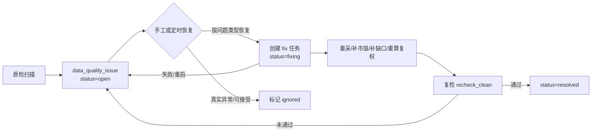

# 数据管理

数据管理将采集入库、质量扫描、问题台账、修复复检与调度串成数据治理闭环。本文说明数据目录接入、鲜活度与质量策略，以及管理页面如何编排各类数据任务。

参考：[个股采集](stock-collection.md) · [板块采集](board-collection.md) · [ST 事实](st-status.md) · [分时归档](stock-intraday.md) · [环境配置](environment-configuration.md) · [任务运行态](task-runtime.md) · [设计规范](../../DESIGN.md) · [项目命令与服务保护](../../AGENTS.md)。

## 核心技术

### 数据源适配（`backend/datasource/`）
- 主源 **AKShare**（新浪日线/指数/日历/股票列表 + 东财单只估值 `stock_value_em`）、备源 **baostock**（退市股历史、复权因子兜底）。能力按 `capabilities` 声明，编排层 `IngestionService._source_for(capability)` 按能力选源（主源支持→主源，否则备源），不硬编码"谁负责什么"。
- 分时使用独立 `intraday_1m` 能力，由 `intraday_ingest` 归档分钟事实与逐日覆盖，查询读取归档且不参与分钟回测。来源与读缓存见 [分时架构](stock-intraday.md)，台账接入见[分时质量闭环](#分时归档与质量闭环)。
- 请求控制统一在真实HTTP发送处：来源登记、共享频率/网络并发/冷却、响应读取容量、超时及有限重试覆盖SDK内部请求、分页、重定向和PreparedRequest。语义重取与传输重试共享逐请求预算，耗尽后不由外层重复放大；BaoStock在SDK查询处执行同一准入，保留会话锁与挂起看门狗。普通非采集外部请求不因未知域名被接管；受控采集中的未登记来源明确停止发送。配置继承、生效与故障边界以[环境与配置加载](environment-configuration.md#行情请求参数与来源能力)为准。
- 主备与溯源继续遵守能力和数据口径，网络成功不替代质量复检。日线与最新市值采用有界取源、编排线程持久化；网络槽不持有到计算和写库结束，断点跟随提交。任务详情区分工作并发、真实网络在途及等锁/执行耗时；来源状态区分PG代表接口探活与Redis运行指标。Baostock提供与日线日期对齐的历史 `isST`；完整闭环见 [st-status.md](st-status.md)。
- 系统配置“测试连通”按来源能力写入 PostgreSQL `data_source_health`：保存最近测试状态、测试时间、失败原因与最近成功时间。普通页面刷新只读取该运行态，不重复访问外部源；失败测试保留上一次成功时间，页面刷新和后端重启都不得清空记录。

### 双库数据资产目录（`backend/storage/catalog.py`）

- `GET /api/data/catalog` 面向系统管理员自动发现 DuckDB `main` 与 PostgreSQL `public` 的物理表和字段，并在服务层合并；两库之间不执行跨库 JOIN。当前事实表与默认隐藏的迁移旧表按实际路由和物理发现结果分类，数量以目录 API 为准。
- 系统目录提供原生类型、可空性、默认值、主键、外键和数据库列注释；代码维护中文名、用途、业务分类、归属范围、数据源、关系、鲜活度策略与质量策略。字段中文名和说明按“表级显式注解 → 数据库列注释/公共词典 → 命名规则生成”解析，并返回来源；任何未识别字段保留为 `fallback`，由目录契约阻断。未登记的新物理表仍以 `unregistered` 展示，不能因缺注解而消失。
- 列表行数使用数据库系统目录的快速估算；只有明确指定 `database + table` 时才允许单表 `COUNT(*)` 精确统计。表名先通过发现结果白名单校验；DuckDB 只报告数据库文件总大小，PostgreSQL 另报告表及索引空间。
- 生命周期为 `active | legacy_readonly | unregistered`。任务运行态复用 `task_runtime_backend()`，平台布局配置复用配置迁移路由函数；受控回滚后事实源和旧表状态随真实 marker 自动切换，不维护第二套路由判断。
- 连板天梯的 7 张 DuckDB 分析事实表、ST 的 4 张行情参考表与 2 张 PG 协调表全部进入目录。四张快照子表分别通过 `snapshot_id` 关联当前有效快照取得最新业务日；ST 日期修订账本展示修订日期范围并按全局最新交易日判鲜活，ST 刷新发布状态、变更历史和失效 outbox 只展示自身更新时间，明确不套用行情鲜活度。
- `GET /api/data/dimensions` 继续保存股东数据、筹码分布等尚无物理表的规划维度；前端将其单列为“规划中”，不与物理表统计混用。

#### 新增或修改表的固定接入流程

新增或修改表、字段及策略统一执行 [数据库接入流程](database-lifecycle.md#接入扩展与变更影响)，其中集中维护 DDL、升级、字段元数据、显式策略及门禁要求。目录 API 继续暴露意外物理表并标记 `unregistered`；这只是可观测兜底，不代表允许带遗漏发布。

鲜活度回答是否追平业务基准，质量问题只统计已配置规则。`open_issues=null` 表示未纳入/不适用，页面显示“—”；`open_issues=0` 才表示已检查且当前零问题。

`indicator_def` 是 DuckDB 中的平台级指标定义资产。其层级、父子预设、参数契约、引用保护、试算和计算语义指纹见 [technical-indicators.md](technical-indicators.md)。结构变更沿用统一数据库接入流程；筛选、评分、买卖方案和回测引用位于 PostgreSQL，在服务层分别读取后内存合并。

### 入库清洗与复权口径

入库闸门由 `backend/dataquality/checker.py` 与采集服务维护，记录拒用或修复证据，质量台账消费同一判定。因子清洗、除权参考价、涨跌停标记和逐日 ST 的源协议由 [个股采集](stock-collection.md) 与 [ST 事实](st-status.md) 维护；本模块不另定义历史限幅或使用投影替代准确事实。

### 股本与市值口径

质量扫描、概览、体检和修复统一消费 `stock_share_capital_daily` 与 `daily_metrics`。逐日来源、有效日期、股本×原价优先及接口证据兜底规则见 [个股采集](stock-collection.md#逐日股本与市值)。本模块负责把字段缺失、业务非法和计算不一致归入业务台账，把原始记录或接口来源差异归入独立来源核验提醒；计算一致不等于来源冲突已解决。

补采与修复复用所属采集服务，不创建展示专用股本；采集完成后仍按本文的固定身份、忽略范围与实际复检规则收口。历史轮询不承诺一次日常更新清空全部历史问题。

<a id="quality-rules"></a>

### 个股四层与指数/板块独立质检（`backend/services/data_report.py`、`dataquality/checker.py`）
统一口径 `_coverage_frame`（全市场批量扫描 + 数据变更签名内存缓存，定向检查按对象过滤且不覆盖全量缓存），概览/逐股/质检三处共用同一份，保证数字一致。缓存签名覆盖行情、市值、基础资料、问题台账和停牌事实；基础资料新增股票或变更上市/退市边界后，立即质检必须重新扫描，不能沿用旧股票池。

概览、逐股质量、目录和维度 API 使用现有 DuckDB 逻辑只读连接池，避免与质检写连接排队；同页并发读取只计算一次全市场覆盖帧，后续请求仍核对数据签名。写任务不等待读端的覆盖帧计算锁，避免与写事务形成锁顺序反转。概览各区独立加载、反馈失败和重试，慢目录或逐股统计不会阻止已完成的核心指标展示，过期请求不能覆盖当前查询结果。

涨跌幅与复权跳变检查在 SQL 中完成历史窗口计算和候选筛选，不把全市场历史明细载入 Python；涨跌幅候选继续调用公共分价舍入规则作最终判定。上市序号、相邻行情和复权归一化均在业务边界过滤前计算，保留上市、退市、ST、停牌间隔及清洗因子的原有口径。

ST 应有日期集合以主键唯一的日线为主体，只对停牌和最新在市股票的补充点去重、排除已有日线后合并；不对千万行日线重复去重，停牌、上市退市和板块范围保持相同口径。

数据概览的分层总览按各层真实度量展示单位：L1/L3 为待处理问题项数，L2 为未达标股票数，L4 为按股票累加的缺口/滞后交易日数。逐股 L1/L3 悬浮原因来自当前台账按问题类型聚合的明细，L2 来自市值缺失/非法分类与日期范围，L4 来自缺口/滞后区间；禁止用固定枚举文案代替该股票实际命中原因。问题对象或类型变化即使总数不变，也必须使覆盖帧缓存失效。

行情、市场指数、板块指数与资金流的滞后统一使用交易日历计数：统计 `(最新数据日期, 基准交易日]` 内 `is_open=true` 的日期，排除周末及节假日；个股继续扣除已确认停牌并尊重存续日期。资金流详情登记 `lag_unit=trading_day` 和各周期 `lag_days`。日历未覆盖区间时明确显示交易日数待核验，保留日期滞后的告警，不以自然日或零值兜底。旧资金流台账（含已忽略/已解决记录）在质量列表读取时按原数据日、问题日转换显示单位，不改原始详情、状态、忽略规则及修复原因。

| 层 | issue_type | 判定 | 粒度 |
|----|-----------|------|------|
| L1 入库闸门 | `null_close` / `ohl_repaired` | 采集时即时记录 | 逐(code,日) |
| L2 字段契约 | `capital_gap` | 已存日线的总/流通股本、总/流通市值缺失；覆盖全部历史及退市股 | 股票聚合、固定空日期身份 |
| | `capital_invalid` | 非正/非有限市值、股数关系、必要来源证据或生效日期非法；公告日期仅作溯源 | 同上 |
| | `capital_mismatch` | 业务市值不等于同日股本×未复权收盘价（容差内不报） | 同上 |
| L3 正确性 | `abnormal_change` | `\|涨跌\|>逐日板块/ST 上限` 且收盘分价越过合法边界 | 逐(code,日) |
| | `adj_jump` | 相邻日前复权价跳变>50% | 逐(code,日) |
| L4 鲜活 | `stale` | 近 90 交易日尾部滞后（扣已确认停牌）；从未有行情的股票从上市日起计 | 整股 |
| L4 全历史覆盖 | `history_data_gap` | 配置历史窗口及更早已入库历史，按上市至退市边界减去已有日线和确认停牌；含退市股 | 股票聚合、固定空日期身份 |
| ST 点时事实 | `st_status_missing` / `st_status_approximate` / `st_status_mismatch` | 缺事实、非权威或日线投影不同步 | code 聚合（detail 写区间） |

市场指数不混入个股 L1-L4 评分，但使用同一 `data_quality_issue` 台账和修复状态机。对当前配置的每只基准指数分别检查：`market_index_gap` 表示未追平全局最新交易日，`market_index_gap_daily` 表示近端某个开市日缺失，`market_index_invalid` 表示非开市日数据、OHLC 非正/越界或成交量额为负。数据目录的 `index_bar` 鲜活度同样要求每只已配置指数都不落后，不再被全表单个最新值掩盖。

- **采集收尾统一入口**：`IngestionService` 的批次采集入口通过 `collection_quality.checked_collection` 合并嵌套阶段的实际对象范围，在正常或部分失败返回前调用既有个股、市场指数和板块扫描；页面任务、调度及 CLI 共用，不逐股重扫。分时继续使用归档服务已有的定向 `sync`。日历采集仍由日历就绪门检查，不另造日历台账类型。
- **扫描范围**：收尾按本次股票/指数/板块对象检查，保留各域历史覆盖及近端鲜活度规则，并非只看刚入库一天。范围包含失败、已完成及断点跳过对象；空范围不扩大成全量。SQL 先过滤对象再聚合，台账收敛和忽略事件对账同步传递范围，不能关闭其它对象的问题。定向板块扫描不收敛无代码的全源资金流滞后问题。立即质检继续主动全量重扫；日常流程对本轮已完成的全市场收尾结果复用，未覆盖域继续扫描。
- **失败边界**：网络错误保留在任务及采集日志，是否建质量台账由已落库事实决定；L1 闸门及不完整成分、资金流未匹配等即时记录继续保留。取消或整体异常中断时不启动成功收尾，已写入数据与即时证据保留；收尾扫描失败向上抛出，任务保留失败/续跑语义，不宣称整个采集闭环成功。每个域先完成计算再短事务收敛，失败域保留旧台账。
- **中断补偿**：采集计划在写入前将待检对象范围合并到原任务检查点 `collection_quality_pending`，收尾成功才清空。续跑先按保存范围检查已落库事实，再按原成功集合跳过取源；补偿扫描失败保留范围，当前批次重新登记自己的待检范围，不把上一子流程的检查结果冒充为本批次成果。升级前没有该字段的旧任务仍在本次采集收尾按完整计划检查。
- **进度反馈**：采集和恢复复用原任务上下文，通过 `TaskProgressScope` 将已有阶段计数映射到父任务区间；逐对象报告已处理量，失败计入处理量但不进入成功断点集合，常规日志继续节流。通用采集预留收尾质检区间，质检展示实际规则组，100% 与任务终态同次写入。显示权重不代表耗时预测，也不增加采集阶段或来源请求参数。普通板块、市场指数修复仅关联复查当前对象，源级资金流恢复保留全源复查。
- **批量恢复取源**：板块指数/成分、市场指数及个股日线缺口/鲜活度、复权因子跳变、股本四类问题按对象归并，复用采集的有界队列并发读取材料；原恢复入口负责主线程持久化、逐条复检和状态/断点提交。个股工作并发沿用 `datasource.update_concurrency`，来源共享额度及 BaoStock 进程池约束不变；取源材料、失败及停牌状态在同股问题间复用，落库前预取下一工作窗口。同股历史缺口先于鲜活问题恢复，仍逐类复检，不能按兄弟问题数量重试备用源。股本事件补充、行情剩余坏行的备用源复核和因子计算继续沿原链路在编排线程执行；单日错价/OHL 等其它恢复仍按原入口处理，不并发整条写库恢复函数。板块服务及资金流原始材料按任务复用，日期与完整性门禁先于缓存。ST三类问题复用一次已有专项刷新及其全市场发布门，子采集检查点隔离于 `issue_done_ids`；分时继续复用按股票分组的归档修复。个股材料仅保留当前对象；所有缓存只在本轮任务内有效，手动重试和续跑可再次取源。
- **幂等**：每次质检按 `(issue_type, code, trade_date)` 原地收敛自动问题（个股 L2/L3/L4、市场指数和板块）；仍存在的问题复用 id，本轮消失的问题转为 `resolved`，新问题才新增，反复运行不堆积。
- **事务边界**：全市场问题计算在事务外完成，每条 SQL 结束即释放共享 DuckDB 连接锁；仅最终台账收敛使用短事务。计算失败不改旧台账，落库前会重读生效中的忽略规则，防止覆盖计算期间的人工操作；任务状态与日志查询可在扫描 SQL 间隙继续响应。
- **通用忽略范围**：所有问题均可选择“仅忽略本次”或“整体忽略”；质量页支持按问题类型、严重度或对象筛选，将范围内全部 `open` 问题批量按所选范围标记正常，默认推荐“仅忽略本次”。前者抑制当前持续事件，完整扫描或成功采集确认异常消失后自动失效；后者按筛选结果中每个稳定业务对象与问题类型持续抑制，直到质量页逐项执行“恢复监控”。无代码的资金流源级问题使用稳定来源标识，未匹配名称使用板块类型与原始名称标识，避免互相误伤。历史 `ignored` 按升级前各类型的精确/整体口径迁移。
- **诊断展示**：质量列表通过 `qualityDetailText` 显示业务说明；未知结构和缺字段分别提示不支持或未记录，不改写台账。所有状态的问题均可通过“查看诊断详情”只读核对完整详情，复用 `data-quality:view`，不触发修复；任务日志保留来源错误及重试原文。分时详情按分钟覆盖、逐来源核验和最近修复分区，完整原文在默认收起的技术详情中查看。

### 股本与市值全历史质量闭环

L2 的三类股本市值问题由 `services/capital_quality.py` 统一判定，具体类型见上表；历史轮询、质量扫描、概览、体检与修复复检共同消费。台账扫描包含全部已入库历史及退市股，不因问题量大截断缺失结果；概览逐股评分只以当前在市股票为对象，但检查每股全部历史。近端统计继续保留，类型计数不能当作去重后的股票数或交易日数。

问题以股票＋类型聚合，`trade_date=NULL` 固定身份，详情保存当前异常日数、起止日期、首个异常日样例和最近采集证据；缺口区间变化不重建 ID。最近核验日志必须显示实际核验范围，不把局部日期的原因计数当作全历史计数。`capital_collect:股票代码` 保存共同采集入口诊断；`capital_review:*` 继续负责历史轮询时间和重试轮转。两者的 checked 记录均不刷新行情数据版本，实际值变化仍由 success 记录驱动下游失效。

质检、采集后同步和问题修复均走现有异步写任务。定向修复使用同一多来源股本采集服务，现有异常市值修复也接入该链路；只有业务规则复检通过才 resolved，业务字段仍缺失或非法时保持 open；仅接口来源价格不同转入来源核验提醒，不继续算业务异常，请求失败清除 fixing 归属并退回 open。扫描复用 fixing 问题身份，不能在任务处理中生成副本或抢先关闭；指定股票同步只处理其自身台账，保留其他股票与人工忽略规则。普通日常更新、统一批量补采/重算在结束时同步台账，包括已不再被缺口选择器选中的股票。

质量页复用既有筛选、批量恢复、类型调度及任务日志；请求成功或来源暂不可得都不能代替复检或人工忽略。

定向同步只收敛指定股票的“仅忽略本次”规则：确认问题消失后该规则失效，之后复发可重新报出；其他股票的忽略规则不受影响。采集返回的问题计数以同步后的 open/fixing 台账为准，不包含仍有效的人工忽略项。

旧 `stock_share_capital_history` 不参与质量统计。原始股本非法记录与接口市值差异作为结构体检的来源核验提醒，不计入业务 L2；缺少有效股本仍报 gap，业务事实非法仍报 invalid。接口证据修订须推进质量缓存输入版本。`stock_ingest/share_capital_history/recalculate_only` 分批重算、支持取消并在结束后同步全历史台账；重算成功不能替代来源核验。

### 全历史日线完整性与范围显示

`HistoryQualityService` 同时供质量台账、概览 L4、修复复检和结构体检使用。检查下界为配置历史起点与库内最早日线中的较早者，上界为库内最新行情日；交易日历与股票上市日、退市日共同决定应有日期，退市当日及之后不要求行情。不能以已有首条行情截断上市后的头部缺口。缺上市日时只从已知首条行情检查，上市日缺失另由基础资料契约报告；北交所不在本项目范围。

近 90 个交易日缺口指标与 `stale` 保留为日常快速定位；全历史问题按股票聚合，日期区间变化不更换问题身份。概览 L4 同时检查历史缺口，点击历史缺口进入对应质量台账；概览的近端缺口卡片仍明确标为近 90 个交易日，不能把两类天数相加当成独立缺口。

缺口修复调用 [历史日线缺口的交易状态收口](stock-collection.md#历史日线缺口的交易状态收口)；只有实际补回日线或取得明确停牌证据后，才能按应有日期复检收口。源端超时、空响应或未知状态不表示永久不可得。

结构体检没有统一的 90 天过滤或窗口选择器：历史行规则覆盖已有历史，日线完整性检查覆盖上述目标区间，快照/运行就绪/跨源抽样遵从各项规则。报告顶部明确说明这一范围，旧市值专项显示近 90 交易日计数只是对照，不限制全历史体检。

### 质量类型归类与兼容边界

`capital_raw_invalid` 仅保留历史兼容与来源提醒；原始记录和接口差异两类提醒不额外计入活动业务类型数量。

质量筛选和调度类型选择共用 `ISSUE_TYPES_ACTIVE` 的顺序及 `sortQualityIssueTypes`：行情、复权、股本市值、ST、市场指数、板块指数、板块成分、板块资金流。同类连续排列，当前可选集合以该注册表为准。默认待办筛选与新调度选项只列活动类型；查看全部/已处理/忽略记录时保留历史类型在末尾。旧调度参数关联统一台账，但按原字段和时间范围筛选、修复及判断本次任务是否成功；只有统一类型全范围复检通过才关闭台账。近端修好而历史仍缺时明确报告剩余问题，不改写用户调度定义或启停状态。

兼容映射：

| 旧类型 | 当前类型 | 兼容边界 |
|---|---|---|
| `mv_missing`、`mv_gap` | `capital_gap` | 缺失字段和实际日期范围保留在详情；统一按股票聚合，不重复报旧市值类型 |
| `mv_invalid` | `capital_invalid` | 旧日期级记录仍可查看及按旧规则复检；新问题统一检查股本与市值 |
| `data_gap` | `history_data_gap`（显示“行情·日线缺口”） | 全历史规则包含近端日期，日常自动收口仍是近端范围，不因此每天重拉全历史 |
| `stale`、ST 三类、板块资金流三类 | 保持独立 | 时效、事实缺失/非权威/投影错误、未映射/源未收录/滞后的修复动作不同 |

旧 open 台账归档时保留原详情和 `merged_into`，明确“类型合并，不是数据已修复”；已解决、人工忽略、fixing 的身份与任务归属不抢占。旧忽略规则仍按原字段、在市股、近端/整段/内部缺口边界作用，不扩大为全部历史股本豁免；旧单次规则在原问题消失后失效。新规则使用统一类型的正常忽略机制。迁移随正式扫描/股本同步执行；SQL 留痕见 [类型合并](../stock-data-ingestion/daily-share-capital/quality-type-consolidation.sql)。

旧的仅来源异常台账可按分类调整为 resolved，但须保留原因和原详情，明确来源尚未修正；不得覆盖人工忽略或抢占 fixing。

### 人工日期与证据修复入口

质量页面的退市操作要求正式退市日期和依据，显示当前日期、接口日期、最后行情日期；不能使用问题发生日或最后交易日默认代填。已解决的历史缺口记录仍提供修正入口。提交后等待互斥修复任务完成，支持撤销人工覆盖并恢复接口值；人工标记退市后仍须检查退市前历史缺口，仅真正通过复检的问题关闭。

停牌证据复查使用现有 `fix` 任务，参考价核验使用现有 `rebuild_price_factors`，不新增质量类型。源端失败与数据缺失分别通过任务结果和现有质量台账表达；停牌复查的 `unverified/errors` 非零或参考价 `unmatched/errors` 非零均不能表述为全部修复成功。证据字段及升级留痕见 [collection-evidence-migration.sql](../stock-data-ingestion/ten-year-history/collection-evidence-migration.sql)，实际结构以 `storage/ddl.py` 为准。

### 分时归档与质量闭环

`intraday_gap/intraday_partial/intraday_invalid` 使用独立“分时”质量层，接入统一台账、任务、修复复检及调度，不混入日线四层评分。个股和指数共用 `intraday_ingest`，采集页与调度页复用 `IntradayTaskScopeFields`；范围、旧参数兼容、来源证据和分钟规则统一见 [分时架构](stock-intraday.md)。

概览和逐股入口见[统计内容与操作映射](#统计内容与操作映射)。来源能力与健康在系统配置“数据治理”中列示，普通查看不联网，只有显式测试访问外网。

### 数据体检（`backend/services/data_verify.py`，与质检互补）

同一组股本/市值关联条件、同表必填字段检查合并为一次条件聚合计数；每项保留独立结论，只有非零命中才按同一条件查询有限样例，不持久化中间全量明细。
`DataVerifier` 做**结构/正确性/字段契约**逐行核查（孤儿行、键对齐、日历一致、OHLC 序、复权因子、整列字段缺失、在市股逐行市值无缺失），只读不写台账，结果以 PASS/WARN/FAIL 报告呈现（`run_structured`）。可写质量扫描还会按板块分价涨跌停上下限检查收盘越界（保留 1 分钱源端舍入容差），并检查成交额/成交量推导的均价是否落在 OHLC 区间；命中后写入质量台账并支持定向重采恢复。市场指数的配置覆盖、日历/OHLC 合法性和鲜活缺口已由可写台账的指数质检统一承担，避免只报 FAIL 却无法修复。板块四表（`board_dict/board_member/board_bar/board_fund_flow`）同纳入体检（E 组）：孤儿板块、指数日历一致、OHLC/量额合法、枚举取值（board_type/period）、`has_bar/has_members/has_fund_flow` 能力标记与实际数据双向一致；板块目标日指数覆盖及资金流五周期覆盖复用质量扫描的计算，在体检中作为 WARN 提示；处置和修复仍归质检台账，体检不写台账。可选联网交叉验证（实时重拉对比原价/前复权价），仅 CLI 用。复权因子核查口径与业务一致：`COALESCE(adj_factor_clean, adj_factor)`，源 `adj_factor` 允许 NULL（仅审计，akshare 个别除权日源因子缺失时 clean 已回填前段因子）。

体检报告的提醒与未通过项统一可展开，不按说明字数决定入口。逐行检查通过同一行查询计算全量命中数与明细，每个条件最多保存 20 条样例，明确区分全量计数与部分样例；组合检查分别展示各条件，字段中文名复用资产目录元数据。连板天梯展示待自愈日期，日历展示检查日、下一开市日和最远开市日等依据；没有可列出对象时展示业务检查说明和处理方向。可选联网核验保存逐日价格对比，无共同交易日或任一实时价格源为空均不能判通过。板块覆盖明细保留忽略状态和精确台账定位；其他样例不伪造台账链接，历史任务未保存的明细需重新运行体检取得。通过项仅有额外依据、明细或说明时提供展开。前端复用 `AppSummaryDisclosureCard` 紧凑摘要及 `AppDataTable/AppTableColumn` 明细表，业务摘要保留完整说明并单行省略，旧分时字典统计兼容转换为中文数量而不改写原始报告；真实截断由统一提示恢复；长说明的通过项也可展开，短计数只在摘要显示，展开区不重复；长篇原始说明和处置正文自然换行。板块对象与 SQL 样例统一为行列模型，布局顺序为摘要、数量/基准日、明细表、处理说明，完整报告序列化包含 `evidence` 与已有的 `items`。

市值校验的时间边界必须明确区分：`DataVerifier` 的 `daily_bar`/`daily_metrics` 键对齐、在市股市值非空、市值为正及总市值/流通市值关系契约不带日期过滤，覆盖库内全部年份；关系比较统一允许万分之一相对误差，避免不同数据源换算和浮点存储尾差形成假阳性。`DataIntegrityReport.null_critical()` 同样统计全表空值和非法值。当前可写台账统一用 `capital_*` 覆盖全部已存历史及退市股，不再重复生成近端 `mv_*` 台账。近 90 个交易日仍用于运营概览分项、日常增量收口和旧市值问题的兼容复检；结构检查没有统一的 90 日限制。

CLI 的 `check-data` 通过 `DataIntegrityReport.run` 输出覆盖与完整性报告，`verify-data` 通过 `DataVerifier.run` 做正确性核查（默认包含联网交叉核验，`--no-cross` 跳过该步骤）；`verify-catalog` 专门检查双库目录契约。它们分别回答覆盖、正确性和目录接入问题，不能用其中一个结果代替其他检查。

### 任务与日志接入

所有长任务复用 [任务运行态](task-runtime.md) 的创建、写槽位、取消、续跑、日志与恢复能力。数据管理只声明本任务的输入范围、检查点粒度及结果是否满足质量条件；不得另建执行或轮询协议。

质量修复在开始处理时绑定 `fix_task_id`，终态前同步实际复检结果；服务重启或任务失败后的孤儿 fixing 由统一恢复入口复位。逐股、逐板块或分钟采集的提交边界、冻结范围和源端错误语义由各采集专题维护，不能用任务 `done` 代替“全部问题已解决”。

## 业务架构

```
数据源(akshare/baostock)──采集──> 入库闸门 sanitize ──> daily_bar / daily_metrics / stock_basic / index_bar / trade_calendar
        │ 限流·重试·超时·兜底·溯源                          │
        │                                                  ├─ rebuild-price-factors: adj_factor_clean / pre_close / 涨跌停标记
        │                                                  │
   质检 个股/市场指数/板块扫描 ──写──> data_quality_issue 台账 ──修复闭环──> 定向重采/补缺/补市值/重算复权
   体检 DataVerifier ──> PASS/FAIL 报告（不写台账）
        │
   编排: pipeline.DailyPipeline / services.IngestionService（增量 update / 全量 backfill）
   底座: async_task 异步任务 + scheduler 定时调度（见任务运行态）
   目录: data_dimension_registry（数据维度登记，驱动概览展示与扩展）
```

- **前端**（`frontend/src/views/data/`）四子页：`OverviewView`（四层达标率/总分/缺口/最新交易日）、`IngestView`（个股/板块数据采集+任务中心进度日志）、`QualityView`（质检台账+修复 / 结构体检）、`ScheduleView`（时间与依赖调度任务）。
- **API**：`/api/data/*`（[data_admin.py](../../backend/api/data_admin.py)、[data_tasks.py](../../backend/api/data_tasks.py)）。
- **数据维度登记** `data_dimension_registry`：`quote/valuation/basic/index/calendar` 为 `collected`，`shareholders`（股东数据）/`chip_peak`（筹码分布）为 `planned`——扩展新数据类型的骨架（见下"业务流程·扩展"）。

## 页面使用说明书

数据管理不是单个工具页，而是维护全系统数据可信度的闭环工作台。它承担四件事：看状态、采数据、查问题、修问题，并把结果继续传给榜单、筛选、个股和回测。

### 1. 数据概览页：先判断系统能不能用

**入口**：左侧菜单「数据管理 → 数据概览」。

#### 统计内容与操作映射

九项概览指标统一消费 `DataMetricCard`，日线四层摘要、逐股分时及最近板块采集的详情统一消费 `DataMetricDetails`。实际指标文案与展示模型在 `frontend/src/views/data/overviewMetrics.ts`，区域和路由操作在 `OverviewView.vue`。

| 指标 | 常驻内容 | 说明入口及补充内容 | 具名操作 |
|---|---|---|---|
| 最新交易日 | 库内日线最大交易日 | `?`：鲜活度基准的含义及覆盖边界 | 无 |
| 在市 / 退市 | 股票基础资料中的两类数量 | `?`：统计范围及退市历史保留 | 无 |
| 日线总行数 | 已入库日线记录总数 | `?`：规模与覆盖、质量的区别 | 无 |
| 分时归档 | 真实分钟行数、目标日完整率 | `i`：目标交易日、完整/应采股票数及指数数、监控股票数及指数数、监控起点、最新归档日及累计完整/部分/缺失的标的交易日 | 包含指数时「查看分时问题」进入统一分时质量台账；仅股票时「查看逐股覆盖」定位本页逐股表；未监控时「去采集分时」进入预填 `intraday_ingest` 的采集页 |
| ST 点时事实 | 权威覆盖率、就绪状态 | `i`：权威/应有、缺失、非权威、发布状态与事实最新日期 | 「刷新 ST 事实」进入预填 `st_status_refresh` 的采集参数页 |
| 板块数据 | 板块数、台账待处理数 | `i`：概念/行业分项及台账边界 | 「查看板块」定位本页板块 tab |
| 日线四层评分 | 日线 L1-L4 全部达标的股票占比评分 | `?`：评分范围及分时独立口径 | 无 |
| 未解决质检 | 未解决台账项数、最高现存严重程度摘要 | `i`：各严重程度数量与最近质检时间，包含独立分时问题 | 「处理问题」进入质量台账 |
| 缺口 / 滞后 | 日线近 90 个交易日有缺口或滞后的股票数 | `i`：累计股票交易日及指标/台账范围差异 | 「查看缺口台账」进入 `history_data_gap,stale` 台账；台账覆盖全历史，数量不与近端指标直接比较 |

**质量摘要区**：展示日线四层达标率和达标股票数，分项问题与规则由统计详情承接；最近质检时间放在本区，不作为整页数据更新时间。日线评分不包含分时质量。实时逐股覆盖与质检台账的扫描时间、忽略状态不同，数值不保证相等。

**数据资产 tab**：提供全部 / DuckDB / PG / 规划中场景，支持业务分类、关键词、迁移旧表筛选，展开查看用途、事实源、生命周期、关系、策略和字段元数据。行数明确区分估算与按需精确统计；质量问题 `0` 表示已检查且零待处理，`—` 表示不适用或未纳入。规划维度不参与物理表统计。

**逐股分层体检 tab**：分时覆盖优先展示整日缺失，其次分钟部分覆盖，无异常时显示完整或暂无归档；未监控单独标明。详情保留完整/部分/缺失分项及监控起点、目标日、最新归档日。异常操作携带股票进入 `intraday_gap,intraday_partial,intraday_invalid` 台账；日线 L1-L4 达标状态只读，异常操作携带股票及对应问题类型进入台账。具体分时统计口径见 [分时归档与质量](stock-intraday.md)。

**板块数据 tab**：展示同花顺概念/行业板块规模、成分/指数/资金流的覆盖进度、日期鲜活度、台账分项与最近采集。覆盖卡保留真实百分比和已覆盖/目标，资金流按行情基准日的同日即时快照计数；最近采集保留业务对象、时间和状态，物理表和长日志放详情。`DataIntegrityReport.board_coverage_summary` 统一计算实际覆盖及 `coverage_handling` 的人工确认/待补采数，只读复用台账的有效忽略规则，不改变事实日期、覆盖分子分母或规则生命周期。同日“仅忽略本次”及适用对象的“整体忽略”单独显示确认数量；未确认缺失仍显示“待补采”，全部缺失已确认且无待处理问题时显示“缺失已人工确认”，不显示采齐或同步；过期、已停用及其他对象/日期的忽略不生效，补齐的数据不再计入人工确认数。指数及资金流日期追平但覆盖不足且仍待补采时显示“未齐”；零待处理问题不表述为整体正常或采齐。板块缺数据时「去采集板块」进入板块采集参数页，问题项进入对应类型台账。完整采集链路见 [板块架构](board-collection.md)。

**展示偏好与布局登记**：核心指标沿用 `visibleItems`，分时使用既有 `intraday` 选项；日线体检沿用 `focusLayer` 与用户列偏好，不增加配置字段。逐股操作组容量由 `AppTableColumn.controlWidth` 承接；布局约束以 `frontend/src/layout/pageRegistry.ts` 和组件 CSS 为准，断点、滚动降级与视口实测登记在[组件清单](../configurable-layout-system/responsive-components.md)及[页面清单](../configurable-layout-system/responsive-pages.md)。

**推荐读法**：先看库内最新交易日，再看未解决台账的最高严重程度，随后检查分时目标日完整率和板块覆盖、鲜活度，通过对应入口定位明细；是否阻断使用按具体问题类型判断，不只看总分。退市基础资料的完整性影响历史回测的幸存者偏差；初始化补齐使用 `delisted --enrich`，不把概览股票数量当作历史覆盖已齐全的证明。

### 2. 数据采集页：采集闭环的操作入口

**入口**：左侧菜单「数据管理 → 数据采集」。

该页围绕 `async_task` 工作：用户提交任务，后端立即返回 `task_id`，页面轮询进度、日志和结果。采集、补数、修复这类写库任务全局互斥，同时只能跑一个。质量页提交质检后保持按钮运行态以防重复创建；单次状态查询超时不判定任务失败，页面静默该请求的全局错误提示并自动重试，最终按 `done/failed/interrupted` 显示对应结果。

| 操作 | 对应任务/命令 | 采集内容 | 适用场景 |
|------|---------------|----------|----------|
| 个股采集 | `stock_ingest` | 日常同步、历史行情、日期区间重采、逐日股本、市值历史/缺口/全历史异常修复、基础资料、退市股历史、ST 状态刷新十类安全方案 | Web 手动与调度的统一入口；按方案选择全市场、指定股票或日期区间 |
| 旧行情任务 | `update/backfill/ingest_date/ingest_codes` | 与统一入口对应方案相同 | 历史任务与旧接口继续兼容；旧调度中的可调度类型继续执行，新建 Web 任务不再直接使用 |
| 板块采集 | `board` | 板块字典/成分快照/指数/资金流 | 板块数据（概念/行业），增量或全量回填 |
| 走势相关重算 | `stock_board_correlation` | 最新完整日或固定日，全市场或指定股票；强制重算并原子发布 | 缺失快照首次读取时幂等创建一次；已有结果由「结果维护」手动或用户调度维护；失败保留最后成功结果 |
| 连板天梯失效 | `limit_ladder_invalidate` | 最新完整日或固定起始日及之后；只标记失效 | 「结果维护」手动或用户调度；查询对应日期时按门禁重算 |
| 每日榜单失效 | `recompute` | 最新交易日、固定日或全部评分快照；只标记 stale | 「结果维护」手动或用户调度；下次榜单读取按需重算。榜单页另提供 owner + `board:compute` 的「重算当日」，只精确失效并刷新当前日期/方案/版本；system 可维护可见方案 |
| 特殊交易日维护 | `stock_special_trading_day` | 经官方公告核验的退市整理首日事实；维护与失效 outbox 原子提交 | 系统管理员通过现有数据任务 API 导入，不开放周期调度；操作见 [天梯架构](limit-ladder.md) |
| 连板天梯单日重算 | `limit_ladder_recompute` | 按完整性门禁计算并原子发布指定交易日不可变天梯快照 | 内部任务类型，不开放调度配置；PG `async_task/task_log` 展示执行进度，`limit_ladder_task_ledger` 与 `limit_ladder_audit_outbox` 保存跨来源协调和可靠审计事实；DuckDB 只保存快照 |
| 质检扫描 | `verify`/质量扫描 | 四层质量问题，写入台账 | 补数后复查 |
| 数据体检 | `checkup` | 结构/字段契约，只读报告 | 初始化后或重大补数后 |

#### 走势板块相关性任务契约

“结果维护”提交 `stock_board_correlation` 强制重算任务，失败保留最后成功结果；首次缺档、写槽繁忙、页面轮询和发布规则统一由 [走势关联架构](stock-board-correlation.md) 维护。采集、补数和修复不隐式重算，也不创建默认调度。

#### 连板天梯任务契约

「结果维护」的 `limit_ladder_invalidate` 只负责将最新完整日或固定起始日及之后的快照标记失效；采集、补数和修复不再隐式调用该能力。读取端还会比较截至所选日的 ST 输入版本：失配时只标记当前日期并复用 `limit_ladder_recompute`，不是批量采集联动。读取失效或缺失日期时，内部任务统一进入完整性门禁、同日活动命令协调和原子发布。任务运行态与执行日志保存在 PG，日期级协调账本与可靠审计 outbox 也在 PG；两库通过 `command_id/task_id/source_event_key` 在服务层对账，禁止跨库 JOIN。内部发布失败或中断时保留最后成功快照，页面最长等待 120 秒。完整模块架构见 [limit-ladder.md](limit-ladder.md)。

个股采集页与定时调度页复用同一方案表单，允许字段、代码范围、年限、截止日及专项模式统一见 [个股采集的方案契约](stock-collection.md#统一采集方案)。本页只维护入口与管理反馈，不另列参数白名单。

采集表单、概览逐股体检和走势板块相关性调度统一使用 `StockCodeMultiSelect` 提供股票/指数候选和领域校验，其通用远程搜索状态、批量粘贴、去重和错误展示复用 `AppMultiSelect`；只允许从已有候选选择，批量粘贴精确核实存在性及标的类型后加入，无效项提示，校验失败保留原选择；对应提交接口仍做最终合法性及范围校验，表单字段和值域消费上述方案契约。历史行情、日期区间、市值历史/缺口/全历史异常修复和退市股历史属于高耗时方案，手动提交与保存调度前均显示风险确认。

日期和强制当日的执行边界分别见 [个股采集](stock-collection.md#日期与源端就绪) 和 [板块采集](board-collection.md#采集模式和日期收敛)。采集与调度表单只按方案展示可用控件，任务结果应展示实际收敛日期及范围；续跑保留已冻结边界，不能把源端回退后日期显示为请求日期。

**采集内容明细**：

| 数据维度 | 表 | 来源 | 下游用途 |
|----------|----|------|----------|
| 交易日历 | `trade_calendar` | AKShare | 每次采集主动请求到下一自然年末，只保存数据源已发布事实；用于补数范围、定时任务交易日判断、回测循环和交易纪律下一日生效 |
| 股票基础信息 | `stock_basic` | AKShare + baostock 兜底 | 股票列表、板块、ST/退市、上市/退市日、点时股票池 |
| 日线行情 | `daily_bar` | 新浪日线/baostock | K线、指标、筛选、榜单、回测撮合 |
| 指数行情 | `index_bar` | AKShare | 中证 500、沪深 300、上证指数、科创 50、深证成指、创业板指；用于回测基准和市场环境对照。增量更新按指数分别计算最新日，新配置指数自动回填系统历史窗口；质检按指数分别识别滞后、单日缺口与非法行，可在质量页定向重采并复检收敛 |
| 流通市值 | `daily_metrics.float_mv` | 同日流通 A 股×本地未复权收盘价优先，接口兜底 | 股票池过滤、列表展示、市值条件 |
| 总市值 | `daily_metrics.total_mv` | 同日总股本×本地未复权收盘价优先，接口兜底 | 数据质量 L2、股票池过滤、榜单/筛选市值条件 |
| 统一逐日股本 | `stock_share_capital_daily` | 东财逐日/变动记录、新浪历史结构/流通序列 | 历史股本、指标、筛选、评分、回测与缺失市值补算 |
| 溯源 | `data_source_provenance` | 采集服务写入 | 审计某段数据来自主源还是备源 |

**任务状态解释**：

| 状态 | 含义 | 用户动作 |
|------|------|----------|
| `pending` | 已入队，等待线程启动 | 等待或刷新 |
| `running` | 正在执行，日志持续增长 | 观察进度，必要时终止 |
| `done` | 成功完成 | 去概览/质量页确认结果 |
| `failed` | 任务异常结束且无可用 checkpoint | 看日志末尾错误，修复后重新创建任务 |
| `interrupted` | 服务重启或用户终止；是否保留进度取决于任务能力元数据 | 支持续跑的任务可点击「继续任务」；不可续跑任务须从头重建 |
| `failed`（含 checkpoint） | 部分工作单元失败，成功部分保留 | 可点击「重试未完成项」，跳过已完成部分 |

### 3. 数据质量页：质检闭环的操作入口

**入口**：左侧菜单「数据管理 → 数据质量」。

质量页有两类检查：一类是"质检台账"，会把 open/resolved/ignored 问题写入 `data_quality_issue`；另一类是"数据体检"，只读输出 PASS/FAIL，不写台账。

问题判定见[质量规则](#quality-rules)及对应采集专题；本表用于选择修复动作。

| 问题类型 | 修复入口 | 影响范围 |
| --- | --- | --- |
| `null_close` | 单日/单股重采 | K线、指标、榜单、回测 |
| `ohl_repaired` | 核对后重采或忽略 | K线展示、涨跌停判断 |
| `capital_gap` | 按股票做全历史多来源股本市值补采并复检 | 市值、股本指标、筛选和股票池 |
| `capital_invalid` | 多来源核验、补采并按同一全历史规则复检 | 市值、股本条件与质量分 |
| `capital_mismatch` | 核对逐日事实与来源证据，补采后复检 | 市值、股本条件与质量分 |
| `abnormal_change` | 重采或人工标记正常 | 回测撮合、涨跌停判断 |
| `adj_jump` | 重采整段并重算复权 | K线、收益率、指标 |
| `history_data_gap` | 全历史缺口恢复，查询交易状态并定向补采 | 指标连续性、筛选和回测 |
| `stale` | 增量更新 | 最新榜单和个股列表 |
| `market_index_gap` | 补最后已有日到最新日；从未入库则回填系统历史窗口 | 回测基准、个股/板块对比 |
| `market_index_gap_daily` | 只重采问题对应日期 | 对比曲线连续性 |
| `market_index_invalid` | 重采异常日指数 | 对比涨跌幅、市场环境 |
| `board_index_gap` | 补最后已有日之后到当前最新日的末尾连续区间 | 板块行情、涨幅榜 |
| `board_index_gap_daily` | 只重采问题对应日期 | 板块趋势连续性 |
| `board_index_invalid` | 重采异常日指数 | 板块行情、涨幅榜 |
| `board_member_incomplete` | 重采该板块成分（绕过周频） | 板块成分、选股池 |
| `board_fund_unmatched` | 重采资金流 | 板块资金流排行 |
| `board_fund_missing` | 按问题日期和缺失周期定向重采 | 板块热度与排行 |
| `board_fund_stale` | 按问题日期和滞后周期重采全源 | 板块热度与排行 |

板块与大盘指数批量修复先复检本地事实，普通采集已经补齐的旧问题直接收敛为已解决，不重复请求；板块来源会话仅在仍有缺口时创建，再进入有界材料取源和原恢复入口落库。成分问题由完整采集原子关闭，旧快照数量不能证明新一轮问题已经修好。取消后只把已经完成落库复检的对象记入完成检查点。

**处理顺序建议**：

1. 先处理 `high` 且 `open` 的问题，并优先核对 `history_data_gap/stale/null_close/adj_jump` 等行情、复权问题。
2. 再处理 `capital_gap/capital_invalid/capital_mismatch`；它们影响股本、市值指标、筛选、评分和回测股票池。
3. 对新股上市首日、退市整理期、长期停牌复牌等真实极端行情，核对后可 `ignored`。
4. 修复任务完成后重新跑质检，确认 open 问题减少或转为 resolved。
5. 如果修复中断，问题会从 `fixing` 自动复位为 `open`，可以重新修复。

**修复闭环图**：



### 4. 定时调度页：把日常维护自动化

**入口**：左侧菜单「数据管理 → 定时调度」。页面保存 `scheduled_job`，执行复用统一任务底座；选择按时间或按任务依赖触发，必要时配置有次数上限的自身重试。

主表 `/api/data/schedules` 服务端分页和排序；上游候选从 `/api/data/schedules/options` 独立远程搜索，不受主表当前页限制。依赖结果条件、延迟、事件可靠等待、关系排序和重试身份统一见 [任务运行态](task-runtime.md#时间调度依赖与重试)。时间任务遇写槽繁忙会跳过；依赖和重试事件等待，页面必须明确区分。

任务行「下游任务」抽屉包含全部直接下游（含停用项），支持排序后统一保存，版本冲突须刷新。触发记录分别展示来源、命中规则、计划/实际时间和执行状态；缺失历史字段显示空值，不推算。抽屉内部滚动，切换任务或关闭后旧请求不能覆盖新内容。

| 任务类型 | 推荐频率 | 交易日限制 | 说明 |
|----------|----------|------------|------|
| `stock_ingest` · 日常同步 | 每个交易日收盘后 | 是 | 新建个股调度的标准入口，更新日常行情与最新市值 |
| `verify` | 每个交易日更新后或隔日 | 可选 | 四层质检写台账 |
| `fix` | 每个交易日质检后 | 可选 | 每条调度选一种质检问题，触发时动态恢复当前 open 问题 |
| `checkup` | 每周/每月 | 否 | 结构与字段体检，耗时可控 |
| `audit_cleanup` | 每日或每周 | 否 | 按 `audit.retention_days` 清理超期审计日志，默认每天 03:30 |
| `board` | 每日（指数/资金流）或每周（成分，周频跳过） | 否 | 支持概念/行业类型、字典/成分/指数/资金流分阶段、增量/回填及成分强刷；与手动采集参数对齐 |
| `stock_board_correlation` | 推荐依赖个股行情或板块采集成功触发 | 是 | 可选全市场或指定股票及同日强制重算；窗口、基准、权重和样本门槛固定由算法版本管理，不生成默认调度 |
| `limit_ladder_invalidate` | 推荐依赖相关行情或板块数据任务成功触发；ST 变化已有读取自检，只有需要盘后预维护时才配置 | 是 | 保存最新完整日或固定起始日参数；触发时只标记天梯快照失效，不直接重算 |
| `recompute` | 推荐依赖影响评分输入的数据任务成功触发 | 是 | 保存最新完整日、固定交易日或全部快照参数；触发时只标记评分快照失效 |
| `stock_ingest` · 其它方案 | 按运维需要，不建议默认周期执行 | 按方案 | 历史补全、区间重采、市值历史/缺口/全历史异常修复和退市补全保存前明确高耗时警告 |
| `update/backfill/ingest_date` | 仅旧调度兼容 | 按旧定义 | 继续可读可执行；编辑保存时转换为 `stock_ingest + recipe`，新建列表不再展示 |

`fix` 调度只保存一种 `issue_type`，触发时查询当前 open 问题；无匹配问题是成功空跑。手动结果维护只按当前弹窗执行一次，保存调度不立即执行，调度列表“立即执行”使用该条定义已保存的参数。采集调度是否启用由用户决定，系统不能因文档、台账或流程变更自动启用。

### 5. 与其它模块的关联关系

| 上游/下游模块 | 关联点 | 数据管理异常会造成什么 |
|---------------|--------|------------------------|
| 每日榜单 | 读 `daily_bar/daily_metrics/stock_basic/stock_st_status_daily`；显式 `recompute` 可批量标 stale，读取还会比较 `param_hash` 与当日 ST 版本 | ST/参数变化由当前读取自愈；其它行情或基础资料变化需由用户按影响范围手动执行或配置依赖调度 |
| 策略筛选 | 指标引擎依赖连续 K线、市值、股票池 | 条件误判、表达式指标为空、候选池偏小 |
| 回测验证 | 依赖历史行情、退市股、交易日历、涨跌停、复权清洗 | 幸存者偏差、成交失真、收益率异常 |
| 个股与分组 | K线、指标序列、分组涨幅都读行情和复权 | K线断档、涨幅不准、详情信号为空 |
| 配置管理 | 指标/方案不直接写行情，但读取生效配置影响采集限流、回测成本和审计保留期 | 配置改错可能导致采集过慢、回测成本口径变化或审计清理窗口异常 |

### 6. 日常巡检清单

| 时间点 | 检查项 | 达标标准 |
|--------|--------|----------|
| 每日收盘后 | `stock_ingest · 日常同步` / CLI `daily` 是否成功 | 任务 `done`，最新交易日更新 |
| 每日更新后 | 质量 open 高危数 | 无新增高危；如有进入修复 |
| 每周 | `checkup` 结构体检 | PASS 或已知豁免 |
| 每次大回测前 | 退市股、复权、市值缺口 | 无关键缺口，`verify-data` 通过 |
| 每次发现榜单异常 | 数据概览风险摘要 | 先排除数据问题，再看评分方案 |

## 业务流程

### 1. 新部署数据搭建（依赖有序）
```
数据库初始化与验收 → 交易日历 → 基准指数 → 股票基础 → 日线 backfill(含 float_mv)
  → 退市股 delisted --enrich(补上市/退市日+行业,防幸存者偏差)
  → 全量 valuation(补逐日总/流通股本和市值，投影最新行情日股本)
  → rebuild-price-factors(去抖因子/pre_close/涨跌停标记)
```
数据库准备遵守 [数据库初始化与升级](database-lifecycle.md#机制新装升级验收与失败恢复)。行情命令：`cli backfill` / `cli delisted --enrich` / `cli valuation` / `cli rebuild-price-factors`。

### 2. 日常运维（`DailyPipeline.run()`，[pipeline.py](../../backend/services/pipeline.py)）
```
增量更新 update(): 日历自愈 → 指数 → 全市场日线增量 → 缺口收口 reconcile_gaps
                 → 刷干净复权因子 → 补最新交易日四字段(逐只) → 历史股本市值分批轮询复查
                   日线日常收口为近端；更早缺口由 history_data_gap 定向修复
→ 数据质检（个股四层 + 市场指数 + 板块，统一写台账）
→ (可选) 数据体检 DataVerifier
```
可手动 `cli daily`，或在「定时调度」页配 `stock_ingest` 日常同步以及 `verify`/`fix`/`checkup` 等数据任务按 cron/每日触发（通常仅交易日）；审计日志清理通过 `audit_cleanup` 定时任务执行，不受交易日限制。CLI 继续作为应急和批处理入口，不再是十类常用个股采集能力的唯一入口。

### 3. 质检修复闭环
```
质检发现 → status=open → 手工恢复/按 issue_type 定时恢复 → status=fixing(绑 fix_task_id)
  → 按 issue_type 分派: capital_*→多来源股本市值补采; history_data_gap/stale→reconcile_gaps;
     market_index_gap→补指数尾部/首次历史; market_index_gap_daily/market_index_invalid→重采单日指数;
     null_close/ohl_repaired/abnormal_change→单日重采; adj_jump→整段重采重算复权
  → recheck_clean 复检 → 通过=resolved / 未通过=退回 open
任务失败或服务重启 → fixing 孤儿自动复位 open（不留死锁）；ignored 人工豁免幂等不翻回。
```

### 4. 扩展新数据类型（以股东数据/筹码峰为例）
`data_dimension_registry` 已把二者登记为 `planned`。落地需动：① DDL 建表（如 `shareholder_info`）；② 数据源能力 + 取数方法（声明 capability）；③ `ingest_*` 采集服务（`_source_for` 选源）；④ 异步任务类型 + handler（`TASK_TYPES`/`_HANDLERS`，可选可调度）；⑤（可选）质检维度扩 `scan_quality_issues`；⑥（可选）指标注册供选股/打分；⑦ registry 状态 `planned→collected` + 填 `tables`。筹码峰需逐笔/分价成交数据（源待定），数据量与采集成本远高于股东数据，建议先验证股东数据扩展模式。

## 风险事项

| 等级 | 风险点 | 影响 | 建议 |
|------|--------|------|------|
| <span style="color:#dc2626">●</span> 高 | 历史披露及跨源数值证据不足 | 源端市值缺失时虽可按同日股本补算，但无前置股本记录、源端非法数值及跨源数值冲突仍需核验 | 使用逐股诊断定位原因、补采和公告核验；不以当前股本倒填 |
| 中 | 全市场取源及历史修复成本 | 吞吐受来源额度、输入规模与写入开销共同限制 | 复用共享请求策略和有界处理，不以提高并发绕过限流 |
| <span style="color:#f59e0b">●</span> 中 | 缺口大时统一台账量大 | 按股票和类型聚合全历史异常，仍可能产生数千条待办 | 分批恢复后复检；只有实际修好才关闭 |
| <span style="color:#f59e0b">●</span> 中 | L3 既有问题存量 | 多为新股、退市整理期、复牌或粗粒度复权残留 | 人工核对后标记正常或重采，逐步收敛 |
| <span style="color:#16a34a">●</span> 低 | 退市股历史股本/市值缺失 | 免费源历史覆盖有限，可能影响含退市股的历史研究 | 逐日股本体检包含退市股；缺失保持可见，不据此删除历史股票池成员 |
| <span style="color:#16a34a">●</span> 低 | 概览与体检统计粒度不同 | 概览按股票、体检按异常行统计，均纳入统一股本质量事实 | 区分股票数与日期行数，避免直接相加 |
| <span style="color:#16a34a">●</span> 低 | DuckDB 单写锁 | Web 写任务与 CLI 写操作互斥 | 大型 CLI 写库前先停服务，避免锁争用 |

来源冲突具备归档、提醒和重试，但没有通用自动真值裁决或独立完整人工核验工单；指定日期核验事实导入不是自动公告识别。日常历史轮询按 [个股采集的范围与重试契约](stock-collection.md#自动转股补充与历史轮询)有界执行，不能承诺一次修完全部历史或更早记录。已存日线四字段齐全不代表应有日线齐全，也不代表来源已经核实；当前规模及未结数量以目录、台账和任务结果为准。
