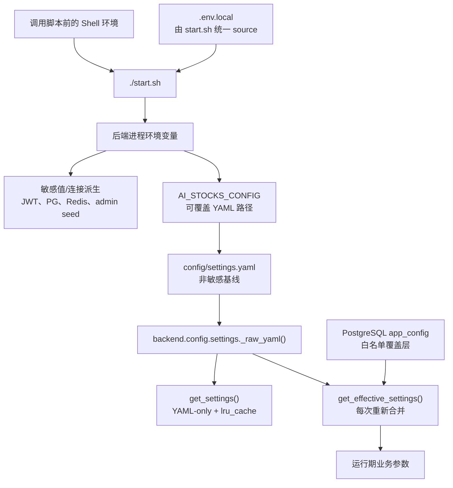

# 环境与配置加载

> 本文是环境变量、变量文件、YAML 基线配置和数据库配置覆盖层的唯一技术入口。其它 README、AI 协作入口和模块文档只保留链接，不重复加载细节。

## 核心技术

### 1. 配置来源分层

| 层级 | 当前用途 | 代码入口 | 生效边界 |
|------|----------|----------|----------|
| Shell 环境变量 | 进程启动前注入的密钥、连接串、脚本开关 | `os.environ` | 已启动进程通常不会感知外部 shell 后续变化；测试可用 `monkeypatch` 改当前进程 |
| `.env.local` | 本机后端敏感变量模板的实际文件 | `start.sh` | 由 `./start.sh` 的服务、`dev-users` 和 `e2e-user` 动作统一读取；直接 `python -m backend.cli ...` 与 `./start-web.sh` 不自动读取 |
| `config/settings.yaml` | 非敏感默认值、路径、端口、运行参数基线 | `backend/config/settings.py` | `get_settings()` 缓存；改 YAML 后需 `/api/config/reload` 或重启刷新缓存 |
| PostgreSQL `app_config` | Web 系统设置白名单覆盖值 | `backend/storage/app_config.py` | `get_effective_settings()` 每次重合并，下一次读取即生效；PG 不可用时回落 YAML |
| PG 布局配置表 | 布局预设、页面默认、组件字段开放策略、页面布局/组件用户层 | `backend/storage/layout_config.py` | `effective` 一次返回 preset/page/user 层与字段策略，前端结合代码 default 按 `default < preset < page < user` 合并 |
| PG 用户偏好表 | 主题、导航模式、页面业务偏好、K 线偏好、回测参数记忆、设置抽屉跨页面偏好 | `backend/storage/user_preference.py`、`/api/user-preferences` | 只保存当前登录用户自己的偏好；未登录或接口失败时前端使用本地 fallback |
| 方案/业务表 | 评分、买卖、筛选、定时任务等业务配置 | 各 repo/service | 不属于环境变量链路，按对应模块的版本和权限规则生效 |

### 2. 环境变量总表

| 变量 | 消费入口 | 用途 | 必填性与默认 | 生效时机 |
|------|----------|------|--------------|----------|
| `AI_STOCKS_CONFIG` | `backend/config/settings.py::_config_path()` | 覆盖 YAML 基线文件路径 | 可选；缺省为 `config/settings.yaml` | `get_settings()` 缓存后需 reload 或重启；`get_effective_settings()` 每次读原始 YAML |
| `AI_STOCKS_JWT_SECRET` | `Settings.jwt_secret()`、`backend/auth/jwt_tokens.py`、`backend/main.py` startup | JWT HS256 签名密钥 | 后端启动必填；无弱默认 | 启动自检会校验；已运行服务变更后需重启确保一致 |
| `AI_STOCKS_CONFIG_ENCRYPTION_KEY` | `backend/security/config_crypto.py`、`AppConfigRepo` | 页面敏感配置的 Fernet 主密钥；数据库只保存带 `enc:v1:` 前缀的密文 | 使用页面 Cookie 配置时必填；无弱默认，不得与 JWT 密钥复用 | 保存、解密及启动迁移时读取；轮换前须先完成密文重加密 |
| `AI_STOCKS_CONFIG_ENCRYPTION_KEY_FILE` | 同上 | 指向仅后端进程可读的 Fernet 密钥文件；仅当直接变量为空时读取 | 可选；生产优先使用受控文件，权限必须为 `0600`，否则拒绝读取 | 同上 |
| `AI_STOCKS_PG_DSN` | `Settings.pg_conninfo()` | PostgreSQL 完整连接串，优先级最高 | 可选；配置后覆盖 YAML 的 PG host/port/db/user 和 `AI_STOCKS_PG_PASSWORD` | 新建 `PostgresClient` 时读取；已创建连接池需重启或重建客户端 |
| `AI_STOCKS_PG_PASSWORD` | `Settings.pg_conninfo()` | PostgreSQL 密码，配合 YAML 连接参数 | 可选；本机 trust 可不填 | 新建 `PostgresClient` 时读取 |
| `AI_STOCKS_REDIS_URL` | `Settings.redis_url()` | Redis 完整 URL，优先级最高 | 可选；配置后覆盖 YAML 的 Redis host/port/db 和 `AI_STOCKS_REDIS_PASSWORD` | 新建 `RedisClient` 时读取；已创建客户端需重启或重建 |
| `AI_STOCKS_REDIS_PASSWORD` | `Settings.redis_url()` | Redis 密码，配合 YAML 连接参数 | 可选；无密码 Redis 可不填 | 新建 `RedisClient` 时读取 |
| `AI_STOCKS_SMTP_ENABLED` | `Settings.mail_config()` | 是否真实发送邮件（注册验证码等）；关闭时降级为 dev 日志、不真发 | 可选；覆盖 YAML `mail.enabled`（基线 false） | 每次 `get_effective_settings().mail_config()` 读取；改 `.env.local` 后需重启进程 |
| `AI_STOCKS_SMTP_USERNAME` | `Settings.mail_config()` | SMTP 登录账号/发信邮箱 | 真实发信必填；覆盖 YAML `mail.username`（基线留空） | 同上 |
| `AI_STOCKS_SMTP_SENDER` | `Settings.mail_config()` | From 显示地址；留空回落 `username` | 可选；覆盖 YAML `mail.sender` | 同上 |
| `AI_STOCKS_SMTP_PASSWORD` | `Settings.smtp_password()`、`backend/common/mailer.py` | SMTP 登录密码/授权码（Gmail 等用应用专用密码） | 真实发信必填；无弱默认 | 真实发信时读取 |
| `AI_STOCKS_THS_COOKIE` | `backend/datasource/ths_board.py::_login_cookie_from_config()` | 同花顺板块登录态 Cookie 头，优先覆盖页面加密配置；不进入审计明细 | 可选；不配置也能采集，只是被登录墙截断（概念 375→390） | 新建 `ThsBoardSource` 实例时读取；变更后重建实例或重启 |
| `AI_STOCKS_THS_COOKIE_FILE` | 同上 | 指向权限受控的 Cookie 文件；仅当 `AI_STOCKS_THS_COOKIE` 为空时读取，生产优先使用受控文件避免凭证出现在进程环境导出中 | 可选；优先级低于 `AI_STOCKS_THS_COOKIE` | 同上 |
| `AI_STOCKS_ADMIN_PASSWORD` | `backend/storage/pg_ddl.py::seed_default_tenant()` | 首次 seed 或补齐 `admin` 密码哈希 | 生产/共享环境必须显式设置；缺失会随机生成并只在日志告警一次 | 仅在 `admin` 不存在或 `password_hash` 为空时使用；不会覆盖已有密码 |
| `AI_STOCKS_TEST_USER_PASSWORD` | `backend/devtools/rbac_test_users.py`、`frontend/e2e/helpers/auth.ts` | `debug_*` 本地调试账号与 Playwright 登录统一密码 | 可选；本地开发未设置时回落测试默认值 | 执行 `./start.sh dev-users` 创建/校准及 `npm run test:e2e(:ui)` 启动时读取 |
| `AI_STOCKS_ENV` / `ENV` | `backend/devtools/environment_guard.py` | 调试账号与 E2E 临时数据写入的环境白名单 | 执行调试数据写入时必填；仅 `dev/development/local/test/testing` 放行，空值、未知值和生产值全部拒绝 | `dev-users`、后端 E2E 健康检查和临时用户夹具每次执行时读取 |
| `AI_STOCKS_E2E_WRITE` | `backend/devtools/environment_guard.py`、`/api/health/e2e` | 允许 Playwright 创建并物理销毁临时 PG 用户 | 默认未启用；只有精确值 `1` 放行，且必须同时满足本地/测试环境白名单 | 启动被测后端和执行 Playwright 时必须同时显式传入；回归结束后重启后端移除 |
| `AI_STOCKS_E2E_LOGIN_BYPASS` | `backend/devtools/environment_guard.py::e2e_login_rate_bypass_enabled()`、`backend/services/auth_service.py::login` | 豁免登录接口的单 IP 限流（`login_rate_per_min`），供全量 Playwright 三视口并行密集登录 | 默认未启用；须 `AI_STOCKS_ENV=dev/test/local` + `AI_STOCKS_E2E_WRITE=1` + 本变量=`1` 三重门控同时成立。仅放开 login 的 IP 限流，账号锁定/失败计数/验证码等其余防滥用不受影响；生产（prod 强制去 E2E_WRITE）永不满足 | 仅全量 E2E 临时使用；启动被测后端时显式传入，回归结束后重启后端移除 |
| `AI_STOCKS_DUCKDB_READ_ONLY` | `backend/storage/duckdb_client.py::get_client()`、`backend/storage/ddl.py::init_db()` | 后端以只读模式连接 DuckDB（不持单文件写锁、跳过 DDL/sequence 初始化） | 默认未启用（读写）；仅值为 `1` 时只读。DuckDB 写锁互斥（写模式下连只读连接也无法并存），故需独占写锁的受控夹具进程（如 `e2e-backtest-run` 种子/清理）与被测后端并存时，后端必须以只读启动 | 仅 E2E 临时使用；生产/日常保持缺省读写。回归结束后重启后端移除 |
| `AI_STOCKS_DUCKDB_READ_POOL_SIZE` | `backend/storage/duckdb_client.py::get_read_client()` | 覆盖 DuckDB 逻辑只读连接池大小 | `0..32`；缺省读 `duckdb.read_pool_size=4`，设 `0` 会回退到专用写连接串行查询 | 启动时读取，修改后重启 |
| `AI_STOCKS_TASK_STORAGE_BACKEND` | `backend/storage/task_runtime.py` | 选择任务/日志/调度运行态存储 | `auto`（默认）只在 PG 存在 `migration.task_runtime_pg_v1` applied 标记后使用 PG；标记不可读时 fail-closed，不猜测切库；`duckdb` 仅用于已执行受控回退后的紧急切回；`postgres` 缺标记也会 fail-closed | 启动时读取，禁止运行中切换或双写 |
| `AI_STOCKS_ENV_FILE` | `scripts/load-local-env.sh` | 覆盖后端和 Playwright 启动器要读取的变量文件路径 | 仅自动化验证变量加载器时使用；日常缺省为仓库根目录 `.env.local` | `start.sh` 及 `scripts/run-playwright.sh` 启动子进程前 |
| `AI_STOCKS_FILE_LOG` | `backend/common/logging.py` | 直接运行 CLI 时额外写 `logs/ai_stocks.log` | 可选；仅值为 `1` 且未被日志收集器托管时开启；此兼容文件不参与服务归档 | `start.sh` 启动的服务始终只由收集器写 `logs/backend.log`，避免额外产生不受清理的副本 |
| `PYTHON` | `start.sh` | 选择后端启动脚本使用的 Python 可执行文件 | 可选；默认 `python` | 必须在调用 `./start.sh` 前的 shell 环境中设置；当前脚本在读取 `.env.local` 前确定该值 |
| `WEB_PORT` | `start-web.sh` | 选择 Vite dev server 端口 | 可选；默认 `5173` | 必须在调用 `./start-web.sh` 前的 shell 环境中设置；该脚本不读取 `.env.local` |

> 邮件 `mail.*` 采用「YAML 安全基线 + 环境变量覆盖」：`config/settings.yaml` 的 `mail` 段默认 `enabled=false`、账号留空（个人/部署账号不入仓库），真实开关与账号由上表 `AI_STOCKS_SMTP_*` 覆盖（`Settings.mail_config()` 叠加），密码只走 `AI_STOCKS_SMTP_PASSWORD`。另有 `server.trust_forwarded_for`（YAML，默认 `false`）控制是否信任 `X-Forwarded-For` 作为限流键 IP——直连公网时保持 false（用 socket 连接地址，防伪造头绕过 per-IP 限流），仅在可信反代会覆盖 XFF 时置 true。

> 同花顺 Cookie 的来源优先级保持“环境变量 > 受控文件 > 页面加密配置”。`ths_board.cookie_validity_days` 默认 30 天，仅对具有可靠保存时间的页面配置计算到期提醒；环境变量和文件不伪造到期日。数据源“测试连通”会访问匿名态受限的概念深页验证登录态，明确登录墙记录为失效，网络、限流或上游异常只记录校验失败。脱敏校验结果保存在 `app_config` 内部运行键，Cookie 替换或清除时同步失效旧结论。

前端代码没有项目自定义 `VITE_*` 运行配置。当前只使用 Vite 内置的 `import.meta.env.MODE` 和 `import.meta.env.DEV` 做测试/开发期分支；API 基址固定为同源 `/api`，开发期由 Vite proxy 转发到 `127.0.0.1:8000`。

后端 pytest 会在 `backend/tests/conftest.py` 模块导入期用 `os.environ.setdefault("AI_STOCKS_JWT_SECRET", "...")` 注入测试默认密钥，部分用例再用 `monkeypatch` 覆盖或删除环境变量。该默认值只服务测试进程，不代表应用运行有默认 JWT 密钥。

## 运维与开发说明书

### 1. 变量文件

| 文件 | Git 状态 | 自动加载者 | 职责 |
|------|----------|------------|------|
| `.env.local.example` | 跟踪 | 无 | 本机模板，只放变量名和示例注释，不放真实密钥 |
| `.env.local` | 忽略 | `./start.sh`、`npm run test:e2e(:ui)` | 本机后端服务、受控 devtool 与 Playwright 变量，可写 `KEY=value` 或 `export KEY=value` |
| `.env` / `.env.*.local` | 忽略 | 当前脚本无自动读取 | 保留给人工或外部工具，项目脚本不依赖它们 |
| `config/settings.yaml` | 跟踪 | 后端配置模块 | 非敏感基线配置；敏感值不写入 |

`duckdb.read_pool_size/read_acquire_timeout_sec/slow_query_ms` 是启动期非敏感基线，分别控制逻辑只读连接数、借连接最长等待和慢查询告警阈值。DuckDB 要求同一进程连接使用一致打开配置：默认服务的读连接物理上仍是 read-write 配置，由 statement type 校验只允许单条 `SELECT`/读 PRAGMA/`EXPLAIN`；`AI_STOCKS_DUCKDB_READ_ONLY=1` 时写连接和读池统一以物理只读配置打开。

`start.sh` 与 `scripts/run-playwright.sh` 通过 `scripts/load-local-env.sh` 在项目根目录执行
`set -a; source .env.local; set +a`，因此 `.env.local` 里的变量会同时进入后端服务、
`./start.sh dev-users`、`./start.sh e2e-user` 和 Playwright 子进程。前端认证 helper 只读取
已经导出的进程变量，不再实现一套不完整的 `.env.local` 文本解析。直接运行 Python CLI 或
`playwright test` 仍不会自动 source 该文件；需要 PG/JWT/Redis 配置的调试账号维护必须走
受控 `start.sh` 动作，E2E 必须走 npm 脚本，避免连接到与后端不同的存储或使用不同登录密码。
`AI_STOCKS_ENV_FILE` 只为加载器自动化回归提供临时变量文件，不作为日常多环境切换入口。

会物理清理临时用户资产的 Playwright 用例还有两层额外保护：

1. 后端与 Playwright 进程都必须明确处于 dev/test/local 环境并设置
   `AI_STOCKS_E2E_WRITE=1`，否则 `/api/health/e2e` 与 Python 夹具均拒绝执行。
2. 后端从实时 PG 连接生成不可逆指纹；夹具在创建和销毁前用同一算法校验指纹，避免 `.env.local`
   PG 覆盖未传导或后端运行中切库时误写、误删另一数据库。

`./start.sh prod` 不信任变量文件里的环境标记：启动生产模式前会强制
`AI_STOCKS_ENV=production` 并移除 `AI_STOCKS_E2E_WRITE`，因此误把本地 `.env.local`
复制到生产也不会开放调试数据写入口。

### 环境身份与运行模式

`start.sh` 的 `dev/prod` 参数控制热重载与监听方式，`AI_STOCKS_ENV`（兼容回落 `ENV`）控制调试工具的环境守卫。开发启动不会自动补 `AI_STOCKS_ENV=dev`，因此两者必须分别核查。

已确认的本机开发环境在 Git 忽略的 `.env.local` 中持久化 `AI_STOCKS_ENV=dev`；这让后续 AI 会话执行 `./start.sh dev-users --list` 时自动继承标记，无需每次手写前缀。不要把个人变量文件内容整体输出到日志或对话。共享/生产部署必须使用对应真实环境值；普通页面验收不设置 E2E 写入或限流豁免开关。

在仓库根目录按以下顺序核查：

1. 执行 `./start.sh status`，确认当前 PID 与服务就绪；脚本核对 `/api/health` 的 `status=up`、DuckDB/PG/Redis 状态及可信任务数，不能仅凭 HTTP 200 判断正常。DuckDB 健康探测实际读取 `stock_basic`，避免数据库失效时 `version()` 仍可执行造成误报。存储降级但 PG 任务数可信时，安全停服仍可执行。
2. 读取 `logs/backend-runtime.json` 的 `pid`、`mode`、`safeEnv.AI_STOCKS_ENV`（兼容 `safeEnv.ENV`）与 `envFile`；PID 必须匹配。档案不存在或 PID 不匹配时标记为未知，不能将历史档案当作当前进程状态。
3. `.env.local` 是后续命令与启动的配置，不会更新已运行进程；改动会让旧档案的变量文件摘要失配。需要生效时先通过脚本检查并停止空闲服务，再按原启动模式启动，禁止伪造或手工改写运行档案绕过校验；随后重新确认健康、PID 和环境标记。
4. 执行 `./start.sh dev-users --list`，成功列出所需启用账号后按最小权限选择账号。若提示 `<unset>`，检查变量加载与环境配置；已经确认本地用途时补齐标记再试，不能据此直接跳过页面验收。账号缺失的维护流程见 [test-users.md](../multi-tenant-rbac/test-users.md)。

运行档案仅保存恢复所需的安全字段和摘要，不是认证授权凭据；`dev` 标记也不能代替 E2E 写入授权和数据库指纹校验。

### 文件日志归档与清理

`start.sh` 与 `start-web.sh` 通过 `scripts/service_logs.py` 收集各自服务及子进程的 stdout/stderr，覆盖应用日志、Uvicorn、Vite 与启动异常。收集器与服务分别使用独立 session；后端原有 PID/进程组和运行档案契约不变，热重载仍共享同一输出管道，服务组退出后收集器读到 EOF 退出。每个日志路径使用文件锁保证单写入者，初始化失败时不启动业务进程。脚本托管时内部设置 `AI_STOCKS_LOG_COLLECTED=1`，阻止应用额外写一份 `ai_stocks.log`；该内部标记不需要用户配置。

策略读取 YAML 基线 `logging`，遵循 `AI_STOCKS_CONFIG`，不读取 PG `app_config`。修改后须重启对应服务，不随应用热重载或 `/api/config/reload` 更新。

| 配置项 | 后端 | 前端开发服务器 |
|--------|------|----------------|
| 当前文件 | `logs/backend.log` | `logs/frontend.log`，非 5173 实例为 `logs/frontend-{port}.log` |
| `max_file_mb` | 50 MiB | 20 MiB |
| `retention_days` | 30 天 | 7 天 |
| `total_size_mb` | 1024 MiB | 200 MiB，每个端口独立计算 |

- 按北京时间跨日或达到单文件大小上限滚动，归档示例为 `logs/archive/backend.2026-10-21.000001.log.gz`。同日序号递增，重启不覆盖当前文件或已有归档。字节流按大小切分，极长单行或 UTF-8 字符可能跨文件；分析此类原文时按日期和序号拼接解压内容。
- 启动时清理过期与超容量归档；运行中每 `logging.cleanup_interval_sec` 秒检查一次（默认 300 秒），没有日志输出也检查跨日和过期。新产生输出时同步检查日期和大小。保留期按归档日期计算，删除早于“北京时间今日减保留天数”的文件；容量超限时优先删除最旧归档，因此不保证保留满上述天数。
- 当前文件另受单文件上限约束，不计入归档总量。首次遇到旧的大文件先整体移动，压缩延后至运行期维护，避免阻塞启动握手。压缩用临时文件完成后原子替换，成功前保留原始归档；中途退出或压缩失败留下的原文在后续维护重试，未压缩原文也计入容量限制。
- 只清理当前日志 basename 的受管归档，不删除其他端口、其他服务或未知命名文件。现有 `logs` 动作使用 `tail -F`，归档更换文件后继续跟踪。
- 该策略只管理脚本启动的文件日志。PG 的 `task_log` 仍执行每任务 2,000 条与启动时 30 天清理，`audit_log` 仍按 `audit.retention_days` 和审计清理调度执行；浏览器控制台错误不自动采集到 Vite 日志。

### 2. YAML 基线与缓存

`get_settings()` 只负责 `config/settings.yaml` 基线读取和 Pydantic 校验，结果用 `lru_cache(maxsize=1)` 缓存。它不能访问数据库，因为 DuckDB/PG/Redis 客户端初始化会依赖 `get_settings()`，在这里合并数据库覆盖层会形成初始化环。

`reload_settings()` 只清 `get_settings()` 缓存并重读 YAML。`GET /api/config` 返回 YAML-only 的 `get_settings()` 结果；`POST /api/config/reload` 适用于人工修改 YAML 后刷新基线缓存，不负责写数据库覆盖层。

股本历史自动轮询的 YAML 基线参数为 `datasource.capital_review_batch_size`（默认 50，0 关闭）和 `capital_review_interval_days`（默认 7）；读取有效配置时生效，未增加 Web 覆盖项。它们控制日常采集内部复查，不改变调度任务的启停。

### 3. 生效配置与数据库覆盖层

运行期业务参数应优先调用 `get_effective_settings()`。它每次读取 YAML 原始 dict，再从 PostgreSQL `app_config` 读取白名单覆盖项，按点分路径深合并后重新校验为 `Settings`。

PostgreSQL `app_config` 是当前系统设置覆盖层的权威表：

| 字段 | 含义 |
|------|------|
| `key` | 点分路径，例如 `datasource.update_concurrency` |
| `value` | JSON 字符串，保留布尔、整数、浮点等类型 |
| `updated_at` | 覆盖值最后更新时间 |

写入口是 `AppConfigRepo.set_many()`，只接受 `CONFIG_GROUPS` 派生出的 `WHITELIST`，并逐项做类型、枚举和范围校验；任一项非法则整批拒绝。当前 Web 系统设置按访问安全、数据治理和研究运行组织认证、数据源、同花顺板块、审计、回测成本及界面基线等白名单配置；隐藏的 `scheduler.*` 只服务旧配置迁移。

同名的 DuckDB `app_config` 仍存在于旧 DDL 中，但不再作为运行期系统设置覆盖层。DuckDB 旧配置表只允许作为旧版本迁移读取源和回滚依据保留；新增运行期系统配置不要写 DuckDB `app_config`。

布局与用户偏好不走 `app_config`：

| 配置类型 | 权威表 | 说明 |
|----------|--------|------|
| 布局预设 | PostgreSQL `layout_preset` | 系统管理员维护的布局预设层 |
| 页面布局默认 | PostgreSQL `layout_page_config` | 单页面 page 层默认值 |
| 组件字段开放策略 | PostgreSQL `layout_field_policy` | 控制组件字段可开放到 preset/page/user 的策略 |
| 页面布局/组件用户层 | PostgreSQL `layout_user_config` | 只保存真实 pageKey 的布局与组件用户层；组件路径保存必须带真实 `PageLayout` 校验归属 |
| 非布局用户偏好 | PostgreSQL `user_preference` | 主题、导航、K 线、页面业务偏好、回测参数记忆等 |
| 设置抽屉跨页面偏好 | PostgreSQL `user_preference` | `scope='global'`、`pref_key='settings-drawer'`；`size`、全局一级 `collapsedSections`、按页面隔离的 `collapsedGroups`，旧 `defaultCollapsed` 仅兼容读取 |

#### 行情请求参数与来源能力

系统配置「数据治理」是采集请求参数、访问凭据和数据源能力/健康的统一管理入口；调度页只管理任务。`backend/datasource/request_policy.py` 维护生效请求策略，`backend/services/data_sources.py` 的能力清单供界面列示和显式测试。AKShare 是接入器，不是单一网站；主备选择仅控制支持切换的行情能力，股本、分时与板块仍按各自接入契约取源。

| 配置 | 统一消费口径 | 生效边界 |
|---|---|---|
| `datasource.update_concurrency` | 单任务工作单元默认上限；任务显式并发参数优先；分时按股票并发取源，归档、来源证据和 checkpoint 由主线程收口 | 任务开始确定；BaoStock 共享会话及同花顺板块会话保持串行 |
| `datasource.rate_limit_per_sec` | 实际来源的请求起始频率上限；Redis TIME + 原子脚本跨线程/进程合计，分页和重试计入；新浪行情/分时共享 `sina`，东财股本/估值/分时共享 `eastmoney`，上交所使用 `sse`，同花顺股票分钟和板块分别保护 | 下一次网络尝试；等待支持取消，不持有覆盖整个HTTP响应的排他锁；Redis失败不绕过保护 |
| `datasource.socket_timeout_sec` | 每次网络尝试的连接和读取超时；不是总任务时限；requests唯一发送包装覆盖AKShare内部HTTP及直连接口 | 下一次请求；在途请求保持已有值 |
| `datasource.max_retries` | 最多尝试次数，包含首次；嵌套重试装饰器共用外层预算，避免次数相乘；多接口业务操作不等于一个HTTP请求 | 开始一次请求操作时读取 |
| `datasource.retry_backoff_sec` | 指数退避起点，如2秒对应2、4、8……秒；限流与退避均可取消 | 新尝试序列读取；同一序列沿用快照 |
| `datasource.baostock_login_timeout_sec` | 仅登录等待；登录后恢复普通请求超时；SDK适配器的进程会话锁覆盖登录、查询、游标读取、失效清理及退出，采集与探活共同受保护 | 下一次SDK查询读取 |
| `ths_board.min_interval_sec` | 板块接口最小起始间隔，与通用请求频率取更严格值；不用于股票分钟 | 下一次板块请求 |

`ths_board.timeout_sec/max_retries/retry_backoff_sec` 是保留的旧显式覆盖，默认 NULL 表示继承通用配置。已有 YAML/PG 自定义值不删除、不改写，系统页的「旧请求覆盖」可查看，关闭「单独设置」并保存为 NULL 后恢复继承；实际来源行显示「保留旧显式覆盖」及有效参数，避免误以为通用设置已经覆盖了它。历史回填年限、板块成分更新间隔、Cookie期限和访问凭据分别归入范围、业务规则与凭据，不与网络参数混用。Cookie保持环境变量 > 受控文件 > 页面加密配置，不回显原文。

能力表分别列示新浪行情、BaoStock、东财股本/估值、上交所股本核验、同花顺板块和三种分时来源，展示使用范围、有效频率/超时/尝试/退避、任务并发上限及BaoStock登录超时。新浪行情以日历接口作代表测试，股本与上交所分别使用轻量估值/转股统计请求；测试通过只证明代表接口返回有效响应，不保证该来源的全部接口或数据覆盖。Cookie登录态独立校验，不能由匿名接口连通推断。

查看来源状态仅读PG最近测试，不触网；`data-source:test` 仍是系统级权限，显式测试可按来源单项执行，全部测试逐项更新。未保存配置时禁用测试，避免把草稿当成生效值。历史测试/最近测试成功时间保留，新增能力在首次测试前显示未测试；并发结果按实际测试时间收敛，较旧结果不得覆盖较新状态或丢失成功记录。无需重置真实 `app_config`、健康记录或菜单。

### 4. 读取规则

| 场景 | 应使用 |
|------|--------|
| 启动期路径、DuckDB 文件、PG/Redis 连接参数、服务端口 | `get_settings()` + 环境变量派生方法 |
| 数据源限流/并发/超时、回测成本、认证开关/限流、审计保留期等运行期参数 | `get_effective_settings()` |
| 布局预设、页面默认和组件字段开放策略 | `LayoutConfigRepo` 读取 PG 布局配置表 |
| 页面布局/组件用户偏好 | `/api/layout/users/{pageKey}`，保存真实 pageKey 且组件路径带真实 `PageLayout` |
| 主题、导航模式、工作页签折叠、页面业务偏好、K 线偏好、回测参数记忆 | `/api/user-preferences` / `/api/user-preferences/bulk` |
| 评分方案、买卖方案、筛选方案 | 对应 profile/version 表，不走环境变量 |
| 定时任务定义 | `scheduled_job` 表，不再用 `scheduler.*` 作为运行态配置 |
| 调试账号密码 | `AI_STOCKS_TEST_USER_PASSWORD` 只在 dev-users 命令运行时读取 |

新增配置项时先判断它是敏感启动变量、非敏感 YAML 基线、Web 可改运行期参数、平台布局配置、用户自有偏好，还是业务资产配置。敏感值只放环境变量；可由系统管理员在线修改的运行期参数必须进入 `CONFIG_GROUPS` 白名单并落 PostgreSQL `app_config`；布局配置使用 PG 布局配置表；登录用户自有 UI/页面偏好使用 `user_preference`；方案类配置应进入对应业务表并保留版本/归属规则。

工作页签折叠保存为 `scope=global`、`pageKey=""`、`prefKey=workspace-tabs`、`value.collapsed`，首次默认 `true`。本地缓存按租户/用户隔离；仅待同步的手动意图优先于旧远端，写回成功后恢复远端权威，避免立刻刷新丢失选择。

### 5. 前端 localStorage 边界

localStorage 不作为登录用户配置或偏好权威。在配置与偏好链路中，允许范围仅限：

| 用途 | 说明 |
|------|------|
| 登录态 token | 当前认证存储仍由 `frontend/src/api/authToken.ts` 管理，不属于本配置链路 |
| 登录前主题读取 | 首屏可先读本地主题，登录后以 `user_preference(global/theme)` 同步 |
| 离线/接口失败 fallback | 页面可继续使用旧本地值渲染，不能宣称云端已保存 |
| 旧偏好迁移源 | 登录后由前端迁移器一次性迁到 PG，并写迁移 marker |
| 临时交互态 | 例如临时搜索草稿，不进 PG；页面设置折叠属于已声明的持久偏好，按 DESIGN.md“设置抽屉”执行 |

`stockSet` 这类“当前股票集合/工作上下文”不是配置项，也不按用户偏好权威处理；如果后续要云端化，应按用户资产或工作集单独设计。

## 风险事项

| 等级 | 风险点 | 影响 | 建议 |
|------|--------|------|------|
| ● 高 | 直接运行 CLI 不加载 `.env.local` | CLI 可能缺 JWT/PG/Redis 环境变量并连接错误数据库 | 调试账号与 E2E 临时用户只通过 `./start.sh dev-users/e2e-user` 执行；夹具另校验后端实时 PG 指纹 |
| ● 高 | 环境标记或 E2E 写开关不明确 | 在生产、共享公网或不确定环境创建/物理删除测试数据 | 调试写入环境白名单 fail-closed；E2E 物理写还须 `AI_STOCKS_E2E_WRITE=1`，结束后立即移除并重启后端 |
| ● 高 | `AI_STOCKS_ADMIN_PASSWORD` 不覆盖已有密码 | 以为改变量即可改 admin 密码，但已有 `password_hash` 不会被 seed 覆盖 | 生产首部署前设置好；已有账号改密走系统功能或专门维护脚本 |
| ● 中 | 连接客户端缓存了初始化时的 DSN/URL | 改 PG/Redis 环境变量后旧连接池仍使用旧连接信息 | 改连接类变量后重启服务 |
| ● 中 | `get_settings()` 与 `get_effective_settings()` 用错 | Web 覆盖值不生效，或启动期初始化访问数据库形成依赖环 | 启动期用 `get_settings()`，运行期业务参数用 `get_effective_settings()` |
| ● 低 | PG `app_config` 不可用时静默回落 YAML | Web 改参看起来保存了，但读取时回退默认值 | 排查时同时看后端日志、PG 连接和 `/api/data/settings` 的 overridden 状态 |
