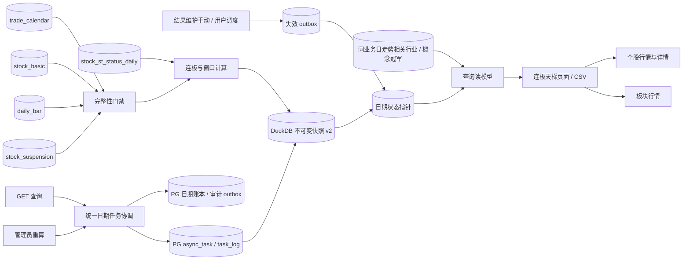

# 连板天梯模块

## 模块定位

连板天梯是「最新行情」下的 EOD 市场复盘模块。它按交易日识别收盘涨停股票，以连续涨停高度组织天梯，并把窗口活跃度、走势相关热点、个股行情分析、任务治理和权限审计串成一条闭环。

> 模块只覆盖主板、创业板和科创板，不含北交所；它不替代按评分方案生成的每日榜单，也不提供盘中实时天梯。

需求范围和验收见 [`../limit-up-ladder/requirement.md`](../limit-up-ladder/requirement.md)，实际任务与验证见 [`../limit-up-ladder/plan.md`](../limit-up-ladder/plan.md) 和 [`../limit-up-ladder/development-trace.md`](../limit-up-ladder/development-trace.md)。

## 核心技术

| 层次 | 当前实现 | 关键入口 |
| --- | --- | --- |
| 市场规则 | 按交易日、上市板块和点时 ST 判断收盘涨停；已确认无涨跌幅日不计涨停，未知规则 fail-closed | `backend/market_rules.py`、`backend/limit_ladder/rules.py` |
| 点时 ST | 当前事实、不可变变更历史与日期修订账本；质量只允许从 `approximate` 升到 `accurate` | `backend/services/stock_st_status.py` |
| 连板计算 | 批量加载行情；连续板回溯到中断或上市边界，不受 60 日窗口截断 | `backend/services/limit_ladder_calculator.py` |
| 快照发布 | coverage 门禁、不可变版本、四档窗口指标冻结、状态指针原子切换 | `backend/services/limit_ladder_snapshot.py` |
| 查询读模型 | 读池查询与单写状态切换分离；统一筛选、摘要、热点、短历史字段、CSV 和同日走势冠军合并 | `backend/services/limit_ladder_query.py` |
| 日期任务协调 | 查询首算、显式失效后的按需刷新、兼容管理 API 重算共享同日活动命令 | `backend/services/limit_ladder_task_coordinator.py`、`backend/storage/limit_ladder_task_repository.py` |
| 执行与审计 | PG 保存任务进度/日志、日期协调账本和可靠审计 outbox；DuckDB 保存天梯快照 | `backend/services/async_task.py`、`backend/storage/pg_ddl.py` |
| 页面 | 主从工作台、天梯卡片、热点、设置、窄屏抽屉和详情返回 | `frontend/src/views/LimitLadderView.vue`、`frontend/src/views/limit-ladder/` |

## 系统架构

DuckDB 与 PostgreSQL 不做跨库 JOIN。协调器通过不可变 `command_id`、PG `task_id` 和审计 `source_event_key` 在服务层关联任务运行态与 DuckDB 快照。

## 业务流程

### 查询与首次物化

1. `GET /api/limit-ladder/{trade_date}` 校验交易日和筛选参数。
2. 查询入口用逻辑只读池检查规则版本、日期状态及截至 T 日的已发布 ST 输入版本；pending 失效事件补偿和版本失配后的 `invalid` 状态切换显式走进程内唯一 DuckDB 写连接。版本为空或变化时只处理当前 T 日，不扫描其它日期。
3. 首次无快照或当前快照失效时调用 `ensure_date_task()`；失效快照先重查 coverage，只有上游已完整时才自动刷新。同日已有 `requested/running` 命令则直接复用；`partial/failed` 等未就绪终态直接返回原因，禁止查询轮询反复创建必然失败的任务。ST 批次处于 `refreshing/failed` 时保留旧指针但返回 `ST_STATUS_NOT_READY`，不创建重算任务。
4. PG 中的 `limit_ladder_recompute` 运行态驱动执行器完成 DuckDB coverage、计算和原子发布。
5. 页面分别为天梯快照计算和同日走势相关首次计算设置 120 秒硬截止轮询；同一阶段后台更换 `command_id/task_id` 不得重置截止时间，阶段切换后重新计时。成功后读取新版本，失败、未就绪或中断时停止等待，保留最后成功快照并显示原因和恢复动作。

### 计算与发布

1. 以 `list_date <= T` 且 `delist_date IS NULL OR delist_date > T`（退市当天起排除）的主/科/创股票构造点时股票池。
2. 每只股票在 T 日必须存在有效日线或确认停牌事实；点时股票池以“有效日线 + 确认停牌”闭合且不存在缺失、非法行情或不支持规则时即可发布。采集终态 `partial/failed` 保留为诊断事实，但已被确认停牌完整解释的无行情不再误判为缺失；仍有未解释缺口时继续拒绝发布。
3. 只把 T 日收盘涨停股票作为候选，继续向前批量读取，直到每只股票出现未涨停、停牌、缺行情或上市边界。
4. 一次计算 10/20/31/60 日涨停次数、后复权累计涨幅、实际起始日和实际交易日数。
5. 概念成员按 `first_seen_date IS NULL OR first_seen_date <= T` 取点时兼容集合；在同一 DuckDB 事务写入快照元数据、股票、概念、聚合和四档窗口指标。发布前重查 coverage 及 ST 输入版本，二者都与计算前一致才写入 snapshot/state 的同一 `st_input_version` 并切换 `current_snapshot_id`。

### 显式失效与补偿

- 「连板天梯失效」支持最新完整交易日或固定起始交易日；固定日必须是交易日历中已登记的开市日。
- 对起始日 D 执行时，标记全部已发布的 `T >= D` 快照失效；连续板没有 60 日回溯上限，因此不收窄传播范围。
- 结果任务先写 `limit_ladder_invalidation_outbox`，再执行失效；失败保留 pending 并使本次结果任务失败。
- 包括“ST状态刷新”在内的采集、补数和板块归属变化只更新原始事实并报告影响范围，不自动写该 outbox。ST 真实变化由被访问的天梯日期按版本自检；是否提前或批量维护既有结果仍由用户判断，可手动执行本任务或在调度页显式配置结果维护依赖。
- 查询前重放 pending；`verify/checkup` 同时检查积压，不能把补偿失败后的旧结果继续标成 valid。

## 数据模型

### DuckDB 行情分析事实

| 表 | 职责 |
| --- | --- |
| `stock_st_status_daily` | 每股每日点时 ST 当前事实、来源和质量 |
| `stock_st_status_history` | ST 值、来源或质量变化的不可变历史 |
| `stock_st_status_refresh_state` | ST 批量刷新发布门，防止天梯读取刷新中的混合批次 |
| `stock_st_status_date_revision` | 日期级 ST 单调修订号，支持截至 T 日版本快速聚合 |
| `limit_ladder_snapshot_state` | 日期状态、当前成功版本、任务和失败摘要 |
| `limit_ladder_snapshot` | 不可变快照元数据、coverage 和四档请求窗口元数据 |
| `limit_ladder_snapshot_stock` | 股票身份、板位、ST/一字板和发布时事实 |
| `limit_ladder_snapshot_concept` | 发布时完整概念归属集合 |
| `limit_ladder_snapshot_aggregate` | 发布校验使用的行业/概念聚合 |
| `limit_ladder_snapshot_window_metric` | 每股四档窗口次数、累计涨幅和短历史字段 |
| `limit_ladder_invalidation_outbox` | 显式结果维护的失效意图、重试和完成状态 |

### PostgreSQL 协调与审计事实

| 表 | 职责 |
| --- | --- |
| `limit_ladder_task_ledger` | 日期级命令、来源、身份快照、请求来源和终态 |
| `limit_ladder_audit_outbox` | requested/running/succeeded/failed/interrupted 的可靠审计投递 |
| `audit_log.source_event_key` | 审计事件幂等键，非空值唯一 |
| `user_preference` | `page/limit-ladder/settings` 用户私有默认偏好 |

任务执行事实位于 PostgreSQL `async_task/task_log`；DuckDB 同名旧表仅作为迁移回滚源冻结保留。天梯快照仍全部位于 DuckDB，服务层分别查询后关联，禁止跨库 JOIN。

## 页面使用说明

- 入口：菜单「最新行情 → 连板天梯」，路由 `/limit-ladder`。
- 默认：最新完整交易日、31 日窗口、主/科/创全选、忽略 ST。
- 热点：行业与概念均按每股唯一的天梯交易日同日走势相关冠军计数；点击热点筛选当前天梯。同日相关快照缺失时，按整份天梯股票范围排队首次计算并自动刷新，等待期间归入未分类，不借用其它日期冠军。
- 卡片：显示名称/代码、窗口板数、累计涨幅、ST/一字板、上市板块、走势相关行业和概念；接口的连板高度保持一级分层，所属板块、所属行业、所属概念、累计涨幅、累计涨停只在每层内部按个人默认的升序或降序做稳定二级排序；概念链接直接进入板块行情，不重复触发热点筛选。
- 分析：桌面右侧复用股票分析；768px 窄屏使用页面内全屏 `PageDrawer`。分析默认模式、分析区显隐、对比指数、周期和指标登记在 `analysis` 图表 slot 的 `stockAnalysis` 组件配置；辅助图表与高度比例登记在同一 slot 的 `stockChart`，K 线快捷范围登记为图表组件字段并由专用全局偏好跨页面共享，抽屉统一在组件设置中渲染。复权口径、默认查询和卡片排序仍属于业务选项。组件默认值单向投影到当前会话，主区临时修改不反写默认。普通页面状态不写入 URL；个股与板块详情返回使用按身份隔离的当前 Tab 页面会话，一次性恢复交易日、筛选、层内排序、选中股票和卡片锚点。
- 滚动：筛选工具栏、摘要和热点固定，梯级在成长区内独立滚动；热点默认收敛，展开后限制高度并在热点区内部滚动。窄屏或低高度窗口默认收起热点，可通过摘要区的“展开热点”查看。
- 初始化态：个人偏好和可用交易日尚未完成加载时保持统一骨架，不把尚未发起快照请求的 `result=null` 渲染成无快照失败态。
- 权限态：页面 403 使用 permission 状态并提示联系管理员，不提供无意义重试。
- 任务态：计算中明确显示最长等待时间；已有最后成功快照进入重算时，继续展示该版本及生成时间，并明确提示“计算完成后将自动刷新”。ST 刷新未发布时同样可保留旧卡片供核对，但页面明确说明它不是当前有效结果且不自动发起重算。存在未解释行情缺口时，有数据任务权限的用户先前往「数据采集」补齐数据，再返回本页显式「重算当日」，也可在调度中配置补采与天梯失效的依赖。页头和计算失败态均保留 system-only「重算当日」，只作用于当前选择日期；跨日期批量失效仍进入「结果维护」。

## API 与权限

| 方法与路径 | 权限 | 说明 |
| --- | --- | --- |
| `GET /api/limit-ladder/trade-dates` | `limit-ladder:view` | 可用交易日和最新完整日 |
| `GET /api/limit-ladder/{trade_date}` | `limit-ladder:view` | 快照、窗口、筛选、摘要、热点和股票层级 |
| `GET /api/limit-ladder/{trade_date}/status` | `limit-ladder:view` | 快照和活动任务状态 |
| `GET /api/limit-ladder/{trade_date}/export` | `limit-ladder:view` | 当前筛选集合 CSV |
| `POST /api/limit-ladder/{trade_date}/recompute` | `limit-ladder:recompute` + system | 单日强制重算；复用同日活动命令 |

`limit-ladder:view` 按既有每日榜单授权范围进入默认业务角色；`limit-ladder:recompute` 仅 system 角色可获得。板块和个股详情继续分别消费 `sectors:view`、`stocks:view`，天梯权限不会扩张关联页面权限。

## 配置、部署与回滚

本模块没有新增环境变量或外部服务。`limit_ladder_invalidate` 是面向用户的可调度结果维护任务；`limit_ladder_recompute` 仍是查询按需物化的内部任务类型，不出现在调度任务类型中。

部署顺序和验证查询见 [`../limit-up-ladder/sql-rehearsal.md`](../limit-up-ladder/sql-rehearsal.md)：

1. 停止后端并备份 DuckDB、PostgreSQL。
2. 执行 `limit-ladder-schema.sql`、`limit-ladder-audit-ledger.sql`、`limit-ladder-rbac.sql`。
3. 发布后端与 `frontend/dist`，重新登录刷新权限版本。
4. system 首算完整交易日，再用普通角色验证只读页面。

代码回退默认保留 DuckDB 事实。永久撤销 PG 对象时使用 `rollback-limit-ladder.sql`；pending 审计、外部授权引用或共享字段复用会触发 fail-closed。

## 验证入口

| 方向 | 入口 |
| --- | --- |
| 后端规则、存储、任务、接口、权限 | `backend/tests/test_limit_ladder_*.py` |
| 代表性规模 | `python -m backend.devtools.benchmark_limit_ladder_pipeline` |
| 页面组件与状态 | `frontend/src/views/limit-ladder/__tests__/` |
| 页面交互 | `frontend/e2e/limit-ladder*.spec.ts` |
| SQL 正反向 | `agent-works/limit-up-ladder/sql-rehearsal.md` |
| 设计契约 | `cd frontend && AI_STOCKS_ENV=dev AI_STOCKS_E2E_WRITE=1 npm run test:design` |

已执行证据以 [`../limit-up-ladder/frontend-test-report.md`](../limit-up-ladder/frontend-test-report.md)、[`../limit-up-ladder/performance-report.md`](../limit-up-ladder/performance-report.md) 和 [`../limit-up-ladder/business-audit.md`](../limit-up-ladder/business-audit.md) 为准；命令入口不代表本轮已重新执行全部测试。

## 当前风险事项

| 等级 | 风险点 | 影响 | 当前处理 |
| --- | --- | --- | --- |
| 中 | Baostock 是第三方运行事实源 | 源端纠错或临时不可用会阻断新快照 | 保存来源与变更历史；批量刷新完整发布、失败关闭业务门；交易所规则单独以官方文件维护 |
| 中 | 正式数据副本尚未完成迁移与恢复演练 | 正式环境锁等待、耗时和资源峰值未知 | 上线前按 SQL 演练文档复演并记录备份恢复耗时 |
| 低 | 天梯日缺少同日走势相关快照 | 等待期间对应行业/概念暂显示未分类或“—” | 查询只排队异步首次任务、不在请求内同步计算；页面轮询同一业务接口，不借用其它日期结果 |
| 低 | DuckDB 单写者限制 | 首算或重算可能排队 | 统一异步任务和同日活动命令；页面展示处理态，不以同步长请求阻塞 |

## 特殊交易日事实维护

`stock_special_trading_day` 为 DuckDB 全市场参考事实，主键为股票代码与交易日。
支持公告确认的 `delisting_first_day`（退市整理期首日）与 `resumption_no_limit`（恢复上市/股改复牌等公告明确无涨跌幅限制日）；仅匹配当日，后续日期仍走板块/ST 规则。
采集、ST 标记重算、全量质检及回测开盘撮合共享此事实。导入/撤销同事务重算当日标记；回测仅解除限幅条件，仍要求有效开盘价。
门禁与窗口计算批量按代码、日期关联此表，不根据股票当前名称或缺失昨收推断例外。
无涨跌幅日仍须满足有效 OHLC 和准确 ST 事实，但不要求昨收，不计涨停并中断连板。
普通交易日缺失昨收继续阻断发布。失败 coverage 返回最多 10 条 `diagnostics`（代码、原因），页面和任务可定位问题。

维护步骤（系统管理员、后端已启动）：

1. 人工核验交易所/巨潮原始公告的代码、生效日及首日不设涨跌幅规则；不以搜索摘要代替公告。
2. 携带已登录 Bearer token 向 `POST /api/data/tasks` 提交：
   `{"task_type":"stock_special_trading_day","params":{"records":[{"code":"301139.SZ","trade_date":"2026-09-30","event_type":"delisting_first_day","announcement_date":"2026-09-21","source_ref":"https://disc.static.szse.cn/download/disc/disk03/finalpage/2026-09-21/d60f2508-dee7-4b50-9f42-57500e4d24b0.PDF","note":"元道通信公告2026-097：2026-09-30进入退市整理期，首日不设涨跌幅限制","active":true}]}}`。
3. 通过 `GET /api/data/tasks/{task_id}` 检查 `done`，失败查同任务 `/logs`。单批最多 100 条，写任务互斥；不自动抓取公告，也不开放定时维护。
4. 导入、当日标记重算与失效 outbox 同一事务提交；修改会失效生效日及之后已有快照。失败重放先补完 pending 通知，再幂等维护；重新提交相同事实不会重复写入。
5. `POST /api/limit-ladder/2026-09-30/recompute` 显式重算，再通过 `/status` 与查询接口确认 `valid/READY`，coverage 无阻断原因。导入本身不代表重算成功。

更正用相同代码/日期提交正确来源和说明；撤销提交 `active:false` 并填写撤销原因，再重算受影响日期。
任务参数/日志保存维护请求，表中保留最近任务与公告来源。参考表非每日连续数据，鲜活度和现有质量问题统计显式不适用；输入合法性由维护服务强校验。
DDL 由 `backend/storage/ddl.py` 初始化，SQL 归档为 `agent-works/limit-up-ladder/stock-special-trading-day.sql`。
此入口复用系统级 `data-task:manage` 守卫与任务审计，无新增业务端点或页面；天梯重算仍用 `limit-ladder:recompute`。
