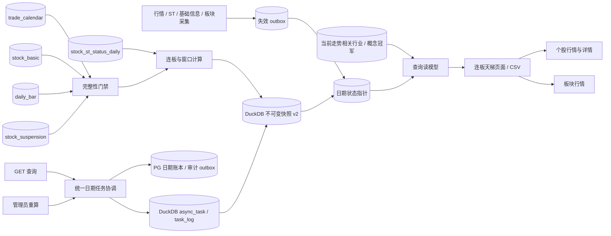

# 连板天梯模块

## 模块定位

连板天梯是「最新行情」下的 EOD 市场复盘模块。它按交易日识别收盘涨停股票，以连续涨停高度组织天梯，并把窗口活跃度、走势相关热点、个股行情分析、任务治理和权限审计串成一条闭环。

> 模块只覆盖主板、创业板和科创板，不含北交所；它不替代按评分方案生成的每日榜单，也不提供盘中实时天梯。

需求范围和验收见 [`../limit-up-ladder/requirement.md`](../limit-up-ladder/requirement.md)，实际任务与验证见 [`../limit-up-ladder/plan.md`](../limit-up-ladder/plan.md) 和 [`../limit-up-ladder/development-trace.md`](../limit-up-ladder/development-trace.md)。

## 核心技术

| 层次 | 当前实现 | 关键入口 |
| --- | --- | --- |
| 市场规则 | 按交易日、上市板块和点时 ST 判断收盘涨停；特殊无涨跌幅日 fail-closed | `backend/market_rules.py`、`backend/limit_ladder/rules.py` |
| 点时 ST | 当前事实与不可变变更历史；质量只允许从 `approximate` 升到 `accurate` | `backend/services/stock_st_status.py` |
| 连板计算 | 批量加载行情；连续板回溯到中断或上市边界，不受 60 日窗口截断 | `backend/services/limit_ladder_calculator.py` |
| 快照发布 | coverage 门禁、不可变版本、四档窗口指标冻结、状态指针原子切换 | `backend/services/limit_ladder_snapshot.py` |
| 查询读模型 | 统一筛选、摘要、热点、短历史字段、CSV 和当前走势冠军合并 | `backend/services/limit_ladder_query.py` |
| 日期任务协调 | 自动首算、失效刷新、管理员重算共享同日活动命令 | `backend/services/limit_ladder_task_coordinator.py`、`backend/storage/limit_ladder_task_repository.py` |
| 执行与审计 | DuckDB 保存任务进度/日志；PG 保存日期协调账本和可靠审计 outbox | `backend/services/async_task.py`、`backend/storage/pg_ddl.py` |
| 页面 | 主从工作台、天梯卡片、热点、设置、窄屏抽屉和详情返回 | `frontend/src/views/LimitLadderView.vue`、`frontend/src/views/limit-ladder/` |

## 系统架构

DuckDB 与 PostgreSQL 不做跨库 JOIN。协调器通过不可变 `command_id`、DuckDB `task_id` 和审计 `source_event_key` 在服务层关联两边状态。

## 业务流程

### 查询与首次物化

1. `GET /api/limit-ladder/{trade_date}` 校验交易日和筛选参数。
2. 查询入口先补偿 pending 失效事件，并检查规则版本和日期状态。
3. 无快照或快照已失效时，统一调用 `ensure_date_task()`；同日已有 `requested/running` 命令则直接复用。
4. DuckDB `limit_ladder_recompute` 任务完成 coverage、计算和原子发布。
5. 页面轮询状态；成功后读取新版本，失败或中断时保留最后成功快照并显示过期/失败。

### 计算与发布

1. 以 `list_date <= T` 且未在 T 日前退市的主/科/创股票构造点时股票池。
2. 每只股票在 T 日必须存在有效日线或确认停牌事实；结构化采集终态为 partial/failed 时拒绝发布。
3. 只把 T 日收盘涨停股票作为候选，继续向前批量读取，直到每只股票出现未涨停、停牌、缺行情或上市边界。
4. 一次计算 10/20/31/60 日涨停次数、后复权累计涨幅、实际起始日和实际交易日数。
5. 在同一 DuckDB 事务写入快照元数据、股票、概念、聚合和四档窗口指标，校验通过后切换 `current_snapshot_id`。

### 上游失效与补偿

- 历史 D 日行情、停牌或 ST 事实变化会失效全部已发布的 `T >= D` 快照，因为连续板没有 60 日回溯上限。
- 基础信息或当前板块归属变化使用全量失效边界。
- 上游先写 `limit_ladder_invalidation_outbox`，再执行失效；失败保留 pending 并使上游任务失败。
- 查询前重放 pending；`verify/checkup` 同时检查积压，不能把补偿失败后的旧结果继续标成 valid。

## 数据模型

### DuckDB 行情分析事实

| 表 | 职责 |
| --- | --- |
| `stock_st_status_daily` | 每股每日点时 ST 当前事实、来源和质量 |
| `stock_st_status_history` | ST 值、来源或质量变化的不可变历史 |
| `limit_ladder_snapshot_state` | 日期状态、当前成功版本、任务和失败摘要 |
| `limit_ladder_snapshot` | 不可变快照元数据、coverage 和四档请求窗口元数据 |
| `limit_ladder_snapshot_stock` | 股票身份、板位、ST/一字板和发布时事实 |
| `limit_ladder_snapshot_concept` | 发布时完整概念归属集合 |
| `limit_ladder_snapshot_aggregate` | 发布校验使用的行业/概念聚合 |
| `limit_ladder_snapshot_window_metric` | 每股四档窗口次数、累计涨幅和短历史字段 |
| `limit_ladder_invalidation_outbox` | 上游失效意图、重试和完成状态 |

### PostgreSQL 协调与审计事实

| 表 | 职责 |
| --- | --- |
| `limit_ladder_task_ledger` | 日期级命令、来源、身份快照、请求来源和终态 |
| `limit_ladder_audit_outbox` | requested/running/succeeded/failed/interrupted 的可靠审计投递 |
| `audit_log.source_event_key` | 审计事件幂等键，非空值唯一 |
| `user_preference` | `page/limit-ladder/settings` 用户私有默认偏好 |

任务执行事实仍在 DuckDB `async_task/task_log`。这是一项已确认的数据域边界，不把全平台任务中心迁入 PostgreSQL。

## 页面使用说明

- 入口：菜单「最新行情 → 连板天梯」，路由 `/limit-ladder`。
- 默认：最新完整交易日、31 日窗口、主/科/创全选、忽略 ST。
- 热点：行业与概念均按每股唯一的当前走势相关冠军计数；点击热点筛选当前天梯。
- 卡片：显示名称/代码、窗口板数、累计涨幅、ST/一字板、上市板块、走势相关行业和概念；概念链接直接进入板块行情，不重复触发热点筛选。
- 分析：桌面右侧复用股票分析；768px 窄屏使用页面内全屏 `PageDrawer`。详情返回恢复交易日、筛选、选中股票和卡片锚点。
- 低高度：筛选工具栏固定，摘要、热点和梯级共用成长滚动区；热点默认收敛但可展开。
- 权限态：页面 403 使用 permission 状态并提示联系管理员，不提供无意义重试。

## API 与权限

| 方法与路径 | 权限 | 说明 |
| --- | --- | --- |
| `GET /api/limit-ladder/trade-dates` | `limit-ladder:view` | 可用交易日和最新完整日 |
| `GET /api/limit-ladder/{trade_date}` | `limit-ladder:view` | 快照、窗口、筛选、摘要、热点和股票层级 |
| `GET /api/limit-ladder/{trade_date}/status` | `limit-ladder:view` | 快照和活动任务状态 |
| `GET /api/limit-ladder/{trade_date}/export` | `limit-ladder:view` | 当前筛选集合 CSV |
| `POST /api/limit-ladder/{trade_date}/recompute` | `limit-ladder:recompute` + system | 单日强制重算；复用同日活动命令 |

`limit-ladder:view` 按既有每日榜单授权范围进入默认业务角色；`limit-ladder:recompute` 仅 system 角色可获得。板块和个股详情继续分别消费 `sectors:view`、`stocks:view`，天梯权限不会扩张关联页面权限。

## 配置、部署与回滚

本模块没有新增环境变量、外部服务或可调度 job。`limit_ladder_recompute` 是内部任务类型，不出现在定时调度配置中。

部署顺序和验证查询见 [`../limit-up-ladder/sql-rehearsal.md`](../limit-up-ladder/sql-rehearsal.md)：

1. 停止后端并备份 DuckDB、PostgreSQL。
2. 执行 `limit-ladder-schema.sql`、`limit-ladder-audit-ledger.sql`、`limit-ladder-rbac.sql`。
3. 发布后端与 `frontend/dist`，重新登录刷新权限版本。
4. system 首算完整交易日，再用普通角色验证只读页面。

代码回退默认保留 DuckDB 事实。永久撤销 PG 对象时使用 `rollback-limit-ladder.sql`；pending 审计、外部授权引用或共享字段复用会触发 fail-closed。

## 验证入口

| 方向 | 入口 |
| --- | --- |
| 后端规则、存储、任务、接口、权限 | `backend/tests/test_limit_ladder_*.py` |
| 代表性规模 | `python -m backend.devtools.benchmark_limit_ladder_pipeline` |
| 页面组件与状态 | `frontend/src/views/limit-ladder/__tests__/` |
| 页面交互 | `frontend/e2e/limit-ladder*.spec.ts` |
| SQL 正反向 | `agent-works/limit-up-ladder/sql-rehearsal.md` |
| 设计契约 | `cd frontend && AI_STOCKS_ENV=dev AI_STOCKS_E2E_WRITE=1 npm run test:design` |

已执行证据以 [`../limit-up-ladder/frontend-test-report.md`](../limit-up-ladder/frontend-test-report.md)、[`../limit-up-ladder/performance-report.md`](../limit-up-ladder/performance-report.md) 和 [`../limit-up-ladder/business-audit.md`](../limit-up-ladder/business-audit.md) 为准；命令入口不代表本轮已重新执行全部测试。

## 当前风险事项

| 等级 | 风险点 | 影响 | 当前处理 |
| --- | --- | --- | --- |
| 中 | 历史 ST 仅有近似事实 | 旧日期涨停与连板可信度下降 | 快照和页面标记质量；准确回填后按受影响日期向后失效 |
| 中 | 正式数据副本尚未完成迁移与恢复演练 | 正式环境锁等待、耗时和资源峰值未知 | 上线前按 SQL 演练文档复演并记录备份恢复耗时 |
| 低 | 当前走势冠军不是历史点时归属 | 历史天梯展示的是当前最新相关行业/概念 | 页面保持统一语义，接口/CSV保留截止日；历史相关性快照仍属 R31 之外 |
| 低 | DuckDB 单写者限制 | 首算或重算可能排队 | 统一异步任务和同日活动命令；页面展示处理态，不以同步长请求阻塞 |
