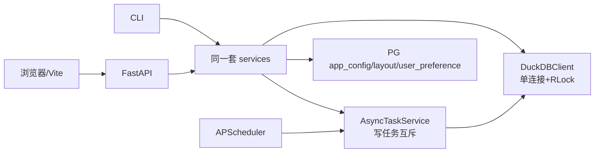

# 平台与基础设施

> 横切所有业务模块的地基：FastAPI 全栈、混合持久层、点时安全仓库总闸门、异步任务底座、定时调度、配置入口与前端布局/交互标准。环境变量、变量文件和数据库配置覆盖层见 [environment-configuration.md](environment-configuration.md)。

> 当前持久层边界：行情/参考数据留 DuckDB（只读分析），用户资产、系统菜单、角色权限和平台配置落 PostgreSQL，Redis 承载 token 黑名单、权限缓存、验证码和限流等短状态。系统菜单、权限和多租户技术架构见 [system-rbac-tenant.md](system-rbac-tenant.md)。

● 服务运行　● 任务调度　● 配置生效　● 平台约束

## 核心技术

- **FastAPI 全栈**：后端 FastAPI（`backend/main.py:40` `create_app`）装配全部业务路由 + 静态托管 + 启动钩子（含三库连通性自检 `_check_storages`）；CLI（`backend/cli.py`）提供 `serve/health/backfill/update/daily/backtest/migrate-rbac` 等子命令，`serve` 内部即 `uvicorn.run("backend.main:app")`。**持久层**：行情 DuckDB + 资产/配置/RBAC PostgreSQL + 短状态 Redis；行情分析、任务编排和调度仍在本进程，用户资产和平台配置在 PG，Redis 承载限流和会话短状态。
- **DuckDB 单文件嵌入式库**：`backend/storage/duckdb_client.py` 封装单文件连接。连接惰性创建、模块级单例 `get_client()`（`:121`）。DuckDB 连接非线程安全，FastAPI 同步端点跑在线程池会并发触碰同一连接，故用一把可重入锁 `RLock`（`:43`）串行化所有 `execute/query_df`；本地查询毫秒级，串行无感。SQL 出错即把 `_conn` 置空，下次访问自动重建（`:64`/`:73`）。幂等写入靠进程内唯一名临时视图 `temp_view()`（`:91`）+ `INSERT ... SELECT`，离开作用域自动注销，避免固定视图名在共享连接下被并发覆盖。
- **点时安全仓库（总闸门）**：`backend/storage/repository.py` 的 `MarketRepository`。一是 `upsert()`（`:47`）按主键 `_PK`（`:22`）做 `ON CONFLICT DO UPDATE` 幂等写，重复运行不产生重复行。二是**防未来函数/防幸存者偏差总闸门**（`:103` 起）：`get_bars()`（`:108`）只返回 `trade_date <= end_date` 的行，复权用去抖因子列 `adj_factor_clean`（为空 `COALESCE` 回落 `adj_factor`），qfq 按 end_date 当日因子点时归一；`get_universe_asof()`（`:182`）以"当日有行情"为存活判据组装点时股票池，含当时存活后来退市的票，并叠加 ST/次新/停牌/一字板/流通市值/板块过滤。
- **异步任务底座**：`backend/services/async_task.py`。`TASK_TYPES` 包含采集、补数、重算、质检、修复、基础信息刷新、`audit_cleanup`、`stock_board_correlation` 和内部单日任务 `limit_ladder_recompute`；`stock_ingest` 以场景参数统一承接 Web 个股采集，旧行情任务类型继续兼容。`WRITE_TASK_TYPES` 为写库类型，质检扫描、问题恢复、走势板块当前态切换和天梯快照发布也在其中，全局只允许一个写任务在跑（单写者互斥）。`AsyncTaskService.create()` 写 `async_task` 行后起守护线程跑处理器；`TaskContext` 提供进度 `progress()`、节流批量实时日志 `log()`/`flush()`、断点 `set_checkpoint()`、协作式取消检查 `check_cancel()`。任务是否可取消或续跑以 `TASK_CAPABILITIES` 为准；走势板块任务可在阶段检查点取消但不支持续跑，天梯单日原子发布任务不可取消或续跑。`_HANDLERS` 按类型分派到各业务服务。
- **APScheduler 定时调度**：`backend/scheduler/scheduler.py`。定义持久化在 `scheduled_job` 表，`SCHEDULABLE_TASK_TYPES` 当前包含 `stock_ingest/stock_board_correlation/board/recompute/verify/checkup/fix/enrich_basic/audit_cleanup`，并保留 `update/backfill/ingest_date` 供旧调度兼容执行；内部 `limit_ladder_recompute` 不对调度页面开放。新建个股调度统一使用 `stock_ingest`，旧调度编辑保存时转换。`stock_board_correlation` 调度只保存规范化的 `codes/force`，不创建默认任务；`fix` 定时任务必须指定单一质检 `issue_type`，触发时动态恢复该类型当前 open 问题。频率 `daily/weekly/monthly/cron` 经 `compile_trigger()` 统一编译成 APScheduler `CronTrigger`，注册到进程内 `BackgroundScheduler` 单例。到点回调 `_fire_job()` 读最新 job 定义→`trading_day_only` 判交易日→`create()` 创建 `async_task`（`trigger_source='scheduled'`）。启动时会确保存在一条默认「审计日志清理」任务，并注册 30 秒一次的天梯 PG 账本/outbox 对账任务；该内部对账复用 PG advisory lock，不生成 `scheduled_job` 配置行。
- **环境与配置入口**：环境变量、`.env.local`、`config/settings.yaml`、PostgreSQL `app_config` 覆盖层、布局配置表、用户偏好表和生效优先级统一维护在 [environment-configuration.md](environment-configuration.md)。平台层只约束新增运行期参数不得硬编码，并按文档选择 YAML、PG 覆盖层、布局配置表、用户偏好表或业务配置表。
- **dev/prod 部署**：`start.sh` 用 `nohup` 脱离会话启动 `backend.cli serve`，防误杀。dev 模式 `--reload`（改 `backend/*.py` 热重启 worker）+ 绑 `127.0.0.1`（仅本机，外部走前端 5173 代理）；prod 无热重载、绑 `0.0.0.0` 对外托管。生产期 `frontend/dist` 由 FastAPI `StaticFiles` 同源托管，SPA 深链/刷新回退 `index.html`（`backend/main.py:80-96`）。
- **前端布局自适应 + 列表交互标准**：Vue 3 + Element Plus + Pinia + vue-router（history 模式）。布局走可配置布局系统（`frontend/src/layout/`，地图见根目录 `DESIGN.md`）：页面声明 `PageLayout` schema 交 `<LayoutHost>` 渲染，整页/视口永不滚动、超高内容由页内"成长区"内部消化；契约样式 `.v-page/.v-grow/.v-scroll` 落在 `frontend/src/styles/global.css`，外壳 `App.vue` 的 `.main` 已 `overflow:hidden`+flex 填充。约束由校验器 + `layout-contract.spec.ts` 机制性强制。列表交互走服务端分页/排序/筛选、筛选变更自动触发、多选跨页累积。

## 业务架构

- **共用单例与初始化**：行情/研究相关服务经 `get_client()` 拿同一个 DuckDB 连接单例；用户资产、RBAC、平台配置和用户偏好经 `PostgresClient`。DuckDB `init_db()` 负责行情、任务、调度、数据维度以及连板天梯点时 ST/版本快照等分析侧表的幂等建表；PG DDL 负责 `app_config`、布局平台配置、布局用户配置、用户偏好、菜单、角色、资产表，以及连板天梯日期任务协调账本和可靠审计 outbox。

- **表与目录分工**：
  - DuckDB 基础设施表：`async_task`（任务状态/进度/结果/来源标记）、`task_log`（实时日志，按 `seq` 增量拉、每任务保留最近 2000 条）、`scheduled_job`（定时任务定义）、`data_update_log`（采集留痕）、`data_dimension_registry`/`data_source_provenance`（数据维度与溯源）。
  - 连板天梯数据边界：DuckDB 保存 `stock_st_status_*`、`limit_ladder_snapshot*` 行情分析事实；ST 质量只允许由 `approximate` 升为 `accurate`，普通名称推断不得覆盖已存在的准确事实，日线派生标记也消费最终有效事实。天梯门禁按点时股票池闭合有效日线/确认停牌后，以不可变版本和状态指针原子发布，失败或失效不删除旧成功版本。计算器按候选集合分批读取历史，连续板不受 60 日展示窗口截断；ST、行情、基础信息和板块归属变化只标记受影响快照失效。PG 保存 `limit_ladder_task_ledger`、`limit_ladder_audit_outbox` 协调与审计事实，二者不跨库 JOIN；`LimitLadderTaskCoordinator` 用同日活动态唯一约束协调三种来源，以 `command_id/task_id/source_event_key` 关联 DuckDB 执行、PG 状态和幂等审计。
  - PostgreSQL 配置与用户偏好表：`app_config`（系统设置覆盖层）、`layout_preset`、`layout_page_config`、`layout_field_policy`、`layout_user_config`、`user_preference`；边界见 [environment-configuration.md](environment-configuration.md)。
  - 业务表（行情/方案/结果/回测/快照）由各业务模块拥有，但**统一经 `MarketRepository.upsert` 与点时查询闸门读写**，主键登记在 `repository._PK`。
  - 数据字典文档化：`backend/storage/catalog.py` 用代码内置 `TABLE_CATALOG` 维护表/字段中文说明，运行时 `build_catalog()` 拼上行数/最新数据时间/未解决质检数，供数据概览页渲染——不另建需手维护的字典表。
  - 目录约定：DuckDB 单文件、parquet、导出、日志路径在 `PathsConfig`（`backend/config/settings.py:31`），相对路径按项目根 `PROJECT_ROOT` 解析为绝对路径。

- **被上层共用的能力**：点时闸门被选股/打分/回测/个股查询统一调用，保证全系统同一套"防未来/防幸存者"口径；异步任务底座被数据采集/补数/重算/质检/修复/基础信息刷新/审计清理复用同一套执行/日志/续跑/取消语义；定时调度只是任务底座的触发器（到点→`create` 一条 `async_task`），与手动任务同一执行通道；运行期配置读取和覆盖规则见 [environment-configuration.md](environment-configuration.md)。

- **网络模型**：对外只暴露前端入口端口（dev 期前端 5173，经 Vite 代理到后端 8000；prod 期后端 8000 同源托管 `frontend/dist`）。后端 dev 绑 `127.0.0.1` 仅本机，CORS 仅放行 `localhost:5173/127.0.0.1:5173`（`backend/main.py:48`）。API 入口启用 JWT 鉴权、默认拒绝和租户归属上下文。

- **前端壳与路由**：`App.vue` 固定左侧菜单 + 顶栏 + `router-view` 内容区；菜单含个股查询/每日榜单/策略筛选/策略回测/配置管理/数据管理（含数据概览/质量/采集/任务调度四子页）。路由表 `frontend/src/router/index.ts` 懒加载各视图，`/` 重定向 `/board`，已下线页用重定向兜旧链接。`stockSet.ts` 这类 Pinia store 用 localStorage 持久化"当前集合"，支撑列表→详情的上一个/下一个跨页导航。

## 运维与开发说明书

平台层说明的是"系统如何跑起来、如何保持一致、哪里不能乱动"。

### 1. 服务运行模式

| 模式 | 命令 | 端口 | 适用场景 |
|------|------|------|----------|
| 开发后端 | `./start.sh` 或 `./start.sh dev` | `127.0.0.1:8000` | 后端热重载，配合前端 Vite |
| 开发前端 | `./start-web.sh` | `0.0.0.0:5173` | 前端 HMR，代理 `/api` 到后端 |
| 自动化验证 | `npm run dev -- --port 5181 --strictPort` | `5181` | AI 截图/交互核查专用，不占用日常 5173 |
| 生产/集成 | `npm run build` 后 `./start.sh prod` | `0.0.0.0:8000` | 后端托管 `frontend/dist` |

开发期浏览器访问 `5173`，生产/集成期访问 `8000`。系统已启用登录鉴权；注册邮箱码已支持真实 SMTP 投递（仓库基线默认关闭、仅写 dev 日志，公网前用 `AI_STOCKS_SMTP_*` 开启），公网部署仍须配合反代 TLS、限流与运维访问控制。

自动化验证（AI 用 preview 做截图/交互核查）走**独立端口 5181**，与日常 5173 并存、互不干扰，同样由 Vite 代理 `/api` 回 8000。Claude Code 的 preview 工具配置在 `.claude/launch.json`；它只服务 AI 验证，与日常开发的 `start.sh`/`start-web.sh` 无关。
preview 工具只能托管自己启动的进程，故验证一律用 `ai-stocks-verify`，不要去抢占或杀掉用户手动起的 5173。

### 2. 进程、任务、数据库关系

关键约束：

- DuckDB 是单文件数据库，所有 SQL 走同一个连接和锁。
- 写库类异步任务同时只允许一个，避免采集/修复/重算互相踩踏。
- CLI 写库命令和 Web 服务同时运行时可能争用库文件；做大规模 CLI 写操作前建议先停服务。
- 调度器和取消状态是进程内状态，不支持多副本部署。

### 3. 异步任务通用语义

| 能力 | 说明 |
|------|------|
| 创建 | API 写入 `async_task` 后启动守护线程 |
| 进度 | 处理器通过 `TaskContext.progress()` 写入进度 |
| 日志 | `task_log` 按 seq 增量拉取，前端实时显示 |
| 取消 | 协作式取消，到下一个检查点停下 |
| 续跑 | 读取 checkpoint，已完成部分幂等跳过 |
| 重启恢复 | startup 把残留 pending/running 标为 interrupted |

所有数据管理页的采集、补数、修复、体检都应复用这套语义，避免单独实现长任务轮询。

### 4. 配置生效边界

配置加载、环境变量、变量文件、YAML 缓存、PG 覆盖层、布局配置表、用户偏好表和 DuckDB 旧表边界统一见 [environment-configuration.md](environment-configuration.md)。平台开发只保留一个判断原则：新增配置先区分它是启动期敏感/连接变量、非敏感 YAML 基线、Web 可改运行期参数、平台布局配置、用户自有偏好，还是需要版本和归属的业务配置。

| 配置类型 | 归属 |
|----------|------|
| 启动期敏感/连接变量 | 环境变量 |
| 非敏感默认值 | `config/settings.yaml` |
| Web 可改运行期参数 | PostgreSQL `app_config` 白名单覆盖层 |
| 布局预设/页面默认/字段策略 | PostgreSQL `layout_preset` / `layout_page_config` / `layout_field_policy` |
| 页面布局/组件用户层 | PostgreSQL `layout_user_config` |
| 主题、导航、页面业务偏好等用户自有偏好 | PostgreSQL `user_preference` |
| 评分/买卖/筛选等方案 | profile/version 表 |
| 定时任务定义 | `scheduled_job` 表 |

### 5. 前端页面开发约束

| 约束 | 目的 |
|------|------|
| 页面外壳不滚动 | 保持左侧菜单、顶栏和内容区稳定 |
| 长内容放 `.v-grow/.v-scroll` 内 | 表格、日志、图表在内部滚动 |
| 列表走服务端分页/排序 | 避免全量数据压到浏览器 |
| 多选跨页用前端集合 | 避免用户翻页后选择丢失 |
| 图表和表格要有稳定高度 | 避免布局抖动和遮挡 |

详细 CSS 和布局规则见根目录 `DESIGN.md`「布局系统」章与 `frontend/src/layout/`（校验器 + 渲染器 + 契约测试）。

### 6. 常见平台级故障定位

| 现象 | 排查路径 |
|------|----------|
| `/api/health` 不通 | `./start.sh status` → `logs/backend.log` → 端口占用 |
| 写任务一直 pending/running | 数据管理任务详情日志；重启后会被 reconcile 为 interrupted |
| 定时任务没触发 | 检查 job enabled、cron、`trading_day_only`、启动日志中的交易日历前瞻告警；日常更新会请求至下一自然年末，源未发布时不会伪造开市日 |
| 配置页面改参不生效 | 按 [environment-configuration.md](environment-configuration.md) 检查读取入口、PG 覆盖层和回落状态 |
| 前端刷新 404 | 生产期应由 FastAPI SPA fallback 返回 `index.html` |
| DuckDB 锁/占用 | 停 Web 服务，确认没有 CLI 写库任务，再重跑 |

## 业务流程

- **异步任务：创建→执行→完成**：`create(task_type, params, trigger_source)`（`async_task.py:164`）先校验类型、写任务类型则查 `_running_write()`（`:113`）有无在跑写任务、有则抛 `ConcurrentTaskError`（映射 409）；写入 `pending` 行后起守护线程跑 `_run()`（`:205`）。`_run` 置 `running`，调对应 `_HANDLERS` 处理器（边跑边 `ctx.progress/ctx.log`），正常完成置 `done` 并写 `result`；数据变更类任务由采集服务在写入收尾时**惰性标记评分快照失效**，处理器复用失效数量并仅在结果缺失时兜底，不立即重算。
- **协作式取消与续跑**：`cancel()`（`:277`）把 tid 加入进程内 `_CANCELLED` 集合并置"终止中"；处理器在步骤间 `ctx.check_cancel()` 探到即抛 `TaskCancelled`，`_run` 捕获后置 `interrupted`（已完成部分已入库、可续跑），并 `_release_fixing()` 把卡在 fixing 的质检问题复位 open。`resume()`（`:187`）读 `result.checkpoint` 重新拉起处理器，按 checkpoint 幂等跳过已完成项续做。
- **重启恢复（reconcile）**：FastAPI `startup` 钩子先调 `AsyncTaskService.reconcile()`，把残留 `running/pending` 任务标 `interrupted`，同时把 DuckDB 中孤儿 `calculating/recalculating` 天梯状态转为 `failed` 并保留最后成功快照指针，再复位孤儿 fixing、清理超期日志；随后 `LimitLadderTaskCoordinator.reconcile()` 在 PG advisory lock 内按 `trigger_event_id=command_id` 镜像天梯账本终态，并对仍漂移的处理态做第二次收敛、收敛启动前无 Duck 任务的 requested 孤儿并投递 outbox。查询入口发现处理态但不存在活动任务时，还会通过同日唯一命令入口幂等重建。该顺序保证重启残留任务不会被误判为仍运行或让页面永久轮询。
- **定时任务触发**：`startup` 另一钩子调 `start_scheduler()`：迁移旧单一配置→确保默认 `audit_cleanup` 调度存在→加载所有 `enabled` 的 job 注册到 APScheduler。到点 `_fire_job()` 读最新 job→若 `trading_day_only` 且非交易日则跳过（`_is_trading_day` 缺日历会自愈补采再判，采集统一尝试覆盖下一自然年）→`create` 一条带 `job_id/job_name` 的 `async_task`，记 `last_run`。已有写任务在跑则本次跳过（不排队），失败仅记日志不崩调度。启动自检、采集收尾和数据体检均报告“下一开市日/跨年覆盖”状态；数据源未发布未来安排时告警但不伪造交易日。job 的增删改启停即时生效：CRUD 里 `register_job/unregister_job` 复用同进程单例重注册触发器，免重启。
- **配置改参即时生效**：系统设置页的保存、重置、YAML reload、变量文件和 DB 覆盖层规则只维护在 [environment-configuration.md](environment-configuration.md)，业务流程文档不再重复展开。
- **dev/prod 启停**：`./start.sh`（dev，热重载，绑 127.0.0.1）/`./start.sh prod`（绑 0.0.0.0 对外）/`stop`/`restart`/`status`/`logs`。启动后轮询 `/api/health`（最多约 15s）确认健康；`stop` 按进程特征 `pgrep/pkill` 优雅停、必要时 `-9` 强杀。`shutdown` 钩子停 APScheduler。

## 风险事项

| 等级 | 风险点 | 影响 | 建议 |
|------|--------|------|------|
| ● 高 | DuckDB 单写锁 + 写任务单例 | 长写任务期间其它写请求被 409 拦下；不具备并发写吞吐能力 | 单机部署下写任务排队靠页面状态和人工错峰 |
| ● 中 | 公网放量前的运维安全缺口 | 登录鉴权、RBAC、租户隔离、业务路由权限码、审计查询、数据字典、注册防滥用配置和真实 SMTP 发码均已接入（邮件基线默认关闭、按 `AI_STOCKS_SMTP_*` 开启） | 公网前用环境变量开启并配好发信账号，配套反代 TLS、限流、监控与备份；prod 暂不直接暴露公网 |
| ● 中 | 本机绑定与进程内状态 | 多进程/多副本下任务互斥、取消、reconcile 会失效 | 仅按单机单进程部署 |
| ● 中 | 服务重启打断在跑任务 | running/pending 会被标为 interrupted，需续跑 | 重启前确认任务完成；中断后从任务页续跑 |
| ● 中 | 配置读取入口选错 | 漏用有效配置会读不到 Web 覆盖值；启动期误读 DB 会引入初始化环 | 新增配置先按 [environment-configuration.md](environment-configuration.md) 判定归属和读取方式 |
| ● 低 | SQL 错误后整连接重建 | 持续性库锁/结构错误会反复重连失败 | 看日志定位根因，不只依赖自动重连 |
| ● 低 | DDL 迁移尽力而为 | 个别迁移失败可能与代码假设不一致 | 启动日志出现 warning 时及时核对表结构 |
