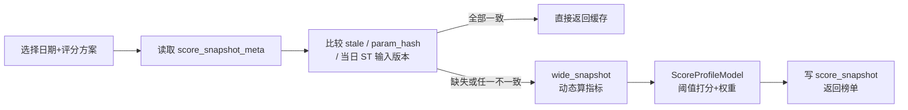

# 选股与榜单

> 用条件树筛选全市场点时命中，再按评分方案打 0~100 综合分并惰性物化成每日榜单。

● 条件筛选　● 评分排序　● 快照缓存　● 口径风险

## 核心技术

### 条件 AST（`backend/screening/condition.py`）
- 一棵嵌套 JSON 树。逻辑节点 `{"op":"AND"|"OR"|"NOT","children":[...]}`（NOT 仅一子）；叶子三类：
  - `ind`：注册表指标，`{type,key,params,cmp,value[,ignore]}`，统一从指标注册表取定义。
  - `col`：固定快照列，`{type,field,cmp,value[,ignore]}`（旧格式，仍兼容）。
  - `expr`：动态表达式，`{type,expr[,ignore]}`。
- `cmp` 白名单：`== != > >= < <= between`（`between` 的 value 必须 `[下限,上限]`）。`validate_ast`（condition.py:30）递归做结构/语义校验，非法抛 `ConditionError`；`expr` 叶子额外调 `validate_expr` 做白名单校验。
- `collect_leaves`（condition.py:73）抽出全部 col/expr 叶子供引擎预取列/预编译。`eval_ast`（condition.py:90）按回调求值各叶子（布尔 Series，index=code）再 AND/OR/NOT 合并，所有叶子结果 `fillna(False)`（NULL 视作不命中）。

### 表达式 DSL 沙箱与防未来拦截（`backend/screening/expression.py`）
- 用 Python `ast` 解析后**白名单遍历求值**（`_check` expression.py:59）：只放行 常量(int/float/bool) / 变量名 / 白名单函数调用 / 二元算术(`+ - * / & |`) / 比较 / 布尔(`and or not`、`~`) / 一元。**禁止**属性访问、下标、推导式、lambda、import、关键字参数、任意函数——杜绝注入。
- 白名单函数 `ALLOWED_FUNCS`（expression.py:34）：`MA/HHV/LLV/REF/COUNT/SUM/ABS`，全部后向算子，复用 `indicators.operators`。
- 防未来：变量序列由引擎传入且只截到 `run_date`（≤T），算子全后向，`REF` 拒绝负移——点时安全。变量约定 `C/O/H/L/V/TURN` + 指标列名。

### 筛选引擎（`backend/screening/engine.py`）
- 混合执行 `run_ast`（engine.py:93）：
  1. `_snapshot` 取 run_date 当日全市场宽截面（`IndicatorEngine.wide_snapshot`，index=code）。
  2. `col` 叶子在截面上向量化比较（`_eval_col`）；`ind` 叶子（`_eval_ind`）——表达式型指标逐股点时算后 reindex，其余复用快照列（`resolve_indicator`）。
  3. `expr` 叶子逐股取 ≤run_date 的 qfq 序列，在 DSL 沙箱求值取末值（`_eval_exprs`，单股异常→False）。
  4. `eval_ast` 合并出命中布尔。`ignore=true` 的叶子恒为 True（软删除一个条件）。

### 阈值打分 + 动态权重（`backend/scoring/score_profile.py`）
- 方案 = 若干指标项，每项独立产出 0~100 达标分（`score_one` score_profile.py:65）：
  - `bool` 满足=100/否=0；`band` 分段阈值（末段含右端）；`linear` 在 `[min,max]` 线性映射到 0~100（min>max 即“越小越高”）。
- 综合分 = Σ(达标分×权重)，权重总和自动归一（`ScoreProfileModel.score` score_profile.py:102）。指标取值经 `resolve_indicator`（score_profile.py:38）解析为快照列：优先同名列（含已 attach 的表达式/自定义指标），其次别名、`ma{n}`/`hhv{w}` 带参映射。分档 grade 按 `grade_thresholds`（观察≥watch/龙头候选≥leader/主升浪核心≥core）。
- 旧固定模型 `ScoreModel`（`backend/scoring/model.py`）：固定 6 维（位置/趋势/量/换手/RS/资金流）、配置权重，资金流默认权重 0 自动从归一中排除。仍用于不带评分方案的榜单口径。

### 评分快照惰性物化与失效（`backend/scoring/snapshot.py`）
- `score_snapshot_meta` 除 `stale/param_hash` 外保存 D 日 `st_input_version`。读取先通过 ST 发布门并比较当前 D 日版本；存量 NULL 或版本不同只让当前日期、方案、版本缓存未命中。可写入口沿用 PG advisory lock 重算，只读入口返回空命中且不越权写入。
- 榜单计算前后再次读取 D 日版本，只有一致时才把明细与版本写入 PG；返回已命中缓存前也二次核对，以收窄 DuckDB ST 事实与 PG 快照之间的跨库竞态。ST 批次 `refreshing/failed` 时保留旧明细，但不把它返回为有效榜单。
- 每日榜单 `/board/run` 在发布门关闭时返回 `business_code=ST_STATUS_NOT_READY` 和可读原因，页面进入明确错误态，不把不可用误显示成“当日空榜”；等待发布完成后由用户刷新即可按当前版本命中或自愈。
- 公共榜单默认日期和数据概览“榜单最新日”同样比较 `stale`、当前指标参数指纹和 D 日 ST 输入版本；不会把仅有 `stale=false`、但参数或 ST 已变化的 PG 元数据报成 fresh。候选日期批量读取日期修订账本，避免跨库 N+1 查询。
- 物化键 = `(tenant_id, owner_user_id, profile_id, profile_version, trade_date)`——**含方案 owner 归属维度**；缓存读写的 WHERE 始终带 `tenant_id + owner_user_id`，API 把二者设为方案真实 owner。`get_board` 只有在 meta 的 `stale=false`、指标参数指纹和 D 日 ST 输入版本都匹配时才直接读 `score_snapshot`；否则进入 `_materialize_locked`，以 `score_day` 对全市场排除 ST 后打分并原子覆盖明细与 meta。
- **榜单结果的共享语义（区别于「资产复用」）**：榜单不是可拥有的资产，没有「我的榜单」、**无复制/复用入口**。其结果是**一份物理快照，落在方案 owner 的缓存槽**（不属任何查看者）；凡对该评分方案有可见性（`get_visible`）且具 `board:view` 权限的人，对同一 `(方案,版本,交易日)` **共读这同一份快照**——首个请求者触发物化（`materialized`），后续命中同一份缓存（`cached`）。「所有人可见」受方案可见性约束：public 方案才接近全员共享，tenant 限同租户，private 仅 owner。
- `score_day`（snapshot.py:25）口径与回测 `_decision_data`、`/board/compute` 一致：`wide_snapshot` 单日 → 按准确点时事实排除当日 ST → `attach_columns` 补表达式型指标列 → `ScoreProfileModel` 打分；事实未就绪时统一失败关闭。
- 失效触发器（只标 meta、不重算，便宜）：
  - `mark_stale_dates`（snapshot.py:116）：指定交易日的所有方案版本标 stale。
  - `mark_stale_all`（snapshot.py:131）：全量标 stale。
  - 实际由数据任务调用（见业务流程）。下次 `get_board` 读到 stale 才重算。

## 业务架构

- **筛选↔评分↔榜单**：
  - 筛选页 `/screen/run` → `ScreenScoreService.screen_scored`：跑筛选得命中票，再用固定 `ScoreModel` 给命中票打分排序、标/排 ST；最终命中排序形成后，按 `run_date` 一次批量附加当前走势行业/概念摘要，摘要不参与筛选或评分，历史日期不匹配时冠军为空。
  - 每日榜单页 `/score-profiles/run` 与回测“查看当日榜单” `/board/compute` → 走评分快照层 `ScoreSnapshotRepo.get_board`，对全市场按评分方案排序，不依赖筛选。
  - 当前页面实际榜单入口 `/board/run` 在 Top N 形成后按 `run_date` 一次批量附加 `related_boards`；历史日期与当前冠军截止日不一致时只返回空冠军和 `as_of_mismatch`。`/board/compute` 是回测/历史计算链路，明确不接入当前冠军摘要。
  - 旧固定模型公共读 `/scores`、`/scores/top`（读 `score_result`）**已废弃删除**（前端无调用方，产品已切到评分快照层）。
- **统一基座**：指标统一从指标注册表/`wide_snapshot` 取，筛选的 `ind` 叶子与评分项的 `indicator` 都经 `resolve_indicator`/`IndicatorDefRepo` 解析，表达式型指标动态算后 attach 成列。
- **涉及表**（`backend/storage/pg_ddl.py`；`ddl.py` 为迁移保留的旧 DuckDB 定义）：
  - `screen_profile` / `screen_profile_version`（ddl.py:196/291）：筛选方案 + 版本归档。
  - `score_profile` / `score_profile_version`（ddl.py:210/223）：评分方案（items+grade_thresholds）+ 版本归档。
  - `screen_result`（ddl.py:235）：筛选命中落库（run_date+profile_id+code）。
  - `score_result`（ddl.py:247）：固定模型每日榜单（含 buy_point/risk_flags）。
  - `score_snapshot` / `score_snapshot_meta`（ddl.py:453/467）：评分方案榜单明细 + 失效元数据。
- **涉及 API**：
  - 筛选方案 CRUD/版本/发布/复制/跑筛选：`backend/api/profiles.py`（`/profiles*`、`/profiles/{ref}/visibility`、`/profiles/{ref}/copy`、`/screen/run`）。
  - 评分方案 CRUD/版本/试算：`backend/api/score_profiles.py`（`/score-profiles*`、`/score-profiles/run`）。
  - 榜单查询：`backend/api/board.py`（`/board/run`、`/board/profiles`、`/board/compute`）。
- **可见性**：筛选方案和评分方案均支持 `private / tenant / public`。API 使用 opaque `profile_ref` 解析真实 owner；非 owner 公开方案只读，可复制当前版本或指定历史版本为自己的 private；方案收窄范围时同步收窄关联公开回测但不删除结果。**复制后运行/筛选**结果归当前执行者。**例外——榜单快照相反**：其结果归**方案 owner** 的缓存槽（非执行者），凡对该方案有可见性者共读同一份（见上「评分快照惰性物化与失效」共享语义）。
- **前端**：`ScreenView.vue` 条件构建器（指标/表达式行 ↔ AST 互转、方案存取/版本恢复、公开范围标签/发布/复制、命中列表导出）；`BoardView.vue` 选评分方案+日期+TopN 拉榜单（调 `/score-profiles/run`，展示综合分/评级/分项徽章）。榜单方案选择走 `AssetProfileSelect`（`select-loaded` 选择即刷新），支持「默认加载方案」偏好（见下「每日榜单页 · 默认加载方案」）。

## 页面使用说明书

本模块包含两个页面：每日榜单用于"看全市场排序"，策略筛选用于"验证一个条件集合能命中哪些股票"。两者都依赖指标引擎，但业务定位不同：榜单是评分排序，筛选是条件命中。

### 1. 每日榜单页

**入口**：左侧菜单「每日榜单」。

| 控件/区域 | 作用 | 注意事项 |
|-----------|------|----------|
| 交易日 | 指定要看的截面日期 | 只使用该日及之前数据，不看未来 |
| 评分方案 | 选择 `score_profile` 版本 | 方案改动后会生成新版本，旧历史仍可回看 |
| TopN | 控制返回榜单数量 | 只影响展示数量，不改变评分结果 |
| 刷新 | 重新读取当前日期、方案和 TopN | 命中有效快照时直接读取，不强制计算 |
| 重算当日 | 将当前日期、方案、版本的快照精确失效后立即刷新 | 非 system 用户仅能操作自己的方案，且须有 `board:compute`；他人公开/租户方案只读，需先复制为自己的方案 |
| 榜单表格 | 展示综合分、评级、分项达标情况 | 排名来自评分方案，不等同筛选页固定模型分 |
| 分项徽章/分数 | 解释分数来自哪些指标 | 用于排查某只股票为何得分高/低 |

**榜单生成闭环**：

**用户判断口径**：

- 想看"今天谁最强"，用每日榜单。
- 想理解"强在哪里"，看分项达标分和评级。
- 想把榜单逻辑拿去历史验证，去回测页选择同一个评分方案。
- 如果最新榜单提示未生成，不需要手动预跑；打开对应日期会按需计算。
- 只想重新读取当前结果用「刷新」；确认原始数据或方案结果需要覆盖时，方案 owner 可用「重算当日」。system 管理员可对可见方案执行该动作。

#### 默认加载方案（无自己的评分方案时自动装载）

面向「还没有自己评分方案」的用户，免去每次进榜单页都要手动去抽屉选方案：

- **设置入口**：`AssetSearchDrawer`（浏览评分方案抽屉）行操作新增「设为默认加载方案 / 取消默认」。该动作由 `setDefaultItem` 回调控制渲染——**仅榜单页经 `AssetProfileSelect` 传入才出现**，筛选/配置/个股详情等其它消费页不传则不显示。单值互斥：以 `defaultItemKey === assetItemKey(item)` 行级比较，改设后其它行自动复原。
- **持久化**：复用既有 `user_preference` 通道（`scope=feature / page_key=board / pref_key=default-score-profile`），前端经 `useUserPreference` 双写（localStorage 即时 + 远端 300ms 防抖），value 存方案 summary 快照（profile_ref/name/version/is_preset/source/owner_label）。**不新建表/端点/权限**（沿用 `user-preference:manage`）。
- **装载时机**：进入榜单页时，**仅当「我的」评分方案列表为空**（`profiles.length===0`）且远端偏好已 `hydrated`，才经 `AssetProfileSelect.applyLoaded`（`selectLoaded` 同构、不开抽屉）把默认方案注入下拉并触发榜单刷新；若用户已有自己的方案，则维持「自动选中我的第一个」，默认偏好被忽略（不删除）。装载等 `hydrated` 完成再判定，避免远端偏好慢于 mine 列表时被过早置空态。
- **失效兜底**：默认方案被 owner 取消公开或删除后，`runBoardProfile` 经 `get_visible` 返回统一响应业务码 404；仅当本次 load 由默认装载触发（`pendingDefaultKey` 命中）且该业务码明确命中时，自动清除偏好并落回空态。服务重启、断网、超时、5xx 或其他权限异常保留默认偏好并显示可重试错误；普通手动选公开方案失败也不清默认。

### 2. 策略筛选页

**入口**：左侧菜单「策略筛选」。

| 区域 | 功能 | 典型用法 |
|------|------|----------|
| 条件构建器 | 用 AND/OR/NOT 组织指标、字段、表达式 | 建"趋势向上 + 放量 + 相对强度高"条件 |
| 指标条件 | 从指标注册表选择 key 和参数 | 适合可复用、可解释的条件 |
| 表达式条件 | 输入 DSL，如 `MA(C,20)>REF(MA(C,20),5)` | 适合临时验证想法 |
| 方案保存 | 保存为 `screen_profile` 并版本化 | 后续回测引用同一筛选方案 |
| 方案公开 | owner 可发布到同租户或全体；非 owner 公开方案只读、可复制 | 复用成熟筛选思路但保持个人资产隔离 |
| 命中列表 | 展示命中股票，并附固定模型评分 | 用于快速看候选池质量 |

**页面布局与方案编辑闭环**（`ScreenView.vue`，与评分/买卖配置页同构）：

- **双栏结构**：左侧 `prof-list` 方案列表（`AssetProfileSelect(list)` + `新建方案`），右侧 `editor-screen` 编辑器（`ed-head` 名称/可见性/`保存`/`删除` + 条件构建器 `b-conds`），下方 `run-head` 运行区 + `run-table-wrap` 结果区。已从旧「单卡 + filter-bar + 保存弹窗」收敛为编辑器头直存，交互路径与评分页一致。
- **选择态与编辑态分离**：`curId`（侧栏选中）与 `editId`/`editName`（编辑器当前身份）解耦，避免「选中新方案、误存到旧方案」；载入详情失败回滚到最后一次成功选中的方案并保留旧编辑器内容，新建走空身份由后端 `_make_id` 生成 id 后绑定。
- **外部预览闭环**：“加载查看”的系统/公开方案只作为临时预览，不混入 mine 列表。行内“×”仅移除预览，不删除资产；方案删除只由编辑区右上角独立按钮承接。移除事件以临时项身份为准，不依赖 `readonly`（本人名下系统内置资产也可能可编辑）；收到事件后先使在途详情失效，并同步清空方案身份、条件参数和旧结果，再刷新 mine。刷新失败保持干净的新建态，禁止把已移除方案的条件留作可编辑参数。只读历史版本只能复制指定版本为自己的 private。
- **结果区四态**：未运行 `AppStateBlock empty` / 首次运行 `AppStateBlock loading` / 运行失败 `AppStateBlock error + 重试` / 命中走 `AppDataTable`、零命中走独立 `empty`。已有结果刷新时保留旧表并显示 loading，失败时保留旧结果并显示紧凑错误态。ready 态补 `run-meta` 摘要行「交易日 {run_date} · 共 N 只 · 已排除 ST · 按方案「名称」运行」并回填 `runDate`，与评分试算口径一致。
- **评级标签**：综合评分评级统一复用 `ScoreGradeTag`，主升浪核心/龙头候选/观察分别使用 danger/warning/success；榜单、筛选、评分试算和回测不得维护页面私有映射。
- **运行主按钮**：`运行筛选` 统一为 primary + `VideoPlay` 图标，与评分试算、回测运行键视觉层级拉齐。

**筛选条件三种叶子**：

| 类型 | 适用场景 | 示例 |
|------|----------|------|
| `ind` | 引用统一指标注册表，推荐优先使用 | `rs_pct >= 80` |
| `col` | 兼容旧字段或固定截面列 | `pct_chg between [0, 8]` |
| `expr` | 临时表达式验证 | `COUNT(C>MA(C,20),5)>=4` |

**筛选到回测的闭环**：

### 3. 每日榜单与策略筛选的区别

| 对比项 | 每日榜单 | 策略筛选 |
|--------|----------|----------|
| 核心问题 | 全市场谁分数最高 | 哪些股票满足条件 |
| 输入 | 日期 + 评分方案 | 日期 + 条件 AST/筛选方案 |
| 输出 | 排名、综合分、评级、分项分 | 命中列表、固定模型评分 |
| 是否落快照 | 保存方案走 `score_snapshot` | 命中可落 `screen_result` |
| 下游 | 回测评分验证、人工复盘 | 回测候选池、方案沉淀 |

### 4. 默认硬性股票范围口径

| 场景 | 默认硬性规则 | 不默认做的过滤 |
|------|--------------|----------------|
| 策略筛选页 `/screen/run` | 取运行日当日 `wide_snapshot`，即当日有日线且指标快照可计算的股票；页面/API 默认 `exclude_st=true`，按当日准确点时事实排除，用户可关闭后只标记 ST | 不套用训练股票池的板块、上市天数、流通市值、一字涨停过滤；这些需要用户写入筛选条件 |
| 每日榜单 / 评分试算 | 取运行日当日 `wide_snapshot`，按评分方案打分；按准确点时事实强制排除当日 ST；TopN 只限制返回/展示数量 | 不默认过滤市值、板块、上市天数、一字涨停 |
| 买卖指标预览 | 对运行日全市场 `wide_snapshot` 评估买/卖条件树；预览按准确点时事实强制排除当日 ST | 买卖方案本身不保存独立股票池，也不默认过滤市值、板块、上市天数、一字涨停 |

上述入口与训练模块的随机池共用 `stock_st_status_daily` 点时事实及发布门；筛选、评分、预览之间不再存在名称推断的平行口径。训练股票池另有更窄的板块、上市天数等规则，见 [market-sense-training.md](market-sense-training.md)。

### 5. 与其它模块的关联关系

| 模块 | 关联方式 |
|------|----------|
| 数据管理 | 行情/市值/股票基础信息是榜单和筛选的原始输入；ST 与指标参数变化由榜单读取版本自检，其它变化可由「结果维护」或用户调度显式让评分快照 stale |
| 配置管理 | 指标注册表、评分方案、筛选条件可用指标都从这里来 |
| 回测验证 | 回测组合筛选方案、评分方案、买卖方案，复用榜单评分口径；公开筛选方案通过 `profile_ref` 进入回测候选池，后端按可见性解析真实 owner 的表达式 |
| 个股与分组 | 榜单或筛选结果中的股票可进入详情查看 K线和买卖方案信号 |

## 业务流程

- **跑一次筛选**：前端用条件行拼 AST → `POST /screen/run`（profile_id 或临时 expression）→ `validate_ast` → `ScreenEngine.run_ast` 出命中 → `screen_scored` 对命中票 `ScoreModel` 打分、排/标 ST、按综合分降序返回。`run_profile` 路径会把命中落 `screen_result`（支持任意历史交易日点时回溯）。
- **出每日榜单**：前端选方案/日期/TopN → `POST /score-profiles/run`（或 `/board/compute?score_profile_id`）→ 已保存方案走 `get_board`（命中即用缓存，未命中/失效惰性物化）；未保存的 inline items 无版本键，`score_day` 实时算不入库。
- **ST 排除口径**：每日榜单按准确点时事实强制排除当日 ST；筛选页默认 `exclude_st=true`（前端默认值与后端默认值一致），可关闭后结果仍按当日事实标记 `is_st`。缺失、非权威或刷新未发布都会阻断业务，不降级为名称推断。
- **评分快照生成与失效**：
  - 生成：首次请求某 `(日期,方案,版本)` 触发 `_materialize` → 落 `score_snapshot` 明细 + meta(stale=false)。
  - 失效：只有「每日榜单失效」结果维护任务按用户选择的最新交易日、固定交易日或全部快照调用 `mark_stale_dates/mark_stale_all`；采集、补数、修复不再隐式标记。读取发现 ST 输入版本变化时只使当前请求缓存未命中，属于缓存正确性校验，不是采集联动或批量维护。
  - 重算：下次 `get_board` 读到 meta 缺失或 stale → 当场重算覆盖、meta 置 false 再返回；每日榜单页的「重算当日」是显式用户动作，只精确标记所选 `(日期,方案,版本,tenant,owner)` 后在同一请求刷新，不属于采集或数据变化联动。
  - 权限：普通用户的「重算当日」必须同时满足 `board:compute` 与方案 owner；公开/租户可见的他人方案共读 owner 快照但不能被查看者强制覆盖。system 管理员可维护可见方案及平台预设。前后端均执行该边界，后端为最终事实源。
- **方案版本化**：`ProfileRepo.save` / `ScoreProfileRepo.save` 仅在名称或内容实质变更时 version+1 并归档历史版本（内容未变返回原版本，避免重复 seed 致版本虚增）。
- **方案 id 自动生成**：三类方案不设业务编码；`save`/`save_with_id` 接受空 `pid`，新建和复制时由后端生成 32 位 UUIDv4 十六进制内部 `id`，名称不参与身份生成。`save_with_id` 返回 `(id, version)` 供 API 绑定新方案；页面不展示内部 `id`。存量可读 `id` 继续兼容，避免改写版本、快照和回测引用。名称必填，空名 `save` 抛 `ValueError`。

## 风险事项

| 等级 | 风险点 | 影响 | 建议 |
|------|--------|------|------|
| ● 中 | ST 第三方事实源临时不可用或发生纠错 | 刷新批次失败时筛选、榜单和预览暂不可运行；纠错后的旧榜单不可继续视为有效 | 依赖批次门禁、自动重连/续跑、变更历史及读取时 ST 版本自检闭环恢复 |
| ● 中 | expr 叶子逐股串行求值 | 全市场筛选随股票数线性变慢（engine.py:74） | 常用逻辑沉淀为指标，减少临时 expr |
| ● 中 | 部分结果输入未纳入缓存版本 | ST 与指标参数能在读取时自愈，但其它行情/基础资料被绕过正规流程修改后可能留下陈旧榜单 | 其它输入变化走「结果维护」或调度；新增关键输入时同步扩展指纹 |
| ● 中 | 评分指标周期受限 | 非预设 `ma/hhv` 周期会抛错 | 用表达式型指标绕行，后续扩展任意周期 |
| ● 中 | 筛选打分与榜单打分模型不一致 | `/screen/run` 与每日榜单分数不可直接比较 | 以榜单/回测评分方案为最终评分口径 |
| ● 低 | 固定模型资金流维度恒 0 | 趋势榜单未纳入资金流信号（model.py:46） | 后续接入资金流数据后再启用权重 |
| ● 低 | expr 求值异常静默为 False | 数据缺失与条件不满足不易区分（engine.py:89） | 调试表达式时先在小样本验证 |
