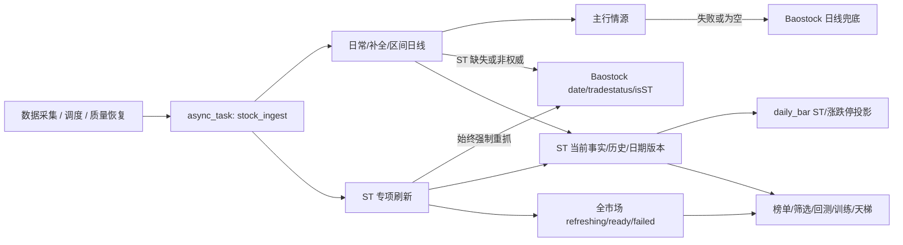

# ST 点时事实模块架构

## 文档范围与结论摘要

本文说明「复盘啦」中 ST 点时事实从采集、存储、发布、质检到业务消费的当前实现，面向开发、数据运维和需要判断结果是否可信的产品使用者。代码范围主要包括 `backend/datasource/baostock_source.py`、`backend/services/ingest.py`、`backend/services/stock_st_status.py`、数据管理任务入口及榜单、回测、天梯等消费者；不把行情价格采集、评分算法或天梯算法本身展开为本文职责。

当前架构结论如下：

- Baostock `query_history_k_data_plus` 的逐股逐日 `isST` 是本系统唯一结构化 ST 事实源；它是统一的可执行口径，不等同于交易所法律文件。
- `stock_st_status_daily` 是唯一当前事实，`daily_bar.is_st` 只是兼容旧查询的物化投影，业务不得从当前股票名称或该投影反推历史 ST。
- 日常行情采集和 ST 专项刷新共用事实解析、落库审计、日期修订版本与中央涨跌停规则，但二者不是同一种运行机制：前者增量复用已有准确事实，后者强制重抓并使用全市场发布门。
- 评分方案的 `include_st` 决定 ST 是否进入评分与全市场排名；筛选方案的 `exclude_st` 只决定命中列表是否展示 ST。两者独立组合，均只读取所选交易日的准确点时事实。
- **ST 状态子调用只读取 Baostock 的 `date/tradestatus/isST`，不会读取或覆盖开高低收、成交量、成交额、换手率和复权因子。**日常行情任务还存在两条与 ST 状态采集相互独立的 Baostock 行情调用：主行情源整段失败时的日线兜底，以及除权参考价异常时只校准 `pre_close`。
- ST 写入不会直接批量失效榜单或天梯；真实变化会递增日期修订版本，榜单和天梯在读取当前结果时按版本自检并只处理本次请求对应的缓存。

本文事实已从当前源码、DDL、前端任务参数和现有测试静态核对；验证章节列出稳定测试入口，实际执行结果以当次交付报告为准。

## 模块定位与职责边界

模块解决“某只股票在某个历史交易日是否处于 ST/风险警示状态”的点时可信问题，并为涨跌停规则、股票池、筛选、评分、回测和天梯提供统一输入。

模块负责：

- 从 Baostock 获取逐日 `isST` 与停牌状态辅助信息；
- 保存当前事实、变更历史、日期修订版本和专项刷新发布状态；
- 把已发布事实投影到 `daily_bar.is_st/limit_status/is_one_word`；
- 对缺失、非权威和未发布状态失败关闭；
- 通过质检、结构体检、数据概览和任务日志暴露数据状态；
- 为下游缓存提供可比较的 ST 输入版本。

模块不负责：

- 不把 Baostock 视为股票所有行情字段的唯一来源；行情主源和兜底属于日线采集模块；
- 不从当前名称中的 `ST`、`*ST` 字样推断历史状态；
- 不在 ST 采集结束后直接删除、覆盖或批量失效评分、回测和天梯结果；
- 不替代下游各自的行情完整性、参数版本、快照发布和用户维护契约。

### 日常行情采集与 ST 专项刷新正面对照

| 维度 | 日常行情采集中的 ST 同步 | ST 专项刷新 |
| --- | --- | --- |
| 主要目的 | 为新增或重采的日线提供同日 ST 输入 | 审计、补齐或纠正历史 ST 事实 |
| 默认范围 | 每股 `max(daily_bar.trade_date)+1` 到本轮目标日；无新行情则不处理该股 ST | 每股上市日/最早行情日至市场最新行情日，可指定股票和日期 |
| 已有准确事实 | 待入库行情日期均已有 `accurate` 时直接复用，不访问 ST 源 | `force=True`，即使已有 `accurate` 也重新请求源端 |
| 源端历史纠错 | 没有新行情或事实已完整时不会主动发现 | 能通过强制重抓发现并审计历史变化 |
| 其它工作 | 采集和清洗日线、校准 `pre_close`、刷新干净复权因子及最新市值等 | 不采集或覆盖 OHLC、成交量、市值、复权因子 |
| 投影时机 | 逐股按同一份 ST 计算行情标记，先写 `daily_bar`，再写当前事实/历史 | 本批源端步骤零失败后，按范围 set-based 重建投影 |
| 发布机制 | 不修改全市场 ST 发布状态；每个请求范围由事实完整性门禁兜底 | 开始即关闭全市场发布门，完整成功并通过全市场覆盖核对后才开门 |
| 失败影响 | 成功股票保留；任务为部分失败。缺失/非权威的业务请求范围失败关闭，未受影响历史范围仍可用 | 任一股票失败则全市场状态为 `failed`，所有经过 ST 发布门的业务读取暂不可声明为有效 |
| 并发和续跑 | 行情可按配置并发，Baostock 会话访问仍串行；按 `done_codes/target_end` 续跑 | 逐股严格串行，按 `st_done_codes/st_changed_dates` 续跑 |
| 恢复全市场发布态 | 不能把既有 `refreshing/failed` 改回 `ready` | 只有专项刷新完成覆盖核对后才能恢复 `ready` |

设计原因是：日常任务是持续追加的新行情链路，若每天都强制重抓全历史并关闭全市场业务，会造成不必要的串行网络成本和长时间停用；专项任务会批量改写既有历史事实，需要发布门防止业务读取新旧股票状态混合的中间批次。

## 核心技术与实现机制

### 三条 Baostock 调用路径必须区分

| 调用路径 | 触发条件 | Baostock 请求字段 | 对行情字段的影响 |
| --- | --- | --- | --- |
| ST 状态获取 | 日线日期缺准确 ST，或执行 ST 专项刷新 | `date,tradestatus,isST`，`adjustflag=3` | 只生成 ST/停牌证据，不含行情价格字段 |
| 日线整段兜底 | 主行情源日线报错或整段为空 | 不复权及后复权日线，包含 OHLC、`preclose`、量额、换手等 | 该股票该请求区间的日线改用 Baostock，不和主源逐行混拼；停牌行被过滤 |
| 除权参考价校准 | 主源因子切换且当前 `pre_close` 会改变涨跌停合法性结论 | Baostock 日线 | 只把异常日期的 `pre_close` 校准为备用源值，其余主源行情字段不替换 |

`BaostockSource._st_data()` 与 `get_st_status()` 是独立的窄字段接口；ST 专项刷新只会走该接口。`BaostockSource.get_daily_bar()` 是另一个能力，只有日线兜底或 `pre_close` 校准明确调用时才参与行情处理。任务日志和 `data_source_provenance` 用于识别实际发生的行情兜底/组合来源。

### 准确事实复用与强制重抓

`IngestionService._accurate_st_facts()` 先查询请求行情日期上的 `quality='accurate'` 事实：

- 日常、历史行情补全和区间重采默认 `force=False`。所有待入库行情日都有准确事实时直接返回库内事实；只要缺少一天或仍是 `approximate`，就按本次请求区间向 Baostock 取一段完整 ST 数据。
- ST 专项刷新固定传入 `force=True`，跳过复用短路。源端返回的区间记录全部进入事实候选，因此停牌日即使没有 `daily_bar` 也能保存 ST 身份。
- 退市证券只有在项目存在退市日前历史 `daily_bar` 时才进入个股行情的可展示退市股票池；
  仅有 `stock_basic` 档案、没有任何项目行情覆盖的早期退市证券不进入列表，也不应提示用户
  运行 ST 刷新。可展示退市证券若缺少退市前 `accurate` ST 事实仍必须 fail-closed，并通过
  ST 专项刷新恢复，禁止按证券当前名称补猜历史状态。
- 个股普通列表和自选分组列表都把筛选拆为“上市板块”与“股票状态”两个维度：主板、创业板、
  科创板在维度内取并集，正常上市、ST、退市也在维度内取并集，两个维度之间取交集。例如
  “主板 + ST”只返回主板 ST 股票，不得把其他板块 ST 股票并入结果。
- 股票状态必须按所选交易日判断。`delist_date` 晚于所选交易日的股票在该日仍属于正常上市或
  ST，只有 `delist_date <= 所选交易日` 才属于退市；禁止用当前是否退市覆盖历史身份。
- 生产路径禁止名称兜底；测试或受控导入可以注入 `approximate`，但不能降级覆盖已有 `accurate`。

### 并发、事务与失败关闭

- Baostock 使用进程级登录会话，所有 ST 请求和 Baostock 日线请求经过 `_BAO_FALLBACK_LOCK`，避免共享 socket/游标串线。
- 网络、协议或游标读取失败时不返回已读部分；完整请求重连重试，重试耗尽后当前股票失败。
- `StockSTStatusService.upsert_facts()` 在单个 DuckDB 事务中完成当前事实 upsert、变更历史追加和日期修订号递增。
- 日线与 ST 事实是连续两次写入，不是跨表大事务。日线先使用本次解析出的 ST 计算派生字段；如果随后事实写入失败，请求范围会因事实缺失/非权威而失败关闭，不会把未知默认为非 ST。
- 所有 DuckDB 写任务仍受全局单写者约束；这不等同于专项刷新的业务发布门。单写锁防写任务交叉，发布门防业务读到批量刷新中间态。

### 中央涨跌停规则

`backend/market_rules.py` 是历史板块限幅、ST 限幅和 IPO 无涨跌幅限制期的唯一原子规则。生产消费须同时传股票代码和交易日，以区分创业板与科创板；Python 和 SQL 采用同一切换日期：

| 股票范围 | ST 限幅 |
| --- | --- |
| 沪深主板，2026-07-06 之前 | 5% |
| 沪深主板，2026-07-06 起 | 10% |
| 创业板，2020-08-24 之前 | 10%（改革前口径） |
| 创业板，2020-08-24 起；科创板 | 20% |

主板切换常量为 `MAIN_BOARD_ST_10_EFFECTIVE_DATE = date(2026, 7, 6)`，按每行 `trade_date` 判断；价格统一用 `ROUND_HALF_UP` 到分。科创板、注册制创业板和注册制主板上市前五个交易日无涨跌幅限制，此时 `pre_close` 可为空且不能算涨停；普通限价日缺 `pre_close` 仍失败关闭。

## 架构组成与调用关系

| 组成单元 | 职责 | 主要入口 | 调用或数据方向 | 证据 |
| --- | --- | --- | --- | --- |
| 数据源适配器 | 分离 ST 窄字段接口与完整日线接口 | `BaostockSource.get_st_status/get_daily_bar` | Baostock → DataFrame | `backend/datasource/baostock_source.py` |
| 采集编排 | 日常复用/补取、专项强刷、行情兜底和投影重建 | `IngestionService.ingest_one_daily/refresh_st_status` | 数据源 → 事实服务/行情仓库 | `backend/services/ingest.py` |
| ST 事实服务 | 发布门、事实事务、历史审计、版本和业务读取 | `StockSTStatusService` | DuckDB ↔ 业务服务 | `backend/services/stock_st_status.py` |
| 异步任务 | 参数规范化、任务状态、日志、检查点和续跑 | `stock_ingest`、`recipe=st_status_refresh` | API/调度 → 采集编排 | `backend/services/async_task.py` |
| 数据治理 | 覆盖率、结构体检、质量台账和问题恢复 | `verify/checkup/fix` | 事实/投影 → 问题台账/页面 | `backend/services/data_report.py` |
| 业务消费者 | 点时股票池、筛选、榜单、回测、训练、天梯 | `status_map` 与日期版本方法 | 已发布事实 → 业务结果 | 对应领域服务与架构文档 |



## 使用与运行方式

### 页面与调度入口

| 场景 | 页面入口 | `stock_ingest` 参数 | 使用时机 |
| --- | --- | --- | --- |
| 日常同步 | 数据采集 → 个股采集 → 日常同步 | `recipe=daily_update` | 每个交易日收盘后更新行情；已同步本次新增行情日期的 ST |
| 历史行情补全 | 数据采集 → 历史行情补全 | `recipe=history_backfill` | 初始化或补行情；不能替代已存在准确 ST 的源端纠错校准 |
| 日期区间重采 | 数据采集/质量恢复跳转 → 日期区间重采 | `recipe=range_refetch` | 覆盖行情区间；已有准确 ST 默认复用，不代表强制重抓 ST |
| ST 专项刷新 | 数据概览“ST 点时事实”卡片，或数据采集 → ST状态刷新 | `recipe=st_status_refresh`，可选 `codes/date_start/date_end` | 首次迁移、源端纠错、批量校准和指定问题恢复 |
| ST 质量恢复 | 数据质量页恢复 ST 问题 | `task_type=fix`、问题 id | 内部调用指定股票专项刷新后复检 |
| 定时校准 | 数据调度新增“个股采集”，选择 ST状态刷新 | 与手动专项入口相同 | 按运维需要配置；不要求每天额外跑全历史 |

统一 API 为 `POST /api/data/tasks`。任务中心从 PostgreSQL `async_task/task_log` 展示状态、进度、检查点和结果；旧 `update/backfill/ingest_date/ingest_codes` 只作历史任务兼容。

### 运维选择

- 常规运行只需调度“日常同步”；它会为新增行情日期补齐 ST，但不会定期复核已经准确落库的历史状态。
- 需要确认 Baostock 是否修正过历史状态、首次填满历史事实或处理 `missing/approximate/mismatch` 时，运行 ST 专项刷新。
- 专项刷新进入 `failed` 后必须续跑或重新运行专项任务。日常同步即使补进个别事实，也不会修改专项发布状态。
- 专项刷新选择单只股票或窄日期仍会关闭全市场发布门；应在可接受 ST 业务暂不可用的时段执行。
- 成功后在数据概览确认覆盖率 100%、非权威 0、发布态 `ready`，再运行质检和结构体检。是否提前批量维护榜单/天梯由用户或调度决定；未提前维护的结果会在实际读取时按 ST 版本自检。

## 核心流程与状态变化

### 日常行情内的 ST 同步

```text
确定每股 max(daily_bar.trade_date)+1 ~ target_end
  ↓ 无新增区间则该股结束，不复核历史 ST
主行情源取日线
  ├─ 报错/整段为空：Baostock 日线整段兜底，不与主源逐行混拼
  └─ 除权参考价异常：只用 Baostock 校准相关日期 pre_close
  ↓
清洗行情并取得待入库行情日期
  ↓
查询这些日期是否已有 accurate ST
  ├─ 全部已有：直接复用，不访问 Baostock ST 接口
  └─ 缺失/非权威：读取 Baostock date/tradestatus/isST 请求区间
  ↓
要求每个待入库行情日都有准确 ST
  ↓
用原始价 + ST + 中央规则计算 is_st/limit_status/is_one_word
  ↓
upsert daily_bar → upsert ST 当前事实/历史/日期版本
```

若行情源返回空，只有 Baostock ST 窄字段接口对请求区间每个开市日都返回 `tradestatus=0`，才认定为确认停牌并只保存 ST 事实、日线写 0 行；周末、空响应或覆盖不全不能伪装为停牌成功。

日常任务不进入 `stock_st_status_refresh_state` 状态机。部分股票失败时，成功工作单元保留、任务终态为失败并可续跑；业务查询自身范围若存在 ST 缺失或非权威则失败关闭，而不是冻结所有历史 ST 业务。

### ST 专项刷新与发布状态

```text
begin_refresh → market=refreshing
  ↓
逐股 force=True 强制重抓自然区间/指定区间
  ↓ 每股事务提交事实、历史、日期版本并保存 checkpoint
任一步失败 ─────────────→ market=failed；不发布本批投影
  ↓ 本批零失败
按目标范围 set-based 重建 daily_bar ST/涨跌停投影
  ↓
核对全体 daily_bar：accurate == expected
  ├─ 不完整 → market=failed
  └─ 完整   → market=ready
```

- `refreshing/failed` 时 `assert_published()` 阻断所有经过统一入口的 ST 业务读取，防止消费“部分股票新、部分股票旧”的批次。
- 成功股票事实不会因其它股票失败而回滚，用于续跑；但在发布门恢复前不能声明为完整可用批次。
- 若上次全市场刷新失败后仅补跑失败股票，重新开门前会全量重建日线投影，避免事实已经完整而旧投影仍混杂。
- `ready` 要求本批源端零失败且全市场现有日线全部有 `accurate` ST。局部专项调用同样受这一全市场开门条件约束。

### 质检与恢复

| 问题类型 | 发现条件 | 恢复动作 |
| --- | --- | --- |
| `st_status_missing` | 应有 ST 的股票日期缺少事实，包括已有日线、研究范围内确认停牌日及最新市场日在市股（即使无日线） | 指定股票专项刷新 → 复检 |
| `st_status_approximate` | 同一应覆盖范围内仍为测试/受控导入口径 | Baostock 强制重抓为 `accurate` → 复检 |
| `st_status_mismatch` | `daily_bar.is_st` 与唯一事实不同 | 强制重抓并重建投影 → 复检 |

恢复失败时 issue 回到 `open`；复检通过才变为 `resolved`。结构体检还核对事实覆盖、投影一致性、日期修订账本和天梯快照 ST 版本。数据概览展示 `expected/present/accurate/approximate/missing/coverage_rate`、专项发布状态以及日期修订范围。

覆盖统计、专项发布核对、质检扫描和恢复复检共用 `ST_EXPECTED_POINTS_SQL`：已有日线全量保留，确认停牌只纳入该股票首条研究行情之后且上市生命周期内、截至市场最新日的记录；最新市场日额外纳入主板、创业板、科创板的全部在市股。日期去重，停牌不免除 ST 身份契约，也不展开全股票与全日历的笛卡尔积。采集名册及覆盖鲜活判断按目标日判断退市是否生效，登记未来退市日期不会提前排除日常同步；日常任务回退或续跑时沿用最终目标日。

日线为空但 ST 窄字段源完整覆盖请求区间全部开市日且逐行 `tradestatus=0` 时，采集保存权威 ST 事实并同步登记这些开市日的 `stock_suspension`，以成功零行情行结束。只有这一正向证据分支允许日常采集确认尾部停牌；单纯行情为空、ST 数据不完整或存在正常交易行仍须失败，不得凭空标停牌。

### 下游缓存版本自检

`stock_st_status_date_revision` 按事实日期保存单调修订号。只有 `is_st/source/source_ref/quality` 新增或真实改变时才递增；相同事实重采不变。

- 每日榜单读取 D 日缓存时比较 D 日 `st_input_version`；不一致或存量 `NULL` 时只让当前日期/方案缓存未命中，并沿用既有锁内物化。
- 连板天梯读取 T 日缓存时比较截至 T 日的版本；不一致时只把 T 日标记为 `invalid`，再沿用 `ensure_date_task(T)` 按需重算。
- 计算发布前后再次比较版本；计算期间 ST 改变或发布门关闭时拒绝发布混合口径结果。
- 回测是不可变运行记录，不自动重算；新回测的运行签名记录 ST 事实版本，避免复用旧口径缓存。

### 页面展示契约

- 研究、选择、交易和复盘列表在股票身份后使用统一 `ST` 文字标签；非 ST 不显示“正常”标签，也不为 ST 新增独立列。
- 标签状态必须对应列表业务日期：榜单/筛选取运行日，板块成分取行情截面日，天梯取业务日，回测成交取买入日，交易纪律取打卡交易日。接口同时返回实际 `st_as_of_date`，历史页面不得使用当前状态装饰。
- 决策链路继续对缺失、非权威或未发布事实失败关闭；允许保留既有快照的辅助选择和复盘入口返回 `is_st=null` 并显式显示未知，不得强制转换为非 ST。
- `StockStatusTag` 是前端显示条件与日期说明的统一入口；页面不得根据名称推断、仅靠颜色表达或复制私有标签规则。

ST 采集自身不调用 `ScoreSnapshotRepo.mark_stale_dates()`，也不调用 `LimitLadderSnapshotService.request_invalidation()`。手动/调度结果维护仍用于提前或批量维护其它输入变化；ST 版本自检不依赖任务依赖关系，也不扫描未访问结果。

## 数据、权限与配置

### 数据模型

| 表 | 所属存储 | 粒度与关键字段 | 职责 |
| --- | --- | --- | --- |
| `stock_st_status_daily` | DuckDB | `(code, trade_date)`；`is_st/source/source_ref/quality/captured_at/updated_at` | 唯一当前逐日 ST 事实 |
| `stock_st_status_history` | DuckDB | `version_id`、新旧事实、`change_reason/changed_at/task_id` | 已有事实真实变化的不可变审计 |
| `stock_st_status_date_revision` | DuckDB | `trade_date/revision/updated_at` | 榜单和天梯的日期范围输入版本 |
| `stock_st_status_refresh_state` | DuckDB | 固定 `scope_key=market`；`status/task_id/target_count/date_start/date_end/last_error` | 专项刷新全市场发布门 |
| `daily_bar` 相关列 | DuckDB | `is_st/limit_status/is_one_word` | 已发布 ST 与中央规则的查询投影，不是第二事实源 |
| `async_task/task_log` | PostgreSQL | 任务、参数、状态、检查点、日志 | 手动和调度任务运行态 |

`stock_st_status_history` 只在已有事实的值、来源、引用或质量改变时追加；首次新增事实只进入当前事实和日期修订账本。已有 `accurate` 不允许被 `approximate` 降级覆盖。

### 权限与审计

- 数据任务 API 使用 system-only 边界并要求 `data-task:manage`；前端按钮使用同一权限控制。
- 数据来源、抓取时间、纠错原因和任务 id 可通过当前事实、历史表、任务日志及行情兜底溯源表复核。
- ST 表属于全市场公共行情事实，不按租户拆分；榜单和回测等用户结果仍遵守各自的 PG 租户/owner 隔离。

### 配置

- `config/settings.yaml` 的 `datasource.primary` 决定日线主源，`datasource.fallback` 当前为 `baostock`；这两个字段影响行情主/备选择，不改变 ST 能力必须由支持 `st_status` 的适配器提供的约束。
- 数据源限流、重试、退避和 socket 超时使用 `datasource.rate_limit_per_sec/max_retries/retry_backoff_sec/socket_timeout_sec`。
- 日常行情并发由 `datasource.update_concurrency` 的生效配置控制；ST 专项参数不接受并发数，因为 Baostock 是进程级单会话。
- ST 限幅日期切换和 IPO 规则位于 `backend/market_rules.py`，不由任务运行日或当前名称配置。

## 上下游依赖与影响范围

| 关系方 | 关系类型 | 输入或输出 | 失败影响 | 变更兼容要求 | 证据 |
| --- | --- | --- | --- | --- | --- |
| Baostock | 外部运行依赖 | 逐日 `date/tradestatus/isST`；必要时另行提供日线兜底 | 专项失败会关闭 ST 业务；日常单股失败则局部缺失 | 字段枚举、停牌行和会话协议变化必须先更新适配器测试 | `baostock_source.py` |
| 日线采集 | 上游运行调用 | 待入库行情日期、原始价和 `pre_close` | 无 ST 时该股行情不能形成可信涨跌停标记 | 必须保持 ST 窄字段调用与行情兜底来源分离 | `ingest.py` |
| 数据治理 | 下游质量依赖 | 覆盖率、质量等级、投影一致性、发布态 | 问题进入质量台账或结构体检失败 | 新增质量等级或表结构须同步目录、概览和恢复路由 | `data_report.py` |
| 股票池/筛选/榜单 | 下游业务依赖 | 目标日期准确 ST 与 D 日版本 | 缺失/未发布时拒绝形成候选或有效缓存 | 禁止名称推断和读取投影替代事实 | `screening-and-board.md` |
| 回测/训练 | 下游业务依赖 | 点时 ST、限幅规则、事实版本 | 缺失时拒绝候选或撮合；旧回测不自动改写 | 运行签名和撮合继续记录当前口径 | `backtest.md`、`market-sense-training.md` |
| 连板天梯 | 下游业务依赖 | 截至 T 日版本、逐日 ST、原始价和覆盖门 | 未发布/缺失时不发布新快照 | 保留最后成功快照但不得声明为当前有效 | `limit-ladder.md` |
| 结果维护调度 | 可选下游运维 | 用户指定失效范围 | 不配置不影响 ST 读取自检；其它输入变化可能仍需维护 | 不把 `changed_date_values` 隐式转换成下游任务参数 | `result-maintenance-scheduling/requirement-closure.md` |

改变 ST 源字段、质量枚举、日期修订算法或发布门语义，会同时影响股票池、榜单、回测、训练和天梯，必须做跨模块回归。只调整任务说明文案不改变上述运行契约。

## 验证与测试入口

下列为可复用验证入口；“静态确认”表示已从当前测试源码确认入口和覆盖目标存在，不代表每次文档变更都执行了该测试，具体执行结果以当次交付报告为准：

| 状态 | 入口 | 覆盖目标 |
| --- | --- | --- |
| 静态确认 | `backend/tests/test_st_status_pipeline.py` | Baostock ST 字段、停牌行、事实复用/强刷、检查点、发布门、目标集合和不自动失效 |
| 静态确认 | `backend/tests/test_limit_ladder_rules.py`、`backend/tests/test_quality.py` | 主板 ST 截止点、IPO 规则、分价与异常涨跌质检 |
| 静态确认 | `backend/tests/test_limit_ladder_t3.py`、`test_limit_ladder_t4.py` | 事实审计、完整性门禁、失效和原子发布 |
| 静态确认 | `backend/tests/test_data_mgmt_c.py` | ST 质量问题发现、恢复与复检 |
| 静态确认 | `backend/tests/test_screening.py`、`test_pit.py`、`test_backtest.py` | 筛选、点时股票池与回测消费 |
| 静态确认 | `frontend/src/utils/__tests__/stockIngest.spec.ts` | ST 专项入口参数和用户可见来源边界说明 |

后端测试若会访问项目 DuckDB，必须先按 `AGENTS.md` 使用 `./start.sh status` 检查并安全停服，测试后恢复原状态。文档结构使用模块架构文档校验脚本验证；任务说明纯函数使用定向 Vitest。

人工验收步骤：

1. 日常同步已最新时确认不会发起历史 ST 校准；新增行情日期缺 ST 时确认任务日志出现 ST 补采。
2. 执行指定股票专项刷新，确认任务进入 `refreshing`、请求字段只有 `date/tradestatus/isST`、完成后为 `ready`。
3. 模拟单股源失败，确认专项状态为 `failed`、投影不发布、业务返回 `ST_STATUS_NOT_READY`，续跑成功后恢复。
4. 触发行情主源失败与除权参考价校准，分别核对 `data_source_provenance`/任务日志，确认它们是独立的 Baostock 日线用途。
5. 相同 ST 重采确认日期版本不变；真实变化确认榜单/天梯在读取当前日期时按需自愈而非全量扫描。

## 风险、限制与待确认项

| 类型 | 事项 | 证据状态 | 影响 | 建议或验证方式 |
| --- | --- | --- | --- | --- |
| 已知限制 | 日常行情采集复用已有 `accurate`，不会主动发现 Baostock 后续历史纠错 | 已确认 | 历史事实可能在源端纠错后仍保持旧值 | 按运维周期或异常线索执行专项强制校准 |
| 可用性风险 | 指定一只股票的专项刷新也关闭全市场发布门 | 已确认 | 刷新期间所有 ST 依赖业务暂不可声明为有效 | 低峰期执行；通过检查点和重试缩短关闭时间 |
| 外部依赖风险 | Baostock 为第三方公共数据源且使用进程级单会话 | 已确认 | 网络或协议异常造成串行任务失败/变慢；源端丢弃连接时其客户端会空转，不加防护会让持有会话锁的采集任务永久挂起且无法取消 | 超时、完整重试、失败关闭和可恢复检查点，外加挂起看门狗：查询在途超过阈值即断开会话，把挂起转成可重试的查询失败 |
| 一致性限制 | 日线和 ST 事实不是一个跨表事务 | 已确认 | 两次写入间可能出现短暂缺事实窗口 | 业务只读唯一事实并对缺失/非权威失败关闭；不得读取投影绕过 |
| 数据权威边界 | Baostock 是当前统一结构化事实源，但不是交易所法律文件 | 已确认 | 极端争议日期仍需人工核对权威公告 | 保留 `source/source_ref/captured_at/history` 审计证据 |
| 运维风险 | 专项失败后日常采集不能自动恢复全市场 `ready` | 已确认 | 即使局部数据已补齐，业务仍被发布门阻断 | 任务中心明确提示续跑/重跑 ST 专项，并在概览核对状态 |
| 规则变更风险 | 主板 ST 限幅切换日或 IPO 规则未来变化 | 已确认 | 派生涨跌停、质检、回测和天梯可能整体偏差 | 只修改中央规则并执行跨模块边界回归，禁止下游复制常量 |

规则依据：[证监会上海监管局说明](https://www.csrc.gov.cn/shanghai/c105566/c7643909/content.shtml)、[上交所交易规则](https://www.sse.com.cn/lawandrules/sselawsrules2025/stocks/exchange/c/c_20260424_10816482.shtml)、[深交所交易规则 PDF](https://docs.static.szse.cn/www/lawrules/rule/trade/current/W020260424690713155663.pdf)。
