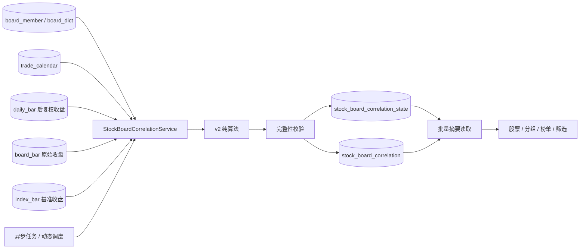

# 个股走势关联板块

## 模块定位

本模块在股票已累计收录的行业、概念候选中，分别选出近期走势最相关的行业冠军和概念冠军。计算通过版本化后台任务预先完成，股票列表、分组列表、每日榜单和策略筛选只批量读取当前结果，不在页面请求期间逐股计算。

> “走势相关”表示在扣除共同市场基准后，股票与板块收益的同步程度；不表示公司主营归属、当前有效成分关系、因果关系或投资建议。

需求与验收边界见 [`../stock-board-correlation/requirement.md`](../stock-board-correlation/requirement.md)，开发和验证证据见 [`../stock-board-correlation/plan.md`](../stock-board-correlation/plan.md) 与 [`../stock-board-correlation/performance-report.md`](../stock-board-correlation/performance-report.md)。

## 页面字段怎么理解

| 字段 | 含义 | 使用方式 |
| --- | --- | --- |
| 综合相关度 | `0.6 × 20日相关度 + 0.4 × 60日相关度`，范围 `[-1, 1]` | 越接近 1 表示同向同步越强；越接近 -1 表示反向同步越强；接近 0 表示线性同步较弱 |
| 20 日相关度 | 最近 20 个收益区间内，股票与板块扣除基准后的缩尾 Pearson 相关系数 | 更敏感地反映近期走势 |
| 60 日相关度 | 最近 60 个收益区间内，同口径的相关系数 | 更偏向中期稳定性 |
| 20 日有效样本 | 20 日窗口内，股票、候选板块和实际基准三方同日均存在可计算收益的日期数 | 最大为 20，少于 15 时该候选无效 |
| 60 日有效样本 | 60 日窗口内，三方共同有效收益日期数 | 最大为 60，少于 40 时该候选无效 |
| 数据截止日 | 本轮计算使用的最后一个开市日 | 页面业务日期与它不一致时不展示冠军 |

有效样本不是“数据库里有多少条收盘价”，也不是自然日数量。一条收益需要相邻两个市场开市日都有合法收盘；随后还要求股票、候选板块和基准指数在同一个区间结束日都能得到收益。任一方缺失，该日期不会进入相关性计算。

例如 20 日窗口显示 `18`，表示最多 20 个收益区间里只有 18 个日期满足三方共同有效。它仍超过 15 的最低门槛，可以计算，但证据完整度低于满样本 `20`。样本数只说明数据支撑强弱，不说明相关方向，也不能单独代替相关系数和可信度。

## 核心技术

| 层次 | 当前实现 | 关键入口 |
| --- | --- | --- |
| 纯算法 | 固定开市日历、收益构造、基准选择、市场中性化、缩尾 Pearson、双窗口加权、可信度和稳定决胜 | `backend/indicators/stock_board_correlation.py` |
| 领域服务 | 股票池与目标日解析、累计候选和行情批量加载、唯一代码收益预计算、完整性校验、原子替换和摘要读取 | `backend/services/stock_board_correlation.py` |
| 异步任务 | `stock_board_correlation` 五阶段任务、DuckDB 写互斥、取消检查、结果统计 | `backend/services/async_task.py` |
| 动态调度 | 全市场或指定股票、`force`、交易日限制、依赖和重试；代码不创建默认调度 | `backend/scheduler/scheduler.py` |
| 数据结构 | 当前冠军表与每股当前状态表；只保存当前态，不保存每日快照和全部候选明细 | `backend/storage/ddl.py` |
| 后端读取 | 单股累计归属及冠军接口；股票、分组、榜单和筛选结果形成后批量附加摘要 | `backend/api/stocks.py`、`backend/groups/stock_group.py`、`backend/api/board.py`、`backend/services/screen_score.py` |
| 前端展示 | 四个表格 slot 复用同一单元格，统一相关度、有效样本、截止日、低可信提示、历史保护和权限跳转 | `frontend/src/components/RelatedBoardCell.vue`、`frontend/src/layout/pageRegistry.ts` |

## 系统架构



## 算法口径

### 1. 日期与收益

- 从 `trade_calendar` 取得截至目标日最近 61 个连续开市收盘点，对应最多 60 个收益区间。
- 个股收盘使用 `close × COALESCE(adj_factor_clean, adj_factor)` 后复权口径；板块和指数使用原始连续收盘。
- 收益按相邻开市日计算：`return_t = close_t / close_(t-1) - 1`。任一相邻收盘缺失、非有限或不大于 0，该区间收益缺失；算法不会跨缺口桥接，也不会向窗口外补样本。

### 2. 基准选择与回退

| 股票范围 | 默认基准 |
| --- | --- |
| 沪市主板 | 上证指数 `000001.SH` |
| 深市主板 | 深证成指 `399001.SZ` |
| 创业板 | 创业板指 `399006.SZ` |
| 科创板 | 科创 50 `000688.SH` |
| 无法识别的板块/交易所 | 上证指数并标记回退 |

默认基准必须在目标日存在合法收盘，并同时满足 20/60 日最低 15/40 收益样本。映射基准不足时整只股票统一回退上证指数；上证指数仍不足则整批任务失败，不发布部分结果。

### 3. 共同有效样本与市场中性化

对每个候选板块和每个窗口，仅保留以下三组收益同时存在的日期：

```text
valid_dates = stock_returns ∩ board_returns ∩ benchmark_returns
```

随后分别扣除同日基准收益：

```text
stock_neutral_t = stock_return_t - benchmark_return_t
board_neutral_t = board_return_t - benchmark_return_t
```

因此页面中的 `sample_20/sample_60` 就是两个窗口各自 `valid_dates` 的数量。它回答的是“这次相关性有多少个真正可比较的共同日期支撑”。

### 4. 缩尾、相关度和综合分

- 股票和板块的中性收益序列分别按自身 5%/95% 分位缩尾，降低极端单日波动影响。
- 对缩尾后的两组序列计算 Pearson 相关系数。常数序列、非有限结果或样本不足均使该候选无效。
- 综合相关度固定为：`score = 0.6 × corr_20 + 0.4 × corr_60`。
- 行业和概念分开评选。候选先按综合分降序，再按 60 日相关度、60 日有效样本降序，最后按板块代码升序稳定决胜。

### 5. 可信度

| 等级 | 条件 |
| --- | --- |
| 高 | 60 日有效样本不少于 50、综合相关度不低于 0.70，且 20/60 日相关度同号 |
| 中 | 60 日有效样本不少于 40，且综合相关度不低于 0.50 |
| 低 | 其它仍满足候选最低样本门槛的结果 |

负相关结果是合法结果：它表示扣除市场基准后，股票和该板块更倾向反向变化。如果某类型所有合格候选都为负，最高的负相关候选仍可能成为冠军，但可信度会是低。冠军表示“候选集合里相对最优”，不保证绝对相关性强。

## 计算与发布流程

1. 解析目标交易日和全市场/指定股票范围；拒绝未知、尚未上市、已退市、北交所或项目范围外的显式代码。
2. 一次批量读取累计行业/概念候选；按唯一股票、板块和基准加载 61 个收盘点。
3. 按唯一板块和基准预计算收益映射，逐股复用，避免按候选关系重复构造。
4. 分别计算行业、概念冠军，并生成每股状态。没有合格冠军是合法状态，不视为逐股失败。
5. 校验目标覆盖、唯一性、类型、有限值、样本、日期、算法版本、基准和板块字典引用。
6. 仅在全部校验通过后，用一个短 DuckDB 事务替换目标范围的冠军表和状态表；失败或取消保留最后成功结果。

任务中心固定展示读取候选、加载行情、批量计算、结果校验、原子切换五阶段。任务可在切换前协作式取消，不支持从不完整结果续跑。安全跳过时，任务结果说明本次目标日与个股/板块指数/宽基指数三类数据族各自最新日期，并在个股行情领先于目标日时提示补齐板块指数/指数日线以推进到更近日期。

## 数据模型

### `stock_board_correlation`

每只股票、每种板块类型、每个交易日一行冠军快照，主键为 `(code, board_type, as_of_date)`。核心字段包括：

- `score/corr_20/corr_60`：综合、短窗和长窗相关度，均限制在 `[-1, 1]`。
- `sample_20/sample_60`：共同有效收益样本，数据库约束最低为 15/40。
- `confidence`：`high | medium | low`。
- `benchmark_code/benchmark_fallback`：实际使用的市场基准及是否回退。
- `as_of_date/computed_at/algorithm_version`：数据截止日、计算时间和算法版本。

### `stock_board_correlation_state`

每只成功处理的股票一行，即使行业和概念都没有冠军也会写入。`has_industry_champion/has_concept_champion` 表示两种冠军是否存在，支撑合法空结果、日期保护和版本重算判断。

两张表都是可重算派生当前态，不保存每日历史冠军、全部候选相关性或逐股空结果原因。正向与回滚 SQL 位于：

- `agent-works/stock-board-correlation/create-stock-board-correlation.sql`
- `agent-works/stock-board-correlation/rollback-stock-board-correlation.sql`

## 页面、API 与权限

| 能力 | 入口 | 权限与行为 |
| --- | --- | --- |
| 单股累计归属和冠军 | `GET /api/stocks/{code}/related-boards` | 需要 `stocks:view`；可传 `business_date` 启用历史保护 |
| 股票普通表/分组表 | `/stocks` | 沿用股票/分组查看权限；最终页数据形成后批量附加摘要 |
| 每日榜单 | `/board`、`POST /api/board/run` | 沿用 `board:view`；摘要不参与评分或排序 |
| 策略筛选 | `/screen`、`POST /api/screen/run` | 沿用 `screen:run`；摘要不参与命中和评分 |
| 板块详情跳转 | `/sectors/{board_code}` | 只有 `sectors:view` 才生成链接；无权限仍可看板块名称 |
| 任务与调度 | 数据管理任务中心、定时调度 | 使用既有 system-only `data-task:manage`、`data-schedule:manage` |

四个业务表格统一使用“行业走势”“概念走势”列名，冠军名称以小号朴素标签展示。悬浮层保留综合相关度、20/60 日相关度、20/60 日有效样本数和数据截止日；有效样本的技术定义由本文统一维护，页面不重复展示定义句。

按业务日期匹配该日冠军快照返回；该日无快照时触发按需回填（单日计算），仍无则行业、概念为空并标记 `as_of_mismatch`（语义=该历史日期无快照），页面显示“—”和固定说明，禁止借用其它日期的结果装饰该日。

## 空结果怎么判断

行业或概念显示“—”不一定是错误，可能包括：

- 股票没有该类型累计候选。
- 股票、候选板块或基准在窗口内缺少相邻收盘，导致共同有效样本低于 15/40。
- 中性收益为常数或相关系数无法得到有限值。
- 页面业务日期与当前结果截止日不一致，此时返回 `as_of_mismatch`。
- 尚未成功执行过相关性任务，当前状态不存在。

当前状态表不保存逐股空结果原因。页面只能区分历史日期不匹配和普通无冠军，不能从 `has_*_champion=false` 反推出具体缺数来源；若产品需要展示原因，需要新增持久化字段和接口契约。

## 性能与容量

- 候选、个股行情、板块行情和基准行情均批量读取；板块与基准收益按唯一代码预计算。
- 当前摘要按当前页代码集合固定一次 SQL，不随行数逐股查询。
- 固定读取基准中，1/50/200 代码 P95 为 `2.498/3.761/6.293ms`，通过 `10/20/50ms` 门槛。
- 本地真实全市场任务曾处理 5211 只股票、67592 条候选并成功原子切换；该结果不代表生产并发和网络条件下的 SLA。

详细环境、固定随机种子、复现命令和真实任务统计见 [`../stock-board-correlation/performance-report.md`](../stock-board-correlation/performance-report.md)。

## 验证入口

```bash
# 纯算法、累计归属、编排、任务、读取和结构体检聚焦测试
python -m pytest \
  backend/tests/test_stock_board_correlation_algorithm.py \
  backend/tests/test_stock_board_correlation_membership.py \
  backend/tests/test_stock_board_correlation_orchestration.py \
  backend/tests/test_stock_board_correlation_task.py \
  backend/tests/test_stock_board_correlation_read.py \
  backend/tests/test_stock_board_correlation_checkup.py -q

# 共享单元格与生产构建
cd frontend
npm test -- --run src/components/__tests__/RelatedBoardCell.spec.ts
npm run build

# 安全真实后端页面链路；runner 负责服务状态、夹具和清理
AI_STOCKS_ENV=dev AI_STOCKS_E2E_WRITE=1 npm run test:e2e:stock-board-correlation
```

会访问项目 DuckDB 的测试必须遵守 `AGENTS.md` 的停服、锁和原状态恢复规则。E2E 只允许在 `dev|test|local` 且显式开启写门控时执行。

## 风险事项

| 等级 | 风险点 | 影响 | 当前控制 |
| --- | --- | --- | --- |
| 中 | `board_member` 是累计关系，不是目标日当前有效成员 | 已退出板块的股票仍可能参与候选比较 | 页面只表达“走势相关”；不宣称当前主营或有效归属 |
| 中 | 基准或行情缺口降低共同有效样本 | 候选无冠军或可信度降低 | 相邻日不桥接、15/40 门槛、基准整股回退、上证不足整批失败 |
| 中 | 当前态没有历史冠军 | 历史页面不能展示对应日期结果 | 业务日期 fail-closed，绝不借用最新冠军 |
| 中 | 当前状态不保存空结果原因 | 页面只能显示“—”，运维诊断需查候选和行情 | 技术文档明确边界；若要展示原因需独立扩展数据契约 |
| 中 | 生产并发与硬件不同于本地验证 | 全量任务窗口或读取尾延迟可能变化 | DuckDB 写互斥、内存计算、短事务切换；生产首轮继续观察 |
| 低 | 负相关候选仍可成为相对冠军 | 用户可能误读为强同向关联 | 页面显示带符号相关度并将结果标为低可信；文档明确解释 |
