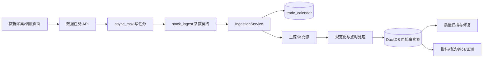

# 个股数据采集模块架构

## 文档范围与结论摘要

本文说明个股 EOD 数据从任务入口、数据源调用、清洗落库、断点续跑到质量修复的完整机制。持久化对象包括股票基础资料、交易日历、指数行情、个股日线、逐日股本、估值市值、ST 点时事实和数据来源审计。

本文维护个股采集方案、来源优先、日期收敛与股本估值落库规则；ST 专项规则、分时与板块源协议由下方对应文档维护，不在此平行定义。采集实现变化时同步本文及对应测试，通用请求配置更新 [环境配置架构](environment-configuration.md)，质量治理入口更新 [数据管理](data-management.md)，不累计当次采集或验收流水。

核心结论：

- Web 新建个股采集统一使用 `stock_ingest` 任务，并通过 10 类受约束方案分派既有采集能力。
- “最近开市日”来自 `trade_calendar`，是截止日候选；日常同步遇到今天为交易日时，还会探测行情源是否已发布当日数据，未就绪则整体回退到上一开市日。
- 行情拉取可并发，DuckDB 写入受单写锁串行保护；任务支持协作式终止、断点续跑和幂等重试。
- 历史行情、市值、ST 状态是不同采集链路。历史行情补全不会自动补齐全历史市值，ST 的权威事实也不能由当前名称反推。

板块采集见 [board-collection.md](board-collection.md)，按需分时查询见 [stock-intraday.md](stock-intraday.md)，ST 专项口径见 [st-status.md](st-status.md)。

## 模块定位与职责边界

本模块负责：

- 维护股票名册、上市退市日期和板块涨跌停基础属性；
- 维护交易日历、市场指数、个股日线和估值市值；
- 采集并发布逐日 ST 权威事实，再重建 `daily_bar` 的消费投影；
- 提供日常同步、历史补全、区间重采、估值修复、基础资料刷新和退市股补全入口；
- 记录任务进度、来源、更新日志和质量问题，供数据管理页面复核与修复。

本模块不负责：

- 板块字典、板块指数、成分和板块资金流；
- 盘中分时的长期持久化；
- 指标、评分、筛选、榜单和回测结果的自动重算。采集改变原始数据后，下游派生结果按各自失效与重算机制处理；
- 跨 DuckDB 与 PostgreSQL 的数据库 JOIN。

## 核心技术与实现机制

### 统一采集方案

`backend/services/stock_ingest.py` 对任务参数做白名单校验，拒绝方案不支持的字段组合。

| 方案 | 用途 | 可选范围与参数 | 主要执行入口 |
|---|---|---|---|
| `daily_update` | 日常增量同步 | 股票、并发数、强制当日 | `IngestionService.update` |
| `history_backfill` | 近 N 年历史行情补全 | 股票、年数、并发数 | `backfill` |
| `range_refetch` | 指定日期区间重采 | 股票、起止日、并发数 | `ingest_date` |
| `share_capital_history` | 逐日股本补采及缺失市值补算 | 股票、年数、并发数；API 可附公告核验事实 | `ingest_share_capital` |
| `valuation_history` | 历史估值市值补采 | 股票、年数、并发数 | `ingest_valuation` |
| `valuation_gaps` | 已有行情范围内的市值缺口修复 | 股票、并发数 | `ingest_valuation_gaps` |
| `valuation_invalid_history` | 全历史异常市值修复 | 股票、并发数 | `repair_invalid_valuation_history` |
| `basic_refresh` | 基础资料和上市退市日期刷新 | 无股票范围参数 | `enrich_basic_dates` |
| `delisted_history` | 退市股资料与历史行情补全 | 年数 | `enrich_basic_dates` 后执行 `ingest_delisted` |
| `st_status_refresh` | ST 点时事实刷新与发布 | 股票、可选起止日 | `refresh_st_status` |

默认历史年限为 10 年（可由平台配置覆盖），年数限制为 1～30，并发数限制为 1～16；`force_current_day` 只允许用于日常同步。股票代码在进入任务前统一规范化。

历史回填、估值历史和退市历史任务首次运行冻结 `history_start/history_end` 到 checkpoint，续跑沿用原窗口；自然年回溯将闰日收敛到目标年二月末。扩容已有股票的市值须用 `valuation_gaps`，不能以整股已有市值判定十年已齐。源端不可得市值可由同日、同口径股本补算；股本也不可得时保持缺失，不用当前股本反推。

### 日期与源端就绪

`trade_calendar` 是日期判断的本地事实源。`_latest_open_day(ref)` 查询不晚于 `ref` 的最大开市日；若 `ref` 本身开市，结果就是当天。因此交易日历回答的是“制度上哪天开市”，不保证免费行情源在盘前或收盘后已经发布完整数据。

所有 EOD 入口共用 `backend/services/eod_dates.py`：北京时间 15:30 前最多采到上一开市日，15:30 起才允许当日；周末和节假日按真实日历回退。日历同时支持全日期与仅开市日格式，缺行只有在已覆盖区间内才表示休市，覆盖未知时明确失败。个股、大盘指数、板块指数在请求前限制区间，返回后过滤超出区间或未收盘的记录。历史修复与直接单股入口也不能绕过这层保护。

日常同步先补最近一段交易日历，再对收盘后“今天是目标交易日”的全量或指定股票任务执行源端就绪探测：

1. 从在市股票中选取探测样本；
2. 请求目标日行情，统计有效、空结果和异常；
3. 达不到就绪门槛时回退到上一开市日，不逐股写入当日半成品；
4. 显式强制当日只允许已收盘的开市日，仅跳过源端就绪回退；15:30 前、休市日和未来日不能强制。

任务首次确定的目标日写入 checkpoint；续跑沿用该日期，避免跨日后改变同一任务的范围。显式区间冻结实际 `range_start/range_end`；历史任务冻结 `history_start/history_end`。一键日常流程将个股结果中的 `end` 传给板块，并以 `pipeline_target_end` 冻结共享上界；板块源未就绪可向前回退，日志和结果记录实际截止日，不用全库局部最大日期覆盖本轮目标。

### 拉取、清洗与写入

- 主源由 `datasource.primary` 配置，补充源由 `datasource.fallback` 配置并惰性创建；主源单股失败时可切换补充源。
- 并发任务为每个工作线程创建独立数据源实例。日线增量、历史补数及指定区间共用 `_run_daily_parallel`：编排线程预读已有准确ST，工作线程取得行情和缺失ST原始材料（BaoStock会话仍串行），编排线程沿原规则校验ST、参考价和持久化；历史估值/股本先并发取估值材料，事件补充与合并回到编排线程。补充源定向校准仍可在编排线程联网，但同样受统一请求保护。
- 新浪不复权与后复权SDK解析共用同股同次取源的HTTP材料和Session，正常每股3次请求；不跨股、任务或语义重试缓存。行情、流通股本、后复权因子的JS变量名分别校验标的；量额比较只作解析一致性检查，不把复用材料当独立来源证据。
- 日线按不超过工作并发窗口、至多等待1秒收集就绪结果；清洗后的行情、ST事实/审计/日期修订、股本市值、来源留痕在同一DuckDB事务批量提交，成功后才推进断点。批次已提交但未登记断点时，续跑复用行情水位，并按目标股票补完未清洗因子。
- 逐日估值接口将起止日期传到源端过滤，保留完整分页校验及本地日期过滤。最新日市值待补不少于32只且来源声明 `valuation_batch` 时，从同一东财报告按交易日取全市场分页快照，再按目标代码分组；小范围或不支持该能力的来源沿用逐股请求。分页总数、页数稳定性、标的、日期及唯一性必须通过校验；空快照、分页异常或未覆盖股票继续逐股取源，不把批量传输成功当作逐股补齐。两条路径共用字段转换、单位及来源价格证据，成功断点仍在合并后登记。主线程按不超过工作并发窗口、至多等待1秒收集结果并批量合并；有缺口、来源冲突或非法原始记录的股票继续原多来源核验链，并复用已取得的估值结果。价格按目标日期关联，真实最新日独立聚合，不逐股向pandas装载全历史；股本、市值合并与修订检查显式限制输入日期范围，避免小批增量反复扫描全历史，实际读写仍按代码和日期关联。旧股本历史表的撤销和来源日期口径清理也按批执行。
- 实际HTTP按来源共享起始频率、网络并发和冷却，分页及重试均计入；网络槽不覆盖数据库写入。日线和最新日市值在落库前预取下一工作窗口，最多保留一批待提交材料及一个在途窗口（合计至多两倍工作并发），其它链路沿用单窗口；提交成功后才写成功断点；取消等待工作线程退出，未提交结果不登记完成。DuckDB仍为单写入通道。
- 日线入库前完成代码、日期、OHLC、成交量额、复权因子和涨跌停/ST 标记所需数据的规范化；停牌日不向 `daily_bar` 写占位行。
- 源复权因子保留在 `adj_factor`，去抖后的消费因子写入 `adj_factor_clean`。有新日线时只刷新受影响股票的干净因子序列。
- 行情、估值和 ST 事实分别落表。历史行情任务只采行情；全历史市值需使用估值历史或缺口方案单独补齐。
- 数据写入使用主键 upsert 或幂等插入，来源与区间写入更新日志和 provenance，重复执行不会制造重复主键。

### 任务状态与失败语义

`stock_ingest` 是可调度、可终止、可续跑的 DuckDB 写任务。同一时刻只允许一个 DuckDB 写任务。逐股阶段保存已完成代码、阶段、目标日和进度；并发终止会等待已提交的工作单元收敛后退出。检查点附请求聚合：工作并发及启动默认值/来源、互斥工作状态、真实请求/失败、累计网络/额度等待、SQL等锁/执行时间、配置版本和阶段ETA。任务终态仍保留 `request_runtime` 聚合供详情读取。线程耗时不相加冒充任务墙钟时长；缺少有效阶段总量、新阶段或本轮新增样本不足时不估算，阶段出现技术失败后停止显示ETA；旧任务无指标时保持未记录。

单股失败不会抹掉已成功数据。返回结果存在 `fail > 0` 时，任务标记为部分失败并保留 checkpoint，用户可继续未完成项；源端未就绪导致的整体跳过会在结果和日志中明确说明。

## 架构组成与调用关系

| 层级 | 主要实现 | 职责 |
|---|---|---|
| 页面 | `frontend/src/views/data/IngestView.vue`、`ScheduleView.vue` | 选择方案、约束参数、创建和查看任务 |
| API | `backend/api/data_tasks.py` | 创建、查询、终止、续跑任务，执行 system 权限守卫 |
| 任务编排 | `backend/services/async_task.py` | 状态机、日志、checkpoint、写任务互斥和方案分派 |
| 参数契约 | `backend/services/stock_ingest.py` | 10 类方案与参数白名单 |
| 采集服务 | `backend/services/ingest.py` | 日期收敛、数据源调用、并发、清洗、落库和收尾校验 |
| 数据源 | `backend/datasource/` | AKShare、baostock 等能力适配、限流和源端响应规范化 |
| 存储与质量 | `backend/storage/`、`backend/services/data_report.py` | DuckDB DDL、仓储、质量扫描和修复任务 |



批次采集的收尾检查通过 `backend/services/collection_quality.py` 统一承接，合并嵌套阶段后按实际对象复用既有质检规则；范围隔离、任务失败与主动全量质检的契约以 [数据管理](data-management.md) 为准。

## 使用与运行方式

系统管理员可在“数据管理 → 数据采集”手动执行，在“定时调度”创建 `stock_ingest` 调度。Web 统一调用 `POST /api/data/tasks`，请求示例：

```json
{
  "task_type": "stock_ingest",
  "params": {
    "recipe": "range_refetch",
    "codes": ["600000.SH"],
    "date_start": "2026-09-01",
    "date_end": "2026-09-10",
    "concurrency": 2
  }
}
```

任务详情、增量日志、终止和续跑分别由 `/api/data/tasks/{id}` 及其 `logs`、`cancel`、`resume` 子路径承接。历史 CLI 入口仍保留，用于运维和兼容；Web 新建任务不再组合旧原子任务类型。

常用校验入口：

```bash
python -m backend.cli verify-data
python -m backend.cli verify-catalog
```

服务启停与测试必须使用仓库 `start.sh`，避免后台服务和测试同时持有 DuckDB 文件锁。

## 核心流程与状态变化

### 日常同步

1. 读取在市股票范围和已有 checkpoint。
2. 补交易日历，得到候选截止日并执行源端就绪探测。
3. 增量补指数行情。
4. 每只股票从自身 `daily_bar` 最大日期的下一天补到目标日。
5. 对有新行情的股票刷新干净复权因子。
6. 采集目标日最新估值市值，汇总成功、失败、行数和实际截止日。

### 历史补全与区间重采

历史补全以最近开市日为截止，根据配置或输入年数确定起点；已覆盖到目标历史起点的股票跳过。区间重采先幂等补齐同区间交易日历与指数，再逐股重采指定区间。两者只对实际有新行的股票刷新价格因子。

### ST 状态发布

ST 刷新先建立批次状态，按每只股票的有效行情区间采集权威点时事实。只有来源步骤无失败且全市场覆盖完整时，批次才发布为 `ready`；部分刷新用于恢复失败批次时，会在重新开放门禁前重建全部 `daily_bar` ST 投影。

### 质量修复

质量扫描把缺失、异常或陈旧事实写入 `data_quality_issue`。修复任务按问题类型调用区间重采、估值补采、ST 刷新等确定性入口，完成后复检并收敛问题状态。修复原始事实不等于自动重算所有下游快照。

## 数据、权限与配置

| 数据对象 | 主要语义 |
|---|---|
| `stock_basic` | 当前基础资料、上市退市日期和静态板块属性 |
| `trade_calendar` | 交易所开闭市事实，是日期区间和最近开市日依据 |
| `index_bar` | 市场指数日线，用于基准和回测 |
| `daily_bar` | 个股可交易日行情、复权因子及消费投影 |
| `daily_metrics` | 估值与市值等逐日指标 |
| `stock_st_status_daily` 及配套表 | ST 权威逐日事实、历史、刷新状态和日期修订 |
| `data_update_log` | 表、来源、区间、行数、状态和详情 |
| `data_source_provenance` | 字段/表来源审计 |
| `data_quality_issue` | 质量问题、忽略、修复和收敛状态 |

数据任务 API 使用 `data-task:manage` 且受 system-only 守卫保护。质量查看、质量修复、调度和数据源设置分别使用对应的系统功能码；前端隐藏按钮不能替代后端鉴权。

主源、补充源、历史年数、请求限流、默认并发和数据源专属参数由 `config/settings.yaml`、环境变量及 `app_config` 覆盖层共同决定，完整优先级见 [environment-configuration.md](environment-configuration.md)。

## 上下游依赖与影响范围

上游依赖公开免费行情源、交易日历能力和本地配置；其发布延迟、限流、字段变化与历史覆盖范围会直接影响采集结果。补充源用于能力补齐，不能假定所有字段、复权口径或交易状态与主源完全等价。

下游包括个股列表与详情、宽表、指标、评分、筛选、榜单、板块关联、回测、交易纪律和质量报告。修改日线、复权因子、ST 事实或交易日历会影响多个领域，实施修复时必须检查相应快照、缓存和重算入口。

## 验证与测试入口

| 验证对象 | 入口 |
|---|---|
| 方案参数、任务注册、分派和部分失败 | `backend/tests/test_stock_ingest.py` |
| 日常同步、源端未就绪回退 | `backend/tests/test_ingest_update_fallback.py` |
| 采集与质量修复闭环 | `backend/tests/test_data_mgmt_c.py`、`test_quality.py` |
| 主流程和结构契约 | `backend/tests/test_pipeline.py`、`test_ingest_integrity.py` |
| ST 点时事实与发布门禁 | `backend/tests/test_st_status_pipeline.py` 及 ST 专项测试 |
| 运行数据检查 | `python -m backend.cli verify-data`、`verify-catalog` |

涉及 DuckDB 的测试必须先按 [AGENTS.md](../../AGENTS.md) 检查并停止后台服务，结束后恢复原运行状态。

## 风险、限制与待确认项

- 免费数据源存在延迟、反爬、限流、字段漂移和局部历史缺失；任务成功只表示本次编排完成，仍需结合实际截止日、行数和质量结果判断新鲜度。
- “已收盘”不能替代“源端已就绪”。收盘后仍可能发布延迟；强制当日只跳过源端回退，不能保证数据完整，实际覆盖仍须质检。
- 并发只覆盖网络等待，不放大配置的来源请求速率；DuckDB 单写锁仍保护落库。统一参数、生效边界和来源例外见 [环境与配置加载](environment-configuration.md#行情请求参数与来源能力)。
- 历史行情、估值和 ST 是独立覆盖面；不能用某一链路成功推断其余数据已完整。
- 原始事实修复后，下游派生结果是否需要失效或重算，应按对应模块架构文档与质量台账确认。

### 十年历史补数边界

历史窗口以最近已就绪交易日回溯自然年，首次执行将起止日期记入任务检查点，续跑沿用原窗口。首日覆盖只接受非交易日或准确停牌证据，不采用自然日宽限。日线重采后按已有逐日股本刷新总/流通市值；没有股本时保留接口兜底，新增历史股本通过股本补采单独补齐。行情入库后需完成干净因子刷新，退市股同样适用；因子失败不写入完成断点。全序列重算保留源端首日前收盘参考价及已校准的除权参考价。清洗因子与参考价/涨跌停标记更新在同一事务内记录 `daily_bar` 的 `derived:price_factors` 修订，确保纯复权重算也推进指标缓存输入版本；日志失败须一并回滚。

源端缺少行业分类时保留已有值，不将接口漏返当作原分类失效。新浪单日重采因长期停牌缺少前收盘锚点时，使用现有 BaoStock 官方参考价校准；质检不得把参考价为空视为异常已修好。OHL 恢复用备用源核验；只有权威状态完整确认停牌且已有记录无成交时，才移除零成交占位行情及对应指标，保留 ST 与停牌事实。有成交记录冲突时保留原数据并报错。

### 十年历史特殊日与源端覆盖边界

- 公告确认的恢复交易不限幅日维护在 `stock_special_trading_day`，按股票/日期精确生效；不从涨幅或停牌时长推断。质检、行情标记、天梯和回测共用该事实。
- 普通异常涨跌幅经复检仍存在时，用既有 BaoStock 备用源重采该股已存历史区间并重建清洗因子，避免重复取回主源同一错误，也避免拼接不同复权基准；按修正后的原始价同步重算市值，保留原接口证据。
- 下一年交易日历未覆盖但下一开市日已存在时，只记跨年预备提醒；缺少下一开市日仍是运行就绪度失败。不推算源端未发布的未来交易日。

## 逐日股本与市值（2026-10-19）

- `stock_share_capital_daily` 为股本历史事实，按 `(code, trade_date)` 与已有日线对齐，单位股。总股本与流通 A 股分别保存来源、生效日期、可用日期；不从市值反推、不使用当前股本倒填。
- 来源优先：指定日期核验总股本；东财逐日估值的股本；符合重建条件的上交所转股统计总股本；新浪日线的流通 A 股；东财完整分页股本变动补缺，仍缺时用新浪历史股本结构核验。变动记录之间先比较生效日期，同日东财优先；新浪较新事件可替换东财旧事件，但不能覆盖已被非本地计算的源端市值与原价共同验证的股数，也不能以 5 股内显示舍入差替换精确值。若东财数值能被源端市值验证而已有新浪值不能，可纠正备用值；只核验接口返回的股数，不从市值反推。逐日报告及已核验事实仍优先。变动记录按来源变更日期生效，沿用至下一次变动。公告日期仅作溯源，不阻止历史落库；不按变动原因文字设置展开白名单。没有前置有效记录时保留空值，不向生效日之前倒填。备用源不得跨越主源较新的变动边界。公开接口可能修订历史，原始版本留档。
- `share_capital_history` 通过原有 `stock_ingest` 异步任务入口执行，支持股票、年限、并发及断点；目标来自已有日线，包含退市股票，不因市值已存在而跳过。估值接口明确空响应与网络失败区分，估值失败不阻断股本尝试，失败票保持可重试。
- `daily_metrics` 的业务市值优先使用有效逐日股本×本地同日未复权收盘价，只有缺少有效计算输入时才使用留存接口市值兜底。流通股本仅用流通 A 股；总市值采用总股本（含 H/B 等股份）×A 股未复权收盘价，不代表各上市地分币种市值之和；`total_mv_eligible` 仅作股份组成证据。`total_mv_source/float_mv_source` 的 `computed:` 前缀表示计算值，总市值前缀为 `computed:a_price:`。股本变更及行情重采共同调用合并服务刷新市值，不能让后来返回的接口市值覆盖有效计算值。
- 接口市值独立保存在 `reported_total_mv/reported_float_mv`，分别附 `reported_*_mv_source` 和同次接口的 `reported_*_close`；旧非计算值在重算前归档，来源不明标记 `legacy_unknown`，未知接口价格不反推。计算值不能当作接口证据用于验证股本。接口值更新、计算输入消失或恢复时，重新选择业务市值；没有计算输入也没有接口值时保持缺失。接口与本地股本、价格的矛盾进入结构体检的来源核验提醒，不计业务质量异常；继续参与历史轮询、日常采集和备用股本选择。计算一致不表示来源已核实。
- `stock_basic.total_share/float_share` 仅为最新行情日的兼容投影，分别有 `*_share_date`；历史区间补采不能倒灌。指标引擎、筛选/评分/回测与个股详情统一读取对应日股本事实并说明来源，缺失显示空值。股本/市值实际变更与修订日志同事务提交；榜单读取通过输入指纹按需重算。历史回测报告保留原运行事实，新回测去重签名纳入区间内股本修订版本。
- 采集时拒绝非正/非有限股本和流通大于总股本；数据体检检查全历史（含退市）股本覆盖、生效日期边界与合法性。目录登记鲜活度与全历史质量策略，台账和体检共用股本市值契约。
- 前端复用既有采集方案选择器与参数组件，仅新增方案选项及任务名称，同时复用 `StockQuoteSummary`、`buildHeaderSummary` 和 `aggregateKlineBars` 传递历史股本；无新增组件、布局或样式，不涉及页面设计闭环或组件/布局维护矩阵变更。
- 升级与回滚 SQL 留痕：`agent-works/stock-data-ingestion/daily-share-capital/schema.sql`。升级前备份：`/Users/pengshuaifeng/ai-stocks-backups/daily-share-capital-20261019`；历史扩展基线提交 `bfaca731`。


### 股本缺口收敛与日常闭环

- 按交易日选择最近一条源记录，不压缩同值记录：新记录即使股数不变，也代表来源在该日的确认，不能让较旧备用记录覆盖它。数值非法时保留缺口，不用旧数越过已知变动。
- 缺口增加新浪历史股本结构备用源，保留公告日、生效日，拒绝 1900 年占位公告日；备用事件不得跨越主源已知的新变动边界。万股显示的三位小数按最多 5 股的单项舍入误差核对股本，A 股组成合计只允许三项累计 15 股显示误差；不扩大市值异常容差。
- 日常最新日补采同时检查总/流通股本、总/流通市值。市值完整而股本缺失也触发补采；与历史任务共用 `_collect_capital_one`。直接估值已经补齐四项且股本×原价与市值在统一容差内一致时，日常入口不再额外请求事件源；非空不一致也会触发复查。
- 历史补采任务结果 `diagnostics` 按股票保存来源返回情况、错误、剩余原因计数与日期样例，区分无前置记录、源记录非法、跨源数值冲突；网络异常仍是失败，保留重试资格。任务成功不代表四字段全部非空。

- 四字段实际值或留存接口市值/价格证据变更才登记 `stock_share_capital_daily` 修订日志，幂等补采不刷新版本。指标缓存/榜单联合指纹纳入该日志；新回测签名纳入请求区间内的股本修订，不再把旧数据结果当成相同输入。历史回测报告不自动重写，采集不直接触发全量结果维护任务。市值历史补采、缺口修复、行情补缺收口也复用四字段补采服务。

- 经原始公告或交易所逐日统计逐条核验的总股本，可在 `stock_ingest/share_capital_history` 参数中附 `verified_facts`，必须同时指定 `codes`。每条提供股票、精确交易日、生效日、公告可用日、总股本、股份组成标记、证据编号、HTTPS 链接及核验说明；单批最多 1,000 条。整批先校验日期、已有行情及流通股本关系，防止部分无效记录静默跳过。仅维护指定日总股本，不外推、不据此改流通股本；按修正后股本同步重算业务市值，留存接口值不变；公告证据保存 `verified_notice:证据编号`；可选 `source_type=exchange_daily` 限上交所官方 HTTPS 证据，保存 `verified_exchange_daily:证据编号`，来源舍入精度须在核验说明中明示，完整证据在任务参数与本次事实归档中保留。常规采集不能覆盖已核验值，纠错须重新提交核验事实。仍走原 system-only 数据任务权限、单写互斥及修订日志。实际事实样例见 [verified-share-facts.json](../stock-data-ingestion/daily-share-capital/verified-share-facts.json)。

- `share_capital_history` 支持 `recalculate_only=true`，按库内同日股本与未复权收盘价统一刷新已有市值及补缺；每批最多 200 只股票，支持取消和进度，不联网、不修改股本或留存接口市值；可按 `codes` 缩小范围，不能与 `years` 或 `verified_facts` 混用。仍通过异步任务执行并登记实际变更修订日志。


### 自动转股补充与历史轮询

- `AKShareSource.get_exchange_share_capital` 通过东财 `RPT_BOND_CB_LIST` 自动发现含已退市转债的正股映射，使用上交所 `COMMON_SSEBOND_SCSJ_SCTJ_ZXTJ_KZZZGTJ_CX_L` 完整年度分页取得逐日累计转股。无内置股票清单，不依赖人工核验 JSON；目前只支持沪市转股统计，不冒充覆盖深市转股和期权行权。
- 基准取转股开始前最近一条、有来源证据的总股本；当日总股本 = 基准 + 当日已发生累计转股。只接受纯转股变动；出现回购、配股、转增、混合增资等其他变动即停止旧基准重建，多只转债重叠或基准证据不足时保留原因，不猜数。只生成总股本，不据此生成流通股本。
- 来源 `sse_conversion_100share:转债代码` 明示 100 股精度。与原数相差不超过 50 股时保留原精确值，不覆盖东财逐日报告或已核验值，不跨越更新的股本记录；较新东财精确记录可校准旧转股统计。若重建总股本小于现有流通股本，拒绝覆盖。债券、基准数量、生效/可用日、精度、跳过原因随任务诊断和轮询日志保存；网络/格式/分页失败不当成空数据。
- `update()` 在最新日补采后调用 `review_capital_history()`，覆盖全历史缺失及非空股本×原价与市值不一致，含历史退市股票。复用 `_collect_capital_one`，因此人工运行日常更新和定时调用日常更新具有相同行为。它不创建新调度任务；现有个股/指数定时任务按用户要求保持关闭。
- YAML 参数 `datasource.capital_review_batch_size=50` 控制每次日常更新最多复查的股票数（0 关闭）；`capital_review_interval_days=7` 是无新证据时同股再次复查的最短间隔，失败最短间隔 1 天。按从未尝试、最久未尝试排序，避免反复阻塞在少数缺失股；实际全池轮询周期还取决于日常更新运行频率和待查股票数。这两个参数为 YAML 基线配置，未新增 Web 设置控件；并发复用既有任务参数。
- 完整历史股本补采和自动轮询都在 `data_update_log` 保存 `source=capital_review:股票代码` 的逐股诊断与尝试时间；`status=checked` 表示完成复查，**不表示没有缺口**，也不作为行情修订版本。只有四字段实际变化才另记 `success` 修订。失败仍为 `failed`；取消遵循现有协作式取消与单写互斥。
- 历史补采诊断不仅保存剩余数量，还保存字段的具体交易日、生效日、可用日样例，区分记录缺失、数值非法、跨源冲突与非空不一致。新浪流通股本也会复查与既有流通市值不一致的旧事件股数；若新备用股数超过已知总股本，保留原事实并继续报告矛盾，不先写入再擦空。
- 通过原异步入口 `stock_ingest/share_capital_history` 的 `review_only=true` 可即时执行一批轮询，使用相同间隔与数量限制；不能和 `years`、`verified_facts`、`recalculate_only=true` 混用。全量立即复查仍使用不带 `review_only` 的历史补采。

历史复查续跑保留独立日期窗口，日常任务优先沿用已收敛的目标日，不修改主采集检查点。缺失原因区分无先前记录、源端无有效股数及交易所股数精度冲突；非空市值不一致会保留该次估值接口的收盘价证据。若源端市值能由同日股本乘源端价格解释，则记为 `*_mv_price_basis_mismatch`，不把价格源差异误记为股本错误，接口原值独立保留，业务值按本地输入计算一致也不关闭来源差异。


股本、市值质量台账由 `CapitalQualityService` 接入共同采集入口：缺口、非法及非空不一致三类全历史问题自动写入并复检。定向修复覆盖该股全部已有历史；异常市值修复复用同一多来源链路，源端覆盖仍限于其原有异常日期规则。日常更新和统一批量任务结束后同步台账，不以请求成功或 checked 日志代替问题 resolved。接口失败、股数缺失或非法、统计精度不足和价格依据不同会分别留证，具体状态与页面承接见数据管理架构的“股本与市值全历史质量闭环”。

历史轮询同时识别 `capital_review:*` 与共同采集入口的 `capital_collect:*` 记录；只有核验窗口完整包含该股当前问题日期范围的尝试才参与重试间隔计算。最新日的局部采集不能延后历史问题复查；完整核验失败按 1 天重试，正常核验仍有缺口按配置的 7 天复查。


日线全历史完整性检查及修复复检由 `HistoryQualityService` 统一定义，近端采集窗口不替代历史覆盖。`reconcile_gaps(full_history=True)` 按已知上市/退市边界选择缺日，主源部分返回后对剩余区间尝试备用日线；只有明确逐日停牌状态可写入 `stock_suspension`，不再将空响应直接当停牌。

### 原始事件、统一逐日股本与质量闭环

- `stock_share_capital_event` 保存东财、新浪原始变动记录、来源、变更日、公告日、原因、采集时间和历史修订版本；展开失败仍归档响应并报失败。空响应不撤销已有原文。
- 接口变更日期是该条历史股数的适用起点，按总/流通字段分别沿用至下一次变动；不要求公告日早于交易日，不按变动原因设置白名单，不把非交易日变更挪至前一个交易日。该口径是修订后的历史事实，不能解释为当时已公开的信息版本。
- `stock_share_capital_daily` 和 `daily_metrics` 是唯一消费事实。个股详情、指标、筛选、评分、回测一致读取；API 的旧 `capital_basis` 参数仅为兼容，不再切换两套股数。旧 `stock_share_capital_history` 表保留结构，重建时清理旧派生值，不再查询或写入。
- `_collect_capital_one` 仍是日常更新、历史补采和台账修复的共同入口：采集、归档、写逐日股本、缺失市值补算、质量复检。`coverage` / `historical_coverage` 为兼容返回相同事实的覆盖；公告晚于变更日不再记为缺口原因。
- `rebuild_events_only=true` 经 `stock_ingest/share_capital_history` 异步任务重放库内原始事件，支持按股票及断点续跑，不联网。不能与年份、核验导入、纯补算、轮询选项混用。值变化才登记修订，指标缓存与新回测据此失效；已有回测报告不自动改写。
- 原始记录流通 A 股为 0 可表示尚未上市或只有其他股类；负股数、流通大于总股本、非正总股本、缺失变更日保留原始证据并列为结构体检来源核验提醒，旧 `capital_raw_invalid` 不再产出业务异常。无效股数不能成为有效逐日股数。台账修复后必须实际复检，不能只凭接口成功关闭问题。原始记录异常的来源即使逐日四字段已完整仍须重新请求，避免备用源异常永远无法复检。
- 股本不会直接改变成交价格和现金盈亏，但会改变市值股票池及使用股本/市值的指标，因此统一数据修订会影响相关新回测；不另加公告日期拦截。
- 页面复用既有摘要提示，仅更新来源和日期说明，无新组件、布局或样式，不触发布局设计改造。


### 日常四字段维护的执行边界

`update()` 在日线阶段之后调用 `ingest_valuation_latest()`，对目标日已有日线且属于本次股票范围的在市股票，检查总股本、流通 A 股股本、总市值、流通市值及来源疑点，共用 `_collect_capital_one`。股本写入 `stock_share_capital_daily`，两项市值按有效股本×本地同日未复权收盘价计算并写入 `daily_metrics`；接口值仅在计算输入不足时兜底。四项已完整且通过检查时不保证每次重新联网请求所有来源；源端失败也不能保证本次四项全部补齐。单独重采日线会按已有股本刷新市值，但不等同于执行完整日常同步的多源股本补采。

最新日之后处理新票历史估值、有界历史股本轮询及业务台账同步。历史退市股由历史补采/轮询处理，不向退市后生成日线或股本。最新估值与历史复查保留独立容错，但错误及失败数量纳入 `stage_failures`，由新旧采集任务入口及每日流水线汇总为失败/部分完成；成功数据保留。任务成功仍不代表所有来源矛盾已经裁决。类型合并、范围差异和剩余闭环缺口统一维护在 [数据管理](data-management.md#质量类型归类合并边界与未完成项)。


### 历史日线缺口的交易状态收口

全历史定向修复先读取逐日交易状态，只对交易日历、上市/退市边界内、尚无日线且同日所有来源记录均明确为 `trade_status=0` 的日期确认停牌。缺失、非 0/1 状态、矛盾重复行和空响应都不作为停牌证据。正常日线采集或 ST 刷新取得的明确停牌状态也经同一入口保存，排除本次即将写入或库内已有日线的日期，并在更新日志记录来源、日期和任务 ID。

取得状态后仍缺的日期继续主源/备用源补行情，实际补回后先重算清洗因子，再衔接股本市值采集并复检；定向复权异常修复同样在重采后执行清洗因子重算，不改写原始来源因子。状态源失败记录关联阶段错误并继续尝试主行情源，避免同源重复兜底；实际缺口仍保留待处理，支持取消及续跑，不推断源端永久不可得。全历史日线修复需要手动/定时选择对应质量类型；日常日线收口仍按近端执行。

BaoStock 登录与普通查询分开控制超时：`datasource.baostock_login_timeout_sec` 默认 120 秒，可通过系统配置调整；登录成功后恢复 `datasource.socket_timeout_sec`（默认 30 秒）。SDK 登录会新建连接，因此在 SDK 本次连接器上设置专用超时，不调整进程全局默认值。登录失败也恢复连接器，挂起看门狗为登录等待保留足够时间。实际探测曾在第 74 秒成功登录，不能将旧 30 秒超时直接解释为来源没有历史数据。

复权清洗仅采用已独立记录来源并通过同次收盘核验的参考价，不使用旧派生 `pre_close` 自证；按“前一交易日原价 × 前一清洗因子 ÷ 当日参考价”衔接；来源原始因子保持不变。新增与局部重采同时核对请求区间左右接缝和源端漏返时保留旧行形成的内部接缝：将跨行原始因子反推参考价与同批来源参考价比较，差异超过 0.011 元或缺少因子/参考价时，必须取得同次收盘匹配的备用源直接参考价；来源推导价只用于发现差异，不能登记为独立证据。核验失败在写行情前报错；保留旧行的新证据与本次行情原子提交，并清空其清洗因子等待统一重算。日常同基准追加不额外联网核验。识别到因子大幅重置而原价未对应跳变时，主源采集须使用备用源的直接参考价核验整段，而非仅核验断点当天，避免换码前因子恒为 1 掩盖分红。重采、定向恢复和后续全量/增量清洗共用该计算；无有效参考价时沿用原因子去抖逻辑。

### 参考价证据、人工退市与停牌纠错

- `daily_bar.reference_pre_close/reference_close/reference_source` 保存接口直接参考价与同次原始收盘；重算仅接受来源非空、参考价为正、同次收盘与本地相差不超过 0.011 元的证据。`pre_close` 是消费结果，不得作为独立证据反向覆盖新因子；旧库派生值不自动迁入来源字段。因子大幅变化且原价连续只用于触发来源核验，不能在无证据时直接抹平因子。
- `rebuild_price_factors` 任务可显式指定 `codes` 和 `refresh_reference=true`，先联网获取同日直接参考价并核对价格，完整通过后重算。存在缺返或错价时返回 `ok=false`，保留旧因子并报告数量，不能宣称修复完成。原始 `adj_factor` 不变。
- 人工退市通过质量页面提交互斥 `fix` 写任务；必须填写依据，日期不能晚于今天、早于/等于上市日、覆盖已存行情。`delist_date_manual` 保护有效人工值，后续基本资料采集只更新 `delist_date_reported`；撤销人工覆盖恢复最近接口值，重新扫描历史缺口。变更前后值、操作者、原因与任务号写入 `data_update_log`。历史记录中无法识别来源的旧退市日期不会被擅自认证为人工值。
- 停牌事实保存 `source/task_id`。逐日交易状态为 1 或采集到正成交量行情时撤销冲突的停牌事实，并保留撤销记录。全历史缺口修复遇到状态源故障仍尝试主行情源，本轮不重复把已失败状态源作为备用日线来源；ST 事实不足时仍遵守原有入库闸门，不伪造 ST。
- `fix` 任务参数 `review_suspensions=true` 复查来源未认证的旧停牌；先将带明确逐日日期的旧证据日志迁入事实表，再联网核验剩余记录。`purge_candidates=true` 同时核验零量候选。非开市日及上市存续期外旧停牌先按边界撤销并留痕；其余缺返、冲突、请求失败保留原记录并在任务结果计入 `unverified/errors`，后续可重试，不能当成确认成功。来源连续失败三次即暂停本轮剩余请求，避免全股票重复等待。CLI `purge-suspension-bars --apply` 也提交同一任务；仅明确停牌且成交量/额无实际成交的占位行允许清理，删除前保存行情与市值。
- 日常采集原本已执行 `CapitalQualityService.sync`，单股失败后继续其他股票的规则保留。历史缺口补回后复用该服务同步股本市值台账；补采技术失败写入 `related_stage_errors`，数据实际缺失才生成质量问题，不因请求失败就伪造缺失。
