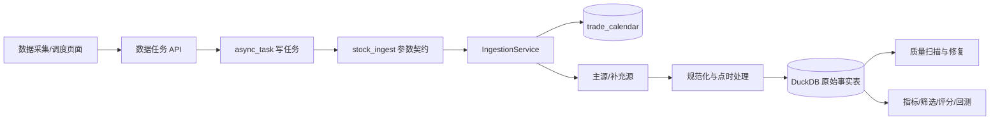

# 个股数据采集模块架构

## 文档范围与结论摘要

本文说明个股 EOD 数据从任务入口、数据源调用、清洗落库、断点续跑到质量修复的完整机制。持久化对象包括股票基础资料、交易日历、指数行情、个股日线、估值市值、ST 点时事实和数据来源审计。

核心结论：

- Web 新建个股采集统一使用 `stock_ingest` 任务，并通过 9 类受约束方案分派既有采集能力。
- “最近开市日”来自 `trade_calendar`，是截止日候选；日常同步遇到今天为交易日时，还会探测行情源是否已发布当日数据，未就绪则整体回退到上一开市日。
- 行情拉取可并发，DuckDB 写入受单写锁串行保护；任务支持协作式终止、断点续跑和幂等重试。
- 历史行情、市值、ST 状态是不同采集链路。历史行情补全不会自动补齐全历史市值，ST 的权威事实也不能由当前名称反推。

板块采集见 [board-collection.md](board-collection.md)，按需分时查询见 [stock-intraday.md](stock-intraday.md)，ST 专项口径见 [st-status.md](st-status.md)。

## 模块定位与职责边界

本模块负责：

- 维护股票名册、上市退市日期和板块涨跌停基础属性；
- 维护交易日历、市场指数、个股日线和估值市值；
- 采集并发布逐日 ST 权威事实，再重建 `daily_bar` 的消费投影；
- 提供日常同步、历史补全、区间重采、估值修复、基础资料刷新和退市股补全入口；
- 记录任务进度、来源、更新日志和质量问题，供数据管理页面复核与修复。

本模块不负责：

- 板块字典、板块指数、成分和板块资金流；
- 盘中分时的长期持久化；
- 指标、评分、筛选、榜单和回测结果的自动重算。采集改变原始数据后，下游派生结果按各自失效与重算机制处理；
- 跨 DuckDB 与 PostgreSQL 的数据库 JOIN。

## 核心技术与实现机制

### 统一采集方案

`backend/services/stock_ingest.py` 对任务参数做白名单校验，拒绝方案不支持的字段组合。

| 方案 | 用途 | 可选范围与参数 | 主要执行入口 |
|---|---|---|---|
| `daily_update` | 日常增量同步 | 股票、并发数、强制当日 | `IngestionService.update` |
| `history_backfill` | 近 N 年历史行情补全 | 股票、年数、并发数 | `backfill` |
| `range_refetch` | 指定日期区间重采 | 股票、起止日、并发数 | `ingest_date` |
| `valuation_history` | 历史估值市值补采 | 股票、年数、并发数 | `ingest_valuation` |
| `valuation_gaps` | 已有行情范围内的市值缺口修复 | 股票、并发数 | `ingest_valuation_gaps` |
| `valuation_invalid_history` | 全历史异常市值修复 | 股票、并发数 | `repair_invalid_valuation_history` |
| `basic_refresh` | 基础资料和上市退市日期刷新 | 无股票范围参数 | `enrich_basic_dates` |
| `delisted_history` | 退市股资料与历史行情补全 | 年数 | `enrich_basic_dates` 后执行 `ingest_delisted` |
| `st_status_refresh` | ST 点时事实刷新与发布 | 股票、可选起止日 | `refresh_st_status` |

年数限制为 1～30，并发数限制为 1～16；`force_current_day` 只允许用于日常同步。股票代码在进入任务前统一规范化。

### 日期与源端就绪

`trade_calendar` 是日期判断的本地事实源。`_latest_open_day(ref)` 查询不晚于 `ref` 的最大开市日；若 `ref` 本身开市，结果就是当天。因此交易日历回答的是“制度上哪天开市”，不保证免费行情源在盘前或收盘后已经发布完整数据。

日常同步先补最近一段交易日历，再对“今天是目标交易日”的全量或指定股票任务执行源端就绪探测：

1. 从在市股票中选取探测样本；
2. 请求目标日行情，统计有效、空结果和异常；
3. 达不到就绪门槛时回退到上一开市日，不逐股写入当日半成品；
4. 显式强制当日时跳过回退保护，适合人工确认源端已发布后的操作。

任务首次确定的目标日写入 checkpoint；续跑沿用该日期，避免跨日后改变同一任务的范围。

### 拉取、清洗与写入

- 主源由 `datasource.primary` 配置，补充源由 `datasource.fallback` 配置并惰性创建；主源单股失败时可切换补充源。
- 并发任务为每个工作线程创建独立数据源实例；请求速率随并发数上升，DuckDB upsert 仍由进程内写锁串行化。
- 日线入库前完成代码、日期、OHLC、成交量额、复权因子和涨跌停/ST 标记所需数据的规范化；停牌日不向 `daily_bar` 写占位行。
- 源复权因子保留在 `adj_factor`，去抖后的消费因子写入 `adj_factor_clean`。有新日线时只刷新受影响股票的干净因子序列。
- 行情、估值和 ST 事实分别落表。历史行情任务只采行情；全历史市值需使用估值历史或缺口方案单独补齐。
- 数据写入使用主键 upsert 或幂等插入，来源与区间写入更新日志和 provenance，重复执行不会制造重复主键。

### 任务状态与失败语义

`stock_ingest` 是可调度、可终止、可续跑的 DuckDB 写任务。同一时刻只允许一个 DuckDB 写任务。逐股阶段保存已完成代码、阶段、目标日和进度；并发终止会等待已提交的在途请求收敛后退出。

单股失败不会抹掉已成功数据。返回结果存在 `fail > 0` 时，任务标记为部分失败并保留 checkpoint，用户可继续未完成项；源端未就绪导致的整体跳过会在结果和日志中明确说明。

## 架构组成与调用关系

| 层级 | 主要实现 | 职责 |
|---|---|---|
| 页面 | `frontend/src/views/data/IngestView.vue`、`ScheduleView.vue` | 选择方案、约束参数、创建和查看任务 |
| API | `backend/api/data_tasks.py` | 创建、查询、终止、续跑任务，执行 system 权限守卫 |
| 任务编排 | `backend/services/async_task.py` | 状态机、日志、checkpoint、写任务互斥和方案分派 |
| 参数契约 | `backend/services/stock_ingest.py` | 9 类方案与参数白名单 |
| 采集服务 | `backend/services/ingest.py` | 日期收敛、数据源调用、并发、清洗、落库和收尾校验 |
| 数据源 | `backend/datasource/` | AKShare、baostock 等能力适配、限流和源端响应规范化 |
| 存储与质量 | `backend/storage/`、`backend/services/data_report.py` | DuckDB DDL、仓储、质量扫描和修复任务 |



## 使用与运行方式

系统管理员可在“数据管理 → 数据采集”手动执行，在“定时调度”创建 `stock_ingest` 调度。Web 统一调用 `POST /api/data/tasks`，请求示例：

```json
{
  "task_type": "stock_ingest",
  "params": {
    "recipe": "range_refetch",
    "codes": ["600000.SH"],
    "date_start": "2026-09-01",
    "date_end": "2026-09-10",
    "concurrency": 2
  }
}
```

任务详情、增量日志、终止和续跑分别由 `/api/data/tasks/{id}` 及其 `logs`、`cancel`、`resume` 子路径承接。历史 CLI 入口仍保留，用于运维和兼容；Web 新建任务不再组合旧原子任务类型。

常用校验入口：

```bash
python -m backend.cli verify-data
python -m backend.cli verify-catalog
```

服务启停与测试必须使用仓库 `start.sh`，避免后台服务和测试同时持有 DuckDB 文件锁。

## 核心流程与状态变化

### 日常同步

1. 读取在市股票范围和已有 checkpoint。
2. 补交易日历，得到候选截止日并执行源端就绪探测。
3. 增量补指数行情。
4. 每只股票从自身 `daily_bar` 最大日期的下一天补到目标日。
5. 对有新行情的股票刷新干净复权因子。
6. 采集目标日最新估值市值，汇总成功、失败、行数和实际截止日。

### 历史补全与区间重采

历史补全以最近开市日为截止，根据配置或输入年数确定起点；已覆盖到目标历史起点的股票跳过。区间重采先幂等补齐同区间交易日历与指数，再逐股重采指定区间。两者只对实际有新行的股票刷新价格因子。

### ST 状态发布

ST 刷新先建立批次状态，按每只股票的有效行情区间采集权威点时事实。只有来源步骤无失败且全市场覆盖完整时，批次才发布为 `ready`；部分刷新用于恢复失败批次时，会在重新开放门禁前重建全部 `daily_bar` ST 投影。

### 质量修复

质量扫描把缺失、异常或陈旧事实写入 `data_quality_issue`。修复任务按问题类型调用区间重采、估值补采、ST 刷新等确定性入口，完成后复检并收敛问题状态。修复原始事实不等于自动重算所有下游快照。

## 数据、权限与配置

| 数据对象 | 主要语义 |
|---|---|
| `stock_basic` | 当前基础资料、上市退市日期和静态板块属性 |
| `trade_calendar` | 交易所开闭市事实，是日期区间和最近开市日依据 |
| `index_bar` | 市场指数日线，用于基准和回测 |
| `daily_bar` | 个股可交易日行情、复权因子及消费投影 |
| `daily_metrics` | 估值与市值等逐日指标 |
| `stock_st_status_daily` 及配套表 | ST 权威逐日事实、历史、刷新状态和日期修订 |
| `data_update_log` | 表、来源、区间、行数、状态和详情 |
| `data_source_provenance` | 字段/表来源审计 |
| `data_quality_issue` | 质量问题、忽略、修复和收敛状态 |

数据任务 API 使用 `data-task:manage` 且受 system-only 守卫保护。质量查看、质量修复、调度和数据源设置分别使用对应的系统功能码；前端隐藏按钮不能替代后端鉴权。

主源、补充源、历史年数、请求限流、默认并发和数据源专属参数由 `config/settings.yaml`、环境变量及 `app_config` 覆盖层共同决定，完整优先级见 [environment-configuration.md](environment-configuration.md)。

## 上下游依赖与影响范围

上游依赖公开免费行情源、交易日历能力和本地配置；其发布延迟、限流、字段变化与历史覆盖范围会直接影响采集结果。补充源用于能力补齐，不能假定所有字段、复权口径或交易状态与主源完全等价。

下游包括个股列表与详情、宽表、指标、评分、筛选、榜单、板块关联、回测、交易纪律和质量报告。修改日线、复权因子、ST 事实或交易日历会影响多个领域，实施修复时必须检查相应快照、缓存和重算入口。

## 验证与测试入口

| 验证对象 | 入口 |
|---|---|
| 方案参数、任务注册、分派和部分失败 | `backend/tests/test_stock_ingest.py` |
| 日常同步、源端未就绪回退 | `backend/tests/test_ingest_update_fallback.py` |
| 采集与质量修复闭环 | `backend/tests/test_data_mgmt_c.py`、`test_quality.py` |
| 主流程和结构契约 | `backend/tests/test_pipeline.py`、`test_ingest_integrity.py` |
| ST 点时事实与发布门禁 | `backend/tests/test_st_status_pipeline.py` 及 ST 专项测试 |
| 运行数据检查 | `python -m backend.cli verify-data`、`verify-catalog` |

涉及 DuckDB 的测试必须先按 [AGENTS.md](../../AGENTS.md) 检查并停止后台服务，结束后恢复原运行状态。

## 风险、限制与待确认项

- 免费数据源存在延迟、反爬、限流、字段漂移和局部历史缺失；任务成功只表示本次编排完成，仍需结合实际截止日、行数和质量结果判断新鲜度。
- “最近开市日”不能替代“源端已就绪”。盘前手动强制当日可能得到空数据或不完整数据，除非已人工确认，否则不应开启。
- 提高并发会成比例放大请求速率，可能触发源站封禁；DuckDB 单写锁也意味着并发只加速拉取，不会并行写库。
- 历史行情、估值和 ST 是独立覆盖面；不能用某一链路成功推断其余数据已完整。
- 原始事实修复后，下游派生结果是否需要失效或重算，应按对应模块架构文档与质量台账确认。
