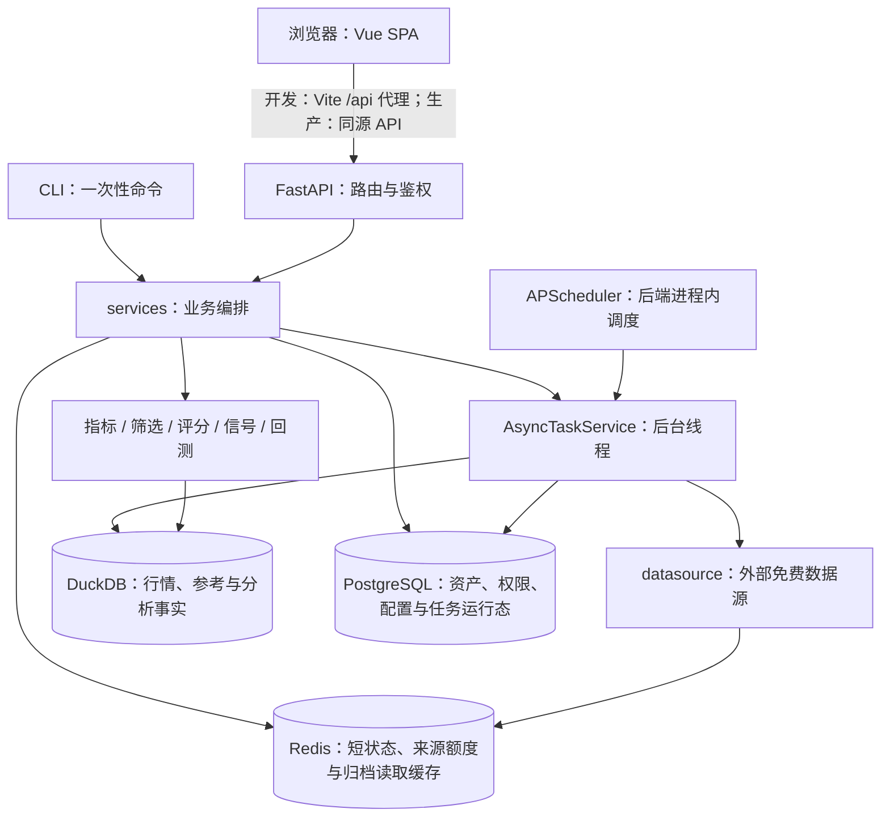

# 系统架构

## 文档边界

本文面向开发者，维护「复盘啦」的系统分层、运行单元、模块依赖、数据流、存储所有权及故障边界。依据为当前仓库源码、配置和启动脚本；部署定义不代表某台服务器已经按该方式运行。

任务执行与调度细节归 [任务运行态](task-runtime.md)，配置来源与生效归 [环境与配置加载](environment-configuration.md)，认证和租户归 [权限架构](system-rbac-tenant.md)，领域算法归各模块正文，前端设计契约归 [DESIGN](../../DESIGN.md)。运行与首次使用见 [README](../../README.md)，命令和执行约束以 [AGENTS](../../AGENTS.md) 为准。开发阶段文档不作为本文的事实依据或维护依赖。

## 运行单元与系统分层

系统以收盘后的 A 股研究为主：数据采集和质量治理产出行情事实，指标引擎形成可组合的研究输入，方案驱动筛选、评分、回测和跟踪。盘感训练与交易纪律分别承接模拟交易和私人真实持仓记录。

| 单元或代码层 | 职责与入口 | 运行边界 |
| --- | --- | --- |
| Vue SPA | `frontend/src/App.vue`、`router/index.ts`、`views/`、`components/` | 路由懒加载；菜单、路由和按钮消费后端授权结果 |
| API | `backend/main.py::create_app`、`backend/api/`、`backend/auth/` | 参数校验、请求身份与权限、统一响应；复杂逻辑进入服务或领域层 |
| 服务与领域引擎 | `backend/services/`、`indicators/`、`screening/`、`scoring/`、`signals/`、`backtest/` | 服务编排跨模块调用，领域层维护计算定义和业务约束 |
| 后台执行与调度 | `services/async_task.py`、`scheduler/scheduler.py` | 与 API 同一后端进程，执行线程和协作取消状态仍在进程内 |
| 数据源与质量治理 | `backend/datasource/`、`dataquality/`、相关服务 | 请求策略、日期校验、清洗、来源证据及质量台账 |
| 持久层 | `backend/storage/`、领域仓储 | 根据事实所有权分别读写 DuckDB、PG 和 Redis，不统一绕行行情仓库 |
| CLI 与启动脚本 | `backend/cli.py`、`start.sh`、`start-web.sh` | CLI 复用服务；脚本管理进程、变量文件、日志和健康检查 |

## 业务能力与模块依赖

运行单元说明进程和存储的关系，业务模块则按输入事实、计算职责和资产所有权分工：

| 能力 | 主要代码入口（相对 `backend/`，前端另注） | 输入、输出与依赖 | 详细正文 |
| --- | --- | --- | --- |
| 数据采集与治理 | `services/ingest.py`、`pipeline.py`、`data_report.py`、`data_verify.py` | 公开数据源 → DuckDB 行情/参考事实、来源证据及质量台账；后台任务负责执行，调度只负责触发 | [数据管理](data-management.md)、[个股采集](stock-collection.md)、[板块采集](board-collection.md)、[ST](st-status.md)、[分时](stock-intraday.md) |
| 指标与研究方案 | `indicators/`、`screening/profile.py`、`scoring/score_profile.py`、`signals/trade_profile.py` | DuckDB 原子指标定义 + PG 方案/版本 → 指标引用、条件树、权重与买卖约束；不直接产生持仓或成交 | [技术指标](technical-indicators.md)、[研究方案](config-definitions.md) |
| 筛选、评分与回测 | `services/screen_score.py`、`backtest_service.py`，`screening/`、`scoring/`、`backtest/` | 点时行情 + 方案 → 候选、榜单、撮合及验证结果；榜单缓存归方案 owner，回测资产归实际执行者 | [选股与榜单](screening-and-board.md)、[回测](backtest.md) |
| 市场复盘与板块关联 | `api/limit_ladder.py`、`services/stock_board_correlation.py`、`api/sectors.py` | 行情/ST → 涨停梯队；个股及板块共同收益 → 走势冠军；板块字典/指数/成分支撑板块工作台与钻取 | [天梯](limit-ladder.md)、[走势关联](stock-board-correlation.md)、[板块](board-collection.md) |
| 个股查询与分组 | `api/stocks.py`、`api/stock_groups.py`、`groups/stock_group.py` | 行情/指标/买卖方案 → 图表与信号；PG 分组保存用户跟踪对象，查询工作台复用行情分析组件 | [个股与分组](stocks-and-groups.md) |
| 训练与交易纪律 | `services/training_service.py`、`trade_discipline_service.py` | 训练消费历史行情及撮合能力；纪律消费交易日历、股票参考与私人规则/成交账本；两者分别保存 PG 用户资产 | [盘感训练](market-sense-training.md)、[交易纪律](trade-discipline.md) |
| 平台控制与布局 | `auth/`、`api/layout.py`、`storage/layout_config.py`，前端 `stores/auth.ts`、`layout/` | 后端权限与归属控制上述业务入口；布局预设/页面/用户覆盖控制呈现，不改变指标、撮合或资产可见性 | [权限](system-rbac-tenant.md)、[环境配置](environment-configuration.md)、[DESIGN](../../DESIGN.md) |

依赖方向为“行情和参考事实 → 原子指标 → 方案驱动的筛选/评分/信号 → 回测验证”。个股分析、板块、天梯与训练按各自场景消费事实和共享引擎，交易纪律记录真实操作，不从训练账户或回测账户反推真实持仓。认证授权横切这些入口，不构成单独的行情计算层；配置管理定义输入，不为每个消费模块复制指标公式。

## 持久层与访问边界

| 载体 | 权威数据与访问入口 | 禁止混用的边界 |
| --- | --- | --- |
| DuckDB | 日线、指数、板块、ST、逐日股本、分时归档、指标定义、关联板块与天梯分析事实；`ddl.py`、`MarketRepository` 及专属行情仓储 | 不用用户资产表替代行情事实，不把任务运行态混入分析查询 |
| PostgreSQL | 用户、租户、角色、菜单和功能点、用户方案及版本、回测与训练资产、交易纪律、平台配置、用户偏好、任务日志及调度、天梯协调账本与审计 outbox；`pg_ddl.py` 和各 PG 仓储 | 用户私有资产按请求上下文的 `tenant_id + owner_user_id` 隔离，不能信任前端归属 |
| Redis | 会话、权限、验证码、限流等短状态；来源共享请求额度；已落库分时的按版本读取缓存 | 不作行情或资产的权威来源；不同使用场景分别决定故障关闭或降级 |

双库联合需求由服务层分别取数、控制规模后内存合并，禁止跨库 JOIN。表目录从物理结构发现表与字段，元数据、鲜活度及质量策略的接入流程由 [数据管理](data-management.md) 维护，不在系统总览冻结表数量或复制字段字典。

用户资产的旧库升级与任务运行态切换是不同操作，分别见 [资产迁移](system-rbac-tenant.md#旧版用户资产的一次性迁移) 和 [运行态迁移](task-runtime.md#一次性升级与受控回滚)。任务表的实际数据库按 marker 路由，不能把尚未迁移或已回退的部署直接当作 PG 运行态统计。

### DuckDB 连接与点时访问

`backend/storage/duckdb_client.py` 提供一个专用写连接和同进程逻辑只读连接池。写连接内部以 `RLock` 保护操作；读连接利用 MVCC 读取已提交快照。默认读池大小为 4，借连接最多等待 3 秒，耗尽返回 503；配置为 0 时回退到写连接串行查询。逻辑只读池的物理打开配置与写连接一致，只读性通过单条查询的 SQL 类型检查约束，不能把它当作允许跨进程并行写入的能力。

`backend/storage/repository.py::MarketRepository` 提供行情幂等写入、指定日期行情和点时股票池；`backend/market_identity.py` 统一证券更码生效日。行情查询只消费业务日及以前记录，复权因子通过 `COALESCE(adj_factor_clean, adj_factor)` 读取。训练股票池与榜单/筛选的 `wide_snapshot` 消费链不同，不能把某个股票池的硬过滤扩展成全系统默认。原子计算见 [技术指标](technical-indicators.md)，撮合记账见 [回测](backtest.md)，ST 与限幅见 [ST 事实](st-status.md)。

### 缓存与物化结果

缓存按其事实所属模块管理，不设“所有结果都放同一个缓存层”的通用规则：

| 内容 | 载体与失效方式 | 正文归属 |
| --- | --- | --- |
| 会话和权限 | Redis；TTL、黑名单与 `perm_ver` 校验；鉴权依赖失败关闭 | [权限架构](system-rbac-tenant.md) |
| 外部源请求额度 | Redis；同来源共享频率与在途保护，不能用增加工作并发绕过 | [环境配置中的请求机制](environment-configuration.md#行情请求参数与来源能力) |
| 分时读取缓存 | Redis；从 DuckDB 归档生成，key 包含标的、日期和覆盖修订，缓存失败可回读数据库 | [分时归档](stock-intraday.md) |
| 指标与覆盖统计 | 有界进程内缓存；数据修订及参数指纹变化失效，消费方遵守复制边界 | [技术指标](technical-indicators.md)、[数据管理](data-management.md) |
| 榜单 | PG 评分快照；按方案真实 owner、版本和日期物化，核对参数及 ST 输入版本 | [选股与榜单](screening-and-board.md) |
| 天梯与走势关联 | DuckDB 分析快照；分别执行版本发布、读取自检或首次计算协议 | [连板天梯](limit-ladder.md)、[走势关联](stock-board-correlation.md) |

## 代表性请求与数据链路

### 每日数据进入研究结果

1. 页面手动任务或显式调度调用 `AsyncTaskService.create()`；CLI 直接复用采集服务。
2. 个股、指数和板块 EOD 共用 `services/eod_dates.py` 解析已收盘日期，源响应不得越过请求区间；日常收尾和续跑使用冻结的实际目标边界。
3. 来源适配器按共享请求策略取数，采集服务校验并写入行情、逐日事实与来源证据，质量规则同步问题台账；失败保留已成功工作单元和真实未完成范围。
4. 榜单、筛选和回测通过统一指标及方案引擎消费这些事实；用户方案与结果按真实 owner 在 PG 读取或保存。
5. 采集不隐式发起全量结果维护。榜单与天梯按所属版本协议自检，走势关联缺失快照时按业务日和范围幂等创建首次计算；显式失效、重算及其权限由所属模块维护。

日期、股本、市值和源端恢复细节见 [个股采集](stock-collection.md)、[板块采集](board-collection.md)、[ST](st-status.md) 与 [分时](stock-intraday.md)；质量台账闭环见 [数据管理](data-management.md)。

### 身份、配置与前端装配

`AuthMiddleware` 对受控 API 默认拒绝，在请求上下文中注入身份与归属；JWT 不携带权限集合，服务按 PG 状态和 `perm_ver` 校验。`/api/auth/me` 返回菜单与功能码，前端 store、路由守卫和 `v-permission` 消费同一结果，按钮显隐不代替后端授权。

`backend/config/settings.py` 将非敏感 YAML 基线与 PG 白名单覆盖层提供给业务消费者；环境变量负责敏感值、连接和启动开关。布局预设/页面/用户层与用户偏好使用各自 PG 表，不能当成普通 `app_config`。前端通过 `LayoutHost`、页面注册和组件目录组织布局，运行时合并机制及视觉约束分别见 [环境配置](environment-configuration.md) 和 [DESIGN](../../DESIGN.md)。

## 运行装配与生命周期

- 开发由 Vite 的 5173 代理 `/api` 到 `127.0.0.1:8000`；后端热重载。5181 为独立验证实例，不占用日常 5173。
- `backend/main.py` 的开发 CORS 白名单为 `localhost:5173` 与 `127.0.0.1:5173`；验证实例同样经 Vite 的同源 `/api` 代理访问后端，不因前端端口不同而直接开放跨域来源。前端 history 路由、动态首页与权限跳转以 `router/index.ts` 和当前授权菜单为准，不固定假设所有用户首页都是榜单。
- 生产启动方式关闭热重载并监听 `0.0.0.0:8000`，FastAPI 在 `frontend/dist` 存在时托管静态资源，非 API 深链接回退 `index.html`；未匹配 API 仍返回 404。公网反代与 TLS 的配置责任不由 SPA 托管替代。
- 启动依次检查存储及 schema、初始化指标目录、恢复任务与模块协调态、启动调度。关键存储不可用会阻止正常启动；任务恢复的具体顺序见 [任务运行态](task-runtime.md#启动恢复与受控停止)。
- `start.sh` 识别独立进程组，停止/重启前核对可信活跃任务数；读不到状态或有任务时拒绝停止，接受中断时才显式使用强制选项。退出时关闭调度、DuckDB 读池/写连接、PG 和 Redis。
- `mode=dev|prod` 表示启动方式，环境身份由有效运行档案和环境守卫判定，二者不能混用。变量来源、运行档案、日志归档和密钥规则归 [环境配置](environment-configuration.md)。

当前支持单后端进程。PG 持久化和 advisory lock 不会把进程内线程、取消状态与调度器变成多副本执行平台；独立 CLI 写库仍可能与在线后端争用 DuckDB 文件锁。

运行目录由配置解析，DuckDB、parquet、导出与日志路径的默认值及相对路径语义见 [路径解析](environment-configuration.md#路径解析与运行目录)。它们不是可提交的研究结果或测试夹具目录。

## 构建与 CI 门禁

前端制品为 `frontend/dist`，由 Vite 构建、FastAPI 在生产启动方式下托管。`frontend/package.json` 中普通 `npm test` 的前置步骤和生产构建均先执行 `check:design`；`npm run check` 串联静态规范、布局契约测试及 TypeScript 检查，不包含浏览器或数据库验收。完整构建只在 AGENTS 的准入条件触发时运行，不能用构建产物代替开发期 HMR 或业务测试。

仓库的 [Frontend contracts 工作流](../../.github/workflows/frontend-contracts.yml) 在 push 和 pull request 触发，在 `frontend/` 下以 Node.js 22 执行 `npm ci`、`npm run check`，没有路径过滤，也不负责生产构建或部署。作为必过合并检查时，远端仓库还须将该检查纳入分支规则；工作流文件本身不配置分支保护，CI 通过也不代表已部署或完成业务验收。

## 变更与验证入口

装配变化回查 `backend/main.py`、`backend/cli.py`、启动脚本和前端代理；持久层变化回查双库 DDL、仓储和目录；共享机制变化同步对应专题与消费方摘要。开发阶段材料保留其形成时的范围和状态，不纳入当前事实的双向同步。

相关验证入口为 `backend/tests/test_duckdb_read_pool.py`、`test_task_runtime_storage.py`、`test_data_catalog_dual.py`，以及各模块测试；前端注册和布局契约在 `frontend/src/layout/__tests__/`。运行条件和最小验证选择遵守 AGENTS；这些入口说明不代表本次已执行服务或业务测试。

故障定位先分清请求鉴权、存储访问、任务执行还是外部源：鉴权 Redis 故障失败关闭；分时缓存故障可降级；读池耗尽与写任务冲突分别返回 503/409；采集来源失败进入任务日志和质量台账。HTTP 200 本身不能替代健康响应中的存储与任务状态判断。

`DuckDBClient` 的执行/查询异常会废弃当前写连接引用并抛出 `StorageError`，后续访问重新建连；这不修复持续存在的文件锁、错误 SQL 或 schema 缺失。`ddl.py::init_db` 对部分兼容迁移逐条捕获并记录“迁移跳过”，但其它 DDL 或关键字段断言仍可直接失败；不能把“进程启动了”解释为所有兼容迁移均已完成。出现此类告警时按对应 DDL、物理结构和数据目录核对，目录接入与验证条件归 [数据管理](data-management.md)。
