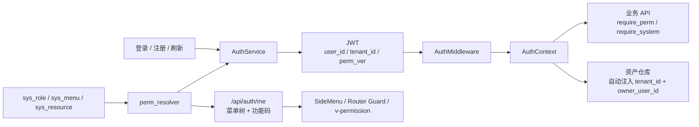

# 系统菜单 / 权限 / 多租户

## 文档边界

本文维护认证、菜单与功能点、角色授权、租户状态、资产归属及新页面权限接入的安全契约。环境守卫和连接配置见 [环境配置架构](environment-configuration.md)，固定调试账号见 [测试用户清单](../multi-tenant-rbac/test-users.md)；本文不保存密码、真实用户配置或测试夹具执行记录。

权限模型、seed 或归属链路变化时同步本文、迁移留痕及对应安全测试；业务字段和资产操作由各模块架构维护，界面组件规则由 [DESIGN.md](../../DESIGN.md) 维护，不在本文平行维护产品页面细则。

> 全系统共享的安全与租户基座：登录会话、系统菜单、角色授权、接口功能码、按钮权限、租户启停和用户资产归属统一以后端为事实源。

## 核心技术

### 1. 鉴权入口与请求上下文

- **默认拒绝中间件**：`backend/auth/middleware.py` 的 `AuthMiddleware` 对非白名单 `/api/**` 强制校验 access token。公开路径只包括 `/api/health` 与 `/api/auth/*`；鉴权关键依赖不可用时返回 503，避免在权限链路上 fail-open。
- **瘦 JWT**：access / refresh token 只承载用户、租户和 `perm_ver`。角色、菜单、功能码不写入 token，而是在请求进入后由 `AuthService` 和 `perm_resolver` 按用户重新解析。
- **请求上下文**：中间件把 `AuthContext` 注入 ContextVar，服务和仓库通过 `get_current_context()` / `get_current_owner()` 读取 `user_id`、`tenant_id`、角色和授权集合。普通业务请求不从前端参数决定资产归属。
- **安全补充**：`SecurityMiddleware` 在 API 层提供 per-IP 粗粒度限流和基础安全响应头；主防护仍应由反向代理承担。限流键 IP 取值口径全站统一（认证端点 `_client_ip`、全局中间件 `_scope_ip`、审计留痕）：默认用不可伪造的 socket 连接地址，仅 `server.trust_forwarded_for=true` 时取 `X-Forwarded-For` 首段。

### 2. RBAC 数据模型

RBAC 主数据落 PostgreSQL，核心表由 `backend/storage/pg_ddl.py` 创建：

| 表 | 职责 |
|----|------|
| `sys_tenant` | 租户、状态、管理员关系 |
| `sys_user` | 用户、租户归属、账号状态、`perm_ver` |
| `sys_role` | 平台级角色，内置 system / tenant_admin / normal，另支持系统管理员创建自定义角色 |
| `sys_menu` | 导航树，区分分组和叶子，记录路由、图标、可见域 |
| `sys_resource` | 功能点，记录资源码、类型、API 方法和路径元数据 |
| `sys_user_role` | 用户与角色关系 |
| `sys_role_menu` | 角色可见菜单 |
| `sys_role_resource` | 角色可用功能点 |

租户名称、平台角色名称和角色标识均按“去首尾空白后忽略大小写”全局唯一；账号与邮箱统一去首尾
空白并转小写后全局唯一。服务层负责友好校验，PostgreSQL 表达式唯一索引负责并发和
旁路写入兜底。软删除用户仍保留账号与邮箱占用，避免历史审计身份被新用户接管。

`perm_resolver.resolve(user_id)` 是有效权限解析入口：system 角色拥有全量菜单和功能点；非 system 用户取所有角色菜单与功能点并集；无角色用户返回空权限。登录基线共享读码由后端在解析时强制并入，角色页不持久化这类基线授权。

**system 判定认结构标记而非具体账号**：解析时以 `sys_role.code='system' OR sys_role.kind='system'` 识别系统角色（`backend/auth/constants.py` 的 `ROLE_SYSTEM` 是唯一角色常量），命中即短路返回全量菜单 + 全量功能点，不查 `sys_role_menu` / `sys_role_resource`。也就是说「系统角色」是一种结构化语义——把任一角色 `kind` 置为 `system` 即获得该特权，而非写死某个角色 ID 或账号；这是设计上唯一的固定特权边界，全系统没有其他按角色名 / 角色 ID 写死放行的分支。

### 3. 接口级授权

接口授权在 FastAPI 依赖层完成，入口在 `backend/auth/deps.py`：

| 依赖 | 用途 | 运行时语义 |
|------|------|------------|
| `require_perm(code)` | 可授权业务功能点 | system 恒过；非 system 必须拥有精确功能码 |
| `require_system()` | 系统管理员硬边界 | 非 system 一律 403 |
| `require_system_perm(code)` | system-only 端点的精确资源码标注 | 运行时等同 system 守卫，同时给路由扫描和审计保留资源码 |

权限码精确匹配，不使用通配符。用户状态、租户状态、角色授权、菜单资源变更会让受影响用户 `perm_ver` 自增；业务写入和 `perm_ver` 自增在同一 PG 事务提交，Redis 清缓存只是提交后的优化。旧 token 下次请求因 `perm_ver` 不一致失效。

system-only 边界在数据层还有一道防线：`role_repository` 的 `system_only_resource_ids()` 同时归集 `visible='system'` 菜单下的资源码，以及普通业务页内显式登记在 `EXPLICIT_SYSTEM_ONLY_RESOURCE_CODES` 的管理员操作。角色授权（`PUT /api/roles/{id}/perms`）落库时拦下这些码，前端权限树依据 `system_locked` 显示但置灰不可授——即「接口硬守卫 + 数据层拦截 + 统一交互」三层一致。业务页管理员操作应归属真实业务菜单，不能为了表达 system-only 而挂到无关系统菜单。

### 4. 前端授权消费

前端只消费后端下发的授权结果，不作为安全边界：

- `frontend/src/stores/auth.ts` 从 `/api/auth/me` 获取用户、租户、角色、菜单树和功能码。
- `frontend/src/components/SideMenu.vue` 使用后端菜单树渲染侧栏；加载失败时 fail-closed，不回退静态全量菜单。
- `frontend/src/router/index.ts` 保留静态路由表；路由守卫通过 `resolveMenuGuard` 判断当前路径是否落在授权菜单叶子内。
- `frontend/src/directives/permission.ts` 提供 `v-permission`，按钮无权时直接移除 DOM 元素。
- `frontend/src/utils/permission.ts` 承载菜单路径收集、首个安全落点、路由判定和按钮判定的纯逻辑，便于单测覆盖。

### 5. 多租户资产归属与公开能力

行情和参考数据仍在 DuckDB 中作为全局只读分析库；用户资产和平台配置在 PostgreSQL 中隔离：

- 用户方案、分组、回测、训练、快照、布局用户覆盖等表以 `(tenant_id, owner_user_id, 业务键)` 为复合归属键。
- `AssetRepository` 和各业务服务默认从请求上下文取归属；CLI、初始化和公共榜单这类非请求链路显式使用系统上下文或平台预设归属。
- 评分方案、筛选方案、买卖方案和回测记录支持 `private / tenant / public` 可见性。榜单、筛选运行和回测通过 opaque ref 解析可见资产，不因为公开能力绕过资产主键归属。
- 方案类公开资产对非 owner 只读，可复制当前版本或指定历史版本为 viewer 自己的 private；公开回测记录只读可见，可复用参数重跑，新的运行结果仍归当前执行者。方案从 `public` 收窄到 `tenant/private` 或从 `tenant` 收窄到 `private` 时，同一事务内同步收窄所有引用它且范围更大的回测，保留历史结果并返回 `affected_run_count` 供提示与审计；方案可见性变更与回测发布校验通过同一 advisory lock 串行化，避免并发产生公开回测引用已私有方案。公开回测记录发布前需校验引用方案不低于目标公开范围，并把历史 legacy id 依赖写回真实 owner 的 opaque ref。
- 其他资产类型如需开放租户可见或全局公开，应复用“显式可见性 + 引用解析 + 权限码”的模型，不直接放宽所有权查询。

#### 发布权放开与来源分段（资产归属重构 asset-ownership-refactor，已落地）

- **发布权放开（C4/R4）**：8 个 `*:publish-tenant` / `*:publish-public` 发布码已由「仅管理员持有」放开为 normal / tenant_admin 的普通业务授权（`backend/auth/constants.py`）；存量库经 marker `migration.asset_publish_open_v2` 一次性回填并同事务 bump `perm_ver`（受影响用户重新登录）。守卫不变——可见性接口仍 owner-only，放开的是「能否发布」，不能改他人资产。回滚走确定性基线恢复 + tombstone（见 `agent-works/asset-ownership-refactor/asset-publish-open.sql`），与所有默认策略迁移一致，不保留迁移后经角色页的人工增删。
- **来源分段取数**：各资产下拉固定 `source=mine`（纯 owner，排除平台槽全部预设）；搜索抽屉按 `preset / tenant / public` 四来源互斥浏览——`preset` 严格 `is_preset AND visibility=public AND 平台槽 PUBLIC_BOARD_OWNER`（只读、永不泄露 private），`tenant / public` 排除自己且 `public` 强制补集排除平台槽公开预设。取数在 `visible_sql` 之上叠加来源条件，全程归属键 + opaque ref，owner 脱敏不回显真实 user_id。
- **收回逃生口**：已发布资产的 owner 即使后来失去 publish 权限，仍可凭 view 基线把自己的资产收回为 private；发布到 tenant/public 继续要求对应 publish 权限。前端已发布标签保留收回入口，后端 `require_visibility_perm` 对 private 目标按 view 资源码守卫。
- 平台预设的归属和初始化以 `pg_ddl.PUBLIC_BOARD_OWNER`、`services/asset_visibility.py::publish_platform_presets` 及当前 PG 资产表为准，不从开发阶段材料推导线上归属或迁移完成状态。

## 旧版用户资产的一次性迁移

本节维护 `backend/services/migrate_rbac.py::migrate_rbac` 的操作条件，不适用于已有线上 PG 资产的日常同步。命令入口为 `backend/cli.py::cmd_migrate_rbac`；任务/日志/调度运行态另走 [任务运行态迁移](task-runtime.md#一次性升级与受控回滚)，不得用用户资产迁移替代它。

迁移从 DuckDB 旧资产表读取方案、分组、回测、训练等数据，按 `_ASSET_TABLES` 和 `_transform` 补齐归属后写入 PG；默认归属为 `default/admin`，旧布局用户 `local` 映射为 admin，其他布局用户身份按转换规则保留。行情事实不迁移、不修改；平台 `app_config` 仅补缺，不覆盖已有配置。具体表集合以 PG DDL 与迁移器为准，不在本文冻结表数量。

这是有前置条件的维护参考，不代表对具体目标库已经完成运行验证：

1. 确认目标连接、DuckDB 源文件和旧库升级场景，按 AGENTS 检查任务并安全停服，备份两库。PG 已有需要保留的新资产时不得重跑；`--apply` 会先删除目标资产表中 `default` 租户行再重载，并非只补缺失数据。
2. 准备 CLI 所需环境后，在仓库根目录预演：

   ```bash
   python -m backend.cli migrate-rbac
   ```

   默认预演不复制或删除用户资产行，但实现会调用 `init_pg_db()` 初始化 schema/seed，因此不能当成完全只读探活。报告应无映射、主键或孤儿问题，退出码为 0；有问题时先处理目标和源数据，不能直接跳到 apply。
3. 确认备份、归属映射及预演报告后执行：

   ```bash
   python -m backend.cli migrate-rbac --apply
   ```

   成功须退出码 0，并核对源与目标行数、字段映射、归属非空及外键关系；`app_config` 是补缺合并，不能要求其总行数等于源。资产按表删除和载入，不是全库单一事务；失败后保持停服并核对受影响表，不将部分完成当作成功。`--recreate` 会 DROP/重建资产表，仅能作为已单独确认的旧主键升级处理，不能加入通用迁移步骤。
4. 验证通过后按 AGENTS 恢复原服务方式，检查健康、登录和授权范围内资产。若原本停止则保持停止。

该入口没有自动反向迁移命令。需要恢复时协调同一版本代码、PG 备份和保留的 DuckDB 源；PG 已产生新业务数据后，不能用重跑 `--apply`、清空 default 租户或只回退代码代替数据恢复。

## 业务架构



系统管理模块提供四个页面：

| 页面 | 路由 | 主要 API | 后端边界 |
|------|------|----------|----------|
| 用户管理 | `/system/users` | `/api/users`、`/api/roles/assignable` | `user:*` 功能码控制列表、创建、编辑、停启、重置密码、删除；system 可跨租户，租户管理员只管本租户 |
| 角色管理 | `/system/roles` | `/api/roles`、`/api/roles/{id}/perms` | system-only；维护角色基础信息、菜单授权和功能点授权 |
| 菜单与功能点 | `/system/menus` | `/api/menus`、`/api/resources` | system-only；维护导航树、菜单可见性、功能码、API 方法与路径元数据 |
| 租户管理 | `/system/tenants` | `/api/tenants` | system-only；维护租户名称、状态和管理员关系；停用租户会让租户内用户会话失效 |

`/system/*` 是系统管理域。评分规则和买卖指标属于业务可授权配置；技术指标、系统设置、角色、菜单/功能点、租户和全局布局配置保持 system-only；用户管理可授权给租户管理员，但服务层仍按租户范围收口。

## 页面使用说明书

### 1. 用户管理

用户管理用于维护租户内账号和角色关系。system 管理员可以按租户筛选与跨租户创建用户；租户管理员即使前端传入其它 `tenantId`，服务层也会固定到自己的租户。

| 操作 | 权限码 |
|------|--------|
| 查看用户 | `user:list` |
| 新建用户 | `user:create` |
| 编辑邮箱、角色、状态 | `user:update` |
| 停用 / 启用 / 解锁 | `user:disable` |
| 重置密码 | `user:reset-password` |
| 删除用户 | `user:delete` |

用户状态变更存在两条入口：编辑弹窗的 `PUT /api/users/{id}` 和行内启停的 `POST /api/users/{id}/status`。两条入口都由服务层保护：任何用户不能通过更新、禁用、锁定或删除操作处理自己；system 管理员可以处理所有租户的其他用户；最后一个租户管理员不再作为特殊保护对象。

### 2. 角色管理

角色管理维护“角色 → 菜单 / 功能点”的授权关系。内置角色承担系统默认能力，自定义角色用于后续细分业务职责。授权变更会让拥有该角色的用户会话失效，下次请求需要重新登录获取新权限。

### 3. 菜单与功能点

菜单是导航树，功能点是接口或按钮授权码。菜单控制“能进入哪里”，功能点控制“能执行什么”。系统菜单和功能点属于平台级全局配置，不能按租户各自维护，避免同一路由在不同租户出现不同安全语义。

`sys_menu` 和 `sys_resource` 同时是运行时事实源。代码内 `_SEED_MENU_TREE` / `_SEED_RESOURCES` 只定义“缺失时采用什么默认值”，不持续同步数据库：启动、普通升级 SQL 和测试均使用 `INSERT ... ON CONFLICT DO NOTHING`，已有行的父级、标题、类型、路由、图标、排序、可见性、功能点绑定和 API 元数据全部保留。代码默认值调整不会自动改动存量库。

覆盖能力保留在显式管理链路：系统管理员通过菜单与功能点页面/API 修改，服务层负责唯一性、防成环、权限版本失效和 before/after 审计。确有不可由管理页面完成的结构迁移时，必须使用独立版本 marker、事务级 advisory lock、精确旧身份校验、确认口令和变更审计；不得把 `UPDATE/DELETE sys_menu/sys_resource` 或 `ON CONFLICT ... DO UPDATE` 放进每次启动或可重复执行的普通 seed。特殊 SQL 菜单/功能点覆盖迁移还必须同时具备事务、`app_config` 迁移标记、人工显式开关 `ai_stocks.confirm_menu_overwrite` 和 `AI_STOCKS_MENU_OVERWRITE: EXPLICIT_CONFIRMATION_REQUIRED` 标识，否则 SQL 静态扫描测试必须拒绝。检测到旧菜单但不能无歧义迁移时只记录/告警，保留现状并交由管理员处理。

测试不得把真实内置菜单当夹具。状态机测试使用随机菜单、功能点和 marker 命名空间；其他平台级写测试也应使用临时身份并精确清理。若无法隔离，必须改用独立测试数据库，禁止在共享开发库中先删除真实配置、测试后再按代码默认值重建。

### 4. 租户管理

租户是用户资产隔离的顶层单元。停用租户后，该租户用户不能继续登录或刷新会话，已有 token 也会在下一次鉴权时被拒绝。默认租户承载初始化管理员和平台预设资产，不应随意删除。

租户删除入口只在 system-only 租户管理页出现。当前口径是：非 `default` 租户、未软删用户数为 0 时可删除，不要求租户必须先停用；后端仍会再次校验默认租户保护和用户数。

## 业务流程

### 登录与加载授权

1. 用户登录或注册，`AuthService` 校验账号、密码、租户状态和账号状态。
2. 后端签发 access / refresh token，token 携带当前 `perm_ver`。
3. 前端调用 `/api/auth/me`，后端按 PG 权威权限解析角色、菜单和功能码。
4. 前端写入 auth store，侧栏、路由守卫和按钮权限统一消费这份结果。

### 访问受控接口

1. 请求进入 `AuthMiddleware`，白名单外必须携带有效 access token。
2. 后端校验签名、过期、黑名单、账号状态、租户状态和 PG 当前 `perm_ver`。
3. 通过后注入 `AuthContext`。
4. 路由依赖执行 `require_perm` 或 system 守卫。
5. 服务和仓库从上下文读取租户与用户归属，完成业务读写。

### 权限或状态变更

1. 服务层在写入前计算受影响用户集合。
2. 在同一 PG 事务中写业务变更并自增受影响用户 `perm_ver`。
3. 提交后尽力清理 Redis 权限缓存。
4. 受影响用户旧 token 在下一次请求时失效，重新登录后加载新权限。

### 认证与权限缓存

认证域通过 `backend/auth/session_store.py` 保存 token 黑名单、权限缓存、验证码和限流状态，权限解析由 `perm_resolver.py` 与 `services/auth_service.py` 编排。`auth:perms:{user_id}` 保存解析结果，登录回填 TTL 为 `access_ttl_min × 60`；权限与状态的权威仍在 PG。

授权或用户/租户状态变更必须在 PG 同事务更新 `perm_ver`，提交后尽力清理 Redis；旧 token 下一次请求失效，不能依靠缓存 TTL 才撤销权限。认证关键 Redis 操作失败时拒绝请求，不能按匿名或空权限继续执行。

这只是认证域的缓存契约。来源共享额度、分时归档读取、指标进程缓存和业务快照由 [系统架构](system-architecture.md#缓存与物化结果) 指向各自正文，不在权限文档定义全系统缓存用途。

### 系统管理对象操作闭环

#### 用户

| 操作 | 入口与守卫 | 服务层规则 | 联动 |
|------|------------|------------|------|
| 查询 | `GET /api/users`，`require_perm("user:list")` | system 可全局查询并按租户过滤；非 system 固定本租户；软删用户不出现在列表 | 无写联动 |
| 新增 | `POST /api/users`，`require_perm("user:create")` | system 可指定未软删且 active 的租户；非 system 固定本租户；账号和邮箱唯一口径包含软删行；角色必须来自当前调用者可分配集合 | 写 `sys_user` 与 `sys_user_role` |
| 更新 | `PUT /api/users/{id}`，`require_perm("user:update")` | 目标必须在可管理域内；不能通过编辑接口变更自己的状态；角色必须可分配；用户归属租户不可改 | 更新资料、状态和角色关系，并在同一事务自增目标用户 `perm_ver` |
| 禁用 / 锁定 / 启用 | `POST /api/users/{id}/status`，`require_perm("user:disable")` | 目标必须在可管理域内；不能变更自己的账号状态；最后一个租户管理员不做特殊保护 | 状态写入与目标用户 `perm_ver` 自增同事务；禁用/锁定时把该用户非 private 的评分、筛选、买卖方案和回测记录下线为 private，回测引用列恢复为裸 id |
| 删除 | `DELETE /api/users/{id}`，`require_perm("user:delete")` | 目标必须在可管理域内；不能删除自己；system 可删除任意租户的其他用户；最后一个租户管理员不做特殊保护 | 逻辑删除 `sys_user.deleted_at`、清空 `sys_user_role`；该用户 token 因 `deleted_at` 实时拒绝；该用户非 private 资产下线为 private |
| 重置密码 | `POST /api/users/{id}/reset-password`，`require_perm("user:reset-password")` | 目标必须在可管理域内；新密码按强度校验 | 写 password hash；审计记录重置动作 |

#### 角色

| 操作 | 入口与守卫 | 服务层规则 | 联动 |
|------|------------|------------|------|
| 查询 | `GET /api/roles`，`require_system`；`GET /api/roles/assignable`，`require_perm("user:list")` | 角色管理页 system-only；用户页角色下拉按调用者分流，system 可取全部角色，租户管理员只取 `tenant_assignable=true` 的非 system 角色 | 无写联动 |
| 新增 | `POST /api/roles`，`require_system` | 只能创建 custom 角色；新角色 ID 为 32 位小写无连字符 UUIDv4；角色码由平台必填，不根据名称自动生成，统一转小写，须符合稳定编码格式且不能撞内置或现有角色；默认不向租户开放，也可在创建时显式开启 | 写 `sys_role`；存量角色 ID 不迁移 |
| 更新 | `PUT /api/roles/{id}`，`require_system` | system 超管锁定角色不可改；可改名称、描述和 `tenant_assignable`，不改 code/kind；system 始终不可下放 | 写 `sys_role`；关闭下放不撤销存量用户角色 |
| 授权 | `PUT /api/roles/{id}/perms`，`require_system` | 锁定角色不可授权；菜单和功能点 id 必须存在；system-only 功能点不能授给非 system 角色；基线共享读码不持久化到角色授权 | 替换 `sys_role_menu` 和 `sys_role_resource`，并与该角色成员 `perm_ver` 自增同事务 |
| 删除 | `DELETE /api/roles/{id}`，`require_system` | 内置角色不可删；仍有用户成员时不可删 | 删除 `sys_role`；`sys_role_menu` / `sys_role_resource` 由 FK cascade 清理；因无成员才允许删除，不需要踢用户 |

#### 租户

| 操作 | 入口与守卫 | 服务层规则 | 联动 |
|------|------------|------------|------|
| 查询 | `GET /api/tenants`，`require_system` | 只返回未软删租户；`user_count` 只统计未软删用户 | 无写联动 |
| 新增 | `POST /api/tenants`，`require_system` | ID 使用后端生成的 32 位小写无连字符 UUIDv4，与用户 ID 同口径且不从名称派生；名称全局唯一；创建时可选择 active 或 disabled | 写 `sys_tenant`；存量租户 ID 不迁移 |
| 更新 | `PUT /api/tenants/{id}`，`require_system` | 名称全局唯一；`admin_user_id` 必须指向该租户内未软删用户 | 写租户名称和管理员关系 |
| 停用 / 启用 | `POST /api/tenants/{id}/status`，`require_system` | `default` 租户不可停用；状态只能是 active/disabled | 停用时租户状态写入、租户内用户 `perm_ver` 自增和整租户非 private 资产下线同事务；启用只恢复租户状态，不自动重新公开资产 |
| 删除 | `DELETE /api/tenants/{id}`，`require_system` | `default` 租户不可删；未软删用户数必须为 0；不要求先停用 | 逻辑删除 `sys_tenant.deleted_at`；整租户非 private 资产下线为 private；后续登录、刷新和请求鉴权把软删租户视为不存在 |

#### 菜单与功能点

| 操作 | 入口与守卫 | 服务层规则 | 联动 |
|------|------------|------------|------|
| 菜单查询 | `GET /api/menus`，`require_system` | 返回整棵平台菜单树，角色页和菜单页共用 | 无写联动 |
| 菜单新增 | `POST /api/menus`，`require_system` | `id` 由后端生成 UUID；菜单编码由平台必填，不根据标题自动生成，统一转小写、全局唯一且创建后不可改；`route_path` 只承载叶子路由；`type` 为 group/leaf；`visible` 为 login/system；parent 必须存在 | 写 `sys_menu`；新节点尚无授权引用，不失效用户；存量内置菜单继续兼容历史 `id=code/route` |
| 菜单更新 | `PUT /api/menus/{id}`，`require_system` | 标题必填；route 唯一；移动时目标父不能是自身或子孙 | 可见性变化或移动节点时，先计算引用该菜单及子树的用户，再与菜单写入和 `perm_ver` 自增同事务；纯标题、图标、route 展示修改不失效 |
| 菜单排序 / 移动 | `POST /api/menus/reorder`，`require_system` | 每个节点必须存在；parent 变化同样做防成环校验 | 纯排序不失效；移动节点会按被移动子树计算受影响用户并自增 `perm_ver` |
| 菜单删除 | `DELETE /api/menus/{id}`，`require_system` | 内置菜单不可删；有子节点不可删；菜单下还有功能点不可删 | 删除前计算引用该菜单及子树的用户；删除 `sys_menu`，`sys_role_menu` 级联清理，并与 `perm_ver` 自增同事务 |
| 功能点查询 | `GET /api/resources`，`require_system` | 可按 `menu_id` 过滤；角色授权树和功能点子表共用 | 无写联动 |
| 功能点新增 | `POST /api/resources`，`require_system` | code 全局唯一且不可复用；menu 必须存在；type 为 button/api | 写 `sys_resource`；新功能点尚无授权引用，不失效用户 |
| 功能点更新 | `PUT /api/resources/{id}`，`require_system` | 内置功能点 code 不可改；code 变化不能撞现有功能点；menu 必须存在 | code 变化会先计算引用用户与 system 用户，再与功能点写入和 `perm_ver` 自增同事务；改名称、类型、API 元数据或移动菜单不失效 |
| 功能点删除 | `DELETE /api/resources/{id}`，`require_system` | 内置功能点不可删 | 删除前计算引用用户与 system 用户；删除 `sys_resource`，`sys_role_resource` 级联清理，并与 `perm_ver` 自增同事务 |

菜单管理页的排序通过 `AppReorderTree` 提交移动意图，指针与同级键盘排序共用 `onMenuReorder`。保存期间锁定重复排序与属性操作；有未保存菜单属性或正在编辑功能点时先保存/还原编辑。请求仅更新顺序或归属发生变化的兄弟组，其他节点原排序值不重置。成功后重载菜单并以 `auth.fetchMe({ background: true })` 刷新 `/me` 导航，已就绪时不进入 loading 拆卸工作区，鉴权刷新失败仍进入 error；排序失败恢复服务端顺序；选中节点与展开状态保留。键盘边界以 `DESIGN.md`「键盘能力与适用边界」为准。

### 新增受控功能

1. 后端新增 API 时明确它是可授权功能点还是 system-only 功能。
2. 可授权端点挂 `require_perm("module:action")`；system-only 端点挂 `require_system_perm("module:action")` 或 `require_system()`。
3. 在 `sys_menu` / `sys_resource` seed 中登记菜单和功能码。
4. 前端页面入口挂在静态路由表，同时依赖 `/me` 菜单树显示；按钮用 `v-permission`。
5. 如果产生用户资产，表结构和查询必须接入 `tenant_id + owner_user_id` 归属。

同一 visibility 路由同时承载“收回/租户公开/全体公开”时，路由依赖使用 `require_visibility_perm(view, publish-tenant, publish-public)`：运行时先对请求体 `visibility` 做统一 `strip/lower` 规范化，再按规范化后的值写入实际 `request.state.resource_code`，函数体继续做 owner-only 与 publish 权限校验；API body 与仓库落库也使用同一规范化 helper，非法值在请求校验阶段拒绝。路由元数据暴露三类资源码，供扫描测试和 API 横切审计追踪，不把发布请求误记为普通 view。

### 新页面接入菜单和权限

新增页面不会因为新增一个 Vue 文件就自动进入系统。当前是“代码登记 + 启动 seed + 角色授权”的可控接入模型：

| 环节 | 怎么维护 | 是否自动 |
|------|----------|----------|
| 前端路由 | 在 `frontend/src/router/index.ts` 增加静态路由，页面组件按 `DESIGN.md` 和 `page-template.md` 完成页面登记与布局验收 | 不自动 |
| 菜单节点 | 内置页面在 `backend/storage/pg_ddl.py` 的 `_SEED_MENU_TREE` 登记；运行期自定义菜单可在「系统管理 → 菜单与功能」维护 | 仅缺失时由 seed 插入，存量配置不覆盖 |
| 功能点 | 内置 API / 按钮权限在 `_SEED_RESOURCES` 登记，资源码全局唯一并绑定菜单 | 仅缺失时由 seed 插入，存量配置不覆盖 |
| 接口守卫 | 业务功能挂 `require_perm("xxx:action")`，系统功能挂 `require_system_perm("xxx:action")` 或 `require_system()` | 不自动 |
| 按钮权限 | 前端按钮、危险操作、导入导出等动作使用 `v-permission="'xxx:action'"` | 不自动 |
| 默认授权 | system 角色每次 seed 自动补齐全量；normal / tenant_admin 不覆盖已配置授权，需要角色页授权或显式一次性回填 | system 自动，业务角色需决策 |
| 用户资产 | 新表和查询必须带 `tenant_id + owner_user_id`，服务层从上下文取归属 | 不自动 |

默认授权决策按页面性质处理：

- **system-only 页面**：菜单 `visible=system`，接口挂 system 守卫，只让 system 角色自动拥有。
- **普通业务页面**：菜单 `visible=login`，资源码加入业务授权集合；新库会随 seed 拿到默认授权，已有库要通过角色页或一次性回填给既有角色补授权。
- **需要确定性撤回的普通业务页面**：可使用独立 marker 状态机登记在 `_SEED_MENU_TREE/_SEED_RESOURCES`，但通用写入循环必须显式跳过，避免 rolled-back tombstone 后被启动 seed 复活。交易纪律模块采用 `migration.trade_discipline_default_grants_v1` + advisory lock `8410010005`，只在 marker 缺失且固定菜单/资源身份无冲突时原子创建并给 system/normal/tenant_admin 初始授权；applied 重启只校验菜单与功能点的稳定 `id/code`，不校验或覆盖管理员可维护的其余菜单和功能点配置。normal/tenant_admin 后续由管理员撤销的默认授权不补回也不导致启动失败。回滚删除当前仍存在的账本内同键行，允许默认授权已缺失，但发现账本外自定义角色授权时拒绝级联；成功后同事务自增受影响用户 `perm_ver` 并保留 tombstone。回滚入口为 `python -m backend.cli trade-discipline-rbac rollback --confirm-marker migration.trade_discipline_default_grants_v1`。
- **跨阶段页面发布门控**：后端菜单/资源/API 先行、正式前端尚未闭环时，菜单码必须进入 `STAGED_FRONTEND_MENU_CODES`，使 `/me` 对包括 system 在内的所有角色隐藏入口。只有前端静态路由、页面、pageRegistry、DESIGN marker 和路由解析测试同批就绪后才能移除；授权不等于可导航发布。
- **租户管理员页面**：上级菜单不能是 system-only；资源码只授给 tenant_admin 或指定自定义角色，服务层仍按本租户收口。
- **临时或租户自定义菜单**：可以走菜单与功能点管理页维护，但它只控制已有前端路由和已有后端 API 的可见与授权，不生成代码。

上线检查清单：

1. 路由存在，菜单 leaf 的 `route_path` 与前端路由一致。
2. API 都有后端守卫，资源码与 `_SEED_RESOURCES` 一致。
3. 需要展示在侧栏的角色已拥有菜单授权。
4. 需要执行动作的角色已拥有功能点授权。
5. 页面按钮和批量操作都挂了 `v-permission`。
6. 新增用户资产已接入租户和 owner 归属。
7. 跑前端构建和后端权限相关测试，至少覆盖路由守卫、资源码扫描、菜单/资源 seed。

## 风险事项

| 等级 | 风险点 | 影响 | 建议 |
|------|--------|------|------|
| <span style="color:#f59e0b">●</span> 中 | 邮件真实发信默认关闭、依赖部署侧环境变量 | 漏配 `AI_STOCKS_SMTP_*` 时开关虽开但只写日志、用户收不到验证码 | 真实 SMTP 已就绪（先存后发、失败按值 CAS 回滚、双维度限流、已注册邮箱不真发）；上线用环境变量开启，系统设置页只读徽标（`mail_status.mode`）可见就绪度 |
| <span style="color:#dc2626">●</span> 高 | 前端权限只提供体验收口 | 如果后端漏挂依赖，隐藏菜单或按钮不能阻止接口被调用 | 新增 API 必须挂后端守卫，并保留路由扫描测试 |
| <span style="color:#f59e0b">●</span> 中 | 公开资产范围仍限评分/筛选/买卖/回测 | 自选股分组、盘感训练记录、布局配置等资产仍不能跨用户共享 | 这些类型若要开放共享，需按现有显式可见性模型单独设计和排期 |
| <span style="color:#f59e0b">●</span> 中 | PG 和 Redis 是鉴权关键依赖 | 依赖不可用时登录态接口会拒绝，影响全站访问 | 部署前做好健康检查、备份和监控；本地开发先启动 PG/Redis |
| <span style="color:#16a34a">●</span> 低 | 菜单和资源是平台级全局配置 | 多租户无法自定义各自导航结构 | 当前 SaaS 形态优先保证统一安全语义；租户个性化应另设配置层 |
