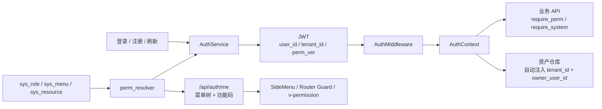

# 系统菜单 / 权限 / 多租户

> 全系统共享的安全与租户基座：登录会话、系统菜单、角色授权、接口功能码、按钮权限、租户启停和用户资产归属统一以后端为事实源。

● 登录会话　● 菜单权限　● 租户隔离　● 安全边界

## 核心技术

### 1. 鉴权入口与请求上下文

- **默认拒绝中间件**：`backend/auth/middleware.py` 的 `AuthMiddleware` 对非白名单 `/api/**` 强制校验 access token。公开路径只包括 `/api/health` 与 `/api/auth/*`；鉴权关键依赖不可用时返回 503，避免在权限链路上 fail-open。
- **瘦 JWT**：access / refresh token 只承载用户、租户和 `perm_ver`。角色、菜单、功能码不写入 token，而是在请求进入后由 `AuthService` 和 `perm_resolver` 按用户重新解析。
- **请求上下文**：中间件把 `AuthContext` 注入 ContextVar，服务和仓库通过 `get_current_context()` / `get_current_owner()` 读取 `user_id`、`tenant_id`、角色和授权集合。普通业务请求不从前端参数决定资产归属。
- **安全补充**：`SecurityMiddleware` 在 API 层提供 per-IP 粗粒度限流和基础安全响应头；主防护仍应由反向代理承担。

### 2. RBAC 数据模型

RBAC 主数据落 PostgreSQL，核心表由 `backend/storage/pg_ddl.py` 创建：

| 表 | 职责 |
|----|------|
| `sys_tenant` | 租户、状态、管理员关系 |
| `sys_user` | 用户、租户归属、账号状态、`perm_ver` |
| `sys_role` | 平台级角色，含 system / tenant_admin / normal / paid 等内置角色 |
| `sys_menu` | 导航树，区分分组和叶子，记录路由、图标、可见域 |
| `sys_resource` | 功能点，记录资源码、类型、API 方法和路径元数据 |
| `sys_user_role` | 用户与角色关系 |
| `sys_role_menu` | 角色可见菜单 |
| `sys_role_resource` | 角色可用功能点 |

`perm_resolver.resolve(user_id)` 是有效权限解析入口：system 角色拥有全量菜单和功能点；非 system 用户取所有角色菜单与功能点并集；无角色用户返回空权限。登录基线共享读码由后端在解析时强制并入，角色页不持久化这类基线授权。

### 3. 接口级授权

接口授权在 FastAPI 依赖层完成，入口在 `backend/auth/deps.py`：

| 依赖 | 用途 | 运行时语义 |
|------|------|------------|
| `require_perm(code)` | 可授权业务功能点 | system 恒过；非 system 必须拥有精确功能码 |
| `require_system()` | 系统管理员硬边界 | 非 system 一律 403 |
| `require_system_perm(code)` | system-only 端点的精确资源码标注 | 运行时等同 system 守卫，同时给路由扫描和审计保留资源码 |

权限码精确匹配，不使用通配符。用户状态、租户状态、角色授权、菜单资源变更会让受影响用户 `perm_ver` 自增；业务写入和 `perm_ver` 自增在同一 PG 事务提交，Redis 清缓存只是提交后的优化。旧 token 下次请求因 `perm_ver` 不一致失效。

### 4. 前端授权消费

前端只消费后端下发的授权结果，不作为安全边界：

- `frontend/src/stores/auth.ts` 从 `/api/auth/me` 获取用户、租户、角色、菜单树和功能码。
- `frontend/src/components/SideMenu.vue` 使用后端菜单树渲染侧栏；加载失败时 fail-closed，不回退静态全量菜单。
- `frontend/src/router/index.ts` 保留静态路由表；路由守卫通过 `resolveMenuGuard` 判断当前路径是否落在授权菜单叶子内。
- `frontend/src/directives/permission.ts` 提供 `v-permission`，按钮无权时直接移除 DOM 元素。
- `frontend/src/utils/permission.ts` 承载菜单路径收集、首个安全落点、路由判定和按钮判定的纯逻辑，便于单测覆盖。

### 5. 多租户资产归属与公开能力

行情和参考数据仍在 DuckDB 中作为全局只读分析库；用户资产和平台配置在 PostgreSQL 中隔离：

- 用户方案、分组、回测、训练、快照、布局用户覆盖等表以 `(tenant_id, owner_user_id, 业务键)` 为复合归属键。
- `AssetRepository` 和各业务服务默认从请求上下文取归属；CLI、初始化和公共榜单这类非请求链路显式使用系统上下文或平台预设归属。
- 评分方案、筛选方案、买卖方案和回测记录支持 `private / tenant / public` 可见性。榜单、筛选运行和回测通过 opaque ref 解析可见资产，不因为公开能力绕过资产主键归属。
- 方案类公开资产对非 owner 只读，可复制为 viewer 自己的 private；公开回测记录只读可见，可复用参数重跑，新的运行结果仍归当前执行者。
- 其他资产类型如需开放租户可见或全局公开，应复用“显式可见性 + 引用解析 + 权限码”的模型，不直接放宽所有权查询。

## 业务架构

系统管理模块提供四个页面：

| 页面 | 路由 | 主要 API | 后端边界 |
|------|------|----------|----------|
| 用户管理 | `/system/users` | `/api/users`、`/api/roles/assignable` | `user:*` 功能码控制列表、创建、编辑、停启、重置密码、删除；system 可跨租户，租户管理员只管本租户 |
| 角色管理 | `/system/roles` | `/api/roles`、`/api/roles/{id}/perms` | system-only；维护角色基础信息、菜单授权和功能点授权 |
| 菜单与功能点 | `/system/menus` | `/api/menus`、`/api/resources` | system-only；维护导航树、菜单可见性、功能码、API 方法与路径元数据 |
| 租户管理 | `/system/tenants` | `/api/tenants` | system-only；维护租户名称、状态和管理员关系；停用租户会让租户内用户会话失效 |

`/system/*` 是系统管理域。评分规则和买卖指标属于业务可授权配置；技术指标、系统设置、角色、菜单/功能点、租户和全局布局配置保持 system-only；用户管理可授权给租户管理员，但服务层仍按租户范围收口。

## 页面使用说明书

### 1. 用户管理

用户管理用于维护租户内账号和角色关系。system 管理员可以按租户筛选与跨租户创建用户；租户管理员即使前端传入其它 `tenantId`，服务层也会固定到自己的租户。

| 操作 | 权限码 |
|------|--------|
| 查看用户 | `user:list` |
| 新建用户 | `user:create` |
| 编辑邮箱、角色、状态 | `user:update` |
| 停用 / 启用 / 解锁 | `user:disable` |
| 重置密码 | `user:reset-password` |
| 删除用户 | `user:delete` |

### 2. 角色管理

角色管理维护“角色 → 菜单 / 功能点”的授权关系。内置角色承担系统默认能力，自定义角色用于后续细分业务职责。授权变更会让拥有该角色的用户会话失效，下次请求需要重新登录获取新权限。

### 3. 菜单与功能点

菜单是导航树，功能点是接口或按钮授权码。菜单控制“能进入哪里”，功能点控制“能执行什么”。系统菜单和功能点属于平台级全局配置，不能按租户各自维护，避免同一路由在不同租户出现不同安全语义。

### 4. 租户管理

租户是用户资产隔离的顶层单元。停用租户后，该租户用户不能继续登录或刷新会话，已有 token 也会在下一次鉴权时被拒绝。默认租户承载初始化管理员和平台预设资产，不应随意删除。

## 业务流程

### 登录与加载授权

1. 用户登录或注册，`AuthService` 校验账号、密码、租户状态和账号状态。
2. 后端签发 access / refresh token，token 携带当前 `perm_ver`。
3. 前端调用 `/api/auth/me`，后端按 PG 权威权限解析角色、菜单和功能码。
4. 前端写入 auth store，侧栏、路由守卫和按钮权限统一消费这份结果。

### 访问受控接口

1. 请求进入 `AuthMiddleware`，白名单外必须携带有效 access token。
2. 后端校验签名、过期、黑名单、账号状态、租户状态和 PG 当前 `perm_ver`。
3. 通过后注入 `AuthContext`。
4. 路由依赖执行 `require_perm` 或 system 守卫。
5. 服务和仓库从上下文读取租户与用户归属，完成业务读写。

### 权限或状态变更

1. 服务层在写入前计算受影响用户集合。
2. 在同一 PG 事务中写业务变更并自增受影响用户 `perm_ver`。
3. 提交后尽力清理 Redis 权限缓存。
4. 受影响用户旧 token 在下一次请求时失效，重新登录后加载新权限。

### 新增受控功能

1. 后端新增 API 时明确它是可授权功能点还是 system-only 功能。
2. 可授权端点挂 `require_perm("module:action")`；system-only 端点挂 `require_system_perm("module:action")` 或 `require_system()`。
3. 在 `sys_menu` / `sys_resource` seed 中登记菜单和功能码。
4. 前端页面入口挂在静态路由表，同时依赖 `/me` 菜单树显示；按钮用 `v-permission`。
5. 如果产生用户资产，表结构和查询必须接入 `tenant_id + owner_user_id` 归属。

同一 visibility 路由同时承载“收回/租户公开/全体公开”时，路由依赖使用 `require_visibility_perm(view, publish-tenant, publish-public)`：运行时按请求体 `visibility` 写入实际 `request.state.resource_code`，函数体继续做 owner-only 与 publish 权限校验；路由元数据暴露三类资源码，供扫描测试和 API 横切审计追踪，不把发布请求误记为普通 view。

### 新页面接入菜单和权限

新增页面不会因为新增一个 Vue 文件就自动进入系统。当前是“代码登记 + 启动 seed + 角色授权”的可控接入模型：

| 环节 | 怎么维护 | 是否自动 |
|------|----------|----------|
| 前端路由 | 在 `frontend/src/router/index.ts` 增加静态路由，页面组件按 `DESIGN.md` 和 `page-template.md` 完成页面登记与布局验收 | 不自动 |
| 菜单节点 | 内置页面在 `backend/storage/pg_ddl.py` 的 `_SEED_MENU_TREE` 登记；运行期自定义菜单可在「系统管理 → 菜单与功能」维护 | seed 后自动入库 |
| 功能点 | 内置 API / 按钮权限在 `_SEED_RESOURCES` 登记，资源码全局唯一并绑定菜单 | seed 后自动入库 |
| 接口守卫 | 业务功能挂 `require_perm("xxx:action")`，系统功能挂 `require_system_perm("xxx:action")` 或 `require_system()` | 不自动 |
| 按钮权限 | 前端按钮、危险操作、导入导出等动作使用 `v-permission="'xxx:action'"` | 不自动 |
| 默认授权 | system 角色每次 seed 自动补齐全量；normal / paid / tenant_admin 不覆盖已配置授权，需要角色页授权或显式一次性回填 | system 自动，业务角色需决策 |
| 用户资产 | 新表和查询必须带 `tenant_id + owner_user_id`，服务层从上下文取归属 | 不自动 |

默认授权决策按页面性质处理：

- **system-only 页面**：菜单 `visible=system`，接口挂 system 守卫，只让 system 角色自动拥有。
- **普通业务页面**：菜单 `visible=login`，资源码加入业务授权集合；新库会随 seed 拿到默认授权，已有库要通过角色页或一次性回填给既有角色补授权。
- **租户管理员页面**：上级菜单不能是 system-only；资源码只授给 tenant_admin 或指定自定义角色，服务层仍按本租户收口。
- **临时或租户自定义菜单**：可以走菜单与功能点管理页维护，但它只控制已有前端路由和已有后端 API 的可见与授权，不生成代码。

上线检查清单：

1. 路由存在，菜单 leaf 的 `route_path` 与前端路由一致。
2. API 都有后端守卫，资源码与 `_SEED_RESOURCES` 一致。
3. 需要展示在侧栏的角色已拥有菜单授权。
4. 需要执行动作的角色已拥有功能点授权。
5. 页面按钮和批量操作都挂了 `v-permission`。
6. 新增用户资产已接入租户和 owner 归属。
7. 跑前端构建和后端权限相关测试，至少覆盖路由守卫、资源码扫描、菜单/资源 seed。

## 风险事项

| 等级 | 风险点 | 影响 | 建议 |
|------|--------|------|------|
| ● 高 | 邮箱验证码仍是开发日志投递 | 注册和找回类能力不适合直接公网放量 | 公网前接 SMTP，并补注册频控和反滥用配置页 |
| ● 高 | 前端权限只提供体验收口 | 如果后端漏挂依赖，隐藏菜单或按钮不能阻止接口被调用 | 新增 API 必须挂后端守卫，并保留路由扫描测试 |
| ● 中 | 公开资产范围仍限评分/筛选/买卖/回测 | 自选股分组、盘感训练记录、布局配置等资产仍不能跨用户共享 | 这些类型若要开放共享，需按现有显式可见性模型单独设计和排期 |
| ● 中 | PG 和 Redis 是鉴权关键依赖 | 依赖不可用时登录态接口会拒绝，影响全站访问 | 部署前做好健康检查、备份和监控；本地开发先启动 PG/Redis |
| ● 低 | 菜单和资源是平台级全局配置 | 多租户无法自定义各自导航结构 | 当前 SaaS 形态优先保证统一安全语义；租户个性化应另设配置层 |
