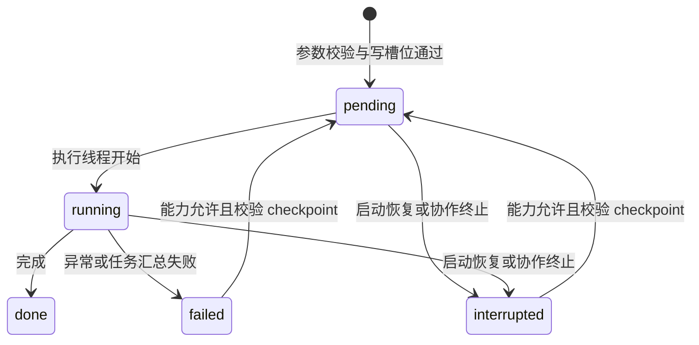

# 异步任务与调度运行态

本文说明跨模块任务的创建、互斥、进度日志、取消续跑、启动恢复、调度依赖及可靠事件机制。

参考：[系统架构](system-architecture.md) · [环境配置](environment-configuration.md) · [数据管理](data-management.md) · [项目命令与服务保护](../../AGENTS.md)。

## 入口、存储与执行边界

| 入口 | 职责 |
| --- | --- |
| `backend/services/async_task.py::AsyncTaskService` | 创建、执行、查询、取消、续跑、日志与恢复 |
| `TASK_TYPES`、`WRITE_TASK_TYPES`、`TASK_CAPABILITIES`、`_HANDLERS` | 分别声明合法类型、DuckDB 写槽位、任务能力和处理器；页面不能自行推断能力 |
| `backend/scheduler/scheduler.py::ScheduledJobService` | 调度定义、依赖关系、参数校验、立即执行及触发记录 |
| `compile_trigger`、`_fire_job`、`enqueue_terminal_events`、`dispatch_due_events` | 时间触发、终态事件生成和可靠分发 |
| `backend/storage/task_runtime.py` | 运行态存储路由、PG 兼容访问、创建事务和事件认领 |
| `backend/api/data_tasks.py`、`data_admin.py` | system 管理入口与精确功能码守卫；任务不接受前端决定执行者身份 |

运行态包含 `async_task`、`task_log`、`scheduled_job`、`scheduled_job_dependency` 和 `scheduled_trigger_event`。实际路由由迁移 marker 决定：旧库尚未迁移或已受控回退时，DuckDB 表仍是运行态事实；PG 标记 applied 后才切换到 PG，并冻结 DuckDB 同名旧表供回滚。全新安装由 [统一数据库初始化](database-lifecycle.md) 直接登记 PG 路由。业务行情始终通过专属行情连接访问，禁止运行中切库或双写。任务、日志和调度不作为用户私有方案资产处理，其管理权限由后端守卫约束。

手动、时间调度、依赖、重试和业务首次物化均复用同一创建通道。CLI 的一次性采集通过 `CliTaskContext` 复用进度和日志接口，不因此变成可在 Web 续跑的后台任务。

## 创建、执行与互斥

1. `create()` 验证任务类型并调用所属模块的参数归一入口；需要审计执行者的参数从请求上下文注入。
2. `_TASK_CREATE_LOCK` 与运行态创建事务覆盖触发事件幂等查询、写槽位检查和 `pending` 落库。相同 `trigger_event_id` 已有任务时返回原任务，不重复创建。
3. 仅 `WRITE_TASK_TYPES` 中的任务占用 DuckDB 单写槽位；有 `pending/running` 写任务时抛 `ConcurrentTaskError`，API 映射 409。只读或仅写 PG 的任务与普通 PG 资产保存不受该槽位限制。
   [连板天梯](limit-ladder.md#查询与首次物化)在自己的 PG 日期账本保留有绝对期限的等待意图。共享创建锁与 PG 创建事务内先检查单写互斥，再让最早的有效天梯意图获得名额；新建写任务及续跑不得越过它。过期或已派发的意图不再预留名额，PG-only 与只读任务不受影响。等待意图不属于 `async_task.pending`，同一时间仍只执行一个 DuckDB 写任务。
4. 创建任务后启动守护线程，`_run` 分派 `_HANDLERS`，保存进度、日志、结果与终态。执行失败保留已提交工作，失败是否可重试由能力和 checkpoint 决定。



`done` 只说明任务按照自身成功条件完成，不证明全部历史数据齐备或来源冲突已经裁决。单股/单板块部分失败、源端未就绪跳过及质量是否解决，必须继续查看结构化结果和所属模块口径。

## 取消、续跑与日志

`cancel()` 持久化 `cancel_requested_at` 并设置进程内取消标记；处理器在工作单元或阶段边界调用 `ctx.check_cancel()`，命中后抛 `TaskCancelled`。容错块必须让该异常穿透，不能吞成普通子阶段失败。

并发采集使用有界在途窗口，取消后停止提交新工作、取消未开始项，并等待当前网络请求返回或超时及线程安全退出后才写终态。限流和重试退避同样响应取消；终态后不得仍有孤儿线程写库。处理器的具体提交边界由个股、板块或分时模块说明。

`resume()` 仅接收 `interrupted/failed` 且能力允许的任务，重新进入任务入口，依靠幂等和 `result.checkpoint` 跳过完成单元；不允许仅凭状态就展示“可续跑”。续跑前清理上一轮取消标记，普通执行线程不能清理，以免吞掉 pending 时的即时终止。首跑冻结的目标日期、区间、股票范围和前置完成标记必须延续，不能隔天续跑时改成新的“今天”。

`TaskContext.log/progress/set_phase` 为统一输出入口：

- 日志采用开始、进度、完成三段，正常用 `info`、可降级问题用 `warn`、失败用 `error`；不逐行情明细打印。
- `current_phase/current_item/phase_done/phase_total` 随 checkpoint 更新，嵌套处理器应映射外层进度；已处理量、已解决量和成功量不能混用。
- 日志批量持久化，按 `seq > after_seq` 增量拉取，每任务保留最近 2000 条，启动恢复清理超过 30 天的任务日志；文件日志归档另见环境配置。
- `CliTaskContext` 将同一接口映射到 stdout。缺失的旧进度字段显示未记录，不补造历史计数。

## 时间调度、依赖与重试

`SCHEDULABLE_TASK_TYPES` 决定可调度类型，不等于全部内部任务。内部天梯单日发布任务不对新建调度开放；个股旧任务定义继续兼容，新建入口使用 `stock_ingest + recipe`。参数语义由任务所属模块校验。

时间任务经 `compile_trigger()` 编译为 APScheduler `CronTrigger`，到点 `_fire_job()` 读取最新定义，检查启用状态和交易日限制，再调用任务创建入口。交易日历缺失会尝试自愈并报告下一真实开市日/跨年覆盖，源未发布时告警，不推算虚构交易日。调度 CRUD 即时重新注册触发器；启动保留审计清理默认调度和内部对账，不自动创建业务结果维护调度。

| 触发方式 | 写槽位繁忙 | 参数和结果边界 |
| --- | --- | --- |
| 手动创建／时间触发 | 创建被拒绝；时间触发记录跳过，不堆积周期任务 | 使用本次请求／该条调度保存参数 |
| 任务依赖／自身重试 | 持久事件保持等待，槽位释放后继续尝试 | 使用生成时的任务配置快照；只决定何时执行，不推断或继承上游业务参数 |
| 首次物化 | 模块按业务日、范围和输入水位幂等协调，繁忙后由读取协议补建 | 是否首次、失败后何时重试及发布门由所属模块决定 |

### 依赖关系与事件身份

依赖可以多选上游，任一上游满足条件就分别触发，不等待所有上游、不按业务日期合并。条件为成功 `done`、失败 `failed` 或二者之一的完成；人工中断 `interrupted` 不传播。上游通过定时、立即执行、依赖、重试或续跑形成的终态尝试均可参与判断。

保存时检查全部分支，拒绝直接或间接环路，共享祖先不构成环。`enqueue_terminal_events()` 为命中的每个下游生成独立 `scheduled_trigger_event`，身份包含来源任务、执行尝试、目标与触发种类；同一次尝试去重，不同尝试分别保留。秒/分钟/小时延迟到期后，分发器认领事件并经 `trigger_event_id` 幂等创建任务；重启不能丢掉等待事件。

依赖边以 `scheduled_job_dependency(upstream_job_id, downstream_job_id, dependency_order)` 为事实源。同一下游在不同上游下可独立排序；旧 `scheduled_job.dependency_job_id/dependency_order` 仅投影稳定上游兼容旧接口。存量单上游幂等补边，不覆盖已配置排序。

依赖边与调度定义同事务保存；完整直接下游集合及顺序版本用于检测并发编辑冲突。新关联追加到末尾，保留关联沿用顺序，普通编辑和启停不重排。事件生成时固化 `dispatch_order`，分发按 `due_at, created_at, dispatch_order, id` 排序；同批同到期时间按用户顺序尝试，但不保证前项完成后才启动后项。不同延迟以到期时间为先，同批自身重试排在普通下游之后。

编辑关系只影响新事件，已有等待事件与运行任务不回写。移除上游或切换触发方式不撤销已生成事件；停用或删除目标任务取消等待事件；删除被依赖上游前须解除引用。单个下游失败、取消或耗尽重试不影响同批其它事件。关系修改和分发共用关系锁，避免引用校验与写入交错。

### 自身重试与触发记录

自身重试可按成功、失败或完成，以独立固定延迟再次运行，并用最大额外次数收口；`retryable=false` 等处理器约束仍须尊重。达到上限只结束运行链，不改写最后一次任务的真实结果。多个 DuckDB 写下游依次等待单写槽，PG-only 或只读任务可以并行。

事件保留生成时的规则快照 `trigger_condition`、计划时间和成功创建时的 `dispatched_at`；历史空字段不反推。触发记录合并事件与 `async_task.job_id`，按关联 ID 去重，区分触发状态与执行状态。服务端按创建时间和 ID 倒序分页取最近记录，默认 100、上限 200；手动/定时记录缺少来源或计划时间时保持空值。

## 启动恢复与受控停止

`backend/main.py` 先调用 `AsyncTaskService.reconcile()`：残留 `pending/running` 变为 `interrupted`，根据能力提示续跑或重新执行；天梯孤儿处理态转失败并保留最后成功版本；孤儿 fixing 问题复位 open，随后清理超期任务日志。接着调用 `LimitLadderTaskCoordinator.reconcile()` 收敛 PG 日期账本和审计 outbox，再启动调度；天梯专属状态细节见 [天梯架构](limit-ladder.md)。恢复异常会写启动告警，须核对实际账本和任务状态，不能以进程存在判断全部恢复成功。

健康接口返回可信活跃任务数、运行态后端与 DuckDB 读池状态。`start.sh` 的停止、重启及空闲停止共用这些状态：无法可信读取或仍有活跃任务时失败关闭；明确接受中断才使用强制选项。

执行线程、取消集合和 APScheduler 仍在同一后端进程。PG advisory lock 与事件认领不能证明多副本安全；独立 CLI 写库由 DuckDB 文件锁约束。

## 存储切换与扩展

任务执行器的创建、更新、取消、日志与质量修复诊断时间复用 `backend/common/timeutil.py::shanghai_now_naive()`，沿用无时区的北京时间表示；DuckDB 的历史 `TIMESTAMP` 与诊断 JSON 不改格式，PG 运行态适配器再按北京时间转换为带时区参数。通用时间边界见[系统分层](system-architecture.md#运行单元与系统分层)。

`AI_STOCKS_TASK_STORAGE_BACKEND=auto` 在可读取 PG 标记但尚无 applied 记录时选 DuckDB，`migration.task_runtime_pg_v1` 生效后选 PG；标记不可读时失败关闭。显式 `postgres` 要求 applied 标记，显式 `duckdb` 不能越过 applied 标记强行切回。变量加载见 [环境配置](environment-configuration.md)，迁移实现为 `backend/storage/task_runtime_migration.py`。

### 一次性升级与受控回滚

以下为有前置条件的维护操作参考，不是日常启动步骤，也不表示对某个数据库已经执行验证。CLI 入口及参数由 `backend/cli.py::cmd_task_runtime_storage` 定义，操作前核对目标 DuckDB 文件、PG 连接和恢复所需的原服务状态；直接 CLI 不自动加载 `.env.local`，进程环境须按环境配置正文准备。

1. 按 AGENTS 检查后端与活跃任务，安全停服并确认没有其他 CLI/写入者；备份 DuckDB 和 PG。整个预检、切换或回滚期间保持停止，不用强制终止绕过未完成任务。
2. 在仓库根目录查看状态并预检，未加 `--apply` 不搬运运行态行：

   ```bash
   python -m backend.cli task-runtime-storage status
   python -m backend.cli task-runtime-storage migrate
   ```

3. 仅当源表引用/JSON/时间字段校验通过、目标 PG 运行表为空且 marker 未 applied 时，执行：

   ```bash
   python -m backend.cli task-runtime-storage migrate --apply
   python -m backend.cli task-runtime-storage status
   ```

   正向迁移在同一 PG 事务中写入五类运行表并激活 marker，保留 DuckDB 源运行态副本。成功应为退出码 0、`state=applied`，且报告的 `duckdb_counts` 与 `postgres_counts` 逐表一致。目标非空或已 applied 时拒绝覆盖，不删表后盲目重试。
4. 需要回滚时仍须停服并备份，使用精确确认串：

   ```bash
   python -m backend.cli task-runtime-storage rollback --confirm-marker migration.task_runtime_pg_v1
   python -m backend.cli task-runtime-storage status
   ```

   回滚先以 PG 全量事实事务替换 DuckDB 运行表并重建日志序列，再在 PG 事务内清空运行表、将 marker 置为 `rolled_back`；成功后由 DuckDB 承接运行态。两库不存在跨库原子事务，任何阶段失败均须保持停服并核对两端数据和 marker，不能仅改环境变量猜测恢复。受控回滚完成且 PG 目标为空后，才可重新走正向迁移。
5. 确认结果后按 AGENTS 恢复原运行方式并检查健康响应中的 `task_runtime_backend` 与预期一致；若原本停止则保持停止。只通过 `status` 或命令正常退出，不能替代数据数量、marker 和运行路由三项核对。

### 新任务接入

新增任务依次维护类型、写槽位、能力和 handler，沿用统一参数归一、日志、取消、checkpoint 与结果结构；开放调度时补调度白名单和参数校验；新增管理动作同步权限 seed 与路由守卫。不要从 UI 按钮状态判断执行能力，也不要让采集 handler 隐式承担结果维护。

## 验证入口与限制

`backend/tests/test_task_runtime_storage.py` 覆盖运行态路由与迁移；任务和调度相关用例位于 `backend/tests/`，按处理器、依赖、取消、恢复或并发风险选择最小范围。页面参数表单与任务展示的测试位于前端对应组件目录。涉及 DuckDB 的验证先遵守 AGENTS 的停服和原状态恢复约束。

本文为静态源码说明，测试入口不等于本次执行结果。来源在线可用性、全市场吞吐和跨进程死亡恢复须各自验证，不以任务创建成功或页面 E2E 替代。
