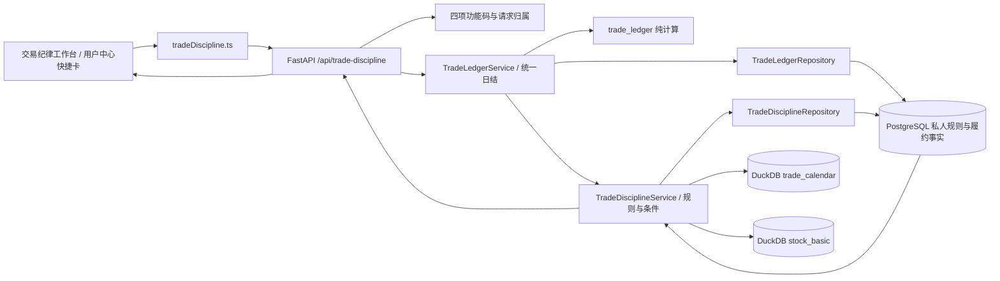

# 交易纪律模块

## 模块定位

交易纪律模块为登录用户提供私人交易规则、规则版本、真实成交与持仓账本、自动履约判断、历史修订和快捷无操作打卡闭环。模块入口是 `/trade-discipline`，数据始终按 `tenant_id + owner_user_id` 隔离；当前仅校验可确认的结构化规则违规，不包含自由文本规则自动裁决、AI 分析、收益曲线、券商同步或规则公开分享。

需求与验收边界见 [`../trading-discipline-checkin/requirement.md`](../trading-discipline-checkin/requirement.md)，本轮实现及验证记录见[持仓与自动履约计划](../trading-discipline-checkin/position-ledger-auto-assessment/plan.md)。本文维护当前代码、数据模型和操作方式，原阶段需求中的手工自评等冲突口径已被本轮约定替代。

## 核心技术

| 层次 | 当前实现 | 关键入口 |
| --- | --- | --- |
| 页面 | 四页签工作台承载今日打卡、现有持仓、规则管理和历史记录；用户中心抽屉提供摘要、跳转和快捷无操作履约 | `frontend/src/views/TradeDisciplineView.vue`、`frontend/src/App.vue` |
| 前端组件 | 规则与操作复用摘要展开卡；买卖规则和操作事实统一按买入/卖出分组；历史复用通用表格、分页和页面抽屉 | `frontend/src/components/AppSummaryDisclosureCard.vue`、`frontend/src/components/trade-discipline/`、`frontend/src/views/trade-discipline/components/` |
| API | `/api/trade-discipline` 下 30 个端点，路由层负责请求模型、权限依赖、统一响应和错误映射 | `backend/api/trade_discipline.py` |
| 服务 | 规则服务编排草稿、发布与激活；账本服务统一初始化、成交、调整、评价、日结及最新日修正 | `backend/services/trade_discipline_service.py`、`backend/services/trade_ledger_service.py`、`backend/services/trade_ledger.py` |
| 仓库 | 所有 PG 查询和写入显式带归属；事务内锁主体、维护版本/事件序号和不可变修订 | `backend/storage/trade_discipline_repository.py` |
| 数据定义 | 18 张 `trade_discipline_*` PG 表、索引、菜单/资源迁移和资产表登记 | `backend/storage/pg_ddl.py` |
| 参考数据 | DuckDB `trade_calendar` 决定下一真实交易日，`stock_basic` 提供轻量股票搜索与点时存续校验 | `backend/services/trade_discipline_service.py`、`backend/storage/trade_discipline_repository.py` |

PG 与 DuckDB 不跨库 JOIN。服务层分别读取私人业务资产与只读参考数据，再在内存中完成校验和组合。

## 结构化选股条件与持仓核对

- 每条选股规则保存 `price_min/price_max`（原始成交价，含边界，最多4位小数）及 `st_filter/loss_filter/st_risk_filter`（`any|exclude|only`）。整套规则保存可空的正整数 `max_positions`；旧版本新增条件默认不限。
- 买入打卡按所选规则展示条件，股价复用成交价；亏损、ST风险在新增操作或换股时按规则预填（排除为 `no`、仅限为 `yes`、不限不预填），填报仅提供 `yes|no`（是/否），可按实际修改；不再提供“未知”选项。切换规则只补未填写项，保留已有事实及“未知”；历史加载不补写。预填不代表系统已核验财报或风险，ST仍取交易日权威数据。卖出保留规则关联但不核对选股条件。
- `selection_facts` 随日结修订保存，ST由服务端按交易日批量读取权威逐日事实；客户端不能写ST结论。人工亏损、ST风险及分类检查项默认取规则符合值，按实际修改。卖出不套用买入选股条件。已采集的ST事实在同日修正沿用，缺失事实可重新核对，旧修订不变。
- 不填写 `peak_positions`：账户期初持仓和按实际时间、全局顺序排列的成交共同计算当日最大同时持股数，同股去重、部分卖出不减只数、清仓才减少。每套有效规则仅用主记账归属该规则的不同股票只数核验其上限，附加规则核对不复制或转移持仓；未分配规则的持仓仅进入账户合计，不套用无关规则上限。账户总峰值与各规则峰值分别保存；分组资金占用按持仓成本累计并在卖出时释放，不能把规则预算当作账户现金。
- 每笔成交只保存一次，可额外关联其他规则核对；附加核对不复制数量、资金或费用。实际操作的选股、买卖规则不符及持仓超限自动归集；仅漏买漏卖由用户补充股票和有效规则。
- 全部事实核对完成后，无违规/遗漏为已履约；至少一笔合规实际操作且有违规/遗漏为部分履约；只有违规/遗漏而无合规操作为未履约。一笔违规交易的其他通过项不能凑成部分履约。必要数据缺失时显示待核对，保留成交、不计正式履约率。
- 快捷“今日无操作”复用完整账户日结服务，不手填峰值、不预设已履约。有持仓超限、待核对、遗漏或已有其他记录时转正式入口；多套规则共用同一无操作日结。
- 增量SQL：[选股条件迁移](../trading-discipline-checkin/selection-conditions-migration.sql)。后端 `init_pg_db` 执行相同幂等增量，先升级数据库/后端再发布前端；回退应用保留字段和已采集事实，不自动删列。

### 分类检查项与人工核对

- 选股检查项分类消费系统字典 `trade_discipline_condition_category`，初始提供基本条件、风险排除、技术形态，允许系统管理员新增、改名、排序和停用。价格固定归 `basic`，ST/亏损/ST风险固定归 `risk`。`checklist_items` 保存稳定 `item_id`、分类编码 `category`、名称快照 `category_label`、`text`、`display_order`；旧 `other` 作为技术形态兼容读取/保存，`notes|other` 不允许新建为分类字典编码；只在草稿编辑时手动整理，旧文本完整保留为可空的补充说明 `content`，不自动拆分。
- 逐项条件支持增删、分类和组内排序，新增优先使用启用的技术形态，否则使用首个启用分类；没有启用分类时不能新增人工检查项。发布时每项内容非空，选股规则至少有一项有效结构化条件、人工检查项或非空补充说明。检查项变化参与版本差异比较，复制规则重新生成检查项标识。
- 每笔买入提交 `checklist_results=[{item_id,status}]`，填报仅提供 `yes|no`（符合/不符合），新增买入默认全部符合，必须完整对应绑定版本所选规则的检查项。切换股票或规则时按新关联条件重新预填全部符合；历史 `unknown` 仍按原快照展示，加载时不补写。卖出和无操作不核对买入条件。
- 人工“不符合”与系统明确违规均进入自动评价；自由文本补充选股条件、买卖动作保留人工符合/不符合核对，默认符合并明确标为用户确认。服务端拒绝检查项重复、遗漏及越界引用；填报不提供未知选项，必要来源缺失单独标识核验不完整。
- 规则管理、今日核对和历史条件共用系统配置的 `ConfigPanelSection` 紧凑子分区，字典分类与补充说明默认独立收起；标题保留范围、检查项数量及今日待核对/不符合/未知数量。收起不卸载字段，按规则/操作隔离展开状态且不保存为用户偏好；新增、改分类与校验失败会展开目标并定位字段。历史分类映射不改写正式快照，保存新草稿时规范为技术形态。
- 核对结果随操作修订不可变保存；当日表单和历史详情通过共用分类条件组件展示版本内容与结果，旧记录未采集显示未记录，不回填。补充说明可展开完整阅读，分类与条件内容仍属于业务资产；展示默认值复用 `trade-discipline.stockConditions` 的 `config-panel.defaultCollapsed`，三个入口共用分类编码及 `notes` 分区 key，代码默认全部收起；页面属性抽屉与页面布局工作台的分类候选动态读取同一字典，既有默认折叠覆盖继续兼容。属性抽屉通过现有布局用户层持久化与恢复默认；页面临时开合按规则/操作隔离，不写回默认。远端默认晚到不覆盖已操作或错误定位的分区；显式修改默认或恢复默认会重置开合，不清除草稿和核对结果。
- 增量 SQL：[分类检查项迁移](../trading-discipline-checkin/selection-checklist-migration.sql)。初始化幂等执行同一升级；先升级数据库和后端，再发布前端。回退须保留字段和已采集快照，旧客户端不支持新项，回退期间暂停规则与打卡写入。

### 买卖类型与字典边界

- 买入类型消费 `trade_discipline_buy_type`，卖出类型消费 `trade_discipline_sell_type`；初始提供建仓、加仓和清仓、减仓。编码在各字典内唯一，两种方向可以使用相同编码。规则页只选择类型，新增、排序及停用统一在系统数据字典维护，沿用系统字典管理权限；普通业务账号只读消费，不因拥有交易规则维护权限而获得公共字典写权限。
- 新增引用必须来自所属字典的启用项；保存/复制时服务端生成 `action_subtype_label` 和 `category_label`，忽略客户端伪造标签。原明细保留同一类型或分类时沿用原名称，停用/删除不会阻断无关修改；新明细不能借用旧引用绕过启用校验。正式版本和操作修订不批量回写，历史展示版本名称快照，旧版本无名称时按内置旧编码或原值兼容。
- 原个人类型表只保留旧数据及兼容删除接口；新保存不再登记个人类型，不把个人数据自动提升为全局字典项。既有规则的旧类型仍可保存、发布及复制。字典读取失败有重试反馈；停用整个字典返回空候选，完整候选读取不受字典管理表格分页上限限制。
- 数据库与后端先升级，再发布前端；幂等迁移见[字典接入迁移](../trading-discipline-checkin/dictionary-integration-migration.sql)。迁移补列和缺失初始字典，不重写已存在的字典设置、个人类型或正式历史。

## 系统架构



## 页面使用说明

### 今日打卡

1. 首次使用，选择账本起算交易日，在“期初股票”和“可用资金”分区录入当日开始前的真实持仓和账户可用资金；持仓成本价、现金可选，总成本由成本价×数量自动计算并按分四舍五入；成本价不是当日市价，未录入与零成本分别保留。未填成本价时不计算该持仓盈亏；未填资金时不计算现金余额，不影响纪律打卡。空仓也必须勾选完整性确认，不能把未初始化当作空仓。期初数据只初始化一次，后续通过显式调整变更。确认区集中在底部，勾选完整性确认后按钮才可用；宽屏双栏，窄宽上下排列，低高度由表单内部滚动承接。
2. 选择操作适用规则，按买入/卖出新增实际成交。填写股票、实际时间、全局顺序、价格、数量及费用（可为0）；金额按价格×数量自动算至分，可按交割单改为手工金额，再恢复自动。
3. “买卖规则核对”独立于“操作依据”，与“选股条件核对”“成交明细”同级。规则正文和符合/不符合选项在同一行，窄宽自然换行；补充选股条件沿用相同排布。规则内容使用正文字阶，章节使用说明由标题旁帮助入口承接，操作适用规则使用表单标签字阶。选股检查及买卖动作默认符合，实际不符时修改。服务端仍独立核验ST、价格及持仓约束。计划外交易选择“未按任何已设规则操作”，保留真实成交并计入未履约依据。
4. 同一笔实际成交需要核对另一套规则时，先选择目标操作规则，再通过“关联已有成交”选择股票、方向和时间对应的成交，点击“添加到当前规则”；只填写附加规则核对项，不能再录一笔成交。未选股票的空白草稿不作为候选；仅有一笔候选时默认选中，没有可关联成交或只读时隐藏入口，删除成交或切换规则后清理失效选择。
5. 如有漏买漏卖，补充事项、股票和对应规则；不会改变持仓。没有遗漏无需填写。操作违规、持仓超限由系统自动生成依据，无需重复关联。未履约原因和详细说明已移除，复盘备注选填，共享下拉能力保留。
6. 非买卖数量变化使用“持仓调整”，如转入转出、送股、拆并股、核对修正；现金变动明确入金、出金、分红或其他调整，分红须指定股票。这些调整须填原因，独立于已删除的未履约原因字段，不冒充成交或买卖金额。转入和增加持仓填成本价，系统计算增加的总成本；送股仅增加数量、不增加总成本。入金、出金、分红自动确定资金方向，仅其他调整需要选择方向。拆并股保持总成本不变，指定分组时只调整该组，否则按同股原数量分摊，按相同比例调整可卖量；不得借拆并股清空持仓或增填成本。非交易调整不接受买卖规则核对，持仓分组必须完整引用当日启用项。
7. 填写完整后自动更新预计持仓和规则结果，确认后直接提交；不提供独立的手动核对按钮，提交时服务端重新核验。未补齐的成交主动展开出错卡片，零价格/零数量不通过，交割单手工金额差异仅提示。提交失败保留草稿；提交后回显真实持仓、金额及服务端结论。

功能页签下的整个主工作区统一使用AppWorkspacePane承接外框、标准面板内距和剩余高度。今日打卡与持仓使用容器正文滚动；历史表格及规则分栏委托内部组件滚动。日期与摘要位于toolbar，打卡提交和历史分页位于footer，正文滚动时保持可见；只读、未初始化或没有填报权限时不显示提交区，保存期间保留操作区并禁用重复操作。今日打卡的持仓摘要与交易日位于同一顶部工具行，规则选择保留在下方填写区；分隔线到填写内容使用16px标准间距，规则选择的共同说明由字段旁帮助入口承接，左右分区标题齐平。成交、遗漏、账户调整、复盘备注及核对结果均使用共享分区面板的完整外框，标题、动作和正文共用内距，正文不再重复套框。今日打卡使用完整可用宽度：应用画布1600以上将成交与补充分为2:1两区，遗漏、账户调整和备注放在右侧；较窄窗口按业务顺序上下排列，不限制整张表单的最大宽度。规则名直接作为成交分区标题，空买卖分组只保留笔数与添加入口；有成交后仍按方向单列。没有遗漏或调整时不显示空内容框，新增后就地展开。遗漏及调整字段消费AppControlRow共享尺寸，调整按记录编号分组、原因单独占行，按补充分区实际宽度降为两列或单列；成交字段按自身面板宽度换行，避免宽屏分栏后挤压输入。

同一账户仅最新已提交交易日可修正或撤回，修正从该日期初重算、替换有效修订，不累加旧影响。较早记录有误时，从最新日依次撤回，再按时间顺序重填。旧修订仍只读可查。撤回通过统一确认弹窗说明指定交易日的持仓与统计影响，不使用详情抽屉；取消不发请求，执行中防重复提交，失败在工作区显示原因并可重试。切换页签、日期或离开页面沿用未保存保护。

### 现有持仓

- 有 `stocks:view` 权限时，持仓代码和股票名称均可进入个股详情；详情集合按股票去重，返回入口保留持仓页签与查看日期。无权限时仍显示普通文字。
- 选择日期查看当日有效持仓，展示股票、数量、可卖数量、总成本、市值、浮动盈亏、估值日期及规则归属；同股跨分组单列但持股只数去重。浮动盈亏以盈红亏绿显示，零值中性、缺失值弱化；成本和市值保持中性色。买入费用计入总成本，卖出时按分组移动加权成本分摊释放买入费用，并从卖出收入扣除本笔费用计算已实现盈亏。市值为剩余数量乘截至所选日期的最近有效未复权收盘价，浮动盈亏为市值减剩余总成本，不预扣未来卖出费用；费用取用户录入的实际成交费用合计，不自动估算佣金、税费或滑点。分红计入现金，不自动降低持仓成本或加入浮动盈亏。
- 成本或现金未采集保持空值，相关收益不按零计算；行情取不晚于查看日的最近有效未复权收盘价并展示实际行情日期。起算日前不展示未来期初持仓。
- 可卖数量独立于总数量，普通A股当日买入不增加当日可卖量，下一交易日日初释放；服务端拒绝超卖。市场制度依据见[深交所现行交易规则第3.1.4条](https://docs.static.szse.cn/www/lawrules/rule/trade/current/W020260424690713155663.pdf)。数量调整属于显式非交易事件，不经普通卖出记账。
- 数量不能直接编辑，使用打卡中的成交或持仓调整保留完整轨迹；入出金、分红分别保存，当前未发布账户收益率或完整交易周期胜率。

### 规则管理

- 左侧规则轨道展示主体状态、目标交易日有效状态、当前正式版本、草稿和待生效动作；右侧就地编辑，不使用规则编辑抽屉。
- 规则详情的只读说明和“编辑规则”入口位于三栏状态摘要之前；正式版本、归档及只读权限保留输入框外形，基础字段、今日打卡与展开明细保留统一的禁用边框和弱文字，编辑态继续使用普通控件样式。规则轨道的普通项与选中项均保留共享卡片边框。
- 新建、复制和保存草稿不产生正式版本号；发布才生成连续版本。
- 选股规则每条使用独占一行的摘要卡；买卖规则和打卡操作均按买入在上、卖出在下单列分组。类型候选统一来自系统买入/卖出类型字典；普通规则维护不新增全局字典。
- 打卡中的买卖规则下拉选项及选中值复用 `BuiltinOptionRow`：名称在左，类型使用右侧小号中性标签，长名称与长类型分别省略。类型名称与规则管理共用映射，支持自定义及历史类型；提交仍使用明细 ID。
- 发布、归档和恢复均从操作自然日之后的第一个真实交易日生效，不倒灌当日或历史交易日。

### 历史记录

- 按日期范围、规则、结果（含待核对）和股票服务端筛选，按交易日排序并分页；列显隐与分页复用页面配置。
- 交易日是详情入口，抽屉按需读取完整不可变修订，显示成交、调整、遗漏、核验依据、备注和当时规则版本。列表只取摘要，避免重复加载大量成交。
- 可切换任意修订；只有最新账户日的当前修订提供修正入口。默认不含已撤回日，在高级搜索勾选“显示已撤回”后可查看其完整旧修订；该项统一参与常显项配置、收起摘要、单项清除和重置，不放入命令区。已撤回记录明确标识不参与持仓和统计。

### 用户中心快捷卡

- 同时拥有页面查看和履约查看权限时展示摘要；拥有提交权限时可确认“今日无操作”。指定规则跳转会定位对应成交分组，没有生效规则也可通过卡片进入账户打卡入口。未初始化、持仓违规、待核对或已有记录冲突时转正式工作台。
- 结果由统一服务计算；成功后刷新共享摘要及已打开工作台，工作台有未保存输入时提示并保留草稿。

## 业务流程

### 规则发布与生效

1. 用户创建或打开每个规则主体唯一的工作草稿。
2. 保存草稿时校验名称占用、买卖类型方向占用、金额、明细启用态和 `draft_revision`。
3. 发布事务锁定规则主体，生成连续正式版本和不可变明细。
4. 服务从 DuckDB 查询操作自然日后的首个开市日；日历缺失时整个 PG 事务回滚并保留草稿。
5. 同一事务分配单调 `event_seq`、写入激活事件、更新主体指针并删除草稿。
6. 履约日有效状态只按 `(effective_from_trade_date, event_seq)` 解析；时间戳仅用于审计和生效日计算。

### 履约提交与修正

1. 服务验证真实交易日、请求归属和已初始化账户；账户及有效规则解析使用同一PG读事务，避免并发发布穿透账户快照；锁定账户并检查账户修订、日结修订及幂等请求摘要。
2. 首次提交使用当日有效正式规则；修正固定使用原日结规则版本，规则后来发布/归档不改写历史。
3. 批量核验股票、具体规则、人工检查项及ST来源；客户端只提交可填写事实，不提交权威履约结论。
4. 从上一有效日结或真实期初重新计算全日成交和非交易事件，更新数量、可卖量、成本、现金、峰值及规则评价。
5. 追加不可变日结修订，推进唯一有效指针和账户修订，同一PG事务提交；同请求重试返回原结果，旧账户版本或跨日重复成交标识拒绝。
6. 页面刷新持仓、历史和共享摘要。撤回仅退出有效状态，修订仍保留；账户级最新日检查覆盖无操作日及全部规则。

## 数据模型

| 数据组 | 表 | 主要不变量 |
| --- | --- | --- |
| 规则主体与占用 | `trade_discipline_rule`、`trade_discipline_rule_name_claim`、`trade_discipline_action_subtype` | 未删除规则名称在归属内唯一；个人买卖类型目录仅保留兼容数据；新候选来自全局数据字典 |
| 工作草稿 | `trade_discipline_rule_draft`、`trade_discipline_draft_stock_rule`、`trade_discipline_draft_action_rule` | 每主体至多一个草稿；用 `draft_revision` 乐观锁；草稿没有正式版本号 |
| 正式版本 | `trade_discipline_rule_version`、`trade_discipline_stock_rule`、`trade_discipline_action_rule` | 只有发布生成版本；正式版本和明细不可变 |
| 生命周期 | `trade_discipline_rule_activation` | 事件只增不改；主体内 `event_seq` 严格单调并决定同生效日顺序 |
| 账户及期初 | `trade_discipline_account` | 每用户默认账户，真实起算日、期初持仓、可空现金及账户乐观修订 |
| 日结及修订 | `trade_discipline_ledger_day`、`trade_discipline_ledger_revision` | 账户+交易日唯一；只有当前且未撤回的修订参与记账，稳定事件ID/幂等键/核验来源/规则快照/calculation_version可追溯 |
| 旧履约与修订（只读兼容） | `trade_discipline_checkin`、`trade_discipline_checkin_revision` | 规则 + 交易日唯一；修订只增不改，当前指针受乐观锁保护 |
| 旧违规与操作（只读兼容） | `trade_discipline_reason`、`trade_discipline_violation`、`trade_discipline_operation` | 原因软删除不改历史快照；操作固定绑定同一规则版本内的具体明细 |

接口支持 `cost_price`（最多四位小数）作为期初及增加持仓的成本单价；服务端使用十进制定点计算总成本，历史仅传总成本的输入继续兼容，双传不一致时拒绝。期初快照保存计算后的总成本，调整事件保存成本单价及计算后的增加总成本，不修改表结构。

当前计算版本为 `ledger-v3`，持仓上限按规则主记账归属核验，规则评价保存独立的 `peak_positions`，账户峰值继续单独保留；旧修订保持原计算版本和快照，不静默重算。期初超限作为独立日级依据，后续新增股票导致本规则只数增加时归到该笔；同股加仓、减仓及其他规则的成交不重复归集原持仓超限。新增成本只核对被增加的选股分组资金上限，其他分组的期初违规或待核对状态不挂到该笔；附加核对不承接主归属之外的持仓/资金超限。

金额使用 PostgreSQL `NUMERIC` 和前端十进制定点字符串链路，不使用 JavaScript 浮点数作为资金约束事实源。

## API 与权限

| 能力 | 主要端点 | 权限 |
| --- | --- | --- |
| 页面摘要 | `GET /summary` | 同时需要 `trade-discipline:view`、`trade-discipline:checkin-view` |
| 规则与类型目录 | `/rules`、`/rules/{rule_id}`、`/rule-types` | 读取用 `trade-discipline:view`；写入用 `trade-discipline:rule-manage` |
| 草稿与生命周期 | `/rules/{rule_id}/draft`、`publish`、`archive`、`restore`、`copy` | `trade-discipline:rule-manage` |
| 履约和历史 | `/checkins/current`、`/checkins`、`/checkins/{id}/revisions/{no}` | 读取用 `trade-discipline:checkin-view` |
| 账本读取 | `GET /ledger`、`/ledger/history`、`/ledger/revisions/{trade_date}/{revision_no}` | `trade-discipline:checkin-view` |
| 初始化、预览、提交/修正、撤回 | `POST /ledger/initialize`、`/ledger/preview`、`/ledger/days`、`/ledger/withdraw` | `trade-discipline:checkin-submit` |
| 快捷无操作 | `POST /checkins/quick-no-operation` | `trade-discipline:checkin-submit` |
| 原因 | `GET /reasons`、`DELETE /reasons/{id}` | 读取用 `checkin-view`；删除用 `checkin-submit` |
| 股票轻量搜索 | `GET /stock-options` | `checkin-view` 或 `checkin-submit` 任一权限 |

旧 `POST /checkins` 和 `/checkins/{id}/amendments` 已冻结并返回升级提示，避免旧客户端绕过账户账本。原因等旧读接口及旧表约束保留兼容，新入口不依赖它们。账本复用本人履约查看/提交的原权限，不新增菜单、全局清理权限或默认授权。

菜单和四项资源由 `migration.trade_discipline_default_grants_v1` 状态机维护。首次迁移默认授权 system、normal、tenant_admin；管理员后续撤销的授权不会在启动时补回。回滚入口：

```bash
python -m backend.cli trade-discipline-rbac rollback \
  --confirm-marker migration.trade_discipline_default_grants_v1
```

回滚只撤销账本中仍存在的 RBAC 行并写 tombstone，不删除业务事实；发现账本外角色授权时拒绝级联。

## 配置与运行边界

- 生产没有新增业务环境变量或业务 `app_config`；页面密度和历史分页复用既有布局/用户偏好链路。
- E2E 复用 `AI_STOCKS_ENV`、`AI_STOCKS_E2E_WRITE`、`AI_STOCKS_E2E_LOGIN_BYPASS` 安全门控，这些变量不属于生产业务配置。
- 发布、归档、恢复依赖 DuckDB 已有下一真实开市日；缺失时 fail-closed，不在生命周期事务内联网补采或用工作日推算。
- 页面未保存保护由应用级工作标签协议统一调度，交易纪律页面集中承载规则三选和打卡二选决策；浏览器刷新使用原生 `beforeunload`。

## 历史重置与恢复

- 新账本结构归档：[ledger-schema-migration.sql](../trading-discipline-checkin/position-ledger-auto-assessment/ledger-schema-migration.sql)。普通启动只幂等建表，不自动清空数据。
- 全用户重置入口 `python -m backend.cli trade-discipline-reset` 默认只读预检；实际执行需 `--apply`、已核实PG指纹、真实生效交易日和备份路径，并受本地环境白名单约束。执行前停服，先校验备份再事务内按归属清理；一次性 marker `trade_discipline.ledger_reset_v1` 阻止重复清空新周期。
- 保留每套规则最新已发布内容（含待生效）重建为v1，保留主体归属、草稿及归档状态；清理全部旧打卡/修订/操作/激活历史和账户测试流水。账号、公共字典、菜单、角色、行情及其他资产不在清理范围。
- 本地执行结果、备份校验及未验证边界在新阶段计划中记录。恢复须先冻结写入，将备份在隔离目标完整还原并核对，再协调旧数据、一次性marker和代码版本；新周期已写数据时禁止直接覆盖或只回退应用。

## 验证入口

```bash
# 后端定向验证前先按 AGENTS.md 停服，结束后恢复并确认健康
python -m pytest backend/tests/test_trade_ledger.py backend/tests/test_trade_ledger_api.py \
  backend/tests/test_trade_discipline_t4.py -q

cd frontend
npm test -- --run src/views/__tests__/TradeDisciplineView.spec.ts \
  src/views/trade-discipline/components/__tests__/TradeLedgerWorkspace.spec.ts \
  src/views/trade-discipline/components/__tests__/TradeOperationEditor.spec.ts \
  src/components/trade-discipline/__tests__/TradeDisciplineQuickCard.spec.ts
```

旧 Playwright 夹具用于原阶段流程，不作为新账本完成证据；本轮使用领域/真实PG服务/API、定向Vitest及内置浏览器验证。执行或升级长期E2E前遵守项目准入规则，不默认运行整组或完整构建。

确定性夹具仅使用 `debug_tenant` 下固定调试账号、`e2e_td_`/`E2E纪律-`/`E2E类型-` 前缀、DuckDB `9988*.SZ` 和 2098 年专属日期。seed/cleanup 必须在后端停服时执行，并校验 `/api/health/e2e` 与直连 PG 指纹一致。

## 风险事项

| 等级 | 风险点 | 影响 | 当前控制 |
| --- | --- | --- | --- |
| 高 | 未来交易日历缺失 | 发布、归档或恢复暂时不可用 | 服务 fail-closed；采集、启动和数据体检检查跨年覆盖 |
| 高 | RBAC marker 冲突或账本外授权 | 错误覆盖管理员配置或误删授权 | advisory lock、严格 marker 校验、普通 seed 只补缺失、回滚拒绝账本外授权 |
| 中 | 多入口未保存状态 | 路由、标签关闭或注销可能丢失输入 | 应用级 preflight、页面级决策、组件契约和内置浏览器复核 |
| 中 | 历史日结数据增长 | 模糊筛选性能下降 | 服务端摘要分页、详情按需加载、归属过滤、单日事件及附加规则核对各上限3000项；达到真实容量阈值后再评估新索引 |
| 中 | 生产回滚尚未演练 | 实际发布回退仍存在操作风险 | 本地已验证代码与确定性夹具；生产备份、部署和 RBAC 回滚演练仍必须在发布授权范围内单独执行 |
