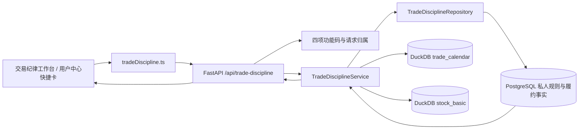

# 交易纪律模块

## 模块定位

交易纪律模块为登录用户提供私人交易规则、规则版本、按交易日履约打卡、操作事实、历史修订和快捷无操作履约闭环。模块入口是 `/trade-discipline`，数据始终按 `tenant_id + owner_user_id` 隔离；当前不包含自动履约裁决、AI 分析、收益曲线、券商同步或规则公开分享。

需求与验收边界见 [`../trading-discipline-checkin/requirement.md`](../trading-discipline-checkin/requirement.md)，任务和验证记录见 [`../trading-discipline-checkin/plan.md`](../trading-discipline-checkin/plan.md)。

## 核心技术

| 层次 | 当前实现 | 关键入口 |
| --- | --- | --- |
| 页面 | 三页签工作台承载今日打卡、规则管理和历史记录；用户中心抽屉提供摘要、跳转和快捷无操作履约 | `frontend/src/views/TradeDisciplineView.vue`、`frontend/src/App.vue` |
| 前端组件 | 规则与操作复用摘要展开卡；买卖规则和操作事实统一按买入/卖出分组；历史复用通用表格、分页和页面抽屉 | `frontend/src/components/AppSummaryDisclosureCard.vue`、`frontend/src/components/trade-discipline/`、`frontend/src/views/trade-discipline/components/` |
| API | `/api/trade-discipline` 下 23 个端点，路由层负责请求模型、权限依赖、统一响应和错误映射 | `backend/api/trade_discipline.py` |
| 服务 | 编排草稿、发布、激活事件、履约、修订、原因、操作、摘要和股票点时校验 | `backend/services/trade_discipline_service.py` |
| 仓库 | 所有 PG 查询和写入显式带归属；事务内锁主体、维护版本/事件序号和不可变修订 | `backend/storage/trade_discipline_repository.py` |
| 数据定义 | 15 张 `trade_discipline_*` PG 表、索引、菜单/资源迁移和资产表登记 | `backend/storage/pg_ddl.py` |
| 参考数据 | DuckDB `trade_calendar` 决定下一真实交易日，`stock_basic` 提供轻量股票搜索与点时存续校验 | `backend/services/trade_discipline_service.py`、`backend/storage/trade_discipline_repository.py` |

PG 与 DuckDB 不跨库 JOIN。服务层分别读取私人业务资产与只读参考数据，再在内存中完成校验和组合。

## 系统架构



## 页面使用说明

### 今日打卡

- 选择真实交易日和该日有效规则版本，查看待打卡、已履约或未履约状态。
- 支持“履约/未履约 × 有操作/无操作”四种组合。
- 有操作时按买入、卖出分组新增记录；分组决定操作方向，卡片内选择股票、具体选股规则、同方向买卖规则及可选成交事实。
- 未履约时必须选择或输入一个原因，并填写保留换行的详细说明。
- 已有记录只读展示；进入修正后只有发生实质变化才能提交新修订。

### 规则管理

- 左侧规则轨道展示主体状态、目标交易日有效状态、当前正式版本、草稿和待生效动作；右侧就地编辑，不使用规则编辑抽屉。
- 新建、复制和保存草稿不产生正式版本号；发布才生成连续版本。
- 选股规则使用摘要卡；买卖规则按方向分组并使用同类摘要卡。内置类型不可删除，自定义类型随草稿保存登记并可从候选中删除。
- 发布、归档和恢复均从操作自然日之后的第一个真实交易日生效，不倒灌当日或历史交易日。

### 历史记录

- 按日期、规则、履约结果、有无操作、股票、原因和修正状态做服务端筛选、排序和分页。
- 规则名称是唯一详情入口；详情抽屉可切换任意不可变修订，并从当前修订发起修正。

### 用户中心快捷卡

- 同时拥有页面查看和履约查看权限时展示摘要；拥有提交权限时可确认“已履约 + 无操作”。
- 快捷成功后刷新共享摘要和已打开工作台；冲突转入正式页面处理。

## 业务流程

### 规则发布与生效

1. 用户创建或打开每个规则主体唯一的工作草稿。
2. 保存草稿时校验名称占用、买卖类型方向占用、金额、明细启用态和 `draft_revision`。
3. 发布事务锁定规则主体，生成连续正式版本和不可变明细。
4. 服务从 DuckDB 查询操作自然日后的首个开市日；日历缺失时整个 PG 事务回滚并保留草稿。
5. 同一事务分配单调 `event_seq`、写入激活事件、更新主体指针并删除草稿。
6. 履约日有效状态只按 `(effective_from_trade_date, event_seq)` 解析；时间戳仅用于审计和生效日计算。

### 履约提交与修正

1. 服务校验交易日、归属和该日有效正式版本。
2. 对每笔操作校验股票点时存续、方向、具体选股规则和同方向买卖规则；股票名称由服务端生成提交时快照。
3. 首次提交创建唯一 `(归属, rule_id, trade_date)` 打卡主体和 r1；修正使用 `expected_revision` 乐观锁追加不可变修订。
4. 修订、违规原因、操作和当前修订指针在同一 PG 事务提交。
5. 页面刷新当前表单、规则轨道、历史列表和用户中心共享摘要。

## 数据模型

| 数据组 | 表 | 主要不变量 |
| --- | --- | --- |
| 规则主体与占用 | `trade_discipline_rule`、`trade_discipline_rule_name_claim`、`trade_discipline_action_subtype` | 未删除规则名称在归属内唯一；自定义买卖类型名在归属内唯一且固定方向 |
| 工作草稿 | `trade_discipline_rule_draft`、`trade_discipline_draft_stock_rule`、`trade_discipline_draft_action_rule` | 每主体至多一个草稿；用 `draft_revision` 乐观锁；草稿没有正式版本号 |
| 正式版本 | `trade_discipline_rule_version`、`trade_discipline_stock_rule`、`trade_discipline_action_rule` | 只有发布生成版本；正式版本和明细不可变 |
| 生命周期 | `trade_discipline_rule_activation` | 事件只增不改；主体内 `event_seq` 严格单调并决定同生效日顺序 |
| 履约与修订 | `trade_discipline_checkin`、`trade_discipline_checkin_revision` | 规则 + 交易日唯一；修订只增不改，当前指针受乐观锁保护 |
| 违规与操作 | `trade_discipline_reason`、`trade_discipline_violation`、`trade_discipline_operation` | 原因软删除不改历史快照；操作固定绑定同一规则版本内的具体明细 |

金额使用 PostgreSQL `NUMERIC` 和前端十进制定点字符串链路，不使用 JavaScript 浮点数作为资金约束事实源。

## API 与权限

| 能力 | 主要端点 | 权限 |
| --- | --- | --- |
| 页面摘要 | `GET /summary` | 同时需要 `trade-discipline:view`、`trade-discipline:checkin-view` |
| 规则与类型目录 | `/rules`、`/rules/{rule_id}`、`/rule-types` | 读取用 `trade-discipline:view`；写入用 `trade-discipline:rule-manage` |
| 草稿与生命周期 | `/rules/{rule_id}/draft`、`publish`、`archive`、`restore`、`copy` | `trade-discipline:rule-manage` |
| 履约和历史 | `/checkins/current`、`/checkins`、`/checkins/{id}/revisions/{no}` | 读取用 `trade-discipline:checkin-view` |
| 提交和修正 | `POST /checkins`、`/amendments`、`/quick-no-operation` | `trade-discipline:checkin-submit` |
| 原因 | `GET /reasons`、`DELETE /reasons/{id}` | 读取用 `checkin-view`；删除用 `checkin-submit` |
| 股票轻量搜索 | `GET /stock-options` | `checkin-view` 或 `checkin-submit` 任一权限 |

菜单和四项资源由 `migration.trade_discipline_default_grants_v1` 状态机维护。首次迁移默认授权 system、normal、tenant_admin；管理员后续撤销的授权不会在启动时补回。回滚入口：

```bash
python -m backend.cli trade-discipline-rbac rollback \
  --confirm-marker migration.trade_discipline_default_grants_v1
```

回滚只撤销账本中仍存在的 RBAC 行并写 tombstone，不删除业务事实；发现账本外角色授权时拒绝级联。

## 配置与运行边界

- 生产没有新增业务环境变量或业务 `app_config`；页面密度和历史分页复用既有布局/用户偏好链路。
- E2E 复用 `AI_STOCKS_ENV`、`AI_STOCKS_E2E_WRITE`、`AI_STOCKS_E2E_LOGIN_BYPASS` 安全门控，这些变量不属于生产业务配置。
- 发布、归档、恢复依赖 DuckDB 已有下一真实开市日；缺失时 fail-closed，不在生命周期事务内联网补采或用工作日推算。
- 页面未保存保护由应用级工作标签协议统一调度，交易纪律页面集中承载规则三选和打卡二选决策；浏览器刷新使用原生 `beforeunload`。

## 验证入口

```bash
# 后端聚焦测试；执行前遵守 AGENTS.md 的 DuckDB 锁与服务恢复规则
python -m pytest backend/tests/test_trade_discipline_t*.py backend/tests/test_e2e_trade_discipline.py -q

# 前端组件与构建
cd frontend
npm test -- --run src/views/__tests__/TradeDisciplineView.spec.ts \
  src/views/trade-discipline/components/__tests__ \
  src/components/trade-discipline/__tests__
npm run build

# 真实 PG + DuckDB 聚焦 E2E；脚本负责指纹、夹具、服务状态与清理
AI_STOCKS_ENV=dev AI_STOCKS_E2E_WRITE=1 npm run test:e2e:trade-discipline
```

确定性夹具仅使用 `debug_tenant` 下固定调试账号、`e2e_td_`/`E2E纪律-`/`E2E类型-` 前缀、DuckDB `9988*.SZ` 和 2098 年专属日期。seed/cleanup 必须在后端停服时执行，并校验 `/api/health/e2e` 与直连 PG 指纹一致。

## 风险事项

| 等级 | 风险点 | 影响 | 当前控制 |
| --- | --- | --- | --- |
| 高 | 未来交易日历缺失 | 发布、归档或恢复暂时不可用 | 服务 fail-closed；采集、启动和数据体检检查跨年覆盖 |
| 高 | RBAC marker 冲突或账本外授权 | 错误覆盖管理员配置或误删授权 | advisory lock、严格 marker 校验、普通 seed 只补缺失、回滚拒绝账本外授权 |
| 中 | 多入口未保存状态 | 路由、标签关闭或注销可能丢失输入 | 应用级 preflight、页面级决策、组件契约和 Playwright 覆盖 |
| 中 | 历史和原因数据增长 | 模糊筛选性能下降 | 服务端分页、归属过滤、受控股票查询和现有索引；达到真实容量阈值后再评估新索引 |
| 中 | 生产回滚尚未演练 | 实际发布回退仍存在操作风险 | 本地已验证代码与确定性夹具；生产备份、部署和 RBAC 回滚演练仍必须在发布授权范围内单独执行 |
