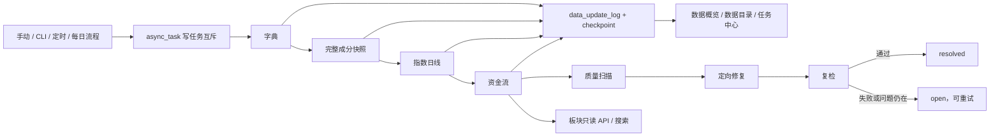

# 概念 / 行业板块业务闭环

## 1. 闭环结论

板块数据作为现有数据管理体系的一等数据类型，入口、执行、状态、失败、恢复和数据管理展示全部复用现有闭环。它不是独立于数据管理的临时采集器。板块只读 API 已可消费数据；独立的 `/sectors` 前端业务页面尚未实施，不作为本轮数据管理闭环的完成项。

## 2. 入口闭环

| 入口 | 模式 | 结果承接 |
| --- | --- | --- |
| 数据采集页快捷操作 | 明确全量回填 | 创建 `board` 异步任务，进入任务中心 |
| 数据概览板块卡片 | 增量 | 跳转数据采集页并打开板块增量选项 |
| 定时任务 | 默认增量，可选择全量回填 | 保存明确 `params.mode`，到点创建同一种 `board` 任务 |
| `python -m backend.cli board` | 默认增量，支持全量、分表、代码、limit | 使用同一 `IngestionService.ingest_board` |
| `python -m backend.cli daily` | 默认包含板块增量 | 板块失败不阻塞后续质检，但流水线整体失败 |

所有入口最终进入同一编排服务，禁止各自维护不同的采集口径。

## 3. 数据闭环

### 字典

概念和行业独立拉取、独立失败。字典 upsert 保留已存在的能力字段，并为缺少 `app_code` 的板块获取 clid。单个 clid 失败不丢弃主体字典，但任务以部分失败结束，后续重跑补齐。

### 成分

成分接口必须返回完整且非空快照。成功后同一事务完成：

1. 新关系 `INSERT ... ON CONFLICT DO NOTHING`；
2. 刷新最近源快照成分数；
3. 写入 `member_snapshot_at`；
4. 解决该板块活动中的 `board_member_incomplete`。

失败时不写任何成员数据，保留历史累计关系，更新日志记失败并创建幂等问题。

### 指数

按板块、年份拉取并幂等写入。部分年份失败时成功年份可以保留，但板块不会进入成功 checkpoint，任务结果包含失败年份，恢复后会重新处理该板块。

### 资金流

按概念 / 行业和周期形成工作单元。映射前验证流入、流出和净流入算术关系；按 `board_type + name` 映射字典。指定代码任务只写指定代码。未匹配项进入幂等质量台账，后续映射成功后改为已解决。

## 4. 状态与失败闭环

| 场景 | 数据 | 任务状态 | checkpoint | 后续动作 |
| --- | --- | --- | --- | --- |
| 工作单元成功 | 幂等写入 | 继续 | 记录完成 | 后续续跑跳过 |
| 工作单元部分成功 | 保留成功数据 | `failed` | 保留成功单元，不记录失败单元完成 | 从失败任务续跑剩余单元 |
| 用户终止 | 已完成数据保留 | `interrupted` | 保留阶段与成功单元 | 用户可续跑 |
| 修复异常 | 原问题退回 `open` | `failed` | 失败 issue 不记完成 | 再次修复 |
| 修复复检未过 | 数据保留 | `failed` | issue 可再次处理 | 保持 `open` |
| 修复复检通过 | 数据完成 | `done` | issue 记完成 | 问题 `resolved` |

任务返回结构中的 `ok=false` 是正式失败信号。异步执行器和每日流水线必须消费该信号，不能只依赖异常。

## 5. 质量修复闭环

- 成分不完整：定向重采单板块，完整快照是唯一解决证据。
- 指数缺口：定向重采单板块历史，追平全局最新交易日后解决。
- 资金流未匹配：刷新字典再采即时资金流，问题详情中的名称和类型真实可映射后解决。
- 扫描板块指数缺口时事务化替换活动问题；扫描失败保留旧问题。
- 修复与普通采集共享同一底层服务、任务日志、终止检查和错误判定。

## 6. 运维可见性闭环

- 任务中心：展示板块增量 / 全量标签、实时阶段、当前板块或周期、部分失败原因和续跑入口。
- 更新日志：四张表分别记录来源、日期范围、行数和 `success / partial / failed`。
- 数据概览：展示字典分类数、三类覆盖率、最新日期和三类活动问题。
- 数据目录：四张表可查询字段、时间列、鲜活度与质量问题映射。
- 数据源健康：`ths_board` 可见并可实际测试。

## 7. 消费闭环

采集成功后，`/api/sectors*` 四个只读接口直接消费四表。列表查询先聚合板块指标和成分涨跌统计，再分页返回，不按每个板块逐次扫描；摘要的 `member_count` 使用最近完整源快照口径，成员分页 `total` 表示累计出现过的关系数。

独立的 `/sectors` 与 `/sectors/:boardCode` 前端页面、路由和 pageRegistry 尚未落地。后续实现页面时，必须显式展示响应中的指数日期与资金流日期，并在无板块数据时提供采集引导；在此之前不得把页面标记为已完成。

## 8. 权限与边界

- 数据管理入口沿用系统级数据管理权限。
- 四个板块只读接口使用 `sectors:view`；后续业务页面也必须消费同一权限。
- 本功能只写行情 DuckDB，不新增租户资产，不跨库 JOIN。
- 同花顺登录 cookie 只从环境变量或环境文件读取，不进入代码、数据库或日志。
