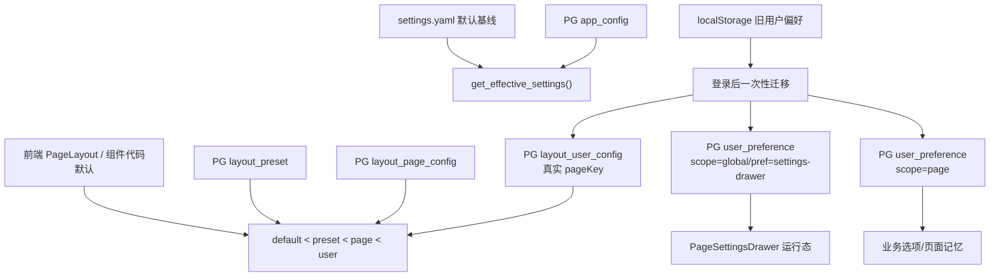

# 开发计划

## 1. 需求来源与目标

- 需求文档：本轮用户确认的配置存储治理诉求，以及计划审查反馈 F1-F9。
- 需求编号说明：本文 R1-R10 为本计划基于用户诉求与审查反馈临时分配的计划内编号；当前没有独立 `requirement.md`。
- 功能目标：
  - 把当前仍落 DuckDB 的布局平台配置迁到 PostgreSQL。
  - 把当前仍落浏览器 localStorage 的布局用户层、组件用户层、页面业务偏好和全局 UI 偏好迁到 PostgreSQL。
  - 保留 YAML 作为默认基线，保留 DuckDB 作为行情/分析数据存储，不再扩展 DuckDB 配置职责。
  - 修正设置抽屉“默认折叠配置”和“当前展开交互态”混用问题。
  - 明确个人偏好云端持久化的权限口径，避免从本地零权限退化为云端 403。
- 本次不做：
  - 不迁移行情、指标计算结果、回测明细、采集数据等分析数据。
  - 不把认证 token 从 localStorage 迁出，本计划只处理配置与偏好。
  - 不在首个迁移版本物理删除 DuckDB 旧配置表，先停止写入并保留回滚依据。
  - 不把 `settings-drawer.bodyScroll`、`settings-drawer.collapsibleSections` 开放到用户层。
- 计划输出目录：`agent-works/config-storage-pg-migration/plan.md`

## 2. 当前项目依据

- 系统设置覆盖层已经是 PostgreSQL：
  - `backend/storage/app_config.py`：`AppConfigRepo` 使用 PG `app_config`，`CONFIG_GROUPS` 是系统设置白名单和前端 schema。
  - `backend/api/data_admin.py`：`GET/POST /api/data/settings` 读写系统设置。
  - `agent-works/architecture/environment-configuration.md`：明确 Web 可改运行期参数落 PostgreSQL `app_config`，DuckDB 同名旧表不再作为运行期权威。
- 布局平台配置仍在 DuckDB：
  - `backend/storage/layout_config.py`：`layout_preset`、`layout_page_config`、`layout_field_policy` 通过 `self.c` 读写 DuckDB；`layout_user_config` 已通过 `self.pg` 读写 PG。
  - `backend/storage/ddl.py`：仍声明 DuckDB 版 `layout_preset`、`layout_page_config`、`layout_user_config`、`layout_field_policy`、`app_config`。
  - `backend/storage/pg_ddl.py`：已有 PG `layout_user_config` 与 `app_config`，但没有 PG 版 `layout_preset`、`layout_page_config`、`layout_field_policy`。
- 组件配置保存存在后端归属校验：
  - `layout_config.py` 的 `_enforce_component_ownership()` 在 values 含 `slots.<slotId>.config.<field>` 且未传 layout 时会拒绝保存。
  - 因此全局抽屉偏好不能保存到伪造 pageKey 的 `/api/layout/users/__global__:settings-drawer`，除非提供合成 layout；本计划不采用合成 layout，改走 `user_preference`。
- `settings-drawer` 字段层级有硬约束：
  - `size`、`defaultCollapsed` 支持用户层。
  - `bodyScroll`、`collapsibleSections` 只支持 preset/page 层，不支持用户层。
- 当前权限口径：
  - `/api/layout/users/{page_key}` 依赖 `layout:user-config`。
  - `layout:user-config` 当前在 `BUSINESS_RESOURCE_CODES`，不是登录基线；无该码的自定义角色会 403。
  - 个人偏好从 localStorage 迁到 PG 后，必须把自有偏好持久化能力纳入登录基线自持久化口径，否则会造成权限回归。
  - 现有 `SHARED_RESOURCE_CODES` 语义是“登录基线共享读”，运行时对有角色的非 system 用户强制注入、角色页不可反选、不落 `role_resource`；本次若放入个人偏好写码，就是有意扩展 baseline 到“自作用域写”。
- 前端用户层仍在 localStorage：
  - `frontend/src/layout/useLayoutConfig.ts`：`ai-stocks:layout:<pageKey>` 保存布局用户层，`ai-stocks:layout-cc:<pageKey>` 保存组件用户层。
  - `frontend/src/composables/useRemoteLayoutConfig.ts`：只拉后端页面层，注释仍说明用户层走 localStorage。
  - `frontend/src/composables/usePageSettings.ts`：页面业务偏好统一写 `ai-stocks:page-settings:<pageKey>`。
  - 其它本地偏好入口：`useTheme.ts`、`useAppNavigation.ts`、`useKlinePrefs.ts`、`BacktestView.vue` 的 `ai-stocks-backtest-params`。
- 设置抽屉当前状态问题：
  - `frontend/src/components/PageSettingsDrawer.vue`：用户点击折叠段时直接写 `slots.settings.config.defaultCollapsed`，导致“默认配置”随当前交互变化。
- 设计规范依据：
  - `DESIGN.md`：配置合并顺序为 `default < preset < page < user`；组件字段必须前后端事实源一致；配置能力必须具备字段事实源、页面消费事实源、存储、读取、消费和测试闭环。

## 3. 实施范围

### 3.1 必须实现

- R1：系统设置继续以 PG `app_config` 为唯一运行期覆盖层，清理代码中对 DuckDB `app_config` 作为配置权威的依赖。
- R2：迁移布局平台配置：`layout_preset`、`layout_page_config`、`layout_field_policy` 从 DuckDB 迁到 PG。
- R3：布局用户层改为 PG 权威：前端不再把 `ai-stocks:layout:<pageKey>` 作为登录用户真实来源。
- R4：组件用户层改为 PG 权威：前端保存组件路径到 `/api/layout/users/{pageKey}` 时必须传真实页面 `PageLayout`。
- R5：设置抽屉自身用户偏好跨页面共享，但保存到 `user_preference`，不保存到伪 pageKey 的 `layout_user_config`。
- R6：拆分抽屉默认折叠配置和当前展开交互态，点击展开/收起不写默认配置。
- R7：页面业务偏好从 `usePageSettings` 的 localStorage 迁到 PG 用户偏好表。
- R8：个人偏好云端持久化能力纳入登录基线自持久化权限口径，避免迁移后普通登录用户 403。
- R9：提供一次性、幂等的数据迁移路径，覆盖 DuckDB 配置迁移和浏览器 localStorage 用户偏好迁移。
- R10：补充接口、权限、测试、文档、发布顺序和回滚方案，确保配置展示、保存、读取、消费、重置和非法值拒绝闭环。

### 3.2 可选增强

| 需求编号/增强编号 | 增强内容 | 需求阶段处理状态 | 开发状态 | 对应任务 | 说明 |
| --- | --- | --- | --- | --- | --- |
| E1 | 首版本后物理删除 DuckDB 旧配置表 | 后续建议 | 跳过 | - | 首个迁移版本保留旧表用于回滚；稳定一版后再单独做清理迁移。 |
| E2 | 把认证 token 存储改为 HttpOnly Cookie | 后续建议 | 跳过 | - | 属认证安全架构，不属于配置迁移。 |
| E3 | 把 `stockSet` 当前股票集合也迁 PG | 后续建议 | 跳过 | - | 它更像导航上下文/工作集，不是配置；后续可按用户资产单独评估。 |
| E4 | 多设备冲突解决 UI | 后续建议 | 跳过 | - | 本次采用后写覆盖和更新时间回显，不做复杂冲突合并界面。 |

### 3.3 暂不实现

- DuckDB 旧配置表物理 drop。
- token、刷新 token、登录态持久化方式重构。
- 无角色用户的偏好云端持久化；无角色用户继续 fail-closed，只允许本地 fallback。

## 4. 技术方案

### 4.1 存储边界

| 配置类型 | 权威存储 | 说明 |
| --- | --- | --- |
| 敏感启动变量 | 环境变量 / `.env.local` | JWT、PG、Redis、SMTP 密码等，不进数据库配置表。 |
| 非敏感默认值 | `config/settings.yaml` | 默认基线，可被 PG `app_config` 覆盖。 |
| Web 系统设置 | PG `app_config` | 已实现，继续作为平台全局运行期配置覆盖层。 |
| 布局预设 | PG `layout_preset` | 从 DuckDB 迁移，系统管理员维护。 |
| 页面布局默认 | PG `layout_page_config` | 从 DuckDB 迁移，系统管理员维护。 |
| 组件字段开放策略 | PG `layout_field_policy` | 从 DuckDB 迁移，系统管理员维护。 |
| 页面布局/组件用户偏好 | PG `layout_user_config` | 仅存真实页面 pageKey 的布局和组件用户层；组件路径保存必须带真实 PageLayout。 |
| 设置抽屉跨页面用户偏好 | PG `user_preference` | `scope='global'`、`pref_key='settings-drawer'`，只存 `size`、`defaultCollapsed`。 |
| 非布局类用户偏好 | PG `user_preference` | 承载主题、导航模式、K 线偏好、页面业务偏好、回测参数记忆等。 |
| 临时交互态 | 组件内存 / sessionStorage | 当前这次打开抽屉时哪些段展开，不进入 PG。 |
| 行情/研究/分析数据 | DuckDB | 不纳入配置迁移。 |

### 4.2 数据流



### 4.3 后端方案

- 在 `backend/storage/pg_ddl.py` 新增 PG 版 `layout_preset`、`layout_page_config`、`layout_field_policy` DDL。
- 保留现有 `layout_user_config`：
  - 继续使用 `(user_id, page_key)` 主键。
  - 查询和写入仍按当前 owner 上下文取 `user_id`，不信任前端传入用户身份。
  - 保存组件路径时仍执行 `_enforce_component_ownership()` 和字段开放策略校验。
- 新增 `user_preference` 表，用于非布局用户偏好与全局抽屉偏好：

```sql
CREATE TABLE IF NOT EXISTS user_preference (
    tenant_id      TEXT NOT NULL,
    owner_user_id  TEXT NOT NULL,
    scope          TEXT NOT NULL,
    page_key       TEXT NOT NULL DEFAULT '',
    pref_key       TEXT NOT NULL,
    value          TEXT NOT NULL,
    schema_version INTEGER NOT NULL DEFAULT 1,
    updated_at     TIMESTAMPTZ NOT NULL DEFAULT now(),
    PRIMARY KEY (tenant_id, owner_user_id, scope, page_key, pref_key)
);
```

- `user_preference` 不额外创建 `(tenant_id, owner_user_id)` 普通索引；主键左前缀已覆盖常用查询，避免冗余索引。
- `UserPreferenceRepo` 约束：
  - `scope` 只允许 `global`、`page`、`feature`。
  - `page_key`、`pref_key` 使用受限字符集。
  - `value` 限制大小，只保存 JSON 标量或对象，不存文件/大对象。
  - `tenant_id + owner_user_id` 取当前请求上下文。
- 改造 `LayoutConfigRepo`：
  - `layout_preset`、`layout_page_config`、`layout_field_policy` 改用 `self.pg`。
  - DuckDB 只作为旧数据迁移读取源，不再作为布局配置运行期写入源。
  - `seed_builtin_presets()` 的 marker 改写 PG `app_config`；迁移时读取 DuckDB 旧 marker 并写入 PG marker，避免跨存储 marker 缺失导致重复 seed 判断异常。
  - 兼容保护：迁移 marker 缺失且 PG 目标表为空时，读接口可只读回退 DuckDB 并记录 warning；写接口要求迁移完成后写 PG，避免双写。
- 新增迁移命令：
  - `python -m backend.cli migrate-config-storage --dry-run`
  - `python -m backend.cli migrate-config-storage`
  - 迁移 DuckDB 的 `layout_preset`、`layout_page_config`、`layout_field_policy` 到 PG。
  - 对 DuckDB 旧 `app_config` 只做对账和缺失补迁，PG 已有值不覆盖。
  - 使用 PG `app_config` marker：`migration.config_storage_pg_v1`，保证幂等。
- 新增用户偏好 API：
  - `GET /api/user-preferences`
  - `POST /api/user-preferences`
  - `POST /api/user-preferences/bulk`
  - 归属取 `get_current_owner()`，不信任前端传入用户身份。

### 4.4 权限策略

- 个人偏好云端持久化属于“登录用户自有偏好写入”，不属于业务功能授权。
- 调整资源码口径：
  - 将 `layout:user-config` 从业务默认授权迁入登录基线自持久化能力；有角色的非 system 用户运行时强制拥有，无角色用户仍 fail-closed。
  - 新增 `user-preference:manage`，同样纳入登录基线自持久化能力。
  - 这是显式扩展 baseline，而不是把这两个码授给全部预设角色后继续允许反选；取舍是所有有角色用户都不可被剥夺“只写自己偏好”的能力。**该取舍已由用户确认采纳。**
  - 两个资源码必须挂在 `visible='login'` 的菜单锚点，不能挂在 `visible='system'` 菜单下，避免被 `system_only_resource_ids` 误判。
  - 更新 `backend/auth/constants.py`、`backend/storage/pg_ddl.py` seed、资源列表 baseline 标记、路由扫描测试和 RBAC 测试。
- `/api/layout/users/{pageKey}` 继续使用 `require_perm("layout:user-config")`。
- `/api/user-preferences/*` 使用 `require_perm("user-preference:manage")`。
- 前端遇到 403 不应静默宣称“已云端保存”；应降级为本地 fallback 并在调试日志或页面状态中可观察。

### 4.5 前端方案

- `useRemoteLayoutConfig` 改为远端优先：
  - 拉取页面平台层：`GET /api/layout/pages/{pageKey}`。
  - 拉取真实页面用户层：`GET /api/layout/users/{pageKey}`。
  - 不再拉取 `/api/layout/users/__global__:settings-drawer`。
- 保存布局/组件用户层：
  - `ai-stocks:layout:<pageKey>` 对应普通布局路径，保存到 `/api/layout/users/{pageKey}`。
  - `ai-stocks:layout-cc:<pageKey>` 对应组件路径，保存到 `/api/layout/users/{pageKey}`，请求体必须带当前真实 `PageLayout`，满足后端组件归属校验。
- 设置抽屉自身偏好：
  - 新增 `useDrawerPreferences()`，内部使用 `useUserPreference(scope='global', pref_key='settings-drawer')`。
  - 只保存 `size`、`defaultCollapsed`。
  - `bodyScroll`、`collapsibleSections` 继续只读 preset/page 层，不在用户偏好 UI 中保存。
  - 抽屉运行时优先使用用户全局偏好覆盖 page/preset 默认：`drawerPref.size ?? componentValueOf('settings','size')`。
  - `defaultCollapsed` 同样按用户全局偏好覆盖 page/preset 默认：`drawerPref.defaultCollapsed ?? componentValueOf('settings','defaultCollapsed')`。
  - 抽屉初始化时只选择一个生效来源，避免同时应用 layout 合并值和 user_preference 值导致二次初始化跳变。
- 设置抽屉折叠状态拆分：
  - `defaultCollapsed` 只表示“打开抽屉时默认折叠哪些段”。
  - 当前点击展开/收起使用组件内 `runtimeCollapsedSections`，不写 PG、不写 localStorage。
  - 每次抽屉打开时用 `defaultCollapsed` 初始化运行态；打开期间用户点击只影响本次。
- 远端加载态与竞态：
  - `useRemoteLayoutConfig` 暴露 `ready`、`loadError`、`remoteHydrated`。
  - 保存动作在 `remoteHydrated` 前禁用或排队，避免首屏拉取覆盖用户刚改的本地值。
  - 若用户在拉取完成前修改字段，记录 dirty path；远端返回后不得覆盖 dirty path。
  - 设置抽屉和组件设置段在远端偏好加载中展示轻量 loading 态；接口失败时明确进入本地 fallback。
- `usePageSettings` 改造为远端优先：
  - 登录态从 `user_preference(scope='page', page_key=<pageKey>, pref_key='settings')` 读取。
  - 保存时 debounce 写 PG。
  - 未登录或接口失败时使用 localStorage fallback。
- 新增通用 `useUserPreference`：
  - 支持 `global/theme`、`global/navigation`、`global/kline`、`global/settings-drawer`、`page/<pageKey>/settings`、`feature/backtest/params`。
  - 统一 schemaVersion、默认值合并、非法旧值丢弃和 debounce 保存。
- 首次登录后的 localStorage 迁移：
  - 读取 `ai-stocks:layout:*` → PG `layout_user_config` 的布局路径。
  - 读取 `ai-stocks:layout-cc:*` → PG `layout_user_config` 的组件路径，保存时带真实 PageLayout。
  - `slots.settings.config.size` 可迁到 `user_preference(global/settings-drawer).size`。
  - 不自动迁移被当前交互污染过的旧 `slots.settings.config.defaultCollapsed`；用户后续通过显式设置重新保存。
  - 不迁移旧 `slots.settings.config.bodyScroll`、`slots.settings.config.collapsibleSections` 到用户层。
  - 读取 `ai-stocks:page-settings:*`、`ai-stocks-theme`、`ai-stocks-navigation-mode`、`ai-stocks:kline-prefs`、`ai-stocks-backtest-params` → PG `user_preference`。
  - 成功后写本地 marker `ai-stocks:migration:config-storage-pg:v1`，避免重复迁移。

### 4.6 页面与组件资产闭环

本次不新增页面，不新增组件种类；复用现有 `PageSettingsDrawer`、`ComponentAutoSettings`、`ConfigGroupForm`、`SettingsGroup`。

| 页面/区域 | 运行时复用组件 | 布局或配置组件种类 | 组件配置字段/页面注册 | 设计规范或组件清单更新 | 真实消费与验证 | 对应任务 |
| --- | --- | --- | --- | --- | --- | --- |
| 页面设置抽屉 | 复用 `PageSettingsDrawer` | 复用 `settings-drawer` | 用户层仅 `size/defaultCollapsed`；`bodyScroll/collapsibleSections` 仅 preset/page | 更新 DESIGN 中 user 层存储说明 | 所有 registry 页面抽屉共享尺寸与默认折叠配置，点击展开不污染默认值 | T6、T7、T11 |
| 组件设置 | 复用 `ComponentAutoSettings` | 复用 data-table/wide-table/tabs/config-panel | 复用既有字段，保存时带真实 PageLayout | 不新增字段 | 表格列显隐、分页、默认排序、config-panel 折叠偏好远端保存生效 | T7、T11 |
| 业务选项 | 复用页面 `#business` 插槽与 `usePageSettings` | 不涉及组件种类 | 不进入 layout 组件字段 | 更新 `usePageSettings` 存储职责 | 页面业务偏好远端保存和回显 | T8、T11 |

## 5. 需求与开发内容映射和开发状态

| 范围类别 | 需求编号 | 需求内容/来源 | 计划开发内容 | 对应任务 | 状态 | 偏差判断 | 说明 |
| --- | --- | --- | --- | --- | --- | --- | --- |
| 必须实现 | R1 | 系统配置不再使用 DuckDB 权威 | 保持 PG `app_config` 权威，清理 DuckDB marker/旧入口依赖 | T1、T3、T5、T10 | 进行中 | 一致 | T1 已完成存储边界冻结，T3 已把布局 seed marker 改到 PG `app_config` 并兼容 DuckDB 旧 marker，T5 已提供 DuckDB 旧 `app_config` 缺失补迁命令；后续 T10 同步文档。 |
| 必须实现 | R2 | 布局平台配置迁 PG | 新增 PG DDL，改造 `LayoutConfigRepo`，迁移 DuckDB 数据 | T2、T3、T5、T12 | 进行中 | 一致 | T2 已新增 PG 表底座，T3 已将运行期仓库读写切 PG，T5 已提供 DuckDB 布局配置到 PG 的迁移命令；发布闭环留到 T12。 |
| 必须实现 | R3 | 布局用户层迁 PG | 前端拉取/保存 `/layout/users/{pageKey}`，localStorage 降级为迁移源 | T7、T9 | 进行中 | 一致 | T7 已接入 `/layout/users/{pageKey}` 的拉取、注入和 debounce 保存；T9 已把旧 `ai-stocks:layout:<pageKey>` 按真实 pageKey 迁到 `/layout/users/{pageKey}`，localStorage 继续仅作 fallback。 |
| 必须实现 | R4 | 组件用户层迁 PG | 组件路径进入 `layout_user_config.config.values`，保存时带真实 PageLayout | T7、T9、T11 | 进行中 | 一致 | T7 已将组件用户配置导出为 `slots.<id>.config.<field>` 并保存时带真实 `PageLayout`；T9 已迁移旧 `ai-stocks:layout-cc:<pageKey>` 中合法组件路径，保存时复用 pageRegistry 的真实 `PageLayout`；T11 继续整体回归。 |
| 必须实现 | R5 | 抽屉偏好跨页面共享 | 抽屉自身偏好进 `user_preference(global/settings-drawer)`，`size/defaultCollapsed` 覆盖 page/preset 默认且运行时只选一个来源 | T4、T7、T9 | 进行中 | 一致 | T4 已提供 `user_preference` 后端存储与 API；T7 已新增全局抽屉偏好消费和保存；T9 只把旧 `settings-drawer.size` 迁为全局偏好，旧 `defaultCollapsed/bodyScroll/collapsibleSections` 不迁。 |
| 必须实现 | R6 | 默认折叠与当前状态分离 | `PageSettingsDrawer` 使用运行态折叠集合，默认值仅显式设置保存 | T6、T11 | 进行中 | 一致 | T6 已完成抽屉打开期运行态分离，点击折叠段不再写 `settings.defaultCollapsed`；后续 T11 做整体回归。 |
| 必须实现 | R7 | 页面业务偏好迁 PG | 新增 `user_preference`，改造 `usePageSettings` 和零散偏好 composable | T4、T8、T9 | 进行中 | 一致 | T4 已提供后端偏好存储与批量保存接口；T8 已新增通用 `useUserPreference`，并把 `usePageSettings`、主题、导航模式、K 线偏好、回测参数记忆接入远端优先与本地 fallback；T9 已把旧 page-settings、theme、navigation、kline、backtest 本地 key 迁到 `user_preference`。 |
| 必须实现 | R8 | 个人偏好权限口径 | `layout:user-config` 与 `user-preference:manage` 纳入登录基线自持久化能力，明确这是扩 baseline 而非可反选角色授权 | T2、T4、T11 | 进行中 | 一致 | T2 已调整资源码和测试契约，T4 已用 `user-preference:manage` 接入 API 并验证 baseline 通过、无角色 fail-closed；完整前端 403 fallback 留到 T11。 |
| 必须实现 | R9 | 数据迁移幂等可回滚 | 后端 CLI 迁 DuckDB，前端一次性迁 localStorage | T5、T9、T12 | 进行中 | 一致 | T5 已完成后端 DuckDB→PG 配置迁移命令和 marker 跳过/force；T9 已完成前端 localStorage 一次性迁移器和 marker 跳过；发布演练留到 T12。 |
| 必须实现 | R10 | 测试、权限、文档、发布闭环 | 补后端/前端测试、页面验证、文档更新和无窗口发布顺序 | T10、T11、T12 | 进行中 | 一致 | T2 已补权限测试契约与 SQL 归档，T3 已补 PG-backed layout repo 与 PG 空表回退测试，T4 已补用户偏好 API 测试，T5 已补迁移命令测试，T6 已补抽屉折叠运行态组件测试，T7 已补布局远端化与抽屉偏好前端单测；T8 已补 `useUserPreference` 与 K 线偏好单测并通过前端构建；T9 已补 `usePreferenceMigration` 单测并通过前端构建；完整文档、浏览器页面验证和发布验证仍在后续任务。 |

## 6. 详细实施步骤与进度追踪

### 6.1 任务 T1：配置存储盘点与契约冻结

- 状态：已完成
- 依赖：无
- 涉及文件/模块：`backend/storage/app_config.py`、`backend/storage/layout_config.py`、`frontend/src/layout/useLayoutConfig.ts`、`frontend/src/composables/usePageSettings.ts`、`DESIGN.md`
- 目标：冻结本次迁移的配置分类、存储归属、迁移范围和不迁移范围。
- 操作：
  - 梳理所有配置和偏好来源，形成“PG / YAML / DuckDB / localStorage 保留”清单。
  - 确认 `app_config` 白名单仍是系统设置唯一事实源。
  - 确认 localStorage 中哪些 key 作为迁移源，哪些继续保留为临时态。
  - 明确 `settings-drawer.bodyScroll/collapsibleSections` 不进入用户层。
- 产出：存储归属清单。
- 影响范围：配置中心、布局系统、页面设置抽屉、页面业务偏好。
- 边界与异常：认证 token、股票工作集、纯当前交互态不纳入配置迁移。
- 验证方式：代码搜索无遗漏；计划中的清单与 `rg localStorage` 结果逐项对应。
- 完成标准：每类配置都有唯一权威存储和回退策略。
- 实际落地情况：已基于当前代码事实冻结 T1 存储边界：系统运行期配置继续以 PG `app_config` 为权威；布局平台配置迁移目标为 PG `layout_preset`/`layout_page_config`/`layout_field_policy`；真实页面布局/组件用户层继续使用 PG `layout_user_config`；全局抽屉和非布局用户偏好进入 `user_preference`；`settings-drawer.bodyScroll/collapsibleSections` 不进入用户层；认证 token、股票工作集和临时交互态不纳入本次迁移。

### 6.2 任务 T2：PG DDL 与权限资源码调整

- 状态：已完成
- 依赖：T1
- 涉及文件/模块：`backend/storage/pg_ddl.py`、`backend/auth/constants.py`、`agent-works/config-storage-pg-migration/config-storage-pg.sql`
- 目标：让 PG 具备承载所有配置和用户偏好的表结构，并明确个人偏好权限口径。
- 操作：
  - 新增 PG `layout_preset`、`layout_page_config`、`layout_field_policy`。
  - 新增 PG `user_preference`。
  - 不新增冗余 `user_preference(tenant_id, owner_user_id)` 普通索引。
  - 将 `layout:user-config` 调整为登录基线自持久化能力。
  - 新增 `user-preference:manage` 并纳入登录基线自持久化能力。
  - 两个资源码挂到 `visible='login'` 的菜单锚点，且资源列表标 `baseline_locked=true`；不得挂到 `visible='system'` 菜单。
  - 写 SQL 文件，说明用途、执行时机、影响范围和回滚方式。
- 产出：幂等 DDL、资源码 seed 调整和 SQL 归档。
- 影响范围：PG schema 初始化、RBAC 资源码、路由扫描。
- 边界与异常：无角色用户继续 fail-closed。
- 验证方式：PG 初始化测试、DDL 幂等测试、baseline 权限测试、路由扫描测试。
- 完成标准：有角色的非 system 用户可访问个人偏好接口；无角色用户仍 403。
- 实际落地情况：已新增 PG DDL 底座：`layout_preset`、`layout_page_config`、`layout_field_policy`、`user_preference`；`user_preference` 使用 `(tenant_id, owner_user_id, scope, page_key, pref_key)` 主键且不新增冗余 owner 普通索引。已将 `layout:user-config` 从业务授权池迁入 `SHARED_RESOURCE_CODES`，新增 `user-preference:manage` 基线码，并在 PG seed 中把两个码挂到 `/board` login 锚点、标为 baseline_locked。已补 SQL 归档 `agent-works/config-storage-pg-migration/config-storage-pg.sql`，并同步改写 `test_stage4_layout.py` 中旧负向用例为 baseline 新语义，补无角色 fail-closed。

### 6.3 任务 T3：后端布局配置仓库迁 PG

- 状态：已完成
- 依赖：T2
- 涉及文件/模块：`backend/storage/layout_config.py`、`backend/api/layout.py`、`backend/tests/test_layout_config.py`
- 目标：布局平台配置运行期只写 PG，迁移期可只读回退 DuckDB 防空窗。
- 操作：
  - `LayoutConfigRepo` 构造时初始化 PG DDL，不再依赖 DuckDB 建布局配置表。
  - `list_presets/get_preset/upsert_preset/delete_preset` 改用 PG。
  - `get_page_config/set_page_config/reset(page)` 改用 PG。
  - `list_field_policies/set_field_policy/reset_field_policy` 改用 PG。
  - `seed_builtin_presets` 的 marker 改到 PG `app_config`，并兼容 DuckDB 旧 marker。
  - 迁移 marker 缺失且 PG 目标表为空时，读接口只读回退 DuckDB 并记录 warning；写接口要求迁移完成后写 PG。
- 产出：PG-backed `LayoutConfigRepo`。
- 影响范围：系统管理 → 布局配置、所有页面布局配置读取。
- 边界与异常：PG 不可用时接口应返回明确错误；前端保留默认渲染兜底。
- 验证方式：后端 layout 单测覆盖 preset/page/user/field-policy/effective/reset，以及 PG 空表只读回退。
- 完成标准：迁移完成后运行期保存和读取布局配置不访问 DuckDB 配置表。
- 实际落地情况：已将 `LayoutConfigRepo` 的 `layout_preset`、`layout_page_config`、`layout_field_policy` 读写切到 PG；仓库构造仅初始化 `app_config` 与布局相关 PG DDL，不触发全量 RBAC/menu seed；`seed_builtin_presets` marker 改写 PG `app_config`，并在发现 DuckDB 旧 marker 且 PG 预设为空时写入 PG marker、保留 DuckDB 只读回退；迁移 marker 缺失且 PG 对应平台表为空时，读接口只读回退 DuckDB 并记录 warning，所有写接口仍写 PG。`test_layout_config.py` 已改为 PG 平台表快照/还原，避免污染真实配置，并新增 PG 空表回退用例。

### 6.4 任务 T4：用户偏好后端服务与 API

- 状态：已完成
- 依赖：T2
- 涉及文件/模块：`backend/storage/user_preference.py`、`backend/api/user_preferences.py`、`backend/storage/pg_ddl.py`
- 目标：给非布局类用户偏好和全局抽屉偏好提供 PG 权威存储。
- 操作：
  - 新增 `UserPreferenceRepo`，按 `tenant_id + owner_user_id + scope + page_key + pref_key` 读写。
  - 新增批量保存接口，支持前端一次性迁移多个 localStorage key。
  - 保存时限制 `scope`、`page_key`、`pref_key` 字符集和 value 大小。
  - 归属只取请求上下文，不接受前端传 userId。
  - 端点使用 `require_perm("user-preference:manage")`。
- 产出：用户偏好 API 和 repo。
- 影响范围：页面业务偏好、全局 UI 偏好、全局抽屉偏好。
- 边界与异常：单个偏好 value 只存 JSON，不存文件/大对象。
- 验证方式：接口鉴权、跨用户隔离、批量保存、非法 key/value 拒绝测试。
- 完成标准：不同用户读写互相隔离，有角色用户可保存自有偏好。
- 实际落地情况：已新增 `UserPreferenceRepo`，按 `tenant_id + owner_user_id + scope + page_key + pref_key` 读写 PG `user_preference`；保存限制 `scope`、`page_key`、`pref_key`、`schemaVersion` 和 value 大小，归属只取请求上下文或仓库显式构造参数。已新增 `/api/user-preferences` GET/POST 与 `/api/user-preferences/bulk`，端点统一使用 `require_perm("user-preference:manage")`，支持当前用户单项查询、单项保存和批量保存。

### 6.5 任务 T5：DuckDB → PG 配置迁移命令

- 状态：已完成
- 依赖：T2、T3
- 涉及文件/模块：`backend/cli.py`、`backend/services/migrate_config_storage.py`、`backend/tests/test_migrate_config_storage.py`
- 目标：把历史 DuckDB 配置迁到 PG，支持 dry-run、幂等和回滚。
- 操作：
  - 新增 `migrate-config-storage` CLI。
  - dry-run 输出 DuckDB 与 PG 行数、待迁移 key、冲突策略。
  - 迁移 `layout_preset`、`layout_page_config`、`layout_field_policy`。
  - DuckDB 旧 `app_config` 只补迁 PG 缺失值，不覆盖 PG 已有值。
  - 读取 DuckDB 旧布局 seed marker，并写入 PG marker。
  - 写入 PG marker `migration.config_storage_pg_v1`。
  - marker 存在时默认跳过；需要 `--force` 才重复执行。
- 产出：配置迁移命令。
- 影响范围：存量配置数据。
- 边界与异常：迁移在 PG 事务内完成；失败回滚 PG 写入。
- 验证方式：构造 DuckDB 旧数据，执行 dry-run 和正式迁移，校验 PG 数据一致。
- 完成标准：迁移前后 layout 配置有效值一致，重复执行不重复写。
- 实际落地情况：已新增 `backend/services/migrate_config_storage.py` 和 CLI `python -m backend.cli migrate-config-storage`。命令默认执行实迁，`--dry-run` 仅输出 DuckDB/PG 行数、待迁移 key、冲突 key 和冲突策略，`--force` 可在 `migration.config_storage_pg_v1` 已存在时重跑；迁移表覆盖 `layout_preset`、`layout_page_config`、`layout_field_policy`，采用 upsert 更新冲突项；DuckDB 旧 `app_config` 只做 PG 缺失补迁，不覆盖已有 PG 值；正式执行在 PG 事务内写入并设置 `migration.config_storage_pg_v1` marker。

### 6.6 任务 T6：设置抽屉折叠状态先行修复

- 状态：已完成
- 依赖：T1
- 涉及文件/模块：`frontend/src/components/PageSettingsDrawer.vue`、相关 Vitest
- 目标：先独立修复“当前点击展开/收起污染默认折叠配置”问题。
- 操作：
  - 增加抽屉打开期间的 `runtimeCollapsedSections`。
  - 每次打开抽屉时从默认折叠配置初始化运行态。
  - 点击段标题只改运行态，不调用 `setComponentKnob('settings','defaultCollapsed')`。
- 产出：抽屉运行态与默认配置分离。
- 影响范围：所有 registry 页面设置抽屉。
- 边界与异常：本任务不改变存储层，可先于 PG 迁移落地。
- 验证方式：组件测试覆盖点击展开不触发默认配置写入；浏览器验证折叠交互。
- 完成标准：临时展开/折叠不改变默认折叠配置。
- 实际落地情况：已在 `PageSettingsDrawer.vue` 中增加 `runtimeCollapsedSections`，抽屉每次打开时从 `settings.defaultCollapsed` 初始化运行态；点击「布局 / 组件设置 / 业务选项」折叠标题只更新运行态集合，不再调用 `setComponentKnob('settings','defaultCollapsed')`。已新增 `PageSettingsDrawer.spec.ts` 覆盖临时折叠不写默认配置、关闭后重新打开按当前默认配置初始化。复用判断：继续复用既有 `SettingsGroup` 折叠 UI 和 `PageDrawer` 外壳，本阶段不新增抽屉/折叠组件；运行态只属于 `PageSettingsDrawer` 打开周期，抽成 composable 会增加跨组件语义负担，暂不抽取。

### 6.7 任务 T7：前端布局/组件用户层远端化

- 状态：已完成
- 依赖：T3、T6
- 涉及文件/模块：`frontend/src/layout/useLayoutConfig.ts`、`frontend/src/composables/useRemoteLayoutConfig.ts`、`frontend/src/api/layout.ts`、`frontend/src/components/PageSettingsDrawer.vue`
- 目标：真实页面布局与组件用户配置以 PG 为权威，并处理加载态和竞态。
- 操作：
  - `useLayoutConfig` 增加远端用户层注入和导出方法。
  - `useRemoteLayoutConfig` 拉取 page 层和当前 page user 层。
  - 保存组件路径时请求体带真实 `PageLayout`。
  - 用户修改布局旋钮和组件字段后 debounce 保存 `/api/layout/users/{pageKey}`。
  - 保存前等待 `remoteHydrated`；拉取中发生本地修改时记录 dirty path，远端返回不得覆盖 dirty path。
  - `PageSettingsDrawer` 使用 `useDrawerPreferences()` 读取全局抽屉偏好，而不是伪 pageKey。
- 产出：远端布局用户层、组件用户层、抽屉偏好消费能力。
- 影响范围：所有 registry 页面设置抽屉、系统设置页面、布局配置页面。
- 边界与异常：旧 localStorage 中的 `defaultCollapsed` 不自动视为用户明确默认设置。
- 验证方式：Vitest 覆盖合并来源、保存 payload 带 layout、403 fallback、加载态、竞态保护；浏览器验证跨页面抽屉尺寸共享。
- 完成标准：刷新、换页面后 PG 中用户偏好回显；点击临时展开不改变默认折叠配置；组件路径保存不触发后端归属校验错误。
- 实际落地情况：已完成。`useLayoutConfig` 新增 `applyUserConfig`、`exportUserConfig`、`userConfigValues` 和拉取前 dirty path 保护，远端用户层返回时不会覆盖拉取期间的本地编辑；旧 `ai-stocks:layout-cc:<pageKey>` 中的 `slots.settings.config.size/defaultCollapsed` 不再自动进入页面用户层。`useRemoteLayoutConfig` 并行拉取 page/user 两层，用户修改布局旋钮或组件字段后 300ms debounce 保存 `/api/layout/users/{pageKey}`，payload 含 `{ schemaVersion, values }` 和真实 `PageLayout`。新增 `useDrawerPreferences` 与 `userPreferences` API 封装，`PageSettingsDrawer` 的 `settings-drawer.size/defaultCollapsed` 读写改走 `user_preference(global/settings-drawer)`，同时覆盖来源展示为 user。复用判断：继续复用既有 `useLayoutConfig`/`useRemoteLayoutConfig`/`PageSettingsDrawer`/`ComponentAutoSettings`，只新增小型 `useDrawerPreferences` 承载全局抽屉偏好的唯一变化点；没有引入页面私有实现，也没有把 T8 的主题/导航/业务偏好泛化迁移提前实现。

### 6.8 任务 T8：前端业务偏好远端化

- 状态：已完成
- 依赖：T4
- 涉及文件/模块：`frontend/src/composables/usePageSettings.ts`、`frontend/src/composables/useUserPreference.ts`、`frontend/src/composables/useTheme.ts`、`frontend/src/composables/useAppNavigation.ts`、`frontend/src/composables/useKlinePrefs.ts`、`frontend/src/views/BacktestView.vue`
- 目标：页面业务偏好和全局 UI 偏好改为 PG 权威。
- 操作：
  - 新增 `useUserPreference` 统一远端读写、默认值合并、schemaVersion 和 fallback。
  - `usePageSettings` 改造为 `useUserPreference(scope='page')` 包装器，保持现有页面调用方式尽量不变。
  - 迁移主题、导航模式、K 线默认范围、回测参数记忆到 `user_preference`。
  - 登录前主题仍可读取 localStorage，登录后同步 PG。
- 产出：远端用户偏好 composable。
- 影响范围：所有使用 `usePageSettings` 的页面、主题、导航和 K 线偏好。
- 边界与异常：接口失败时继续使用本地 fallback，页面不能白屏。
- 验证方式：composable 单测、典型页面交互测试、登录后刷新回显测试。
- 完成标准：同账号换浏览器可回显偏好；不同账号偏好隔离。
- 实际落地情况：已完成。新增 `useUserPreference`，统一处理 `global/page/feature` 三类用户偏好，支持默认值深合并、schemaVersion、localStorage fallback、未登录跳过远端、登录态远端拉取、debounce 保存和拉取期间 dirty 保护；`usePageSettings` 已改为 `scope='page'` 包装器，保持原有页面调用的 `settings/isDirty/reset` 接口。`useTheme` 和 `useAppNavigation` 保留登录前 localStorage 读取能力，登录后按 `global/theme`、`global/navigation` 同步 PG；`useKlinePrefs` 改为 `global/kline-prefs`；`BacktestView` 的参数记忆改为 `feature/backtest/params`，保留旧 `ai-stocks-backtest-params` 作为 fallback 和后续迁移源。复用判断：本阶段没有新增页面私有偏好实现，主题、导航、K 线、回测参数均复用同一个 `useUserPreference` 存取骨架。

### 6.9 任务 T9：前端 localStorage 一次性迁移

- 状态：已完成
- 依赖：T4、T7、T8
- 涉及文件/模块：`frontend/src/composables/usePreferenceMigration.ts`、`frontend/src/App.vue` 或认证初始化入口、`frontend/src/api/userPreferences.ts`
- 目标：把用户浏览器旧偏好安全迁到 PG。
- 操作：
  - 登录态确认后执行迁移，未登录不迁。
  - 读取并校验旧 localStorage keys。
  - 按目标表拆分成 layout user config、global drawer preference 和 user preference。
  - 组件配置路径迁移保存时带真实 PageLayout。
  - 丢弃越权字段：不把旧 `bodyScroll/collapsibleSections` 写入用户层。
  - 批量提交成功后写迁移 marker。
  - 迁移失败只记录并继续使用 fallback，不阻塞应用。
- 产出：客户端偏好迁移器。
- 影响范围：存量用户偏好。
- 边界与异常：旧值越界或结构损坏时丢弃；不把污染的抽屉 `defaultCollapsed` 自动迁为真实默认。
- 验证方式：构造旧 localStorage，登录后校验 PG 写入和 marker；重复进入不重复迁移。
- 完成标准：存量布局密度、表格列显隐、页面业务偏好可迁移并生效。
- 实际落地情况：已完成。新增 `usePreferenceMigration`，登录后读取旧 localStorage 并按目标表拆分：`ai-stocks:layout:<pageKey>` 和 `ai-stocks:layout-cc:<pageKey>` 经过 `useLayoutConfig` 同源清洗后保存到 `/layout/users/{pageKey}`，保存 payload 携带 pageRegistry 的真实 `PageLayout`；旧 `slots.settings.config.size` 迁到 `user_preference(global/settings-drawer)`，旧 `defaultCollapsed/bodyScroll/collapsibleSections` 不迁；`ai-stocks:page-settings:*`、`ai-stocks-theme`、`ai-stocks-navigation-mode`、`ai-stocks:kline-prefs`、`ai-stocks-backtest-params` 通过 `/user-preferences/bulk` 批量保存。迁移成功后写 `ai-stocks:migration:config-storage-pg:v1`，失败时保留 marker 为空并继续本地 fallback，便于下次登录重试。App 登录初始化链路已接入迁移器，并在主题/导航云同步前执行。复用判断：迁移器复用 `pageRegistry/getPageLayout`、`saveLayoutUserConfig`、`saveUserPreferencesBulk` 和导出的布局旧值清洗函数，未新增页面私有迁移逻辑；没有新增 UI 或样式。

### 6.10 任务 T10：文档与设计规范同步

- 状态：待开始
- 依赖：T3、T4、T7、T8
- 涉及文件/模块：`DESIGN.md`、`agent-works/architecture/environment-configuration.md`、`agent-works/architecture/platform.md`
- 目标：同步配置存储边界，避免后续继续把配置写到 DuckDB 或 localStorage。
- 操作：
  - 更新 DESIGN 的 `user` 层维护入口，删除“localStorage 为用户层权威”的描述。
  - 更新 `settings-drawer` 用户层字段说明，只列 `size/defaultCollapsed`。
  - 更新环境配置文档，明确 DuckDB 旧 `app_config` 和旧 layout 表仅迁移/回滚保留。
  - 更新平台文档的配置类型归属表。
  - 标注 localStorage 仅用于认证 token、登录前主题、临时交互态和离线 fallback。
- 产出：架构和设计文档同步。
- 影响范围：后续开发约束。
- 边界与异常：不重复写历史迁移流水账，只沉淀稳定规则。
- 验证方式：文档审阅，和代码事实一致。
- 完成标准：文档不再把 DuckDB/localStorage 描述为配置权威。
- 实际落地情况：待实施。

### 6.11 任务 T11：测试与页面验证

- 状态：待开始
- 依赖：T3、T4、T6、T7、T8、T9
- 涉及文件/模块：`backend/tests/`、`frontend/src/**/*.spec.ts`、浏览器自动化验证
- 目标：验证配置迁移、保存、读取、消费、重置和权限闭环。
- 操作：
  - 后端：layout repo、migration CLI、user preference API、权限隔离测试。
  - 前端：layout merge、remote user layer、PageSettingsDrawer、usePageSettings/useUserPreference、migration composable 测试。
  - 权限：有角色用户 baseline 可保存偏好；无角色 fail-closed；403 fallback 可观察。
  - 明确改写 `backend/tests/test_stage4_layout.py` 中两条旧负向用例：`test_reset_user_scope_requires_user_config_code` 和 `test_user_config_read_write_requires_code`。在新 baseline 语义下，有角色但未显式授权 `layout:user-config` 的用户应通过守卫，不再预期 403；另补无角色用户 fail-closed 负向用例。
  - 浏览器：系统设置页、任一表格页、审计宽表页、设置抽屉跨页面共享验证。
  - 构建：`cd frontend && npm run build && cd ..`。
- 产出：测试用例和验证记录。
- 影响范围：配置系统全链路。
- 边界与异常：涉及 DuckDB/FastAPI 的后端测试按 AGENTS 要求先停服务再跑，跑完按原状态恢复。
- 验证方式：见第 8 章。
- 完成标准：关键测试通过，页面无控制台错误，配置跨刷新/跨页面生效。
- 实际落地情况：待实施。

### 6.12 任务 T12：发布与回滚闭环

- 状态：待开始
- 依赖：T5、T11
- 涉及文件/模块：`agent-works/config-storage-pg-migration/config-storage-pg.sql`、发布说明、迁移命令
- 目标：确保上线顺序和回滚路径清晰，避免 PG 空表导致布局平台层短暂丢失。
- 操作：
  - 发布采用停服务迁移，不做热切换。
  - 先停后端服务，再执行 PG DDL。
  - 部署包含迁移命令的新代码，但不启动 Web 服务。
  - 执行 `migrate-config-storage --dry-run` 对账。
  - 执行正式迁移。
  - 启动新后端与前端。
  - 验证布局配置页、系统设置页、业务页面设置抽屉。
  - 回滚时切回旧代码，DuckDB 旧表仍保留；PG 新表不立即 drop。
- 产出：发布步骤和回滚说明。
- 影响范围：部署流程。
- 边界与异常：如果必须误启动新后端，T3 的只读回退可防止 PG 空表直接丢失平台层；正式流程仍要求先迁移再启动。
- 验证方式：预发布环境演练。
- 完成标准：无“新代码已读 PG 但 PG 未迁移”的配置丢失窗口。
- 实际落地情况：待实施。

## 7. 数据库与 SQL 计划

- SQL 文件路径：
  - `agent-works/config-storage-pg-migration/config-storage-pg.sql`
- 用途：
  - 新增 PG `layout_preset`、`layout_page_config`、`layout_field_policy`、`user_preference`。
  - 调整个人偏好相关资源码 seed 和 baseline 标记。
  - 补充迁移 marker 说明。
- 执行时机：
  - 后端服务停止后、正式迁移命令执行前。
  - 数据迁移命令在 DDL 完成后执行。
- 影响范围：
  - 只新增 PG 表、资源码和必要索引，不修改行情 DuckDB 表。
  - 不删除旧 DuckDB 配置表。
- 回滚方式或不可回滚原因：
  - 首版本回滚不 drop 新 PG 表；回滚旧代码后仍读 DuckDB 旧配置表。
  - 若必须清理，可删除 PG 新增表，但会丢失迁移后产生的新用户偏好，因此生产回滚不建议 drop。

## 8. 测试与验证计划

- 单元测试：
  - 计划：补 `test_layout_config.py` 的 PG 平台配置读写、PG 空表只读 DuckDB 回退、组件路径无 layout 被拒、真实 layout 可保存；补 `test_user_preference.py` 的用户偏好隔离；补前端 `useLayoutConfig`/`useUserPreference`/`PageSettingsDrawer` 单测。
  - 具体完成情况：T1-T2 阶段已执行 `python -m py_compile backend/auth/constants.py backend/storage/pg_ddl.py backend/tests/test_stage4_layout.py backend/auth/perm_resolver.py backend/storage/resource_repository.py backend/services/role_admin_service.py`，通过；T3 阶段已执行 `python -m py_compile backend/storage/layout_config.py backend/tests/test_layout_config.py`，通过，并补齐 PG-backed layout repo 与 PG 空表 DuckDB 只读回退单测。T4 阶段已执行 `python -m py_compile backend/storage/user_preference.py backend/api/user_preferences.py backend/main.py backend/tests/test_user_preference.py`，通过，并补 `test_user_preference.py` 覆盖用户偏好隔离。T5 阶段已执行 `python -m py_compile backend/services/migrate_config_storage.py backend/cli.py backend/tests/test_migrate_config_storage.py`，通过，并补 `test_migrate_config_storage.py` 覆盖 dry-run、正式迁移、marker 跳过和 force 重跑。T6 阶段新增 `PageSettingsDrawer.spec.ts`，执行 `npm run test -- src/components/__tests__/PageSettingsDrawer.spec.ts`，结果 2 passed。T7 阶段新增 `useLayoutConfig.spec.ts` 与 `useRemoteLayoutConfig.spec.ts`，扩展 `PageSettingsDrawer.spec.ts`；执行前端定向测试 9 passed，并在布局/组件配置回归集中执行 30 passed。T8 阶段新增 `useUserPreference.spec.ts` 与 `useKlinePrefs.spec.ts`，覆盖未登录本地 fallback、登录远端覆盖、拉取期间本地编辑不丢失、K 线旧 localStorage fallback 与 reset。T9 阶段新增 `usePreferenceMigration.spec.ts`，覆盖未登录不迁移、登录后拆分迁移、marker 跳过、失败不写 marker 重试。
- 接口测试：
  - 计划：覆盖 `/api/layout/*`、`/api/user-preferences/*` 的鉴权、越权、非法 payload、批量保存；验证 `layout:user-config` 与 `user-preference:manage` 基线可用；改写 `test_stage4_layout.py` 的旧负向断言，新增无角色 fail-closed 断言。
  - 具体完成情况：T2 已改写 `test_stage4_layout.py` 的旧负向断言，并执行 `python -m pytest backend/tests/test_stage4_layout.py backend/tests/test_stage4_menu_guard.py backend/tests/test_stage4_resource_codes.py backend/tests/test_stage5_platform_t1.py backend/tests/test_stage5_resource_codes.py -q`，结果 34 passed；T3 阶段执行布局接口/RBAC 相关定向回归，结果 29 passed。T4 阶段执行 `python -m pytest backend/tests/test_user_preference.py -q`，结果 6 passed，覆盖 `/api/user-preferences` 鉴权、批量保存、非法 payload 和归属字段忽略。
- 页面/交互测试：
  - 计划：浏览器验证系统设置页、用户管理页或数据字典页的设置抽屉、审计宽表页组件配置。
  - 具体完成情况：T1-T2 不涉及前端页面代码，未执行浏览器验证。T6 改动设置抽屉点击折叠交互，本地环境未暴露浏览器点击工具且前端依赖未安装 Playwright，未执行真实浏览器验证；已用 jsdom 组件点击单测覆盖同一折叠事件链路。T7 同样受该环境限制未执行真实浏览器跨页面验证；已用 `useRemoteLayoutConfig.spec.ts` 和 `PageSettingsDrawer.spec.ts` 覆盖远端保存 payload、拉取竞态和全局抽屉偏好写入链路。T8 未执行真实浏览器登录后跨设备回显验证，已用 composable/jsdom 测试和构建验证业务偏好远端化链路。T9 为登录初始化后台迁移，无新增 UI 或点击交互，未执行浏览器验证；完整浏览器回归留到具备浏览器自动化环境的 T11。
- 组件资产闭环测试：
  - 计划：验证 `settings-drawer.size/defaultCollapsed` 用户偏好进 `user_preference` 后真实消费且覆盖 page/preset 默认；验证运行时只应用一个抽屉默认来源；验证 `bodyScroll/collapsibleSections` 不出现在用户层保存路径；验证 `data-table`、`wide-table`、`config-panel` 字段保存到 PG 后真实消费。
  - 具体完成情况：T2 已在后端字段层级和 SQL/DDL 计划中固定 `settings-drawer.bodyScroll/collapsibleSections` 不进入用户层；T7 已验证 `settings-drawer.size/defaultCollapsed` 由全局 `user_preference` 消费并覆盖页面配置，旧页面级 localStorage 中的这两个字段不自动回放，组件路径保存 payload 带真实 `PageLayout`；T9 已验证旧 `settings-drawer.size` 迁移为全局偏好且旧 `defaultCollapsed/bodyScroll` 不迁，旧组件配置保存 payload 带真实 `PageLayout`；真实浏览器端跨页面回显留到 T11。
- 权限与数据范围测试：
  - 计划：不同用户保存同 pageKey 偏好互不影响；前端传 userId 不生效；有角色普通用户可保存自有偏好；无角色用户 fail-closed；403 fallback 不显示云端保存成功。
  - 具体完成情况：T2 已执行 `python -m pytest backend/tests/test_auth_middleware.py -q`，结果 20 passed；同一阶段布局用户配置 baseline 语义已在 `test_stage4_layout.py` 验证“有角色用户通过、无角色 fail-closed”。T4 已验证 `user_preference` 跨用户隔离、前端传归属字段不生效、有角色用户 baseline 可写、无角色用户 403。T7 前端 layout/user-preference 请求均使用静默失败 fallback，已在 composable 级验证接口失败不阻塞本地态。T8 已验证无 token 时不发远端请求且使用 localStorage fallback，登录态远端值可覆盖旧本地值。T9 已验证无 token 时不迁移、不写 marker；完整 403 页面提示回归留到 T11。
- 回归测试：
  - 计划：`python -m pytest backend/tests/test_layout_config.py backend/tests/test_auth_middleware.py backend/tests/test_stage4_layout.py -q`；`cd frontend && npm run test -- ...`；`npm run build`。
  - 具体完成情况：T1-T2 已完成后端定向回归：布局/RBAC/资源码 34 passed，鉴权中间件 20 passed。T3 阶段执行 `python -m pytest backend/tests/test_layout_config.py -q`，结果 23 passed；布局接口/RBAC 相关定向回归 29 passed。T4 阶段执行资源码/布局权限回归 24 passed。T5 阶段执行 `python -m pytest backend/tests/test_migrate_config_storage.py -q`，结果 4 passed；执行 `python -m pytest backend/tests/test_layout_config.py backend/tests/test_stage4_resource_codes.py backend/tests/test_stage5_resource_codes.py -q`，结果 42 passed。T6 阶段执行 `npm run test -- src/components/__tests__/PageSettingsDrawer.spec.ts`，结果 2 passed；执行 `npm run build`，通过。T7 阶段执行 `npm run test -- src/layout/__tests__/useLayoutConfig.spec.ts src/composables/__tests__/useRemoteLayoutConfig.spec.ts src/components/__tests__/PageSettingsDrawer.spec.ts src/layout/__tests__/componentConfig.spec.ts src/components/__tests__/ComponentAutoSettings.spec.ts`，结果 30 passed；执行 `npm run build`，通过。T8 阶段执行 `npm run test -- src/composables/__tests__/useUserPreference.spec.ts src/composables/__tests__/useKlinePrefs.spec.ts src/composables/__tests__/useAppNavigation.spec.ts src/layout/__tests__/useLayoutConfig.spec.ts src/composables/__tests__/useRemoteLayoutConfig.spec.ts src/components/__tests__/PageSettingsDrawer.spec.ts`，结果 16 passed；执行 `npm run build`，通过。T9 阶段执行 `npm run test -- src/composables/__tests__/usePreferenceMigration.spec.ts src/composables/__tests__/useUserPreference.spec.ts src/composables/__tests__/useKlinePrefs.spec.ts src/composables/__tests__/useAppNavigation.spec.ts src/layout/__tests__/useLayoutConfig.spec.ts src/composables/__tests__/useRemoteLayoutConfig.spec.ts src/components/__tests__/PageSettingsDrawer.spec.ts`，结果 20 passed；执行 `npm run build`，通过。
- 异常与边界测试：
  - 计划：PG 不可用、本地旧值损坏、schemaVersion 不匹配、重复迁移、字段开放策略收紧后保存失败、远端加载中本地编辑竞态、迁移 marker 缺失。
  - 具体完成情况：T2 已覆盖 baseline 权限反转与无角色 fail-closed 边界；T3 已覆盖迁移 marker 缺失且 PG 平台表为空时的 DuckDB 只读回退；T5 已覆盖迁移 marker 已存在时跳过、`--force` 重跑和 PG 既有 `app_config` 不被覆盖；T7 已覆盖远端加载中本地编辑竞态和旧 settings-drawer localStorage 污染字段丢弃。T8 已覆盖未登录 fallback、旧本地 K 线偏好兼容、远端拉取期间本地编辑不被覆盖并回写远端。T9 已覆盖前端 marker 跳过、迁移失败不写 marker 并允许下次重试、未登录不迁移。
- 图示与原型一致性验证：
  - 本次不新增页面；验证设置抽屉视觉和交互不退化，尤其默认折叠和当前展开状态。
- 配置闭环验证：
  - 计划：配置项展示、保存、读取、生效、重置、非法值拒绝、旧值兼容全部覆盖。
  - 具体完成情况：T8 已验证业务偏好 composable 的默认值合并、本地 fallback、远端读取覆盖、本地编辑保存、K 线 reset 和旧 localStorage 兼容；T9 已验证旧 localStorage 批量迁移到 layout_user_config 与 user_preference 的拆分、保存和 marker；页面级浏览器回显留到 T11。
- 需求映射验证：
  - 计划：R1-R10 均有任务编号和可观察验证方式。
- 页面功能点验证：
  - 计划：系统设置页仍按现有分组展示；设置抽屉三段仍按 DESIGN 固定顺序展示；业务选项远端保存后刷新回显。
  - 具体完成情况：T8 已把业务选项基础存储能力切到 `useUserPreference(scope='page')`，保持 `usePageSettings` 现有调用接口；T9 已在登录初始化中触发一次性迁移，真实页面刷新回显留到 T11 浏览器验证。

## 9. 发布与回滚

- 发布前检查：
  - PG 连接正常。
  - 当前后端服务状态确认；涉及 DuckDB/FastAPI 测试按 AGENTS 停服规则执行。
  - 备份 PG `app_config`、`layout_user_config`，备份 DuckDB 文件。
- 发布步骤：
  1. 停止后端服务，避免新代码读 PG 空表。
  2. 部署 PG DDL。
  3. 部署包含迁移命令的新代码，但暂不启动 Web 服务。
  4. 执行 `python -m backend.cli migrate-config-storage --dry-run`。
  5. 执行 `python -m backend.cli migrate-config-storage`。
  6. 启动新后端和前端。
  7. 登录后触发客户端 localStorage 迁移。
  8. 验证系统设置、布局配置、页面设置抽屉、页面业务偏好。
- 配置或环境变量：
  - 不新增必填环境变量。
  - 继续依赖既有 PG 连接配置。
- 回滚方案：
  - 回滚代码到上一版本。
  - DuckDB 旧配置表未删除，旧代码继续读取。
  - PG 新表保留，不做数据破坏。
  - 若前端已迁移 localStorage marker，旧代码仍可读旧 localStorage fallback；如需完全回退，可清除 marker 后重新按旧逻辑使用本地值。

## 10. 风险、假设与待确认项

### 10.1 风险

- DuckDB 与 PG 配置在迁移窗口内可能短暂双写不一致。对策：停服务迁移；迁移后运行期只写 PG，DuckDB 只保留回滚。
- localStorage 旧值可能已被历史 bug 污染。对策：迁移前逐字段校验；抽屉 `defaultCollapsed` 不自动迁移。
- PG 用户偏好保存失败时，如果没有 fallback，页面体验会退化。对策：前端保留本地 fallback 和错误状态，不阻塞页面。
- 远端偏好加载完成前用户已修改配置，可能被旧响应覆盖。对策：保存前等待 hydration，或按 dirty path 阻止远端覆盖本地新改动。
- 新增 `user_preference` 可能被滥用存大对象。对策：后端限制 value 大小、scope/key 白名单或格式。
- 权限口径变更会影响 RBAC 基线定义。对策：把个人偏好写入明确命名为“登录基线自持久化能力”，并补资源列表和路由扫描测试。
- baseline 从“共享读”扩展到“自作用域写”后不可被角色页反选。对策：计划明确接受该取舍，并把两个资源码限制为只写当前用户自己的偏好；未来只读/访客角色如果要禁止偏好写入，需要另行设计未登录或无角色模式，而不是复用有角色 baseline。

### 10.2 假设

- 当前部署仍是单机单后端进程，配置迁移不需要处理多副本并发写。
- `layout_user_config` 继续作为真实页面布局/组件用户配置表，不另建重复表。
- `user_preference` 使用 `tenant_id + owner_user_id` 作为用户归属模型，符合新建用户私有 PG 表的隔离规则；`layout_user_config` 保持既有主键不在本次重构。
- `app_config` 继续只承载平台全局运行期配置，不承载页面用户偏好。
- 未登录用户允许继续使用本地默认和 localStorage fallback。
- 本次**已由用户确认**采用“扩展 baseline 到自作用域写”的方案，而不是“授予所有可分配预设角色但保留可否决”的方案；因此既有“有角色但缺 `layout:user-config` 应 403”的测试语义需要同步反转。若将来出现需禁止偏好写入的只读/访客角色，另行按无角色模式设计，不回退本决定。

### 10.3 待确认项

- 首个迁移版本是否需要在系统管理页显示“用户偏好云同步状态”。建议不做，先用静默同步和失败 fallback。
- `stockSet` 是否也要按用户资产迁 PG。建议不纳入本次配置迁移，后续作为“工作集/股票集合”单独设计。
- 旧 DuckDB 配置表物理清理时间。建议至少稳定一个版本后再做单独清理计划。

## 11. 二次整体审查结论

| 审查项 | 复核结论 | 计划整改 |
| --- | --- | --- |
| F1 全局抽屉 key 走 layout_user_config 会被归属校验拒绝 | 成立 | 全局抽屉用户偏好改走 `user_preference(global/settings-drawer)`；真实页面组件配置保存才走 `layout_user_config` 且必须带真实 PageLayout。 |
| F2 `bodyScroll/collapsibleSections` 不允许 user 层 | 成立 | 用户层抽屉字段收敛为 `size/defaultCollapsed`；`bodyScroll/collapsibleSections` 保留 preset/page。 |
| F3 权限回归 | 成立 | `layout:user-config` 和 `user-preference:manage` 明确纳入登录基线自持久化能力；补 RBAC/路由扫描测试。 |
| F4 发布顺序有 PG 空表窗口 | 成立 | 发布顺序改为停服务、DDL、迁移、再启动；后端增加迁移期只读回退保护。 |
| F5 加载态与竞态未覆盖 | 成立 | `useRemoteLayoutConfig` 增加 `ready/loadError/remoteHydrated`，保存前 hydration gating，dirty path 防远端覆盖。 |
| F6 需求编号来源未声明 | 成立 | 第 1 章补充 R1-R10 为计划内临时编号。 |
| F7 用户偏好身份模型和索引 | 部分成立 | `user_preference` 按新用户私有表规则使用 `tenant_id + owner_user_id`；删除冗余普通索引；`layout_user_config` 既有主键不在本次重构。 |
| F8 seed marker 跨存储迁移 | 成立 | T3/T5 明确读取 DuckDB 旧 marker 并写入 PG marker。 |
| F9 阶段偏大 | 成立但可控 | 抽屉状态修复拆为 T6 可先行；后端迁移、前端远端化、localStorage 迁移分阶段推进。 |
| C1 baseline 后旧负向测试会反转 | 成立 | T11 指名改写 `test_reset_user_scope_requires_user_config_code`、`test_user_config_read_write_requires_code`，并补无角色 fail-closed 负向测试。 |
| C2 baseline 语义从共享读扩展到自作用域写 | 成立，**用户已确认采纳** | 第 4.4 节明确这是扩 baseline，不是可反选角色授权；资源码必须挂 `visible='login'` 锚点并标 baseline_locked。已从待确认项收口为既定决策。 |
| C3 抽屉 `size/defaultCollapsed` 有双来源 | 成立 | 第 4.5 节规定两个字段均由 `user_preference` 覆盖 page/preset，运行时只选择一个生效来源，测试覆盖无二次初始化跳变。 |

整体复查结果：本计划已重新覆盖存储路径、字段层级、权限口径、baseline 副作用、发布顺序、加载竞态、迁移 marker、测试验证和风险假设；R1-R10 均有任务映射，调整后的任务、验证、风险和发布步骤保持一致。
