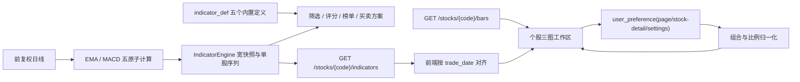

# MACD 技术指标与个股详情多图工作区开发计划

## 1. 需求来源与目标

- 需求文档：[requirement.md](./requirement.md)。
- 交互原型：[prototypes/stock-detail-macd-charts.html](./prototypes/stock-detail-macd-charts.html)。
- 阅读结论：已完整读取当前需求文档 710 行及其引用原型 1556 行；原型中的状态演示按钮只用于说明，不作为线上工具栏功能。
- 需求编号：严格沿用需求文档的 R1–R16，不重新编号、不改变含义。
- 功能目标：
  - 建立 EMA、MACD 数值与金叉/死叉五个原子结果的唯一后端口径。
  - 让五个原子结果进入统一指标目录，并自然贯通筛选、评分、榜单和买卖方案。
  - 在 `/stocks/:code` 把现有 K线/量能双网格升级为 K线、量能、MACD 三图联动工作区。
  - 支持辅助图选择、自动交换、隐藏、拖动/键盘调整高度，并按用户、按可见组合保存偏好。
  - 完成局部失败隔离、请求竞态、KeepAlive、主题、响应式、辅助模块显隐和可访问性闭环。
- 本次不做：
  - 不实现 R10 的统一云端偏好失败告警。
  - 不实现 R11 的自定义 MACD 参数。
  - 不实现 R12 的其他周期、R13 的其他指标/无限槽位、R14 的导出分享。
  - 不新增 MACD 值表、PG DDL、菜单、资源码、默认角色授权或布局组件配置字段。
- 计划输出：`agent-works/macd-indicator-stock-detail-charts/plan.md`。
- 当前结论：不存在会改变已确认流程、数据结构、权限、接口或验收标准的阻塞项，可以进入开发。
- 当前进度：T1–T18 已全部完成并通过对应阶段验证；发布 smoke、seed 对账、回滚演练、四轮图表体验修正及前端复用专项收口均已闭环。

## 2. 当前项目依据

### 2.1 指标与下游

- `backend/indicators/operators.py` 已有 MA、HHV、REF 等严格后向算子，但没有 EMA。
- `backend/indicators/compute.py` 同时维护单股 `compute_stock_indicators()` 和全市场向量化 `compute_market_indicators()` 两条路径；二者必须同步增加 MACD。
- `backend/indicators/engine.py` 通过 `_IND_COLS`、`range_frame()`、`wide_snapshot()` 和 `compute_series()` 向筛选、评分、回测、买卖方案和个股查询提供统一结果。
- `backend/indicators/registry.py`、`backend/indicators/definition.py` 已提供内置定义、分类、幂等 upsert、启停和不可删除保护。
- `GET /api/indicators/registry`、评分方案和买卖方案的目录来源都是 `IndicatorDefRepo.list()` 读取 DuckDB `indicator_def`；运行时没有回退到代码 `REGISTRY` 的分支。
- `IndicatorDefRepo.seed_builtins()` 已存在且会保留管理员调整过的 `enabled/categories`，但当前应用启动链路没有调用它，仓库内除测试外也没有其他调用点。因此现有环境若已有目录数据，只可能来自历史/人工/测试期持久化；全新数据库会出现目录为空的存量初始化缺口。
- 本次接入启动 seed 会首次持久化 `REGISTRY` 中整套内置定义，而不只是新增五个 MACD key；已有 key 会刷新代码管理的名称、类型、表达式、参数和描述，同时保留管理员的启停与分类。
- `backend/scoring/score_profile.py`、`backend/screening/engine.py`、`backend/signals/trade_profile.py` 优先读取快照同名列，新增五列后可沿用通用求值，不需要建立 MACD 专属下游分支。

### 2.2 个股接口

- `GET /api/stocks/{code}/bars` 与 `GET /api/stocks/{code}/indicators` 均受 `stocks:view` 保护。
- 指标接口已支持可选 `fields` 业务字段白名单和 `lookback=1..6000`；未传 `fields` 时仍返回旧完整指标行，传入时始终保留 `trade_date`。
- 指标序列化已统一把 pandas/NumPy 标量转换为原生 JSON 类型，并把 `NaN`、`pd.NA`、正负无穷转换为 `null`。
- `StockDetailView.vue` 已在 T6 将行情、指标序列、原始最新价和买卖评估拆为独立请求通道，分别使用取消信号与请求序号守卫；指标局部失败不再把主图链路置为整体错误。
- 买卖方案列表返回的 `profile_ref` 已由个股页原样透传；`trade-eval` 使用 `TradeProfileRepo.get_visible()` 解析真实 owner，公共/同租户方案可评估，裸 `id` 只兼容当前 owner。

### 2.3 页面、图表与布局

- 页面入口、路由和菜单已经存在：`/stocks/:code`、`StockDetailView.vue`、`pageKey=stock-detail`，不新增路由或菜单。
- 页面已使用 `LayoutHost` 和 `detail` 原型；`detail` 主区由 `LayoutHost` 的 `.v-scroll` 承担内部滚动，适合承载最低 650px 的图表工作区和下方顺序卡片。
- `CandleChart.vue` 继续保持单个 ECharts 实例、固定 480px、K线与量能双 grid 及原 props 契约；其 MA/VMA 定义、格式化、K线 tooltip 和盘感训练标准序列色复用 `stock-chart/chartUtils.ts`，响应式主题统一消费 `useStockChartTheme()`，盘感训练和回测继续复用旧组件。
- `StockChartWorkspace.vue` 已完成按面板分实例、唯一 ECharts group、共享日期轴、显式缩放广播、MACD 信号、分层柱宽、盘感训练同源配色、仅 K线固定左上角行情 tooltip 与唯一光标日期、局部状态和可访问分隔线，并已由 `StockDetailView` 正式消费；`DESIGN.md` 已登记其真实组件职责与使用规则。
- `DESIGN.md` 明确禁止页面写 `calc(100vh - Npx)`，要求金融涨跌使用 `--market-up-color` / `--market-down-color`，四态使用 `AppStateBlock`，页面设置使用 `PageSettingsDrawer`。

### 2.4 用户偏好与权限

- `usePageSettings('stock-detail', defaults)` 已落到 PG `user_preference`：
  - `scope=page`
  - `pageKey=stock-detail`
  - `prefKey=settings`
  - localStorage key 为 `ai-stocks:page-settings:stock-detail`
- `useUserPreference` 已提供递归默认值合并、localStorage 回退、300ms 远端延迟保存和 dirty-before-hydrate 保护。
- `stock-detail/settings` 已增加 `charts` 默认子树和 `showIndicatorSnapshot` 模块显隐字段；图表类型、组合 key、按组合高度和拖动草稿由 `useStockChartPreferences` 统一归一化，远端同步仍复用 `useUserPreference`。
- PG `user_preference` 已具备 `tenant_id + owner_user_id` 归属主键、64KB JSON 限制和标准 JSON 校验；本次不新增 DDL。
- `user-preference:manage` 是登录基线自有偏好能力；即使远端请求失败，前端仍必须按既有骨架本地降级。
- 本次不新增资源码、菜单、默认角色授权或按钮权限；公共行情仍只使用 `stocks:view`。
- `debug_stocks_only` 由自定义角色提供最小 `stocks:view`；启动 `seed_rbac()` 只为无任何角色的存量用户补遗留 `role_code`，不会再给已有自定义角色的账号追加 `normal`。

### 2.5 测试与交付

- 后端现有指标测试：`backend/tests/test_indicators.py`、`backend/tests/test_indicator_def.py`。
- 前端现有布局、偏好和状态测试：`frontend/src/layout/__tests__/`、`frontend/src/composables/__tests__/useUserPreference.spec.ts`、`frontend/src/components/__tests__/AppStateBlock.spec.ts`。
- 页面设置和远端偏好属于现有 Playwright 覆盖路径；本次涉及真实点击、远端保存、本地 fallback、重置和可复用图表交互，必须新增稳定 E2E。
- 修改 `frontend/src` 后必须执行 `npm run build` 并同步 `frontend/dist`。

## 3. 实施范围

### 3.1 必须实现

| 需求编号 | 内容 | 开发状态 | 对应任务 |
| --- | --- | --- | --- |
| R1 | EMA 与 `macd_diff/macd_dea/macd_hist` 三个数值原子结果 | 已完成 | T1、T9 |
| R2 | `macd_golden_cross/macd_dead_cross` 两个可空布尔原子结果 | 已完成 | T1、T9 |
| R3 | 五指标注册、启动期 seed、统一目录及既有下游接入 | 已完成 | T2、T9、T13、T17 |
| R4 | 个股 MACD 序列查询、字段白名单、lookback 校验、日期对齐 | 已完成 | T3、T6、T9、T10、T11、T13 |
| R5 | 默认三图、图名、共享日期/光标/缩放、分层柱宽、盘感训练同源配色、唯一 K线 tooltip/日期、MACD 图形、贴点信号标签与完整日期提示 | 已完成 | T5、T6、T10、T11、T14、T15、T16、T17、T18、T19、T20 |
| R6 | 图表二/三选择量能、MACD、隐藏，自动交换且不留空白 | 已完成 | T4、T7、T10、T11、T17 |
| R7 | pointer 拖动、键盘调整、最低高度、相对比例和释放后保存 | 已完成 | T4、T5、T7、T10、T11 |
| R8 | 按用户、按有序组合保存类型和高度，兼容旧偏好并恢复默认 | 已完成 | T4、T7、T9、T10、T11、T13 |
| R9 | 页面四态、历史不足、MACD 局部失败、整体失败和权限分层 | 已完成 | T3、T5、T6、T8、T10、T11 |
| R15 | 响应式、辅助模块显隐、主题、pointer/键盘可访问性和 reduced motion | 已完成 | T5、T8、T10、T11、T12、T14、T17、T18、T20 |
| R16 | 接口/偏好兼容、请求竞态、辅助模块旧偏好合并和 KeepAlive 生命周期 | 已完成 | T3、T4、T5、T6、T10、T11、T13、T14 |

### 3.2 可选增强（建议项处理）

| 需求编号 | 建议内容 | 需求阶段处理状态 | 开发状态 | 对应任务 | 跳过原因 |
| --- | --- | --- | --- | --- | --- |
| R10 | 偏好云端同步失败时提供统一显式消息 | 后续建议 | 跳过 | - | 当前需求明确沿用本地 fallback，不在本次新增全站尚未统一的告警交互。 |
| R11 | 自定义 MACD 参数 | 后续建议 | 跳过 | - | 本次固定 12、26、9，避免图表口径与五个原子定义分叉。 |

### 3.3 暂不实现

| 需求编号 | 范围 | 开发状态 | 原因 |
| --- | --- | --- | --- |
| R12 | 分时、周线、月线等其他周期 MACD | 跳过 | 本次仅日线前复权。 |
| R13 | KDJ、BOLL、无限辅助图或自由增删槽位 | 跳过 | 本次固定 K线、量能、MACD 与三个槽位。 |
| R14 | 截图、导出、分享或第三方图表全量复制 | 跳过 | 不属于本次指标与工作区闭环。 |

## 4. 技术方案

### 4.1 总体数据流



### 4.2 后端指标口径

- 在 `operators.py` 增加严格后向 `EMA(x, n)`：
  - 使用 `x.ewm(span=n, adjust=False, min_periods=n).mean()`。
  - 输入缺失日强制输出空值，不用上一日 EMA 冒充当日结果。
- 单股路径：
  - `DIFF = EMA(close, 12) - EMA(close, 26)`。
  - `DEA = EMA(DIFF, 9)`。
  - `MACD柱 = 2 * (DIFF - DEA)`。
  - 金叉/死叉只比较当前行与同股紧邻前一行；当前或前一行任一 DIFF/DEA 无效时输出 `pd.NA`。
- 全市场路径：
  - 使用按 `code` 分组的向量化 `ewm` 与 `shift(1)`，禁止逐股 SQL/N+1。
  - 输出索引和行顺序与当前 `compute_market_indicators()` 一致。
- 同步修改 `_IND_COLS`，保证宽快照、缓存、筛选、评分和买卖方案获得同名列。
- 在 `build_params()` 增加固定算法版本标识，例如 `indicator_algo_version=macd-v1`，使 `param_hash` 能区分加入 MACD 后的新计算语义；不把 12/26/9开放为配置。
- 全局算法版本会使旧 `param_hash` 语义失效；新版本首次执行相应单股或全市场范围时会按新 hash 重算。当前缓存是进程内缓存，因此这是一次性缓存失效，不是持久化指标回填或数据库迁移。

### 4.3 指标定义与启动期 seed

- 在 `REGISTRY` 增加五个 `builtin`、`is_builtin=true`、默认启用定义。
- 主分类统一为“趋势”，`PRESET_CATEGORIES` 为“趋势”“动量”；三个数值指标 `direction=None`。
- 描述中写明 `(12,26,9)`、前复权和固定参数，不提供参数 schema。
- 在应用 DuckDB 连通性自检后执行：
  1. `init_db(client)` 确认 `indicator_def` 存在。
  2. `IndicatorDefRepo(client).seed_builtins()` 幂等 upsert。
- 该调用遍历并 upsert 整个 `REGISTRY`：全新库首次写入全部 builtin，存量库刷新全部 builtin 的代码元数据，并额外加入五个 MACD 定义。
- seed 保留管理员已调整的 `enabled/categories`；不得用静态 INSERT 覆盖管理员配置。
- 下游不新增 MACD 专属解析器；通过 `_IND_COLS` 同名列和现有通用 registry 消费自然接入。

### 4.4 个股指标接口

- 沿用 `GET /api/stocks/{code}/indicators`，不新增 MACD 专属接口。
- 新增可选逗号分隔参数 `fields`：
  - 未传时保持现有完整返回行为。
  - 传入时只允许 `_IND_COLS` 中可对外返回的字段；`trade_date` 始终返回。
  - 空字段、重复字段可归一化；未知字段返回明确 400 业务错误，不参与 SQL 拼接。
- 为 indicators 接口新增 `lookback=1..6000` 服务端上限；6000 不是该接口现状，而是对齐 `StockDetailView` 现有“全部”档给 bars 行情接口使用的加载边界，使新增整段 MACD 请求与同页行情范围一致。
- 计算仍额外读取既有暖机窗口，返回时只裁剪用户请求范围；MACD 不扩大引擎 `_max_lb`。
- 序列化前统一处理 pandas/NumPy 标量，将 `NaN`、`pd.NA`、正负无穷转成 JSON `null`，布尔值转成原生 `bool`。
- 前端一次请求字段集合包含五个 MACD 字段和“最新指标快照”当前可见字段，用同一范围响应同时供图表与快照末行消费，避免同范围重复计算。

### 4.5 前端请求与状态模型

- 把当前单个 `Promise.all` 拆为互不连带的请求流：
  - 行情流：当前复权 K线 + 不复权最新价，失败进入页面级错误。
  - 指标流：前复权指标序列，失败只进入 MACD 局部错误；最新指标快照保留已有值，初次无值时显示 `—`，不另起页面错误，不阻断 K线/量能。
  - 买卖评估流：继续独立，不阻塞主图。
- 每条请求流使用独立 `AbortController` 或请求序号：
  - 切换范围时重拉行情与指标。
  - 切换 K线复权只重拉行情，不重拉固定前复权 MACD。
  - 切换辅助图显隐只消费已加载数据，不发请求。
  - 旧请求不得覆盖新股票、新范围或新复权状态。
- 指标数据按 `trade_date` 建 Map，再与可见 `Bar.date` 对齐；缺失日保留 `null`，不按数组位置拼接。
- “重试 MACD”只重试指标流，不刷新行情、光标、缩放或高度。

### 4.6 多图工作区实现

- 新增页面域多图组件，建议路径：
  - `frontend/src/components/stock-chart/StockChartWorkspace.vue`
  - 必要的内部 panel/option helper 放在同目录。
- 不直接把 `CandleChart.vue` 改造成承载所有页面专属状态的大组件；抽取类型化 MA/VMA 定义、响应式股票主题入口、主题 token 解析和通用格式化工具，让 `CandleChart` 与新工作区共同消费，避免重复实现并保护盘感训练/回测。
- 工作区采用“每个可见面板一个 ECharts 实例 + 当前组件唯一 group id + `echarts.connect`”：
  - DOM 面板天然承载图名、局部四态和可访问分隔线。
  - group 同步 axisPointer、dataZoom 和日期索引。
  - 每个页面实例使用唯一 group id，防止不同个股标签页互相联动。
  - 最下方可见面板显示日期轴和 slider，其余面板隐藏重复日期标签。
- 面板职责：
  - K线：现有蜡烛、MA 和行情 tooltip。
  - 量能：涨跌色柱、VMA5、VMA10。
  - MACD：正负柱、DIFF、DEA、零轴、金叉/死叉。
- 图表颜色通过组件根节点 `getComputedStyle()` 解析 CSS token：
  - 上涨/金叉：`--market-up-color`。
  - 下跌/死叉：`--market-down-color`。
  - DIFF/DEA：使用预设同步覆盖的 Element Plus 语义 token，禁止页面硬编码红绿 hex。
- 金叉/死叉使用自定义 signal series：
  - 数据点的 X 值固定为事件交易日索引，Y 值固定为当日 DIFF。
  - 标签和贴点短三角指针在同一 X 坐标，不显示贯穿面板的长引导线。
  - 密集时只分配上下 lane，不横向平移。
  - tooltip/可访问文本至少包含“金叉/死叉 + 完整日期”。
- loading、历史不足、局部错误时仍初始化基础日期轴并保留面板标题和稳定高度；只隐藏不可用 series，在面板内容层覆盖 `AppStateBlock`。

### 4.7 图表组合、高度与偏好

- 在 `detailDefaults` 增加需求文档中的 `charts` 结构，默认：
  - `slot2=volume`
  - `slot3=macd`
  - 三图 `0.6/0.2/0.2`
  - 单辅助图 `0.75/0.25`
- 新增纯函数/页面 composable 处理：
  - `volume | macd | hidden` 枚举归一化。
  - 两个可见辅助图重复时按 R6 自动交换。
  - 有序 composition key 生成。
  - 有限正数、长度、归一化和最低高度校验。
  - 非法值只回退当前组合，不清空其他有效页面偏好。
- 拖动期间高度放在工作区临时状态，不直接写 `settings`：
  - pointermove 只更新 DOM 比例和 chart resize。
  - pointerup/pointercancel/有效卸载终态只 emit 一次 commit。
  - commit 后才写 `settings.charts.heightRatios[key]`，由现有偏好骨架延迟远端保存。
- 键盘每次按键按约 2% 调整相邻面板并提交有效比例。
- 面板最低高度按实际可用高度换算：
  - K线 `>=250px`
  - 量能/MACD `>=126px`
  - 三图工作区 `min-height:650px`
- 窗口临时变小只做像素收敛和 resize，不回写用户比例。
- 重置继续使用 `PageSettingsDrawer` footer：`reset()` 恢复全部页面业务默认，`resetLayout()` 恢复布局用户层；图表自定义组合高度随默认对象替换而清除。

### 4.8 前端页面设计闭环

#### 页面定位与原型

- 页面：P1 个股详情。
- 页面类型：更新既有页面。
- 用户主流程：进入个股 → 查看三图 → 联动定位交易日 → 设置辅助图 → 调整高度 → 自动恢复个人偏好。
- 选用原型：既有 `detail`。
- 选择理由：页面仍是股票摘要、连续图表和下方分区详情的强阅读顺序，不适合 dashboard 重排。
- 新增布局原型：否。
- 原型依据：`prototypes/stock-detail-macd-charts.html`；示意数据和演示按钮不进入生产代码。

#### Slot 与组件设计

| 区域 | slotId | 组件种类 | growMain | 滚动归属 | 是否可重排 | 说明 |
| --- | --- | --- | --- | --- | --- | --- |
| action | toolbar | `toolbar` | 否 | 固定 | 否 | 返回、股票身份、行情摘要、分组、K线范围、页面设置入口；复权留在抽屉。 |
| main | detail | `detail` | 否 | `LayoutHost` 主区 `region` 内滚 | 否 | 集合导航、最低 650px 多图工作区、指标快照、买卖评估顺序排布。 |
| overlay | settings | `settings-drawer` | 否 | 抽屉正文内滚 | 否 | 复用 `PageSettingsDrawer`，即时生效，无提交按钮。 |

#### P1 页面功能点承接

| 页面功能点 | 原型区域 | ready | loading/empty | error/权限 | 关键交互与异常 | 对应需求 | 对应任务 | 验证方式 |
| --- | --- | --- | --- | --- | --- | --- | --- | --- |
| 默认三图与命名 | 原型中部连续三图工作区 | K线、量能、MACD 名称和光标值齐全 | 标题与高度稳定；无行情整体空态；历史不足只覆盖 MACD | 行情失败页面级重试；MACD 失败局部重试；无 `stocks:view` 为 permission error | 日期对齐、共享光标/缩放、贴点信号标签、范围切换取消旧请求 | R4、R5、R9、R15、R16 | T3、T5、T6、T8、T19 | Vitest、Playwright、固定样本、关键视口截图 |
| 设置辅助图 | 设置抽屉“业务选项 → 图表设置” | 图表一固定；图表二/三可选量能、MACD、隐藏 | 偏好加载遵守 dirty-before-hydrate；至少保留 K线 | 远端失败或无偏好权限时本地生效 | 重复类型自动交换；隐藏移除面板和分隔线；不重复请求 | R6、R8、R9、R16 | T4、T7 | 归一化单测、抽屉 E2E、远端偏好断言 |
| 拖动/键盘调整高度 | 图表间分隔线 | pointer 拖动实时 resize；方向键约 2% 调整 | 仅 K线时不显示；偏好未完成时使用本地/默认有效值 | 非法比例回退当前组合；远端失败不影响本地 | 最低高度、相对比例、释放后一次提交、停用清监听 | R7、R8、R15、R16 | T4、T5 | 组件测试、Playwright 尺寸/ARIA 断言 |
| 恢复默认 | 设置抽屉 footer | 恢复量能/MACD和 60/20/20 | 沿用抽屉现有同步状态 | 远端失败仍完成本地重置 | 无二次确认、不重载行情、同时保持页面和布局总重置契约 | R6、R7、R8 | T4、T7 | Vitest、Playwright、PG 偏好轮询 |

#### 四态反馈

| 状态 | 页面/组件处理 | 复用组件 | 结论 |
| --- | --- | --- | --- |
| ready | 图名、核心值、图形、分隔线、共享光标和缩放可用 | ECharts + 工作区标题 | 价值态不额外加状态图标。 |
| loading | 初次行情使用页面稳定 loading；MACD 独立 loading 保留标题/高度/日期轴 | `v-loading`、`AppStateBlock state=loading` | 不用空态代替加载。 |
| empty | 无行情为整体 empty；历史不足为 MACD 局部 empty，值显示 `--` | `AppStateBlock state=empty` | 不制造零值和假交叉。 |
| error | 行情为页面 error；MACD 为局部 error；403 使用 permission variant | `AppStateBlock state=error` | 错误均有原因，允许重试的链路提供重试。 |

#### 控件、浮层、主题与排版

- 主操作不新增；“重试 MACD”使用普通 `el-button`，页面设置入口继续使用 `PageSettingsTrigger/AppIconButton`。
- 分隔线是专用交互元素，不伪装成按钮；必须提供：
  - `role="separator"`
  - `aria-orientation="horizontal"`
  - `aria-valuemin/aria-valuemax/aria-valuenow`
  - `tabindex="0"`
- 设置抽屉继续挂在 `#overlays`，由 `PageSettingsDrawer → PageDrawer` 限制在当前 `LayoutHost` 内容区；正文内滚，关闭不撤销偏好。
- 页面间距、标题和状态文本消费 `--app-space-*`、`--app-font-*`、`--app-line-height-*`；图表 canvas/tooltip 数值属于 DESIGN 允许的局部特例。
- 不调整主题底色或三套预设，不新增金色 token；只消费现有市场和 Element Plus 语义 token。
- `prefers-reduced-motion` 下关闭分隔线和面板非必要过渡。

#### 配置设计

| 类型 | 字段 | 层级 | 落点 | 说明 |
| --- | --- | --- | --- | --- |
| 布局旋钮 | `density` | page/user | 既有 `pageRegistry.editable` | 不变。 |
| 组件设置 | 无新增 | - | - | 不新增 `COMPONENT_FIELD_DEFS`。 |
| 页面记忆 | `charts.slot2/slot3/heightRatios` | `usePageSettings` | `user_preference(page/stock-detail/settings)` | 类型即时保存；高度释放后提交。 |
| 临时交互态 | 当前拖动比例、hover 日期、zoom | component memory | 不持久化 | 不进入 PG 或布局配置。 |

#### 复用与组件资产闭环

| 资产 | 处理 | 系统组件关系 | 维护结论 | 验证 |
| --- | --- | --- | --- | --- |
| `LayoutHost/detail` | 复用 | 既有 `detail` | 不改原型、slot 或滚动事实源 | `pageRegistry.spec.ts`、`layout-contract.spec.ts` |
| `PageSettingsDrawer/PageSegmented` | 复用 | 既有 `settings-drawer` | 新业务选项只进入页面记忆 | 组件测试、E2E |
| `AppStateBlock` | 复用 | 状态语义 | MACD 局部四态不得另写私有状态皮肤 | 组件测试 |
| `CandleChart` | 保留现有对外契约并抽取共享 helper | 无新增种类 | 盘感训练/回测继续消费，补回归 | Vitest、build、现有页面 smoke |
| `StockChartWorkspace` | 新增领域真实组件 | 不新增系统组件种类 | 登记到 DESIGN 真实组件清单，说明只承接股票多图联动；至少由 `StockDetailView` 实际消费 | 组件测试、Playwright |
| 图表组合归一化 helper/composable | 新增复用单元 | 不涉及布局种类 | 统一自动交换、组合 key、比例校验，页面不复制逻辑 | 单元测试 |

#### 维护清单

- `frontend/src/layout/pageRegistry.ts`：页面结构与配置字段均不变，不修改。
- `frontend/src/layout/components.ts` / `COMPONENT_CATALOG`：不新增组件种类，不修改。
- `COMPONENT_FIELD_DEFS`、`componentSchemas.ts`、后端 `layout_config.py`：不修改。
- `DESIGN.md`：
  - 登记 `StockChartWorkspace` 真实组件及使用规则。
  - `page-registry` 中 `StockDetailView` 仍为 `detail`，结构不变。
- `agent-works/e2e-automation/guide.md`：在当前基线用例中登记新增个股多图 E2E。
- RBAC：不触发新页面/新资源接入；复用 `stocks:view`、`user-preference:manage`。
- 自动化锚点：
  - 复用 `page-settings-trigger/page-settings-drawer/page-settings-reset`。
  - 新增 `stock-chart-workspace`、各 panel、slot2/slot3 segmented 和 splitter 的稳定 `data-testid`。
  - 不使用坐标、DOM 顺序或临时说明文本作为长期选择器。

#### 关键视口验收

- `1100×620`：图表工作区保持最低高度，由 `LayoutHost` 主区内滚；无整页横向滚动。
- `1366×768`：三图名称、核心值、设置入口和分隔线可用。
- `1440×900`：默认主视口完整验证三图、抽屉、下方卡片和信号标签。
- 明暗主题各覆盖至少一个关键视口；附加检查 reduced motion。

### 4.9 接口契约

| 接口 | 变更 | 权限 | 兼容性 | 异常 |
| --- | --- | --- | --- | --- |
| `GET /api/stocks/{code}/indicators` | 增加 `fields` 可选参数；新增 `lookback=1..6000` 上限并对齐同页 bars 的 6000 行加载边界；返回五个 MACD 字段 | `stocks:view` | 不传 `fields` 时外层和字段行为不变 | 非法字段明确 400；空/非有限值转 `null` |
| `GET /api/stocks/{code}/bars` | 无契约变更 | `stocks:view` | 保持现状 | 行情失败进入页面级错误 |
| `GET /api/stocks` | 仅在当前上下文具备 `stock-group:view` 时读取并附加自选分组 | `stocks:view`；分组 enrichment 另查 `stock-group:view` | `groups` 字段保持存在；无分组权限时固定为空数组，不创建默认分组 | 次级资产权限缺失时 fail-closed，不实例化 `StockGroupRepo` |
| `GET/POST /api/user-preferences` | 无接口/DDL变更，增加 `settings.value.charts` JSON 子树和 `showIndicatorSnapshot` 布尔字段 | `user-preference:manage` | 旧偏好递归合并默认；旧客户端忽略新字段 | 失败继续 localStorage fallback |
| `GET /api/indicators/registry` | seed 后自然出现五定义 | `indicator:registry` | 外层不变 | 管理员停用后不进入新建方案候选 |

## 5. 需求与开发内容映射和开发状态

| 范围类别 | 需求编号 | 需求内容/来源 | 计划开发内容 | 对应任务 | 状态 | 偏差判断 | 验证方式 | 说明 |
| --- | --- | --- | --- | --- | --- | --- | --- | --- |
| 必须实现 | R1 | `requirement.md §5.1`：EMA 与三个数值原子结果 | EMA、三数值列、暖机、空值、算法版本、单股/全市场一致 | T1、T9 | 已完成 | 一致 | 已知公式、前缀稳定、两路径容差单测 | T1 实现与 T9 后端总回归均已通过；固定 12/26/9，不开放参数。 |
| 必须实现 | R2 | `requirement.md §5.2`：金叉、死叉两个布尔原子结果 | 两个可空交叉列、相等穿越、缺失段和同日互斥 | T1、T9 | 已完成 | 一致 | 交叉边界和缺失段单测 | T1 实现与 T9 后端总回归均已通过；空值保留 null，下游按不成立处理。 |
| 必须实现 | R3 | `requirement.md §5.3`：统一指标目录与既有下游接入 | 五定义、分类、方向、整套 builtin 启动 seed、下游通用求值、长技术标识可读 | T2、T9、T13、T17 | 已完成 | 一致 | repo/API/筛选/评分/买卖方案测试、管理页检查 | T13 真实启动对账为 43 个 builtin、五个 MACD 定义，启动 seed 变更 0；筛选、评分和买卖条件固定样本均通过。T17 为标识列补足最小宽度、等宽字体与溢出提示。 |
| 必须实现 | R4 | `requirement.md §5.4`：个股 MACD 序列查询与日期对齐 | 字段白名单、新增 lookback 上限、null、单次指标序列、trade_date 对齐 | T3、T6、T9、T10、T11、T13 | 已完成 | 一致 | API、Vitest、Playwright | T13 真实接口同时通过旧调用、五字段 `lookback=6000`、严格 JSON、非法字段 400 和超界 422，页面继续按交易日对齐。 |
| 必须实现 | R5 | `requirement.md §5.5`：个股详情三图联动与图表命名 | 三图、命名、共享日期/光标/显式缩放、分层柱宽、盘感训练同源配色、唯一 K线 tooltip/日期、MACD 贴点信号标签与完整日期提示 | T5、T6、T10、T11、T14、T15、T16、T17、T18、T19、T20 | 已完成 | 一致 | option/组件测试、固定样本、截图和 E2E | T15 收口唯一 K线 tooltip；T16 统一 MA/VMA/MACD 色板和唯一光标日期；T17 完成真实信号悬停；T18 将两类股票画布的响应式主题和 MA/VMA 元数据收敛为唯一复用入口；T19 收口无长引导线的贴点标签；T20 按最新确认将训练、回测、个股详情和原型统一为参考图精确身份色。 |
| 必须实现 | R6 | `requirement.md §5.6`：辅助图类型、交换与隐藏 | 两辅助槽选择、自动交换、隐藏、空间释放和程序化选中语义 | T4、T7、T10、T11、T17 | 已完成 | 一致 | 归一化单测、抽屉 E2E、可访问属性测试 | 真实点击覆盖自动交换、隐藏、重显、无无效分隔线、切股与刷新恢复；T17 由共享 `PageSegmented` 补齐 `aria-pressed`。 |
| 必须实现 | R7 | `requirement.md §5.7`：拖动与键盘调整高度 | pointer/键盘分隔线、最低高度、释放提交 | T4、T5、T7、T10、T11 | 已完成 | 一致 | 组件 ARIA/事件测试、E2E 尺寸断言 | T11 以分隔线实际位置执行 pointer 拖动，验证最低高度、相对比例保存、键盘调整及切股/刷新恢复。 |
| 必须实现 | R8 | `requirement.md §5.8`：组合与高度个人偏好 | 有序组合比例、PG/本地偏好、隔离、重置 | T4、T7、T9、T10、T11、T13 | 已完成 | 一致 | 偏好 API、Vitest、跨用户 E2E | T13 发布 smoke 再次覆盖图表组合、高度保存/重置、真实 PG 跨用户隔离和 403 本地回退；临时用户清理后残留为 0。 |
| 必须实现 | R9 | `requirement.md §5.9`：页面状态与局部失败隔离 | 整体与局部四态、历史不足、权限语义 | T3、T5、T6、T8、T10、T11 | 已完成 | 一致 | 状态测试、403/失败注入 E2E | T11 真实路由和 route 注入覆盖路由守卫、页面 loading/empty/permission、MACD 503 局部失败与重试。 |
| 必须实现 | R15 | `requirement.md §5.10`：响应式、主题与可访问性 | 自适应填满、指标快照显隐、主题 token、关键视口、pointer/键盘、reduced motion、播报与选中语义 | T5、T8、T10、T11、T12、T14、T17、T18、T20 | 已完成 | 一致 | 样式/契约测试、build、主题截图、尺寸 E2E、可访问属性测试 | T14 验证工作区自适应；T17 补齐播报和选中语义；T18 统一主题修订订阅、WCAG 对比度公式和 E2E 控制台问题口径；T20 验证明暗主题使用同一参考色相身份，MA20 仅在暗色使用亮紫变体。 |
| 必须实现 | R16 | `requirement.md §5.11`：兼容回退与竞态保护 | 接口与偏好兼容、模块显隐旧值合并、竞态、KeepAlive 监听清理 | T3、T4、T5、T6、T10、T11、T13、T14 | 已完成 | 一致 | 竞态和生命周期测试、偏好 Vitest 与 E2E | T14 将 `showIndicatorSnapshot` 作为 additive 页面偏好，旧值默认显示并复用总恢复默认；图表主题重绘保持当前共享缩放窗口。 |
| 建议实现 | R10 | `requirement.md §4.2`：云端同步失败统一显式消息 | 不纳入本次开发 | - | 跳过 | 一致 | 范围审查 | 需求已明确留作后续建议，本次沿用本地 fallback。 |
| 建议实现 | R11 | `requirement.md §4.2`：自定义 MACD 参数 | 不纳入本次开发 | - | 跳过 | 一致 | 范围审查 | 需求已明确留作后续建议，本次固定 12/26/9。 |
| 暂不实现 | R12 | `requirement.md §4.3`：其他周期 | 不纳入本次开发 | - | 跳过 | 一致 | 范围审查 | 仅日线前复权。 |
| 暂不实现 | R13 | `requirement.md §4.3`：其他指标/无限槽位 | 不纳入本次开发 | - | 跳过 | 一致 | 范围审查 | 固定 K线、量能、MACD 与三个槽位。 |
| 暂不实现 | R14 | `requirement.md §4.3`：导出/分享/第三方全量复制 | 不纳入本次开发 | - | 跳过 | 一致 | 范围审查 | 不扩展为图表平台能力。 |

## 6. 详细开发任务与状态

### 6.1 任务 T1：建立 EMA 与 MACD 五原子计算口径

- 状态：已完成
- 对应需求：R1、R2。
- 依赖：无。
- 涉及文件：
  - `backend/indicators/operators.py`
  - `backend/indicators/compute.py`
  - `backend/indicators/engine.py`
  - `backend/tests/test_indicators.py`
- 目标：建立五个原子结果唯一、后向、单股与全市场一致的计算事实源。
- 开发内容：
  - 新增 EMA 算子和缺失值语义。
  - 单股、全市场同步计算 DIFF、DEA、MACD柱、金叉、死叉。
  - `_IND_COLS` 纳入五字段。
  - `build_params/param_hash` 纳入算法版本。
- 产出：EMA 算子、五个动态指标列、更新后的 `_IND_COLS` 与算法 hash。
- 影响范围：所有通过 `IndicatorEngine` 计算动态指标的单股、筛选、评分、榜单、买卖方案和回测链路；新 hash 首次执行时发生一次性进程内缓存失效。
- 边界：
  - 不使用未来数据。
  - 不跨股票、不跨紧邻缺失行判断交叉。
  - 可空布尔在原始结果中保持 `pd.NA`。
- 验证方式：
  - 固定序列与 pandas 递推公式对照。
  - 暖机、相等穿越、缺失段、前缀稳定测试。
  - 单股和全市场逐行对照。
- 完成标准：R1、R2 的全部验收样本通过，现有指标列无回归。
- 实际落地情况：已完成（2026-07-23）。
  - `operators.py` 新增严格后向 EMA，采用 `adjust=False/min_periods=n`，缺失和无穷输入当天保持空值。
  - 单股与全市场路径均输出固定 12/26/9 的 DIFF、DEA、MACD柱、金叉和死叉；交叉不跨股票或缺失行。
  - `_IND_COLS` 已加入五个字段，`build_params()` 已加入 `2.1-macd-v1` 算法版本并进入 `param_hash`。
  - `backend/tests/test_indicators.py` 已覆盖 pandas 公式对照、暖机、相等后向上/向下突破、缺失段、前缀稳定、含 `NaN/+inf/-inf` 的单股/全市场一致和算法版本 hash。
  - 定向验证结果：`python -m pytest backend/tests/test_indicators.py -q` 为 `14 passed`。
  - 下游冒烟结果：筛选 `ScreenEngine.wide_snapshot`、评分 `ScoreProfileModel`、回测 `HitPrecomputer` 三条链路与指标测试合并执行为 `17 passed`，确认 `_IND_COLS` 加列不破坏既有下游。
  - 本次可复现完整命令：

    ```bash
    python -m pytest \
      backend/tests/test_indicators.py \
      backend/tests/test_screening.py::test_screen_engine_hybrid_col_and_expr \
      backend/tests/test_indicator_def.py::test_custom_indicator_in_scoring_end_to_end \
      backend/tests/test_backtest.py::test_precompute_matches_screen_engine \
      -q
    ```

    执行结果：`17 passed in 1.13s`。
  - 停服恢复结果：测试前后端运行中，已用 `./start.sh stop` 停服；测试后用 `./start.sh` 恢复，`./start.sh status` 确认 `/api/health=200`。
  - 其他验证结果：`python -m py_compile` 与 `git diff --check` 通过。
  - 静态检查限制：当前 Python 环境未安装 Ruff（`python -m ruff` 返回 `No module named ruff`），因此未执行 Ruff；未将工具缺失误记为代码失败。

### 6.2 任务 T2：注册五指标并接入启动 seed 与既有下游

- 状态：已完成
- 对应需求：R3。
- 依赖：T1。
- 涉及文件：
  - `backend/indicators/registry.py`
  - `backend/indicators/definition.py`
  - `backend/main.py`
  - `backend/tests/test_indicator_def.py`
  - `backend/tests/test_screening.py`
  - `backend/tests/test_score_profile.py`
  - `backend/tests/test_trade_profile.py`
- 目标：让五个 MACD 定义进入统一目录，并补齐全新数据库缺少 builtin 初始化的存量启动缺口。
- 开发内容：
  - 新增五个固定参数 builtin 定义和“趋势/动量”分类。
  - 启动期在 DuckDB schema 就绪后执行 `seed_builtins()`；该操作首次持久化整套 `REGISTRY`，不是只插入五个 MACD key。
  - 验证整套 builtin 在重复 seed 后幂等，并保留管理员启停/分类。
  - 用通用快照列打通筛选、评分和买卖条件，不增加专属分支。
- 产出：五个 MACD builtin 元数据、应用启动 seed 执行点、统一下游目录与求值证据。
- 影响范围：DuckDB `indicator_def` 的全部 builtin 行；全新库首次写入整套定义，存量库刷新代码管理的元数据字段并新增五个 MACD 定义，管理员 `enabled/categories` 保留。
- 边界：
  - 不新增权限、菜单或角色授权。
  - 被停用定义不进入新建候选，但已有引用不被删除。
- 验证方式：全量 REGISTRY repo seed、registry API、管理员配置保留和下游固定样本测试。
- 完成标准：五指标目录可见且下游正确求值，重复启动幂等。
- 实际落地情况：已完成（2026-07-23）。
  - `REGISTRY` 已增加五个固定 12/26/9、前复权、默认启用的 builtin；主分类为“趋势”，预设分类为“趋势/动量”，数值和布尔定义均无方向与参数 schema。
  - `seed_builtins()` 继续处理整套 REGISTRY，并改为从原始列区分 SQL `NULL` 与管理员明确清空的 `"[]"`：重复 seed 保留任意 builtin 的 `enabled/categories`，同时刷新代码管理的元数据。
  - 旧库 `enabled=NULL` 按“未初始化”处理并回退 REGISTRY 默认值，只有明确的 `TRUE/FALSE` 才作为管理员启停状态保留。
  - seed 会比较名称、分类、类型、方向、种类、表达式、参数、分类标签、启用态、内置标记和描述；11 个业务字段均未变化时跳过 `_upsert`，不刷新 `updated_at`。
  - 应用启动期在 DuckDB 连通后通过 `IndicatorDefRepo` 幂等确保 schema 并 seed 整套 builtin；PG、Redis、JWT 自检和既有任务/调度流程不变。
  - 目录 API 的启用项、全量幂等、内置不可删除、管理员停用/分类保留均已有自动化证据；停用的 MACD 定义不进入启用候选但仍保留记录。
  - 筛选通过注册指标叶子使用 `macd_golden_cross`，评分直接消费 `macd_hist/macd_golden_cross`，买卖条件直接消费金叉/死叉；三个下游均复用同名快照列和通用求值，没有新增 MACD 专属分支。
  - 真实启动验证前已在仓库外创建本地 DuckDB 备份；启动 seed 前为 38 个 builtin、0 个 MACD，启动后为 43 个 builtin、5 个 MACD，五个定义的类型、分类和启用状态对账通过。
  - 完整相关文件回归命令：

    ```bash
    python -m pytest \
      backend/tests/test_indicators.py \
      backend/tests/test_indicator_def.py \
      backend/tests/test_screening.py \
      backend/tests/test_score_profile.py \
      backend/tests/test_trade_profile.py \
      -q
    ```

    执行结果：`70 passed in 5.69s`；16 条 warning 均为项目既存 FastAPI `on_event` 弃用提示，无测试失败。
  - 真实启动幂等验证：43 个 builtin 的 `key+updated_at` SHA-256 在启动前后均为 `e6ed1db09b64a36ddd3db93dacb0d8c8e7959dee53615ac6b5e6f8ecc90c1e75`，确认无变化启动不产生 43 行无意义写入。
  - 停服恢复结果：测试和真实库对账均按 `./start.sh stop` 停服；最终用 `./start.sh` 恢复，`./start.sh status` 确认 `/api/health=200`。

### 6.3 任务 T3：扩展个股指标接口并保证兼容序列化

- 状态：已完成（2026-07-23）
- 对应需求：R4、R9、R16。
- 依赖：T1。
- 涉及文件：
  - `backend/api/stocks.py`
  - `frontend/src/api/stocks.ts`
  - `backend/tests/test_stock_indicators_api.py`
  - `frontend/src/api/__tests__/stocks.spec.ts`
- 目标：在不建立第二套接口的前提下，为详情页提供安全、兼容的整段 MACD 序列。
- 开发内容：
  - 增加 `fields` 白名单，并为 indicators 接口新增 `lookback=1..6000`；6000 对齐同页 bars 行情加载边界。
  - 保留无 `fields` 的旧返回。
  - 统一 pandas/NumPy 标量与非有限值序列化。
  - 前端定义 `IndicatorRow/IndicatorField` 类型并把字段数组稳定编码为逗号分隔参数。
- 产出：扩展后的指标接口、强类型前端 API 和接口测试。
- 影响范围：`GET /api/stocks/{code}/indicators` 的请求参数校验与响应序列化；不影响 bars、路由或权限。
- 异常：
  - 非法字段明确返回 400。
  - 无行情返回空数组。
  - 无 `stocks:view` 保持 403。
- 验证方式：旧调用、字段裁剪、边界 lookback、非法字段、null JSON 和权限测试。
- 完成标准：接口契约满足 R4，现有调用方无需改造即可继续使用。
- 实际落地情况：已完成（2026-07-23）。
  - `GET /api/stocks/{code}/indicators` 新增 `fields` 逗号参数；仅开放 `_IND_COLS` 业务指标列，排除重复身份字段 `code/trade_date` 和内部 `param_hash`，`trade_date` 始终返回。
  - 未传 `fields` 时保留旧完整指标行；空项和重复项按首次出现顺序归一化，未知或内部字段在指标计算前返回 400。
  - `lookback` 新增 FastAPI `1..6000` 校验，计算仍复用既有 520 行暖机窗口；空行情保持空数组。
  - pandas/NumPy 标量统一转为原生 JSON；`NaN`、`pd.NA`、正无穷和负无穷均转为 `null`，可空布尔保持 `bool/null`。
  - 前端在既有 `stocks.ts` 内新增 `IndicatorField`、`IndicatorRow` 和 `IndicatorParams`，字段数组按调用方顺序编码为逗号参数；没有新增请求 helper 或第二套接口。
  - 复用判断：沿用现有 `http.get(..., { params, signal })` 和项目已有短 `join(',')` 参数模式；该领域字段联合只服务个股指标契约，抽成跨 API query builder 会扩大依赖且没有第二个同变化原因的消费点，因此未新增公共 util。
  - 后端目标及相关回归：

    ```bash
    python -m pytest \
      backend/tests/test_stock_indicators_api.py \
      backend/tests/test_indicators.py \
      backend/tests/test_rbac_deps.py \
      backend/tests/test_stage4_resource_codes.py \
      -q
    ```

    执行结果：`44 passed in 4.95s`；112 条 warning 均为项目既存 FastAPI `on_event` 弃用提示。
  - 前端目标测试：`cd frontend && npm run test -- --run src/api/__tests__/stocks.spec.ts`，结果 `2 passed`。
  - 前端构建：`cd frontend && npm run build` 通过；仅有依赖注释位置和既有大 chunk 告警，无类型或构建失败。
  - 真实库冒烟：`600000.SH` 五个 MACD 字段返回 60 行（2026-04-24 至 2026-07-22），字段裁剪准确，`json.dumps(..., allow_nan=False)` 通过。
  - `python -m py_compile backend/api/stocks.py backend/tests/test_stock_indicators_api.py` 与 `git diff --check` 通过；最终按脚本恢复后端，`/api/health=200`。

### 6.4 任务 T4：实现图表偏好归一化与高度状态模型

- 状态：已完成（2026-07-23）
- 对应需求：R6、R7、R8、R16。
- 依赖：无。
- 涉及文件：
  - 新增 `frontend/src/composables/useStockChartPreferences.ts` 或同职责 util
  - `frontend/src/views/StockDetailView.vue`
  - 对应 `frontend/src/composables/__tests__/`
- 目标：形成图表类型、顺序和高度比例的唯一归一化状态模型。
- 开发内容：
  - 声明 `ChartType`、默认组合和默认比例。
  - 实现非法枚举、重复类型、自动交换、composition key 和比例校验。
  - 区分“拖动临时比例”和“释放后持久比例”。
  - 旧偏好缺少 `charts` 时递归补默认；非法组合只局部回退。
- 产出：图表偏好类型、归一化 helper/composable 和组合矩阵测试。
- 影响范围：`stock-detail/settings` 新增 `charts` 子树；不改变既有复权、导航、交易卡和指标快照偏好。
- 验证方式：
  - 两槽所有组合矩阵。
  - 隐藏/重显和顺序组合记忆。
  - 负数、零、NaN、无穷、长度/和异常。
  - dirty-before-hydrate 期间用户操作不被覆盖。
- 完成标准：任何输入都归一化为至少有 K线的合法组合，且不高频远端写高度。
- 实际落地情况：已完成（2026-07-23）。
  - 新增 `useStockChartPreferences.ts`，集中声明 `ChartType`、两个辅助槽枚举、五种有序组合 key、默认 60/20/20、75/25 和仅 K线比例。
  - 旧偏好缺少 `charts` 继续由 `usePageSettings/useUserPreference` 递归补默认；新 composable 在 hydrate 完成前只提供安全派生值，不主动回写，避免本地修复误触 dirty-before-hydrate。
  - 存量重复可见类型因无法判断最后操作槽位而回完整默认；只有一个槽位非法时保留另一个合法槽位，并为非法槽位选择不冲突的回退类型。
  - 实时类型冲突按 R6 交换；当前槽原为 `hidden` 时，另一槽随交换隐藏。隐藏不删除任何有序组合高度，重显恢复原组合最近比例。
  - 高度逐组合校验长度、有限正数与和为 1；负数、零、`NaN`、正负无穷、长度或和异常只回退该组合，其他合法组合不受影响。
  - `useStockChartPreferences` 将拖动比例保存在 draft；`updateRatioDraft()` 不写 `settings`，只有 `commitRatioDraft()`/`commitHeightRatios()` 才更新当前组合一次。
  - `StockDetailView` 的 `detailDefaults` 已增加 additive `charts` 子树，并通过可写 computed 接入归一化模型；现有复权、指标快照、导航和交易卡偏好字段不变。
  - 复用判断：
    - 已查找 `useUserPreference`、`usePageSettings`、`useDrawerPreferences` 及对应测试。
    - 已复用递归默认合并、300ms 远端保存、localStorage 降级和 dirty-before-hydrate；未复制身份、远端请求或保存状态逻辑。
    - 新增的领域 composable 只承担图表组合与高度规则，后续 T5/T7 的工作区和设置抽屉共同消费；不新增 UI 组件、样式或 DESIGN 登记。
  - 定向验证：

    ```bash
    cd frontend
    npm run test -- --run \
      src/composables/__tests__/useStockChartPreferences.spec.ts \
      src/composables/__tests__/useUserPreference.spec.ts
    ```

    执行结果：`27 passed`。
  - 前端全量回归：`cd frontend && npm test`，结果 `59 files / 387 tests passed`；输出中的 PageDrawer 容器与 Element Plus `null` prop 提示为既存用例提示，无失败。
  - 前端构建：`cd frontend && npm run build` 通过；仅有依赖注释位置和既有大 chunk 告警。
  - 本阶段未改模板、样式或真实点击入口，浏览器视觉/E2E 不适用；设置抽屉和分隔线交互分别留在 T7/T5。

### 6.5 任务 T5：开发三图联动工作区和可访问分隔线

- 状态：已完成
- 对应需求：R5、R7、R9、R15、R16。
- 依赖：T1、T4。
- 涉及文件：
  - 新增 `frontend/src/components/stock-chart/StockChartWorkspace.vue`
  - 新增或抽取 `frontend/src/components/stock-chart/*`
  - `frontend/src/components/CandleChart.vue`
  - `frontend/src/styles/global.css`（仅在确需共享图表 token/状态样式时）
  - 对应组件测试
  - `frontend/e2e/fixtures/stock-chart-workspace-preview.*`
  - `frontend/e2e/stock-chart-workspace-preview.spec.ts`
- 目标：实现可联动、可调整、可访问且能隔离局部状态的连续三图工作区。
- 开发内容：
  - 创建按面板分实例、唯一 ECharts group 的工作区。
  - 实现三图 option、共享 axisPointer/dataZoom、标题当前值和底部日期轴迁移。
  - 实现金叉/死叉自定义 series；该阶段的同 X 引导线、锚点和竖向 lane 后由 T19 按最新确认替换为贴点短指针标签。
  - 实现 pointer 与键盘分隔线、最低高度和实时 resize。
  - 处理主题切换、reduced motion、KeepAlive、隐藏/换位和销毁。
  - 抽取 `CandleChart` 可共用的 MA/VMA/主题 helper，并保持其现有 props 行为。
- 产出：`StockChartWorkspace`、共享图表 helper、信号自定义 series、可访问分隔线和组件测试。
- 影响范围：个股详情主图；共享 helper 同时影响盘感训练和回测现有 `CandleChart`，因此必须保持其对外契约并做回归。
- 验证方式：
  - option 与固定样本对照。
  - signal 的 label/line/anchor X 坐标一致。
  - role/ARIA、pointercancel、keyboard、resize 和监听清理。
  - 盘感训练/回测 `CandleChart` 回归。
- 完成标准：工作区在三种可见数量、明暗主题和 KeepAlive 往返下稳定。
- 实际落地情况：
  - 新增 `StockChartWorkspace.vue`，按 K线、图表二、图表三分别维护 ECharts 实例；group ID 由 `chartUtils.ts` 的模块级递增器生成，组件内三图同组、同时并存的不同组件实例异组，任一实例销毁不会断开另一实例。隐藏或换位会销毁/复用正确实例，最下方可见图独占日期标签和 slider，inside zoom 与 axisPointer 通过 group 联动。
  - 新增 `workspaceOptions.ts`：按 `trade_date` 对齐行情与指标，分别生成 K线、量能、MACD option；K线 formatter 保留时间、开高低收、涨幅、振幅、成交量、成交额和换手率；底部日期轴显式保留首尾标签，并将首标签左对齐、末标签右对齐，避免紧凑视口下边界交易日被画布裁切；MACD 空点不连线，正负柱消费涨跌 token，并通过 `markLine yAxis=0` 和动态 min/max 保证全正、全负数据都显示零轴；金叉/死叉只读取 R2 布尔结果，信号形态后由 T19 收口为紧贴当日 DIFF 点的短指针标签。
  - 新增 `chartUtils.ts` 并让既有 `CandleChart` 复用后向 MA、量额格式化和主题 token 解析；`CandleChart` 原 props、双 grid、K线/量能和训练/回测消费契约不变。
  - 分隔线实现 pointer、触控和键盘输入，提供 `role=separator`、水平朝向、min/max/now；K线/辅助图最低 250/126px，工作区最低 650px；pointermove 只发 draft，pointerup、pointercancel、KeepAlive 停用或卸载的有效终态只提交一次。
  - 主题切换重渲染图表，分隔线遵守 reduced-motion；MACD loading/insufficient/error 复用 `AppStateBlock` 紧凑覆盖，标题和面板高度稳定，error 只发局部 `retryMacd`。
  - 新增 15 个图表定向用例，覆盖日期对齐、完整 K线 tooltip、MACD 零轴与全正/全负范围、日期轴首尾向内对齐配置、信号同 X、双工作区 group 隔离、三/二/一图、底部轴迁移、局部状态、ARIA、pointercancel、键盘 2%、隐藏销毁、KeepAlive 往返和旧 `CandleChart` 回归；连同 T4 偏好用例定向执行为 38 passed。
  - 前端全量回归 `62 files / 402 tests passed`；正式构建通过。新增不进入生产路由的 E2E 回归夹具和 Playwright 用例，固定命令 `npm run test:e2e -- stock-chart-workspace-preview.spec.ts` 可在 1100×620、1366×768、1440×900 重放三/二/一图、夜间主题、MACD 局部错误、键盘调整、横向溢出和控制台错误检查，3 projects passed；日期轴边界修复后再次执行同一命令仍为 3 passed，并在浅色/深色实际画布中确认首日 `2026-04-01` 与末日标签完整可读。
  - 本阶段只交付可独立验证的工作区组件和共享 helper，没有提前修改 `StockDetailView` 请求/渲染链，也未进入 T6；真实页面消费与 DESIGN 真实组件登记按计划留 T6/T8。

### 6.6 任务 T6：接入个股页面并拆分请求竞态

- 状态：已完成
- 对应需求：R4、R5、R9、R16。
- 依赖：T3、T5。
- 涉及文件：
  - `frontend/src/views/StockDetailView.vue`
  - `frontend/src/views/StocksView.vue`
  - `frontend/src/api/stocks.ts`
  - `backend/api/stocks.py`
  - 页面、接口与 E2E 测试
- 目标：把三图工作区接入真实详情页，并让行情、指标和买卖评估各自收敛状态与竞态。
- 开发内容：
  - 以工作区替换详情页当前 `CandleChart` 卡片。
  - 指标请求一次返回 MACD 与快照字段，按日期 Map 对齐。
  - 拆分行情/指标/买卖评估控制器与状态。
  - 复权只刷新行情，范围刷新行情和指标，显隐不刷新数据。
  - 增加 MACD 局部重试和 403 permission 识别。
- 产出：完成数据接线和请求分层的 `StockDetailView`、局部重试入口及页面测试。
- 影响范围：个股详情的主图、最新指标快照和请求协调；集合导航与买卖评估职责保持不变；个股列表的分组 enrichment 和列显示按既有 `stock-group:view` 权限收口。
- 异常：
  - 行情失败没有 bars 时页面级错误。
  - 已有行情刷新失败时保留旧图并显示紧凑错误。
  - 指标失败只让 MACD 面板进入局部 error；最新指标快照保留已有值，初次无值显示 `—`，不阻断 K线/量能。
- 验证方式：请求 mock、延迟响应竞态、取消、局部失败和无权限测试。
- 完成标准：旧响应不会覆盖新状态，R9 分层成立。
- 实际落地情况：已完成（2026-07-23；权限审查修正至 2026-07-24）。
  - `StockDetailView` 已用 `StockChartWorkspace` 替换原 `CandleChart` 卡片，消费 `useStockChartPreferences` 的当前槽位和组合高度；图表设置抽屉选项与高度持久化事件仍按阶段边界留给 T7。
  - 指标请求一次携带八个快照字段和五个 MACD 字段，lookback 与行情加载边界一致；工作区继续按 `trade_date` 对齐，不按数组位置拼接。`getIndicators` 使用局部错误反馈并关闭重复全局 toast，旧无参数调用的 URL/参数语义不变。
  - 行情、指标、原始最新价和买卖评估拆为四个请求通道，各自持有 `AbortController + sequence`；范围变化只刷新行情和指标，复权只刷新行情，辅助图显隐不请求数据，报价和买卖评估不被范围/复权连带刷新。买卖方案选择值统一使用 `profile_ref || id`，后端评估接口复用 `TradeProfileRepo.get_visible()`，公共/同租户方案可评估，旧裸 id 仅命中当前 owner。
  - 快速切换范围或买卖方案时先取消旧请求，并以序号和当前方案二次校验响应；KeepAlive 停用时记录在途通道并取消，激活后只恢复原本在途的请求。
  - 行情首次失败使用页面错误态，已有行情刷新失败保留旧图并显示紧凑错误，无行情使用 empty；HTTP 403 使用 `AppStateBlock variant=permission`，立即清除行情、指标、报价和买卖评估并取消并发通道，后续请求 pending/普通失败均保持 fail-closed，只有新的行情成功响应才解除权限态。MACD 加载、历史不足和局部失败只覆盖 MACD 面板，失败保留旧快照并提供“重试 MACD”。
  - 方案列表和评估卡按 `trade-profile:view + stocks:trade-eval` 双权限消费；最小 `stocks:view` 账号不请求方案/分组接口、不渲染对应控件。`GET /api/stocks` 也只在当前上下文包含 `stock-group:view` 时构造 `StockGroupRepo` 并附加分组，无权限时保持兼容的 `groups: []`，不会读取分组成员或由只读请求创建默认分组；`StocksView` 的“所属分组”列复用既有 `canViewGroups` 同步隐藏。
  - 页面设置沿用同一权限：`PageSettingsDrawer` 透传 `ComponentAutoSettings` 已有的 slot 过滤能力，无 `stock-group:view` 时从普通列表列元数据移除 `groups`、整体排除 `groupTable`，并从默认视图选项移除“默认分组”；默认视图模型在无权限时只投影为 `list` 且 setter 完全拒绝写入，重复点击唯一的“普通查询”也不会覆盖隐藏的 `group` 偏好，权限恢复后继续使用原值。
  - 为保证最小权限验收可重复，`seed_rbac()` 的存量迁移改为只给无任何角色用户补 `role_code`，影响范围是启动期 PG RBAC seed，不新增 DDL/SQL/资源码；回滚只需还原该代码条件，但会重新引入自定义角色账号被扩权的风险。§7.1 已同步记录执行时机、影响范围和回滚方式。
  - `KlineRangeSelect` 新增可选 `testId`，个股页使用稳定 `stock-detail-range` 锚点；`DESIGN.md` 已登记 `StockChartWorkspace` 的真实组件职责。通用 HTTP 状态提取收敛到 `utils/error.ts::getErrorStatus`，审计页同步复用，无第二套状态组件或错误状态解析。
  - 复用判断：
    - 已查找的同类实现：详情页原请求取消、`AuditLogView` 请求序号/403、`AppStateBlock` 四态、`useStockChartPreferences` 组合状态、Board/Config/Backtest 的 `profile_ref || id` 资产引用口径、项目 E2E 登录及用户偏好 helper。
    - 已复用：`StockChartWorkspace`、`AppStateBlock`、`useStockChartPreferences`、`getErrorMessage`、`TradeProfileRepo.get_visible()`、`loginAsDebugUser`、`ComponentAutoSettings.slotIds` 和既有 `LayoutHost`/设置抽屉。
    - 本次新增复用单元：`getErrorStatus` 作为通用 HTTP 状态提取，原审计页同步迁移；`KlineRangeSelect.testId` 作为可选稳定自动化锚点，不改变既有调用方；`PageSettingsDrawer.componentSlotIds` 只负责把既有运行时 slot 过滤能力传给通用组件设置渲染器。
    - 未抽取的重复点及理由：四个 `RequestChannel` 共享页面内小型 helper，但不抽成通用 composable；行情、指标、报价和买卖评估的触发条件、旧值保留和恢复规则只属于个股详情，跨页面抽象会泄漏领域状态。`profile_ref || id` 是与既有页面一致的一行 opaque 引用兼容表达式，单独抽 util 会增加类型耦合且不减少业务分支。现有 `saveUserPreference/getUserPreference` E2E helper 会直接读写共享 PG，且最小权限账号不应为测试额外扩权；本用例改用局部路由内存仓复现相同 API 契约，避免把共享账号历史状态变成测试前置条件，该隔离逻辑当前仅此一处，不另抽全局 helper。
    - 同步维护：`DESIGN.md` 真实组件清单、页面/API/错误工具测试和真实页面 Playwright。
  - 页面定向测试扩展为 15 passed，覆盖初始请求与 opaque `profile_ref`、最小权限不请求次级接口、复权/范围/显隐刷新边界、MACD 局部失败与重试、初次普通错误/重试、成功空数据、已有行情刷新失败、成功后 403 及二次 pending/403、403 早于方案列表的竞态、范围/买卖竞态、报价失败、KeepAlive 四通道取消恢复和历史不足；API/错误工具合计定向 19 passed。
  - 后端资产可见性与 RBAC seed 定向回归 21 passed，覆盖 public、同租户、私有不可见、跨 owner 同名裸 id、owner 旧 id 兼容和自定义角色重启不追加 `normal`。新增 `test_stocks_permissions.py` 预置真实分组成员，断言最小 `stocks:view` 请求不构造分组仓库、响应不泄露分组且不创建默认分组；连同分组、方案可见性和 RBAC schema 回归执行为 26 passed。完整后端回归为 `662 passed, 1 failed`；唯一失败 `test_stage5_audit_tenant_admin_is_scoped_to_own_tenant` 独立复跑仍失败，原因为存量测试假定 tenant_admin 默认有 `audit:view`，与当前 `revoke_tenant_admin_audit_default_grants()` 既有事实冲突，不属于 T6 改动范围。
    - 本轮可复现命令：`python -m pytest backend/tests/test_stocks_permissions.py backend/tests/test_stock_group.py backend/tests/test_stage6_trade_profile_visibility.py backend/tests/test_rbac_schema.py -q`。
    - system 授权路径另以真实库执行 `python -m pytest backend/tests/test_api.py::test_stocks_list_and_bars -q`，结果 1 passed，确认原有分组 enrichment 路径仍可用。
  - Playwright 前先在明确 dev/test/local 环境通过 `./start.sh dev-users` 校准，校准后及后端重启后 `debug_stocks_only` 均仅有 `debug_role_stocks_only`。真实页面在 1100×620、1366×768、1440×900 断言 `/auth/me` 有 `stocks:view` 且无分组、方案和评估权限；先进入个股列表验证“所属分组”列不存在且未请求 `/api/stock-groups`，再打开页面设置确认“普通查询”可用而“显示所属分组”“分组视图”“默认分组”均不存在。用户偏好 GET/POST 由用例内存端点按真实 API 契约隔离，确定性返回 `defaultView=group`，不读取或修改固定调试账号的 PG 历史数据；点击“普通查询”并跨过 300ms 自动保存窗口后，本地值、内存远端值和点击前后写入次数均证明隐藏偏好未被覆盖；模拟同一身份恢复 `stock-group:view` 后“默认分组”重新出现并保持选中。最后验证详情三图、指标 503 局部重试和范围刷新，三个视口连续复跑两轮均为 3 passed。
    - 本轮可复现命令：`cd frontend && npm run test:e2e -- stock-detail-chart-workspace.spec.ts`。
  - 前端全量回归 `64 files / 420 tests passed`；`npm run build` 通过，仅有既有依赖注释位置和大 chunk 告警；`git diff --check` 通过。
  - T6 交付时未提前增加图表二/三设置项、接收高度 commit 或修改恢复默认；这些职责已在后续 T7 独立完成。

### 6.7 任务 T7：接入设置抽屉、自动保存和恢复默认

- 状态：已完成
- 对应需求：R6、R7、R8。
- 依赖：T4、T6。
- 涉及文件：
  - `frontend/src/views/StockDetailView.vue`
  - `frontend/src/components/PageSettingsDrawer.vue`
  - `frontend/src/components/PageSegmented.vue`（仅复用，原则上不改）
  - `frontend/src/composables/useStockChartPreferences.ts`
  - `frontend/src/composables/usePageSettings.ts`（原则上只消费，不复制同步逻辑）
  - `frontend/src/components/__tests__/PageSettingsDrawer.spec.ts`
  - `frontend/src/composables/__tests__/useStockChartPreferences.spec.ts`
  - `frontend/src/views/__tests__/StockDetailView.spec.ts`
  - `frontend/e2e/helpers/auth.ts`
  - `frontend/e2e/stock-detail-chart-workspace.spec.ts`
- 目标：在既有页面设置抽屉内完成辅助图选择、自动保存和总重置闭环。
- 开发内容：
  - 在既有“图表设置”增加固定图表一、图表二和图表三选择。
  - 为 slot2/slot3 `PageSegmented` 传稳定 testId。
  - 类型选择调用统一归一化逻辑并立即生效。
  - 高度只接收工作区 commit 后写偏好。
  - `@reset` 保持 `reset(); resetLayout()` 总重置契约。
- 产出：设置抽屉图表选项、稳定 E2E 锚点、即时生效和恢复默认链路。
- 影响范围：`stock-detail` 页面业务选项和既有“恢复默认”；共享 `PageSettingsDrawer` 恢复“提供 `#business` 默认显示、显式 `false` 才隐藏”的 DESIGN 契约；不新增第二个抽屉或提交按钮。
- 验证方式：自动交换、隐藏、关闭不撤销、刷新恢复和默认重置。
- 完成标准：无第二个抽屉、无提交按钮、偏好正确保存。
- 实际落地情况：已完成（2026-07-24）。
  - `PageSettingsDrawer` 通过 `withDefaults(..., { businessVisible: true })` 落实共享契约：页面提供 `#business` 且未传 prop 时默认显示，Config 等显式传 `false` 的场景继续隐藏。`StockDetailView` 不再携带单页绕过；组件测试分别锁定默认显示和显式隐藏。
  - 图表一以静态“`K线（固定，不可隐藏）`”表达，不提供伪可编辑控件；图表二、图表三复用 `PageSegmented`，分别提供量能、MACD、隐藏及稳定 `stock-detail-chart-slot2/slot3-*` 锚点。选择统一调用 `useStockChartPreferences.setSlotType()`，冲突时自动交换，隐藏后实际面板和无效分隔线立即移除。
  - `StockChartWorkspace.ratioDraft` 只调用 `updateRatioDraft()` 更新当前内存显示；`ratioCommit` 接收最终比例后调用 `commitRatioDraft()`，只在 pointer/键盘终态写入当前有序组合的页面偏好。`useStockChartPreferences` 在槽位类型或归一化比例与现值相同时跳过 source 赋值，重复选择和分隔线原位释放不会触发完整偏好 POST；真实变化继续由 `usePageSettings/useUserPreference` 300ms 延迟自动保存，关闭抽屉不撤销。
  - 恢复默认先取消未提交高度草稿，再保持 `reset(); resetLayout()` 的总重置契约；图表组合恢复量能/MACD，全部组合高度恢复默认，其中三图为 60/20/20。重置不重新请求行情或指标；抽屉自身全局偏好仍由 `PageSettingsDrawer` 既有逻辑同时重置。
  - Playwright 将原长链拆为“最小权限分组偏好”和“详情图表偏好闭环”两个独立用例；用户偏好继续使用用例内存 GET/POST 端点，不读取或污染固定调试账号 PG 状态。现有认证 helper 新增认证快照安装能力，同一项目 worker 的第二个用例复用快照，单独运行仍自行登录，避免拆分后重复登录触发限流。
  - 详情用例覆盖重复选择与分隔线原位释放零写入、自动交换、隐藏、空间释放、关闭不撤销、刷新恢复、键盘高度保存、总重置和全过程不额外请求指标；1100×620、1366×768、1440×900 共 6 项在默认 45 秒限制下连续执行两轮，分别 `6 passed (20.9s)`、`6 passed (27.6s)`。
  - 复用判断：
    - 已查找的同类实现：`PageSettingsDrawer` 的全部 `#business` 消费页和 Config 显式条件控制、`PageSegmented` 稳定锚点、`usePageSettings/useUserPreference` 自动保存、`useStockChartPreferences` 组合归一化、`StockChartWorkspace` draft/commit 事件及 Playwright 认证 helper。
    - 已复用：上述公共能力；未新增第二个抽屉、保存按钮、页面私有偏好 API、组合归一化函数或认证写入逻辑。
    - 本次新增复用单元：`installAuthSnapshot()` 进入既有 E2E `auth` helper，登录函数和同 worker 的第二用例共同消费；共享抽屉默认值在组件层一次修复，所有 `#business` 消费页统一受益。
    - 未抽取的重复点及理由：固定 K线说明是本页单个静态业务值，抽组件会增加无意义 API；两个辅助槽共用同一 options 常量与 setter，未复制行为逻辑。
    - 同步维护：共享抽屉组件测试、偏好 composable 测试、页面单元测试、真实页面 Playwright 和本计划任务状态；不新增系统组件类型或 DESIGN 配置字段。
  - 定向 Vitest 完整命令：`cd frontend && npm test -- --run src/components/__tests__/PageSettingsDrawer.spec.ts src/composables/__tests__/useStockChartPreferences.spec.ts src/components/stock-chart/__tests__/StockChartWorkspace.spec.ts src/views/__tests__/StockDetailView.spec.ts`，结果 `4 files / 56 tests passed`。
  - 前端全量为 `64 files / 424 tests passed`；固定 E2E 命令 `cd frontend && npm run test:e2e -- stock-detail-chart-workspace.spec.ts` 连续两轮均为 6 passed；正式构建通过，仅有既有依赖注释位置和大 chunk 告警。
  - 本阶段没有数据库、SQL、seed、菜单、权限码、接口或配置初始化变更；T8 尚未开始。

### 6.8 任务 T8：完成页面四态、主题和关键视口设计闭环

- 状态：已完成
- 对应需求：R9、R15。
- 依赖：T5、T6、T7。
- 涉及文件：
  - `frontend/src/views/StockDetailView.vue`
  - `frontend/src/components/stock-chart/StockChartWorkspace.vue`
  - `frontend/src/components/stock-chart/workspaceOptions.ts`
  - `frontend/src/layout/useLayoutPreset.ts`
  - `frontend/playwright.config.ts`
  - `frontend/e2e/stock-detail-chart-workspace.spec.ts`
  - `agent-works/e2e-automation/guide.md`
  - `DESIGN.md`
- 目标：让更新后的 P1 页面完整符合项目四态、布局、主题、响应式和可访问性规范。
- 开发内容：
  - 逐项落实 ready/loading/empty/error/permission。
  - 工作区最小 650px，面板纵向排列，由 `LayoutHost` 主区滚动。
  - 使用主题 token，清理本次新增路径中的红绿硬编码。
  - 保证标题在所有状态保留，短视口不压坏下方卡片。
  - 在 DESIGN 登记真实组件，不新增系统组件种类/字段。
- 产出：P1 四态和关键视口实现、DESIGN 真实组件登记、主题与可访问样式。
- 影响范围：个股详情视觉与交互；不改变 `pageRegistry` 原型、slot、组件字段或主题预设。
- 验证方式：layout contract、主题、关键视口、无横向溢出和 reduced motion。
- 完成标准：页面设计闭环维护项和视口验收全部通过。
- 实际落地情况：
  - `useLayoutPreset` 新增共享响应式 `themeRevision`，每次预设 key、明暗模式或同 key 后端覆盖完成整套 CSS token 写入后递增；`StockChartWorkspace` 监听该版本重新取色。组件测试覆盖“工作区已挂载 → 当前预设注入覆盖”，断言三幅画布均重新 `setOption` 且读取新背景色。
  - `StockDetailView` 的最新价涨跌改为 `--market-up-color` / `--market-down-color`，次级文本改用 Element 语义 token；页面头部和买卖评估头部允许自然换行，1180px 以下标题与操作区分行，不新增视口高度公式。
  - ready/loading/empty/error/permission 继续复用 `AppStateBlock`、`v-loading` 和 MACD 局部状态；真实浏览器验证 loading 时三幅图名和 650px 工作区稳定，empty/permission 不渲染旧工作区，MACD 局部错误仍不阻断 K线与量能。
  - `DESIGN.md` 既有真实组件登记已补充主题修订版本和 reduced-motion 使用规则；未新增系统组件种类、布局字段、页面原型、slot 或主题预设。MACD 信号自定义系列移除 ECharts 已废弃的 `api.style`，确定性视觉样本包含金叉/死叉时控制台仍保持无告警。
  - 定向 Vitest 命令为 `cd frontend && npm test -- --run src/components/stock-chart/__tests__/StockChartWorkspace.spec.ts src/views/__tests__/StockDetailView.spec.ts src/layout/__tests__/layout-contract.spec.ts src/layout/__tests__/useLayoutPreset.spec.ts`，结果 `4 files / 37 tests passed`；前端全量为 `64 files / 428 tests passed`，正式构建通过，仅有既有依赖注释位置和大 chunk 告警。
  - 固定 Playwright 命令 `cd frontend && npm run test:e2e -- stock-detail-chart-workspace.spec.ts` 在 1100×620、1366×768、1440×900 三项目最终为 `12 passed (24.4s)`；视觉用例使用确定性行情/MACD/交易日历 fixture，交易日历替身完整返回真实接口的 `dates/min/max/count` 契约，浅色与深色截图前均断言顶栏交易日为同一个固定样本，覆盖纵向三图、最低高度、`LayoutHost` 主区滚动、无横向溢出、白天/夜间及夜航预设、reduced-motion、金叉/死叉和既有偏好闭环；补齐 `count` 后视觉定向三项目复跑为 `3 passed (8.9s)`。
  - Playwright 同时启用 list 与 HTML reporter，并同步 `agent-works/e2e-automation/guide.md`；成功运行后的 `frontend/playwright-report/index.html` 真实存在，`data/` 留存三视口各一组明暗 PNG 共 6 张，已用文件类型检查并实际打开 1100×620 明暗图复核，两图顶栏交易日均为 `2026-05-08`。该目录按项目规则保持为本地忽略验收产物，不纳入 Git。
  - 本阶段没有数据库、SQL、seed、菜单、权限码、接口或配置初始化变更；T8 未提前进入 T9。

### 6.9 任务 T9：补齐后端领域、接口和数据隔离测试

- 状态：已完成
- 对应需求：R1、R2、R3、R4、R8。
- 依赖：T1、T2、T3。
- 涉及文件：`backend/tests/`。
- 目标：为全部后端必须项建立可重复、能识别口径回归和初始化回归的自动化证据。
- 测试内容：
  - EMA/MACD 公式、暖机、缺失、前缀稳定和两路径一致。
  - 交叉边界与同日互斥。
  - 在全新内存库中对完整 `REGISTRY` 执行 seed，断言全部 builtin 均持久化，而非只检查五个 MACD key。
  - 重复全量 seed 后记录数和 key 集合不增长，管理员对任意存量 builtin 与 MACD builtin 的启停/分类均不被覆盖。
  - registry 元数据、内置不可删除和启动后目录 API 非空。
  - 筛选、评分、买卖条件端到端。
  - indicators API 白名单、边界、兼容、null 和 403。
  - 复用 `test_user_preference.py` 验证归属隔离和 JSON additive 保存；不新增表。
- 产出：后端领域、定义初始化、接口、下游和偏好隔离测试集。
- 影响范围：后端测试资产；不修改生产数据。
- 验证方式：执行 §8.1 定向 pytest，并按 §8.2 停服/恢复。
- 完成标准：需求后端验收项都有自动化证据。
- 实际落地情况：
  - 复用既有领域和接口测试，新增的测试资产仅位于 `backend/tests/`：五个 MACD 原子结果共同进入筛选条件、评分模型和买卖条件求值；五个 MACD builtin 逐项验证不可删除。
  - `test_user_preference.py` 新增 `stock-detail/settings` additive JSON 回归：测试租户与用户使用 UUID 隔离，在保留既有复权、范围和未知旧字段的基础上增加 `charts`，并同时验证同租户跨用户、同 owner 跨租户读取隔离；清理 SQL 精确限定 `tenant_id + owner_user_id + scope + page_key + pref_key`，同文件通用用户清理也至少绑定 `tenant_id + owner_user_id`。
  - 偏好大小测试直接复用生产 `MAX_VALUE_BYTES` 和同样的紧凑 JSON 序列化，断言序列化后恰好 `65536 bytes` 保存成功、`65537 bytes` 明确报大小限制；同时保留非标准 `NaN` JSON 拒绝断言。偏好文件独立复跑为 `8 passed, 48 warnings in 2.89s`。
  - 按 §8.2 在后端运行状态下先执行 `./start.sh stop`；最终源码状态运行 §8.1 七文件命令，结果 `87 passed, 56 warnings in 7.77s`。告警均为既有 FastAPI `on_event` 弃用提示，不是测试失败或本次新增告警类型。
  - 次级资产权限矩阵 `python -m pytest backend/tests/test_stocks_permissions.py -q` 结果 `1 passed, 16 warnings in 1.16s`，确认最小 `stocks:view` 仍不读取、创建或泄露分组。
  - 测试结束后使用 `./start.sh` 恢复原运行状态，最终 `/api/health=200`。本阶段没有生产代码、数据库、SQL、seed、菜单、权限、接口或配置变更，也未进入 T10。

### 6.10 任务 T10：补齐前端单元、组件和布局契约测试

- 状态：已完成（2026-07-24）
- 对应需求：R4、R5、R6、R7、R8、R9、R15、R16。
- 依赖：T4、T5、T6、T7、T8。
- 涉及文件：
  - `frontend/src/components/__tests__/`
  - `frontend/src/composables/__tests__/`
  - `frontend/src/views/__tests__/`
  - `frontend/src/layout/__tests__/`
- 目标：覆盖无需真实浏览器即可稳定验证的偏好、图表 option、状态、竞态和生命周期逻辑。
- 测试内容：
  - 组合归一化、自动交换、按组合比例、非法回退。
  - 工作区 panel、标题、局部状态、底部轴、signal option。
  - separator ARIA、pointer/keyboard、释放单次 commit。
  - 请求竞态、MACD 局部重试、复权不重拉指标。
  - KeepAlive 激活/停用监听数量。
  - `layout-contract.spec.ts` 拦截视口硬编码。
- 产出：composable、组件、页面和布局契约 Vitest。
- 影响范围：前端自动化测试资产及为可测性新增的稳定组件边界；不增加业务配置字段。
- 验证方式：执行 `cd frontend && npm test`。
- 完成标准：前端核心逻辑不依赖人工点击才能证明。
- 实际落地情况：已完成（2026-07-24）。
  - 复用并扩展既有 `useStockChartPreferences.spec.ts`、`workspaceOptions.spec.ts`、`StockChartWorkspace.spec.ts`、`StockDetailView.spec.ts` 和 `layout-contract.spec.ts`，没有建立第二套页面或偏好测试夹具。
  - 偏好测试覆盖 9 种辅助槽组合、自动交换、隐藏/重显、有序组合高度、非法枚举/比例局部回退、拖动草稿与单次提交，以及 hydrate 前用户修改保护。
  - 工作区测试覆盖三/二/一图、标题、底部日期轴、K线 tooltip、MACD 零轴与 signal 同 X 定位、唯一 group、主题重绘、separator ARIA、pointercancel、键盘 2% 和卸载清理；T19 追加无长引导线的贴点形态断言。
  - 新增 MACD `loading/insufficient/error` 三种局部状态的真实组件断言，确认均保留 MACD 图名、稳定最低高度，且只有错误态提供局部重试。
  - `ResizeObserver` mock 记录每个实例；KeepAlive 停用时旧 observer 仅断开一次，激活时仅创建并 observe 一份新实例，卸载时当前 observer 仅断开一次。
  - 集合下拉懒加载直接消费当前 Element Plus Select 的 `end-reached` 事件；删除全局 `document.querySelector`、共享 popper class 和手工 `addEventListener/removeEventListener`，每个页面实例只处理自身 Select 发出的触底事件。
  - 新增两个 KeepAlive 个股实例的隔离回归：两个实例均从第 1 页独立加载第 2 页，停用第一个实例后，第二个实例继续独立加载第 3 页，确认持久化下拉与分页状态不会跨标签串扰。
  - 页面测试继续覆盖行情/指标/报价/买卖评估四通道竞态与取消、MACD 局部重试、复权不重拉指标、范围刷新边界、空态/错误/403、刷新保留和历史不足；布局契约继续拦截视口高度硬编码。
  - 定向验证完整命令：

    ```bash
    cd frontend
    npm run test -- --run \
      src/composables/__tests__/useStockChartPreferences.spec.ts \
      src/components/stock-chart/__tests__/workspaceOptions.spec.ts \
      src/components/stock-chart/__tests__/StockChartWorkspace.spec.ts \
      src/views/__tests__/StockDetailView.spec.ts \
      src/layout/__tests__/layout-contract.spec.ts
    ```

    执行结果：`5 files / 64 tests passed`。
  - 前端全量回归：`cd frontend && npm test`，结果 `64 files / 429 tests passed`；PageDrawer 容器与 Element Plus `null` prop 输出为既存测试提示，无失败。
  - 前端构建：`cd frontend && npm run build` 通过并同步 `frontend/dist`；仅有依赖注释位置与既有大 chunk 告警。
  - 本阶段未新增数据库、SQL、seed、菜单、权限、接口或配置字段；页面结构和视觉样式未变化。真实浏览器同时保留两个个股详情标签，`300834.SZ` 集合下拉触底后候选由 20 条增至 120 条（含加载提示的 option 数由 21 增至 121），控制台无错误；该探索性复核不替代 T11 的 Playwright 总回归。

### 6.11 任务 T11：新增 Playwright 业务闭环回归

- 状态：已完成（2026-07-24）
- 对应需求：R4、R5、R6、R7、R8、R9、R15、R16。
- 依赖：T6、T7、T8、T10。
- 涉及文件：
  - `frontend/e2e/stock-detail-chart-workspace.spec.ts`
  - `frontend/e2e/helpers/auth.ts`
  - `backend/devtools/rbac_test_users.py`
  - `backend/devtools/e2e_test_users.py`
  - `backend/devtools/environment_guard.py`
  - `backend/storage/pg_identity.py`
  - `backend/api/health.py`
  - `scripts/load-local-env.sh`
  - `scripts/run-playwright.sh`
  - `start.sh`
  - `backend/tests/test_rbac_test_users.py`
  - `backend/tests/test_devtool_environment.py`
- 目标：把三图、设置、拖动、远端偏好、权限和局部失败沉淀为真实点击回归。
- 场景：
  - `debug_normal` 默认三图、图名、共享日期和设置抽屉。
  - 自动交换、隐藏、重显和无无效分隔线。
  - pointer 拖动、键盘调整、最低高度、刷新/切个股恢复。
  - PG 偏好值轮询，单次运行使用两名唯一 normal 临时用户隔离。
  - 恢复默认得到 60/20/20。
  - 路由注入指标失败，验证 MACD 局部重试而 K线/量能仍在。
  - `debug_board_only` 直达详情由路由守卫 fail-closed；页面级 403 由行情 route mock 验证 permission 状态，偏好 403 用 route mock 验证本地 fallback。
  - 1100×620、1366×768、1440×900，明暗主题截图和无横向溢出。
- 产出：个股三图 Playwright 用例、必要的偏好测试 helper 和关键视口截图。
- 影响范围：`frontend/e2e` 长期回归、本地调试账号校准工具、测试专用临时用户夹具和条件开放的 `/api/health/e2e` 指纹检查；跨用户用例不再改写固定调试账号偏好。调试写入仅在明确本地/测试环境放行，临时用户物理写还须独立开关和 PG 指纹一致。
- 选择器：只使用 data-testid、可访问名称和 helper，不使用坐标或脆弱层级；拖动按 splitter bounding box 计算相对移动属于业务动作，不用固定屏幕坐标。
- 验证方式：执行 §8.4 定向 Playwright，并检查 trace、截图和控制台。
- 完成标准：真实点击、远端偏好和局部失败有长期回归。
- 实际落地情况：已完成（2026-07-24）。
  - 现有 `stock-detail-chart-workspace.spec.ts` 从 T8 的四类基础场景扩展为八类长期回归；业务/权限/真实 PG 写入集中在 `chromium-standard` 串行执行，三种视口只重复视觉契约，避免固定调试账号跨 project 登录触发后端 10 次/分钟限流。
  - `debug_normal` 首次进入验证默认 K线、量能、MACD 三图、完整图名、两个分隔线和设置抽屉默认值；`debug_board_only` 真实直达被路由守卫退回每日榜单，行情 403 注入继续验证页面 permission 状态。
  - 组合闭环从个股列表真实点击进入详情，覆盖指标 503 局部失败/重试、范围刷新、自动交换、隐藏、无效点击/原位释放零写入、pointer 拖动到最低高度、键盘调整、切换第二只股票、刷新恢复和 60/20/20 总重置。
  - 新增真实 PG 跨用户用例：每次运行创建两名 UUID 化 normal 临时用户，分别预置图表组合，页面水合后由一名用户修改并轮询 PG，确认另一名用户的值不变；`finally` 关闭上下文后销毁临时用户，固定调试账号的 value、schemaVersion、updated_at 和记录存在性均不再被测试触碰。
  - 临时用户夹具不再直接启动 Python：前端 helper 统一调用 `./start.sh e2e-user`；Playwright 的 npm 启动入口统一调用 `scripts/run-playwright.sh`。二者与后端服务均复用 `scripts/load-local-env.sh` 读取 `.env.local`，完整支持 `KEY=value` 和 `export KEY=value`，认证 helper 只消费已导出的密码变量，不再二次解析变量文件。后端 `/api/health/e2e` 与 Python 夹具均要求明确 dev/test/local 环境及 `AI_STOCKS_E2E_WRITE=1`；创建、销毁前还会比较后端与夹具基于实时连接生成的不可逆 PG 指纹，变量文件 PG 覆盖未传导、未知环境、生产环境或运行中切库均 fail-closed；`./start.sh prod` 另会强制 production 并移除 E2E 写开关。
  - `dev-users` 查询和写入统一 fail-closed：CLI 在分支选择前执行环境守卫，`list_debug_users()` 自身也保留守卫；空环境、未知环境及 production 下 `./start.sh dev-users --list` 会在建立 PG 访问前拒绝，不再暴露固定调试账号、租户和角色信息。
  - 偏好接口 403 用 route mock 验证 `ai-stocks:page-settings:stock-detail` 本地 fallback 仍能读取和保存调整；最小 `stocks:view` 用例继续确认分组能力不展示、不请求，隐藏分组偏好不被无效点击覆盖。
  - 视觉固定样本在 1100×620、1366×768、1440×900 验证三图纵向布局、650px 最低高度、主区滚动、无横向溢出、共享光标日期、明暗/夜航预设和 reduced-motion；T19 按最新确认重新留存无长引导线的贴点金叉/死叉标签截图。
  - 固定调试账号校准工具会幂等清除账号历史 `deleted_at`。测试使用 UUID 租户/用户预置 `disabled + deleted_at + normal` 状态，执行与 `dev-users` 相同的 upsert、角色重建和同事务 `perm_ver` 递增后，断言恢复为 `active + deleted_at=NULL + normal + perm_ver 8`，并按精确租户/用户条件清理。认证 helper 抽出并缓存按账号的认证快照，同 worker 后续页面复用，进一步降低登录限流噪声。
  - 新增 `backend.devtools.e2e_test_users` 作为可销毁临时用户夹具：只允许 normal，账号和 ID 均为 `e2e_<uuid>`。销毁事务首先以 `id + tenant_id + account FOR UPDATE` 锁定精确身份，不存在时在任何资产删除前失败；资产、审计、角色和用户删除处于同一事务，最终用户删除未恰好命中 1 行会在事务内抛错并整体回滚。
  - 定向后端验证覆盖环境空值/未知值/生产值拒绝、专用写开关、`.env.local` PG 覆盖加载、健康检查指纹、PG 指纹不一致、错误 account/tenant 不删资产、并发 account 修改被 `FOR UPDATE` 阻塞、最终删除未命中整体回滚，以及真实 PG 软删除恢复。
  - 当前五文件后端范围完整命令为 `python -m pytest backend/tests/test_devtool_environment.py backend/tests/test_rbac_test_users.py backend/tests/test_smoke.py backend/tests/test_auth_middleware.py backend/tests/test_stage4_resource_codes.py -q`，覆盖环境/夹具、健康路由、鉴权中间件和路由守卫扫描，最新实跑结果为 `57 passed`。
  - T11 复审继续补齐两条环境闭环：变量加载回归使用 `export AI_STOCKS_TEST_USER_PASSWORD=...`，并断言两个 npm Playwright 入口均经过共享 loader；`dev-users --list` 以空环境、未知环境和 production 三类子进程样本验证在 PG 访问前拒绝。定向命令 `python -m pytest backend/tests/test_devtool_environment.py backend/tests/test_rbac_test_users.py -q` 最新结果为 `20 passed`。
  - 前端全量回归：`cd frontend && npm test`，结果 `64 files / 429 tests passed`；正式构建 `cd frontend && npm run build` 通过，仅有既有依赖注释和大 chunk 告警。
  - 最终定向 Playwright 在显式 `AI_STOCKS_ENV=dev AI_STOCKS_E2E_WRITE=1` 下执行；改由共享环境启动器后复跑结果为 `10 passed / 14 skipped in 46.6s`。14 项为非标准视口有意跳过的重复业务场景，不是环境跳过或未验证功能；完整回归结束后 PG 中 `e2e_%` 用户计数为 0。
  - 回归结束后以不含 `AI_STOCKS_E2E_WRITE` 的环境重启日常后端，`/api/health=200`，`/api/health/e2e` 返回业务码 403；物理写授权未残留。
  - 另以外部故意传入 `AI_STOCKS_ENV=dev AI_STOCKS_E2E_WRITE=1` 的方式启动 `./start.sh prod`，生产动作仍强制覆盖为 production，`/api/health/e2e` 返回业务码 403；随后已恢复日常 dev 后端。
  - 复用判断：
    - 已查找的同类实现：既有 `start.sh` 变量文件加载、`stock-detail-chart-workspace.spec.ts`、`page-settings-drawer.spec.ts`、`helpers/auth.ts`、偏好 API helper、固定调试账号清单、`rbac_test_users` 校准链路、PG 资产表清单和页面稳定 `data-testid`/可访问名称。
    - 已复用：`start.sh` 服务与受控 devtool 动作统一环境加载、认证快照安装、偏好 GET/POST、内存偏好端点、固定行情/MACD/交易日历 fixture、PageSettings 选择器、真实 splitter bounding box、HTML reporter 附件机制、真实 `_ensure_users()` 用户/角色校准与 `_ASSET_TABLES` 私有资产范围。
    - 本次新增的复用单元：`scripts/load-local-env.sh` 是后端服务、dev-users、E2E 夹具和 Playwright 进程唯一变量文件加载函数，`scripts/run-playwright.sh` 只负责定位项目并复用该 loader；`pg_identity.pg_fingerprint()` 同时供后端健康检查与夹具校验；`createTemporaryE2EUser()/destroyTemporaryE2EUser()` 统一封装临时账号生命周期，页面 spec 不内嵌环境加载或 PG SQL。
    - 未抽取：个股固定列表和三图偏好 fixture 仍留在同一领域 spec 内；它们只服务该页面的组合/切股语义，抽到全局 helper 会把股票领域细节泄漏给无关 E2E。
    - 同步维护：本计划任务状态、R4–R9/R15/R16 映射和本地调试账号 seed 影响/回滚说明；E2E guide 的稳定用例登记按阶段边界留 T12。

### 6.12 任务 T12：同步设计、架构、E2E 文档与前端产物

- 状态：已完成（2026-07-24）
- 对应需求：R15。
- 依赖：T8、T11。
- 涉及文件：
  - `DESIGN.md`
  - `agent-works/architecture/config-definitions.md`
  - `agent-works/architecture/stocks-and-groups.md`
  - `agent-works/e2e-automation/guide.md`
  - `frontend/dist/`
- 目标：同步稳定设计/架构事实，并让生产静态资源与源码一致。
- 开发内容：
  - DESIGN 只沉淀稳定组件复用与图表 token 规则，不复制需求流水账。
  - 架构文档同步五原子定义、启动 seed 和个股请求分层。
  - E2E guide 登记新稳定用例。
  - 执行前端 build，同步 dist。
- 产出：更新后的设计/架构/E2E 文档和 `frontend/dist`。
- 影响范围：后续 AI/开发约束、生产静态资源；不改变运行时数据。
- 验证方式：文档事实复核、`npm test`、`npm run build` 和 dist 差异检查。
- 完成标准：文档与代码事实一致，生产静态资源包含新页面。
- 实际落地情况：已完成（2026-07-24）。
  - `DESIGN.md` 在既有 `StockChartWorkspace` 组件登记基础上补齐个股工作区画布 token 规则：该组件经 `stockChartTheme()` 读取语义色，MACD 正柱/金叉与负柱/死叉分别复用 A 股涨跌 token；T19 将事件识别更新为文字、轮廓和贴点短指针，不新增金色 token。`StockChartWorkspace` 监听完整 token 写入后的 `themeRevision`，覆盖明暗、预设 key 与同 key 后端覆盖；该规则不扩展为仓库全部金融图表的既有契约。
  - `config-definitions.md` 同步五个 MACD 原子的 key、dtype、固定 12/26/9、分类和不可删除口径，并记录 FastAPI 启动时校准完整 `REGISTRY`、保留管理员启停/分类、旧库 NULL 回落默认及无变化跳过 UPDATE；风险表明确首次启用 seed 的整套 builtin 影响和回滚边界。
  - `stocks-and-groups.md` 从旧的三请求/双图/owner-only 方案描述更新为行情、指标、报价、买卖评估四通道，补齐 403 fail-closed、MACD 局部失败、opaque `profile_ref/get_visible()`、无分组权限不构造仓库、三图联动、辅助图显隐交换和按组合高度偏好。
  - `e2e-automation/guide.md` 登记 `stock-detail-chart-workspace.spec.ts` 为稳定基线，说明标准视口业务闭环、三关键视口视觉状态、两名临时 normal 用户、双重环境授权、PG 指纹和零残留要求。
  - 前端全量 `cd frontend && npm test` 为 `64 files / 429 tests passed`；`npm run build` 通过，仅有既有依赖注释和大 chunk 告警。构建后的 `frontend/dist` 与仓库已跟踪产物无差异，个股详情产物可检索到 MACD 工作区文本，说明生产静态资源已经包含当前源码，不产生重复 hash 提交。
  - 文档事实复核、`git diff --check`、后端 `/api/health=200` 与日常前端 `5173=200` 通过；P1 复审后将主题硬约束从“全部金融图表”收窄为真实消费 `themeRevision` 的 `StockChartWorkspace`/个股详情股票画布，未扩大到其它既有图表。收窄后执行 `cd frontend && npm test -- --run src/components/stock-chart/__tests__/StockChartWorkspace.spec.ts src/layout/__tests__/useLayoutPreset.spec.ts`，结果 `2 files / 15 tests passed`。本阶段不改生产页面源码、数据库、seed、权限或接口，不需要重跑浏览器交互，T11 已留存的 Playwright 业务与视觉证据继续有效。

### 6.13 任务 T13：发布、烟测与回滚演练

- 状态：已完成
- 对应需求：R3、R4、R8、R16。
- 依赖：T9、T10、T11、T12。
- 涉及模块：启动 seed、DuckDB `indicator_def`、PG `user_preference`、前端 dist。
- 目标：验证部署顺序、全量 builtin seed 影响、核心 smoke 和可执行回滚。
- 开发内容：
  - 按第 9 章顺序执行发布。
  - 验证整套 builtin seed、五个 MACD 定义、接口字段、三图默认、偏好保存和下游候选。
  - 演练前端回滚和定义停用。
- 产出：发布 smoke 结果、seed 对账结果和回滚演练结论。
- 影响范围：部署过程中的 DuckDB `indicator_def` 全部 builtin 元数据、前端 dist 和测试用户页面偏好。
- 验证方式：执行 §9.1 发布顺序、§7.3 对账 SQL 和 §9.2 回滚检查。
- 完成标准：发布后核心 smoke 通过，回滚不会留下“定义可选但旧引擎无法计算”的不一致。
- 实际落地情况：已完成（2026-07-25）。
  - 完整可复演命令、实际快照定位、SHA-256、Playwright 报告位置、旧前端 worktree 构建和事务精确恢复记录见 [release-verification.md](./release-verification.md)；该文档是 T13 发布与回滚审计的命令事实源。
  - 发布前在仓库外导出 `indicator_def` 全表 Parquet 快照和 JSON 基线，记录 44 条定义、43 个 builtin、5 个 MACD；快照哈希已校验。按停服规则执行七文件后端发布门槛，结果 `87 passed / 56 warnings`，告警均为既有 FastAPI `on_event` 弃用提示。
  - 当前后端真实启动日志连续确认 `内置指标定义校准完成：总数 43，变更 0`。目录 API 对账为 44 条定义、43 个 builtin、5 个 MACD，五项均为 builtin、默认启用，dtype 为 3 个 `number` 和 2 个 `bool`。
  - `300834.SZ` 真实接口 smoke 通过：旧调用 `lookback=1` 返回 200；五字段 `lookback=6000` 返回 1094 个按交易日对齐的严格 JSON 行，范围为 2022-01-13 至 2026-07-22；非法字段返回 400，`lookback=6001` 返回 422。
  - 筛选、评分和买卖条件分别以五个 MACD 原子固定样本执行，结果 `3 passed`；确认三类下游继续复用统一同名列，没有 MACD 专属求值分支。
  - 当前前端 `npm run build` 通过，仅有既有依赖注释和大 chunk 告警。稳定 Playwright 用例结果 `10 passed / 14 skipped in 42.3s`，覆盖 `debug_normal` 默认三图、MACD 局部失败、组合与高度保存/重置、真实 PG 跨用户隔离、偏好 403 fallback、权限状态和关键视口；结束后临时 `e2e_%` 用户为 0，并关闭 E2E 写开关。
  - `debug_system` 在真实 `/system/config/tech` 页面看到五个 MACD 定义且均为启用，浏览器控制台错误为 0；系统目录 API 与页面展示一致。
  - 前端回滚采用功能开发前提交 `6169975` 的临时 detached worktree 重新构建旧 dist，构建通过；旧包 90 个文件、入口引用 3 项且缺失 0，且不含新工作区 marker。临时 worktree 已移除，当前工作区和当前 dist 未被替换。
  - 指标定义回滚按 §7.3 scoped UPDATE 仅停用五个 MACD builtin：停用数 5、builtin 总数仍为 43、其余定义与快照差异 0；再次执行完整 `seed_builtins()` 后五项仍保持停用，证明管理员停用态不会被启动 seed 反向覆盖。
  - 演练结束在事务内从发布前快照精确恢复五项全部字段，`indicator_def` 全表双向差异为 0、五项重新启用；恢复后 44 行规范化 SHA-256 与快照同为 `b5fa225e96a93e01698c15b2e3969faf91073bb19a9079421c3902fcd9807a3b`。恢复当前后端后启动 seed 仍为“43、变更 0”，`/api/health=200`。演练没有删除定义、清理用户偏好、修改 PG schema 或留下临时 E2E 用户。

### 6.14 任务 T14：修复三图自适应、缩放与视觉映射

- 状态：已完成
- 对应需求：R5、R15、R16。
- 依赖：T13。
- 涉及文件：
  - `frontend/src/views/StockDetailView.vue`
  - `frontend/src/components/PageToggleRow.vue`
  - `frontend/src/components/stock-chart/StockChartWorkspace.vue`
  - `frontend/src/components/stock-chart/chartUtils.ts`
  - `frontend/src/components/stock-chart/workspaceOptions.ts`
  - 对应 Vitest、Playwright、需求、DESIGN 和 E2E 基线文档
- 目标：修复真实页面中图表高度固定、指标快照不可整块隐藏、柱宽缺少层级、日期轴被滑块遮挡、缩放未可靠联动和标题值配色与曲线不一致的问题。
- 开发内容：
  - 详情页改为正常文档流下的弹性主区；工作区最低 650px，并填满扣除当前可见辅助模块后的剩余高度。
  - 在页面设置抽屉新增“最新指标快照”显隐开关，复用 `PageToggleRow` 与现有页面偏好；默认显示，旧偏好递归补齐。
  - K线、量能、MACD 柱宽分别使用 `72%/44%/24%`，最大宽度分别为 `18/12/7px`。
  - 增加底部日期轴和 dataZoom 的纵向留白，保证首尾标签完整且不被滑块覆盖。
  - 维护组件级共享 `start/end`，任一图触发 `datazoom` 时显式广播到其他可见图，主题重绘继续使用该窗口。
  - 将标题指标值和 ECharts 系列统一接入 `stockChartTheme().series` 映射，坐标轴保持中性色。
- 产出：自适应详情布局、指标快照模块偏好、可靠三图缩放同步、分层柱宽、日期轴修复和同源主题配色。
- 影响范围：仅个股详情页、共享 `PageToggleRow` 的可选测试锚点、`StockChartWorkspace` 及其测试/文档；不改变后端接口、数据库 schema、seed、权限、菜单或指标计算。
- 验证方式：
  - option/组件测试断言柱宽、标题/序列色映射、日期轴与滑块间距、显式 zoom 广播及重绘后窗口保持。
  - 页面测试断言指标快照显隐、恢复默认、无额外请求和弹性布局类。
  - Playwright 在真实画布上验证隐藏辅助模块后的高度填充、重新显示后的空间释放、MACD slider 驱动共享缩放及关键视口/主题。
- 完成标准：六项反馈全部可由自动化重现并验证，旧偏好与短视口行为兼容，文档状态同步后本地提交。
- 实际落地情况：已完成（2026-07-25）。
  - `StockDetailView` 使用 `.stock-detail-main/.stock-detail-ready` 弹性容器，工作区采用 `flex: 1 0 650px`；指标快照和买卖评估卡都隐藏时，图表实际填满 `.v-scroll` 主区，重新显示快照后图表按可用空间收缩，短视口仍由既有主区滚动。
  - `showIndicatorSnapshot` 已加入 `stock-detail/settings` additive 默认值并由设置抽屉控制；旧值默认 `true`，总恢复默认重新显示。共享 `PageToggleRow` 只增加可选 `data-testid`，未形成第二套开关组件。
  - 三图柱宽、最大宽度、底部 grid/axis label/dataZoom 间距和主题系列映射统一在 `workspaceOptions.ts/chartUtils.ts`；标题值通过同一 `panelMetricColor()` 取色，避免展示色与折线色分叉。
  - `StockChartWorkspace` 保留唯一 ECharts group 处理光标，同时增加组件级共享 zoom 状态和显式 sibling `dispatchAction`；单实例触发 `datazoom` 后三图窗口一致，主题修订或 option 重建不重置用户窗口。
  - 定向 Vitest 命令：`cd frontend && npm test -- --run src/components/stock-chart/__tests__/workspaceOptions.spec.ts src/components/stock-chart/__tests__/StockChartWorkspace.spec.ts src/views/__tests__/StockDetailView.spec.ts`，结果 `3 files / 38 tests passed`。前端全量为 `64 files / 433 tests passed`；`npm run build` 通过，仅有既有依赖注释和大 chunk 告警。
  - 完整浏览器命令：`cd frontend && AI_STOCKS_ENV=dev AI_STOCKS_E2E_WRITE=1 npx playwright test e2e/stock-detail-chart-workspace.spec.ts --workers=1`，三个浏览器项目结果为 `11 passed / 16 skipped`。串行命令避免固定调试账号并发认证的环境噪声，同时保留三项目覆盖。
  - 回归结束已移除 E2E 写开关并重启后端，`/api/health=200`、`/api/health/e2e` 业务码 403，PG 中 `e2e_%` 临时用户为 0。无数据库、seed、配置或初始化数据变更。

### 6.15 任务 T15：收敛三图 tooltip 与 MA60 颜色

- 状态：已完成
- 对应需求：R5。
- 依赖：T14。
- 涉及文件：
  - `frontend/src/components/stock-chart/chartUtils.ts`
  - `frontend/src/components/stock-chart/workspaceOptions.ts`
  - `frontend/src/components/CandleChart.vue`
  - 对应 option/兼容组件测试、Playwright、需求、DESIGN 和 E2E 基线文档
- 目标：消除三幅图同时弹出内容浮层造成的遮挡，把 K线详情固定到主图左上角并补齐涨跌色，同时明确 MA60 黄色。
- 开发内容：
  - 抽取 `klineTooltipHtml()`，统一新工作区与兼容 `CandleChart` 的行情字段、双列布局和涨跌语义色。
  - K线 tooltip 固定为绘图区左上角 `[10, 6]` 并限制在画布内；收盘与涨幅按相对昨收使用 `--market-up-color/--market-down-color`。
  - 量能和 MACD 设置 `showContent=false`，不再渲染内容 tooltip；共享十字光标、交易日与标题值继续联动。
  - MA5 使用市场上涨红色系，MA60 使用 Element Plus warning 主题黄色；标题值和折线继续消费同一 `series.kline` 色板。
- 产出：唯一 K线行情 tooltip、无辅助图内容浮层、共享 tooltip helper 和稳定 MA60 黄色。
- 影响范围：个股三图工作区及继续消费兼容 `CandleChart` 的训练/回测页面；不改变数据、接口、偏好、权限、菜单、数据库、seed 或配置。
- 验证方式：
  - option 测试断言固定位置、完整字段、上涨/下跌颜色及辅助图 `showContent=false`。
  - 兼容组件测试断言共享 helper、MA60 主题黄色和既有双 grid/暖机行为。
  - 三关键视口 Playwright 断言 tooltip 只存在于 K线、位于主图左上角并留存明暗截图。
- 完成标准：量能/MACD 无内容浮层，K线 tooltip 位置和涨跌色可重复验证，MA60 在明暗主题可辨且新旧 K线图一致。
- 实际落地情况：已完成（2026-07-25）。
  - 复用判断：已查找并复用旧 `CandleChart` 的固定左上角提示交互、`stockChartTheme()` 主题 token、`formatVolume/formatAmount` 格式化和现有工作区 option/test fixture；共同 HTML 收敛到 `klineTooltipHtml()`，没有新增提示组件、第二套主题色或页面私有样式。两类图表生命周期不同，仍各自维护 ECharts option，仅共享稳定的纯格式化能力。
  - 定向命令：`cd frontend && npm test -- --run src/components/stock-chart/__tests__/workspaceOptions.spec.ts src/components/stock-chart/__tests__/CandleChartRegression.spec.ts src/components/stock-chart/__tests__/StockChartWorkspace.spec.ts`，结果 `3 files / 21 tests passed`。
  - 前端全量 `64 files / 433 tests passed`；`npm run build` 通过，仅有既有依赖注释和大 chunk 告警。
  - 浏览器命令：`cd frontend && npx playwright test e2e/stock-detail-chart-workspace.spec.ts --grep '关键视口保持纵向三图' --workers=1`，结果 `3 passed`。三项目均断言 `.stock-chart-kline-tooltip` 唯一、可见并位于 K线面板左上角，移出画布后隐藏；报告附加 K线 tooltip 截图。
  - 视觉复核确认浅色截图只出现一个 K线行情框，收盘和负涨幅使用下跌绿色，量能/MACD 无内容浮层；MA5 为红色系、MA60 为主题黄色。无数据库、seed、权限、配置、初始化数据或后端运行态变更。
  - 后续调整：T16 根据最新用户确认改为盘感训练共享指标色板；本任务的 tooltip 位置、字段与涨跌色结论继续有效。

### 6.16 任务 T16：统一盘感训练指标色板与唯一光标日期

- 状态：已完成
- 对应需求：R5。
- 依赖：T15。
- 涉及文件：
  - `frontend/src/components/stock-chart/chartUtils.ts`
  - `frontend/src/components/stock-chart/workspaceOptions.ts`
  - `frontend/src/components/stock-chart/StockChartWorkspace.vue`
  - `frontend/src/components/CandleChart.vue`
  - `agent-works/macd-indicator-stock-detail-charts/prototypes/stock-detail-macd-charts.html`
  - 对应 option/组件测试、Playwright、需求、DESIGN 和 E2E 基线文档
- 目标：以盘感训练既有颜色为股票指标序列的唯一标准，使训练、回测和个股三图同步；光标轴日期气泡只在 K线显示一次。
- 开发内容：
  - 将 MA5/10/20/30/60、VMA5/10、DIFF/DEA 的盘感训练色板收口到 `trainingChartSeriesPalette()`；T18 进一步把 K线/量能的周期、标签、ECharts 名称和色板键收口到类型化定义，使 `CandleChart` 与 `StockChartWorkspace` 的序列和标题共同消费。
  - T18 抽取 `useStockChartTheme()`，由其统一订阅明暗和 `themeRevision`；两个画布只监听该响应式主题，保证盘感训练、回测与个股工作区在明暗、预设及同 key 后端覆盖后一起重绘。
  - K线保留光标日期标签和标题日期；量能、MACD 隐藏重复的 X 轴光标日期标签与标题日期，但继续同步十字线、指标值和缩放窗口。
- 产出：盘感训练标准共享色板、三个消费页面一致的指标颜色、三图唯一交易日展示。
- 影响范围：盘感训练和回测的兼容 `CandleChart`、个股详情 `StockChartWorkspace` 及相关测试/文档；不改变后端、接口、数据库、权限、seed、配置或偏好结构。
- 验证方式：
  - 共享主题测试断言完整 MA/VMA/MACD 色板和明暗 MA5。
  - option/组件测试断言 K线显示日期、辅助图隐藏日期且三个面板仍同 group。
  - 三关键视口 Playwright 断言页面只有一个标题日期，并用真实画布截图复核只有 K线日期气泡。
- 完成标准：训练/回测/个股详情不存在页面私有指标色值，三图只在 K线显示一次光标轴交易日气泡，联动、缩放和 tooltip 行为无回归。
- 实际落地情况：已完成（2026-07-25）。
  - 复用判断：已检查盘感训练/回测共用的 `CandleChart` 与个股详情 `StockChartWorkspace`。两类图表的布局、状态和实例生命周期不同，因此不合并为万能组件；共同变化点已由 T18 收敛为 `useStockChartTheme()`、`KLINE_MA_DEFINITIONS`、`VOLUME_MA_DEFINITIONS`、共享色板、格式化和 tooltip helper，不再分别订阅主题或复制均线周期/标签映射。
  - K线、量能、MACD 的标题值和实际折线继续通过同一 `stockChartTheme().series` 取色；共享色板为 MA5 灰白、MA10/VMA5/DIFF 橙黄、MA20 洋红、MA30/VMA10/DEA 青色、MA60 橙红。红涨绿跌只用于蜡烛、方向柱、信号和 tooltip 方向值。
  - `CandleChart` 与 `StockChartWorkspace` 均只监听 `useStockChartTheme()`；盘感训练、回测和个股工作区在明暗、预设 key 或同 key 后端覆盖后均重新读取共享主题。
  - K线 X 轴保留光标日期标签，量能/MACD 的 X 轴光标日期标签关闭；工作区标题日期也只渲染在 K线。辅助图的十字线、指标值和缩放联动保持不变。
  - 需求引用原型同步补齐 MA30，将 MA60 恢复为真实 60 日计算，并统一 MA/VMA/DIFF/DEA 色值与唯一 K线标题日期，避免原型继续传播旧标准。
  - 定向命令：`cd frontend && npm test -- --run src/components/stock-chart/__tests__/workspaceOptions.spec.ts src/components/stock-chart/__tests__/StockChartWorkspace.spec.ts src/components/stock-chart/__tests__/CandleChartRegression.spec.ts --reporter=dot`，结果 `3 files / 21 tests passed`。
  - 前端全量 `64 files / 433 tests passed`；`npm run build` 通过，仅有既有依赖注释和大 chunk 告警。
  - 浏览器命令：`cd frontend && npx playwright test e2e/stock-detail-chart-workspace.spec.ts --grep '关键视口保持纵向三图' --workers=1`，结果 `3 passed`。三关键视口断言页面标题日期只有一个；真实画布截图确认只有 K线出现光标日期气泡，量能/MACD 无重复日期，序列颜色与盘感训练标准一致。
  - 原型通过无服务器 Playwright file smoke，页面脚本错误为 0；MA5/10/20/30/60 的计算后颜色依次为灰白、橙黄、洋红、青色、橙红，K线标题日期节点 1 个、辅助图活动日期节点 0 个。
  - 无数据库、接口、偏好结构、权限、菜单、seed、配置或后端运行态变更。

### 6.17 任务 T17：修复 MACD 信号提示、浅色对比度与可访问细节

- 状态：已完成
- 对应需求：R3、R5、R6、R15。
- 依赖：T16。
- 涉及文件：
  - `frontend/src/components/stock-chart/chartUtils.ts`
  - `frontend/src/components/stock-chart/workspaceOptions.ts`
  - `frontend/src/components/stock-chart/StockChartWorkspace.vue`
  - `frontend/src/components/PageSegmented.vue`
  - `frontend/src/views/StockDetailView.vue`
  - `frontend/src/views/ConfigView.vue`
  - `frontend/e2e/stock-detail-chart-workspace.spec.ts`
  - 对应组件测试、引用原型、需求、DESIGN、E2E 基线和本计划
- 目标：修复审查发现的信号完整日期不可悬停、浅色身份色与信号文字对比度不足，并收口高频播报、分段选中语义和指标长 key 可读性。
- 开发内容：
  - 保持量能和 MACD 普通柱线无内容浮层，为金叉/死叉自定义 item 系列单独启用 tooltip，显示信号类型和完整交易日期。
  - `trainingChartSeriesPalette()` 保持盘感训练色相身份不变，浅色主题使用同色相加深版本，暗色主题继续使用高亮版本；对实际画布背景增加 `4.5:1` 对比度回归。
  - 信号标签改用主题中性表面和中性文字，涨跌 token 用于标签轮廓；T19 按最新确认移除长引导线与圆形锚点，改用贴点短三角指针，同时保留“金叉/死叉”文字。
  - 移除三组随光标高频变化指标值的 `aria-live`；共享 `PageSegmented` 为选项增加 `aria-pressed`，个股详情为图表二、三分别提供可访问名称。
  - 指标管理的技术标识列改为合理最小宽度、等宽字体并启用溢出提示。
- 产出：可真实悬停的 MACD 信号日期提示、明暗主题可读色板、信号高对比标签、共享分段选中语义和可完整识别的指标 key。
- 影响范围：个股详情三图、盘感训练与回测共享色板、全部 `PageSegmented` 消费页、技术指标管理表格及对应测试/文档；不改变后端、接口、数据库、权限、菜单、seed、配置、偏好结构或 E2E 临时用户。
- 验证方式：
  - option 单测断言普通柱线 formatter 为空、信号 item tooltip 可见且包含类型与完整日期。
  - 主题单测通过共享 `contrastRatioFromHex()` 断言明暗两套 MA/VMA/MACD 身份色对各自画布背景均不低于 `4.5:1`。
  - 组件测试断言工作区无高频 `aria-live`，`PageSegmented` 当前项正确切换 `aria-pressed`。
  - 三关键视口 Playwright 在真实 ECharts canvas 上悬停金叉标签，断言提示包含 `金叉` 与确定性 fixture 的完整交易日期，并留存 MACD 面板截图。
  - 前端全量 Vitest、正式 build、原型 file smoke 和 `git diff --check`。
- 完成标准：审查的 2 项 P1 与 3 项 P2 均有生产实现和相称验证，MACD 普通柱线无多余行情浮层，信号日期可精确确认，明暗身份色和标签文字可辨，可访问状态不形成高频播报。
- 实际落地情况：已完成（2026-07-25）。
  - 复用判断：继续复用 `trainingChartSeriesPalette()`、`stockChartTheme()`、ECharts 原生 item tooltip、共享 `PageSegmented` 与 `ConfigView` 既有 `.mono`；T18 将本任务新增的对比度验证迁移到 `contrastRatioFromHex()`，并把相关 E2E 的 console error/warning 与 HTTP 白名单规则迁移到 `helpers/console.ts`，不再保留测试私有公式或监听器。
  - T17 浅色身份色对 `#ffffff` 的最低对比度为 `5.43:1`，暗色身份色对 `#0b0e16` 的最低对比度为 `5.01:1`；T19 进一步拉开浅色五类色相，并将信号方向表达收口为文字、轮廓和贴点短指针。
  - 定向命令：`cd frontend && npm test -- --run src/components/stock-chart/__tests__/workspaceOptions.spec.ts src/components/stock-chart/__tests__/StockChartWorkspace.spec.ts src/components/stock-chart/__tests__/CandleChartRegression.spec.ts src/components/__tests__/PageSegmented.spec.ts --reporter=dot`，结果 `4 files / 23 tests passed`。
  - 前端全量命令：`cd frontend && npm test -- --run --reporter=dot`，结果 `64 files / 434 tests passed`；`npm run build` 通过，仅有既有依赖注释位置和大 chunk 告警。
  - 浏览器命令：`cd frontend && npx playwright test e2e/stock-detail-chart-workspace.spec.ts --grep '关键视口保持纵向三图' --workers=1`，结果 `3 passed`。1100×620、1366×768、1440×900 三项目均在真实 MACD canvas 悬停金叉，断言 `金叉` 和完整交易日期，并把 `stock-detail-macd-signal-tooltip` 截图附加到 `frontend/playwright-report/index.html`。
  - 原型通过无服务器 Playwright file smoke，页面脚本错误为 0；默认 MACD 面板存在 2 个信号，SVG 原生 title 均包含类型和完整日期，标签表面/文字分别使用 `var(--surface)` / `var(--text)`。
  - 后端 `/api/health=200`；无数据库、接口、权限、菜单、seed、配置、初始化数据、偏好结构或后端运行态变更。

### 6.18 任务 T18：收口股票画布与前端测试共享契约

- 状态：已完成
- 对应需求：R5、R15。
- 依赖：T16、T17。
- 涉及文件：
  - `frontend/src/components/stock-chart/useStockChartTheme.ts`
  - `frontend/src/components/stock-chart/chartUtils.ts`
  - `frontend/src/components/stock-chart/workspaceOptions.ts`
  - `frontend/src/components/stock-chart/StockChartWorkspace.vue`
  - `frontend/src/components/CandleChart.vue`
  - `frontend/src/layout/themeSurfaces.ts`
  - `frontend/e2e/helpers/console.ts`
  - 股票画布、布局预设与五个相关 E2E 测试
  - `DESIGN.md`、E2E 指南、本计划及 `AGENTS.md` 拉取时间记录
- 目标：修复复用专项审查发现的股票主题订阅、均线元数据、WCAG 对比度公式和 E2E 控制台监听重复，保持两个图表组件各自布局与生命周期不变。
- 开发内容：
  - 新增 `useStockChartTheme()` 作为股票画布响应式主题唯一入口，内部统一组合 `useTheme`、`useLayoutPreset`、`themeRevision` 与 `stockChartTheme()`；两个画布只监听返回的 computed theme。
  - 新增类型化 `KLINE_MA_DEFINITIONS`、`VOLUME_MA_DEFINITIONS`，统一周期、标题、ECharts 系列名与 palette key；兼容 `CandleChart`、工作区序列、有数据/空数据标题指标和颜色映射共同消费。
  - 在 `themeSurfaces.ts` 增加 `contrastRatioFromHex()`，图表和布局预设测试共同使用；非法颜色返回 `NaN`，避免不同测试维护不同公式和错误兜底。
  - 新增 `e2e/helpers/console.ts::collectConsoleIssues()`，默认统一收集 `error/warning`，预期路由失败通过 `allowedHttpStatuses` 显式白名单；迁移个股详情、工作区预览、页面设置、质检定时恢复和组件四态预览用例。
- 产出：股票画布主题 composable、类型化均线定义、共享 WCAG 对比度工具和共享 Playwright 控制台 helper。
- 影响范围：个股详情 `StockChartWorkspace`、训练/回测 `CandleChart`、主题预设测试及五个 E2E 用例；不改变图表 props、数据、视觉、接口、数据库、权限、菜单、seed、配置或用户偏好结构。
- 验证方式：
  - option 测试断言 K线/量能的 series 名称、有数据标题指标与颜色映射均逐项等于共享定义；工作区组件测试以空行情断言空数据标题仍逐项来自相同定义。
  - `CandleChartRegression` 与 `StockChartWorkspace` 测试分别验证兼容组件和三图工作区在同 key 预设覆盖后通过共享主题重绘。
  - 预设测试验证 `contrastRatioFromHex()` 的 21:1、1:1 和非法颜色 `NaN` 边界，图表色板继续验证明暗背景 `≥4.5:1`。
  - 五个迁移后的 E2E 用例使用同一 console helper；页面注入的 403/503 仍通过显式白名单验证。
  - 前端全量 Vitest、正式 build、`git diff --check` 和服务健康检查。
- 完成标准：两个股票画布不再直接组合主题依赖，序列及有数据/空数据标题不再复制 MA/VMA 周期和标签；前端只保留一个 WCAG 对比度公式和一个 E2E console error/warning 收集实现，现有页面行为及主题回归全部通过。
- 实际落地情况：已完成（2026-07-25；复审补充空数据标题消费共享定义）。
  - 复用判断：
    - 已查找的同类实现：`CandleChart`、`StockChartWorkspace`、`workspaceOptions` 的序列/标题、`themeSurfaces`、预设与图表对比度测试、全部 `frontend/e2e` 控制台监听。
    - 已复用：`useTheme`、`useLayoutPreset`、`stockChartTheme`、`trainingChartSeriesPalette`、`movingAverage`、既有两个图表组件和各自 fixture。
    - 本次新增复用单元：`useStockChartTheme`、`KLINE_MA_DEFINITIONS`、`VOLUME_MA_DEFINITIONS`、`contrastRatioFromHex`、`collectConsoleIssues`。
    - 未抽取：兼容双 grid 与个股三图的 ECharts option、状态和实例生命周期变化原因不同；组件预览 fixture 与真实页面 API fixture 的业务目标不同，继续保留，未合并成高参数万能组件或 fixture。
    - 同步维护：DESIGN 股票画布契约、E2E helper 规范、T16/T17 复用判断、共享工具测试和两个画布回归。
    - 复审补充：移除 `StockChartWorkspace` 空数据分支中硬编码的 K线周期与量能标签，空态分别消费 `KLINE_MA_DEFINITIONS`、`VOLUME_MA_DEFINITIONS`；新增空行情组件回归，防止状态切换前后标签漂移。
  - 定向命令：`cd frontend && npm test -- --run src/components/stock-chart/__tests__/workspaceOptions.spec.ts src/components/stock-chart/__tests__/StockChartWorkspace.spec.ts src/components/stock-chart/__tests__/CandleChartRegression.spec.ts src/layout/__tests__/presets.spec.ts --reporter=dot`，复审补充后结果 `4 files / 36 tests passed`；其中空态直接关联的两文件先行验证为 `2 files / 21 tests passed`。
  - 前端全量命令：`cd frontend && npm test -- --run --reporter=dot`，复审补充后结果 `64 files / 436 tests passed`。
  - 正式构建：`cd frontend && npm run build` 通过，仅有既有依赖注释位置和大 chunk 告警。
  - 共享 console helper 用例：`npx playwright test e2e/stock-chart-workspace-preview.spec.ts e2e/page-settings-drawer.spec.ts e2e/quality-repair-schedule.spec.ts e2e/component-state-preview.spec.ts --project=chromium-standard --workers=1`，结果 `4 passed`。
  - 三图真实页面：`npx playwright test e2e/stock-detail-chart-workspace.spec.ts --grep '关键视口保持纵向三图' --workers=1`，结果三个视口 `3 passed`；完整日期悬停、主题、布局和 console error/warning 均无回归。
  - 后端 `/api/health=200`；前端 `5173=200`。无数据库、接口、权限、菜单、seed、配置、初始化数据、偏好结构或后端运行态变更。

### 6.19 任务 T19：收口 MACD 贴点信号与浅色身份色

- 状态：已完成。
- 对应需求：R5、R15。
- 依赖：T17、T18。
- 涉及文件：
  - `frontend/src/components/stock-chart/chartUtils.ts`
  - `frontend/src/components/stock-chart/workspaceOptions.ts`
  - `frontend/src/components/stock-chart/__tests__/workspaceOptions.spec.ts`
  - `frontend/src/components/stock-chart/__tests__/CandleChartRegression.spec.ts`
  - `frontend/e2e/stock-detail-chart-workspace.spec.ts`
  - 原型、需求、DESIGN 和本计划
- 目标：按最新确认取消金叉/死叉的贯穿式引导线，并增强浅色主题下 MA/VMA/MACD 折线之间的视觉区分。
- 开发内容：
  - 金叉标签放在当日 DIFF 点上方，死叉标签放在下方；标签边缘只保留连接事件点的短三角指针，删除长竖线、独立圆形锚点和全局 lane。
  - item tooltip 继续显示信号类型与完整交易日期，信号数据仍只读取 R2 布尔原子结果，不改变后端口径。
  - `trainingChartSeriesPalette(false)` 调整为深石墨、赭黄、洋红、深青、橙红五类高饱和深色；量能与 MACD 继续复用对应身份色，暗色主题色板保持不变。
  - 原型与真实组件同步标签形态和浅色色板；Playwright 改为沿确定事件日 X 轴扫描真实 Canvas item，避免依赖旧的顶部 lane 坐标。
- 产出：无长引导线的贴点 MACD 信号标签，以及盘感训练、回测、个股详情共同生效的高区分浅色色板。
- 影响范围：前端股票画布、MACD 信号视觉、共享色板、原型与自动化验收；不涉及指标算法、接口、数据库、权限、菜单、seed、配置或用户偏好。
- 复用判断：
  - 已查找：`StockChartWorkspace`、兼容 `CandleChart`、盘感训练色板、MACD 自定义 series、真实页面/组件预览 E2E 和原型。
  - 已复用：`trainingChartSeriesPalette()`、`stockChartTheme()`、R2 信号原子结果、ECharts 自定义 item tooltip 和既有真实页面 fixture。
  - 本次新增复用单元：无；信号形态仍由既有 `buildSignalSeries()` 唯一生成，色值继续集中在共享色板。
  - 未抽取：原型是独立静态 SVG 演示，不能直接消费 TypeScript 运行时，但色相和信号结构按同一已确认契约同步维护。
- 验证方式：
  - option 单测断言信号 group 仅包含短指针 polygon、标签 rect/text，不包含 line/circle；交易日 tooltip 保持。
  - 共享色板单测断言两个股票画布消费相同浅色色板，全部身份色对浅色背景仍满足 `≥4.5:1`。
  - 三关键视口 Playwright 真实悬停贴点标签、核对完整交易日期，并留存浅色/暗色 MACD 截图。
  - 前端全量 Vitest、正式 build、原型 file smoke、`git diff --check` 和服务健康检查。
- 实际落地情况：已完成（2026-07-26）。
  - 金叉/死叉自定义 series 删除 `line`、`circle` 和全局 lane，当前每个信号 group 只包含短指针 `polygon`、中性表面 `rect` 与高对比 `text`；标签 X/Y 直接由当日 DIFF 点计算。
  - 浅色五类身份色调整为 `#374151`、`#8a6500`、`#a21caf`、`#006d77`、`#c2410c`，最低白底对比度为 `5.18:1`；暗色色板未变。
  - 复用判断：盘感训练、回测和个股详情继续共同消费 `trainingChartSeriesPalette()`；真实组件与原型均未新增页面私有色板或第二套信号渲染器。
  - 定向命令：`cd frontend && npm test -- --run src/components/stock-chart/__tests__/workspaceOptions.spec.ts src/components/stock-chart/__tests__/StockChartWorkspace.spec.ts src/components/stock-chart/__tests__/CandleChartRegression.spec.ts --reporter=dot`，结果 `3 files / 23 tests passed`。
  - 前端全量命令：`cd frontend && npm test -- --run --reporter=dot`，结果 `66 files / 446 tests passed`；`npm run build` 通过，仅有既有依赖注释位置和大 chunk 告警。
  - 浏览器命令：`cd frontend && npx playwright test e2e/stock-detail-chart-workspace.spec.ts --grep '关键视口保持纵向三图' --workers=1`，1100×620、1366×768、1440×900 三项目 `3 passed`；真实 Canvas 贴点标签悬停继续显示金叉与完整交易日期，明暗截图已留存到 HTML 报告。
  - 原型通过无服务器 Playwright file smoke：页面脚本错误为 0，默认 MACD 两个信号均只含 `title/polygon/rect/text`，K线五类 stroke 与共享浅色色板一致。
  - 后端 `/api/health=200`；前端 `5173=200`。无数据库、接口、权限、菜单、seed、配置、初始化数据、偏好结构或后端运行态变更。

### 6.20 任务 T20：统一参考图指标色板

- 状态：已完成。
- 对应需求：R5、R15。
- 依赖：T18、T19。
- 涉及文件：
  - `frontend/src/components/stock-chart/chartUtils.ts`
  - `frontend/src/components/stock-chart/__tests__/CandleChartRegression.spec.ts`
  - `agent-works/macd-indicator-stock-detail-charts/prototypes/stock-detail-macd-charts.html`
  - `DESIGN.md`、需求文档与本计划
- 目标：按最新确认的明暗参考图，将盘感训练、回测、个股详情三图及原型的 MA/VMA/MACD 指标颜色统一为同一组身份色。
- 开发内容：
  - 共享色板固定为 MA5 `#e28a35`、MA10 `#418af5`、MA20 浅色 `#9f3793`/暗色 `#c53c92`、MA30 `#56c3df`、MA60 `#e56023`。
  - VMA5 与 DIFF 复用 MA5 橙色，VMA10 与 DEA 复用 MA10 蓝色；颜色只表达指标身份，不表达涨跌方向。
  - `CandleChart` 与 `StockChartWorkspace` 继续共同消费 `trainingChartSeriesPalette()`，不在页面或 option 中新增第二套色值。
  - 同步静态原型、需求和 DESIGN；T19 的贴点信号形态保持不变，仅由本任务替换其临时浅色高对比色板。
- 产出：参考图精确色板的唯一运行时事实源、原型同步和颜色身份回归测试。
- 影响范围：前端股票画布共享色板、原型和关联文档；不涉及指标算法、接口、数据库、权限、菜单、seed、配置或用户偏好。
- 复用判断：
  - 已查找：`CandleChart`、`StockChartWorkspace`、`trainingChartSeriesPalette()`、MA/VMA 共享定义、盘感训练与个股详情图表测试。
  - 已复用：既有共享色板、响应式股票主题和类型化 MA/VMA 定义；训练、回测与详情无需页面级改动即可同步生效。
  - 本次新增复用单元：无；继续维护唯一色板入口。
  - 未抽取：静态 SVG 原型无法直接加载 TypeScript 运行时，按相同精确色值同步并通过无服务器 smoke 验证。
- 验证方式：
  - 定向 Vitest 断言精确明暗色板、五色唯一性和 VMA/MACD 身份复用。
  - 三关键视口 Playwright 核对浅色、暗色真实 Canvas 色相与既有贴点信号悬停。
  - 前端全量 Vitest、正式 build、原型 file smoke、`git diff --check` 和服务健康检查。
- 实际落地情况：已完成（2026-07-26）。
  - `trainingChartSeriesPalette()` 已成为参考图精确色板的唯一运行时入口：MA5/VMA5/DIFF 为 `#e28a35`，MA10/VMA10/DEA 为 `#418af5`，MA20 浅色为 `#9f3793`、暗色为 `#c53c92`，MA30 为 `#56c3df`，MA60 为 `#e56023`。
  - 盘感训练、回测和个股详情沿用同一共享色板；静态原型同步精确色值，T19 的贴点信号结构和完整日期 item tooltip 保持不变。
  - 定向命令：`cd frontend && npm test -- --run src/components/stock-chart/__tests__/workspaceOptions.spec.ts src/components/stock-chart/__tests__/StockChartWorkspace.spec.ts src/components/stock-chart/__tests__/CandleChartRegression.spec.ts --reporter=dot`，结果 `3 files / 23 tests passed`。
  - 前端全量命令：`cd frontend && npm test -- --run --reporter=dot`，结果 `66 files / 446 tests passed`；`npm run build` 通过，仅有既有依赖注释位置和大 chunk 告警。
  - 浏览器命令：`cd frontend && npx playwright test e2e/stock-detail-chart-workspace.spec.ts --grep '关键视口保持纵向三图' --workers=1`，1100×620、1366×768、1440×900 三项目 `3 passed`；浅色、暗色 Canvas 与既有共享缩放、光标和信号悬停无回归。
  - 原型通过无服务器 Playwright file smoke：页面脚本错误为 0，K线 stroke 精确包含五个参考色值，两个 MACD 信号均只含 `title/polygon/rect/text`。
  - `git diff --check` 通过；后端 `/api/health=200`，前端 `5173=200`。无数据库、接口、权限、菜单、seed、配置、初始化数据、偏好结构或后端运行态变更。

## 7. 数据库、SQL、seed 与配置计划

### 7.1 变更清单

| 类型 | 路径/对象 | 执行时机 | 影响范围 | 回滚方式 |
| --- | --- | --- | --- | --- |
| DuckDB DDL | 无新增；复用 `backend/storage/ddl.py::DDL_INDICATOR_DEF` | 无额外执行 | 不新增指标值表，不修改 `daily_bar` | 无 DDL 回滚 |
| DuckDB seed | `backend/indicators/registry.py`、`backend/indicators/definition.py::seed_builtins`、`backend/main.py` 启动链路 | 首次部署前备份 `indicator_def`；新版本后端每次启动时在 DuckDB schema 就绪后幂等执行 | 首次启用会持久化整个 `REGISTRY`：全新库写入全部 builtin，存量库刷新全部 builtin 的代码元数据并新增五个 MACD key；重复执行保留管理员 `enabled/categories` | 回滚前停用五个 MACD 定义；非 MACD builtin 默认保留，避免破坏既有目录；只有要求精确恢复部署前状态时才使用预部署备份 |
| PG DDL | 无新增；复用 `backend/storage/pg_ddl.py::DDL_USER_PREFERENCE` | 无额外执行 | 只在既有 `value` JSON 增加 `charts` 子树和 `showIndicatorSnapshot` 布尔字段 | 旧前端会忽略未知字段；新前端对缺失模块字段递归合并为默认显示；无需删行或改表 |
| 菜单/资源/角色 seed | 菜单、资源定义和默认授权定义无变化；调整 `backend/storage/pg_ddl.py::seed_rbac()` 的存量 `role_code` 迁移条件 | PG schema 初始化后每次执行 `seed_rbac()` 时 | 只给尚无任何 `sys_user_role` 关联的存量用户补 `role_code`；已有自定义/最小角色用户不再被追加 `normal`，不新增资源码或默认授权 | 还原迁移条件即可回滚代码，但会重新引入自定义角色账号被追加旧角色的扩权风险；无需回滚 schema，已存在的错误角色关联应通过 `dev-users` 校准或管理员按归属清理 |
| 本地调试账号 seed | `backend/devtools/rbac_test_users.py::ensure_debug_users()/list_debug_users()`、`./start.sh dev-users` | 创建、校准和 `--list` 均仅在明确 `dev/development/local/test/testing` 环境执行；`start.sh` 与后端统一加载 `.env.local` | 幂等校准固定 `debug_*` 账号、角色、密码和 active 状态；T11 补充清除固定账号历史 `deleted_at`，确保软删除账号能被真实恢复；查询与写入对空值、未知值及生产环境均 fail-closed | 回滚代码不会自动重新软删除账号；如需恢复测试前状态，管理员只能在明确本地/测试库按具体账号处理；守卫代码回滚会重新暴露不确定环境下的查询风险 |
| Playwright 临时用户 | `backend/devtools/e2e_test_users.py`、`backend/devtools/environment_guard.py`、`backend/storage/pg_identity.py`、`frontend/e2e/helpers/auth.ts` | 仅后端和 Playwright 同时明确本地/测试环境且启用 `AI_STOCKS_E2E_WRITE=1` 时，在跨用户 E2E 开始/结束创建与销毁 | 每次创建两名唯一 normal 用户；创建/销毁前校验后端与夹具实时 PG 指纹；只影响精确临时用户，不读取或覆盖固定账号偏好 | `finally` 自动销毁；事务先以三项身份锁行，再清资产/审计、角色和用户，任一身份或最终行数检查失败均整体回滚；回归结束移除写开关并重启后端 |
| E2E 环境配置 | `.env.local.example`、`scripts/load-local-env.sh`、`scripts/run-playwright.sh`、`AI_STOCKS_ENV`、`AI_STOCKS_E2E_WRITE` | 本地调试账号维护或真实 PG E2E 前显式设置；日常后端不启用 E2E 写开关 | 不写 PG 配置表；只控制本地进程是否允许调试数据操作，后端、devtool 和 Playwright 复用同一变量文件及 `export` 语义 | 清除 `AI_STOCKS_E2E_WRITE` 并重启后端；环境标记为空或未知时自动拒绝，不存在数据回滚 |
| 应用配置 | 不修改 `config/settings.yaml` 或 PG `app_config` | 无 | MACD 固定 12/26/9；算法版本在代码参数哈希中 | 代码回滚 |
| 前端本地 fallback | `ai-stocks:page-settings:stock-detail` | 用户进入页面和修改偏好时 | 当前浏览器、当前用户图表组合、高度和指标快照模块显隐偏好降级 | 恢复旧代码后未知 `charts/showIndicatorSnapshot` 字段被旧默认合并逻辑忽略 |

### 7.2 SQL 文件结论

- 本次不新增 SQL 文件。
- 原因：
  - `indicator_def` 表已存在，整套 builtin 由现有 repository 幂等 seed，五个 MACD key 随 `REGISTRY` 一并进入。
  - `user_preference` 表、归属主键、权限资源均已存在。
  - 没有菜单、资源码、默认角色授权、配置表或初始化数据结构变更；`seed_rbac()` 仅修正存量 `role_code` 向 `sys_user_role` 的迁移条件，因此不另建 SQL 文件。

### 7.3 seed 验证与回滚 SQL

发布验证：

```sql
SELECT count(*) AS builtin_count
FROM indicator_def
WHERE is_builtin = TRUE;

SELECT key, name_cn, dtype, category, categories, enabled, is_builtin
FROM indicator_def
WHERE key IN (
  'macd_diff',
  'macd_dea',
  'macd_hist',
  'macd_golden_cross',
  'macd_dead_cross'
)
ORDER BY key;
```

需要回滚旧引擎时，先阻止新方案继续选择五指标：

```sql
UPDATE indicator_def
SET enabled = FALSE, updated_at = CURRENT_TIMESTAMP
WHERE is_builtin = TRUE
  AND key IN (
    'macd_diff',
    'macd_dea',
    'macd_hist',
    'macd_golden_cross',
    'macd_dead_cross'
  );
```

- 不执行 `DELETE`：内置定义不可删除，且删除会破坏已有方案的可解释性。
- 首次部署前应导出或备份 `indicator_def`；如果必须精确恢复 seed 前状态，只能在确认无上线后新增引用后使用该备份，不用宽泛 DELETE 猜测历史来源。
- 如果上线后已有方案引用 MACD，后端旧版本不能单独回滚；应优先回滚前端或保留新后端计算能力，待引用盘点后再处理。
- 不对 `user_preference` 做批量清理；新 `charts` 字段是兼容的 additive JSON。
- T13 的快照导出、规范化哈希、停用影响行数、完整 seed、双向 `EXCEPT`、事务全字段恢复、旧前端 worktree 构建与清理，以及 Playwright 实际命令和报告位置，统一见 [release-verification.md](./release-verification.md)。

## 8. 测试与验证计划

- 计划：按后端领域/接口、前端单元/契约、Playwright 真实点击、关键视口和发布 smoke 五层执行；任何访问项目 DuckDB/FastAPI 的后端测试严格遵守停服与恢复规则。
- 具体完成情况：
  - T1 已完成：指标测试通过（14 passed），其中相等后向上/向下突破均有独立断言，双路径一致性覆盖正常值、`NaN`、正无穷和负无穷。
  - T1 下游冒烟已完成：筛选、评分、回测三条真实 `wide_snapshot/_IND_COLS` 链路与指标测试合计 17 passed；完整命令记录在 T1“实际落地情况”，按停服规则恢复后 `/api/health=200`。
  - T2 已完成：五个 MACD builtin、全量启动 seed、目录 API 和筛选/评分/买卖通用求值均有自动化证据；`enabled=NULL` 回退与无变化 `updated_at` 稳定均有回归，五个相关测试文件完整回归为 70 passed。
  - T2 真实启动对账已完成：builtin 从 38 增至 43，MACD 从 0 增至 5；仓库外备份可用于本地精确恢复，最终 `/api/health=200`。
  - T3 已完成：字段白名单、旧完整行兼容、lookback 1/6000 边界、非法字段 400、空行情、严格 null JSON 和 `stocks:view` 权限均有自动化证据；相关后端回归 44 passed，前端 API 测试 2 passed。
  - T3 真实库五字段序列冒烟返回 60 行且严格 JSON 通过；前端正式构建通过，最终 `/api/health=200`。
  - T4 已完成：9 种槽位组合、自动交换、隐藏/重显、五种有序组合高度、非法比例局部回退、draft/commit 和 dirty-before-hydrate 均有自动化证据；定向 27 passed。
  - T4 前端全量回归 `59 files / 387 tests passed`，正式构建通过；本阶段无模板、样式或点击入口变更，不执行浏览器视觉验收。
  - T5 已完成：三/二/一图、日期对齐、完整 K线 tooltip、MACD 零轴与单边范围、日期轴首尾向内对齐、信号同 X、双工作区 group 隔离、底部轴迁移、局部状态、ARIA、pointercancel、键盘 2%、隐藏销毁、KeepAlive 往返和旧 `CandleChart` 回归定向 15 passed；连同 T4 偏好模型为 38 passed。
  - T5 前端全量回归 `62 files / 402 tests passed`，正式构建通过；可重复 Playwright 夹具在 1100×620、1366×768、1440×900 三项目覆盖明暗主题、三种可见数量、局部错误、键盘调整、横向溢出和控制台错误，日期轴边界修复后复跑仍为 3 passed；浅色/深色实际画布确认首日 `2026-04-01` 和末日标签完整。
  - T6 已完成：真实详情页消费三图工作区；行情/指标/报价/买卖评估独立取消与序号守卫；复权、范围和显隐刷新边界；MACD 局部失败/重试、历史不足、普通错误/重试、空态、刷新保留、403 fail-closed、KeepAlive 和报价失败均有自动化证据。页面 15 passed，相关 API/错误工具合计定向 19 passed。
  - T6 后端原定向 21 passed，覆盖买卖评估 `profile_ref` 的 public/tenant/private、同名裸 id 和 owner 兼容，以及 RBAC seed 不扩权；最小权限分组隔离修复后，新增接口用例并连同分组、方案可见性与 RBAC schema 回归执行为 26 passed，system 授权路径真实库冒烟另为 1 passed。后端全量 `662 passed, 1 failed`，唯一失败为与本次无关且可独立复现的既有 tenant_admin 审计授权测试与当前撤权 seed 事实冲突。
  - T6 前端全量回归 `64 files / 420 tests passed`，正式构建通过；Playwright 前幂等校准账号，重启后最小角色未漂移，偏好 GET/POST 使用用例内存端点隔离共享 PG 状态，真实页面三关键视口同时断言最小权限集合、个股列表和设置抽屉均不展示分组能力、隐藏偏好在本地与内存远端均不被点击覆盖且权限恢复后重新生效、无越权次级请求、指标 503 局部重试和范围刷新，连续两轮均为 3 passed。
  - T7 已完成：共享抽屉落实“提供 `#business` 默认显示、显式 `false` 才隐藏”的契约；图表一固定展示，图表二/三复用 `PageSegmented` 支持量能、MACD、隐藏和自动交换；高度 draft 不写偏好、commit 才按有序组合保存，同值类型和比例不写 source/远端；恢复默认同时清除草稿并保持页面、布局和抽屉总重置。
  - T7 定向 Vitest 完整命令为 `cd frontend && npm test -- --run src/components/__tests__/PageSettingsDrawer.spec.ts src/composables/__tests__/useStockChartPreferences.spec.ts src/components/stock-chart/__tests__/StockChartWorkspace.spec.ts src/views/__tests__/StockDetailView.spec.ts`，结果 `4 files / 56 tests passed`；前端全量 `64 files / 424 tests passed`，正式构建通过。Playwright 拆为两个独立用例，隔离偏好端点并复用同 worker 认证快照；固定命令 `cd frontend && npm run test:e2e -- stock-detail-chart-workspace.spec.ts` 在三个关键视口共 6 项，默认 45 秒限制下连续两轮分别 `6 passed (20.9s)`、`6 passed (27.6s)`。
  - `python -m py_compile` 与 `git diff --check` 通过。
  - Ruff 未执行：当前环境没有 `ruff` 命令且未安装 Python Ruff 模块。
  - T8 已完成：主题修订版本覆盖预设 key、明暗和同 key 后端覆盖，驱动 ECharts 重新取色；个股页清除本次路径的涨跌硬编码并完成紧凑视口换行；四个定向文件 37 passed、前端全量 428 passed、正式构建通过。真实页面三关键视口 12 项 Playwright 覆盖纵向最低高度、无横向溢出、明暗/预设、reduced-motion、loading/empty/permission 和既有偏好闭环；确定性交易日历 fixture 保证明暗截图外壳业务状态一致，HTML 报告真实留存 6 张明暗截图。
  - T9 已完成：七文件后端定向回归 `87 passed`，覆盖 R1/R2 公式与边界、R3 全量 seed/目录/五原子下游求值、R4 白名单/边界/null/403，以及 R8 additive JSON、精确 65536/65537 bytes 边界、标准 JSON 和租户/用户隔离；测试身份使用 UUID，偏好清理遵守租户归属与精确键约束。次级资产权限另为 `1 passed`，停服测试后已恢复 `/api/health=200`。
  - T10 已完成：五文件定向回归 `64 passed`，前端全量 `64 files / 429 tests passed`，正式构建通过；KeepAlive observer 有精确清理计数，两个缓存个股实例的集合下拉触底事件与分页状态互不串扰。真实浏览器同时保留两个个股详情标签，`300834.SZ` 集合下拉触底后候选由 20 条增至 120 条（含加载提示的 option 数由 21 增至 121），控制台无错误；该探索性复核不替代 T11 的 Playwright 总回归。
  - T11 已完成：环境/夹具定向最新 `20 passed`，当前包含健康路由、鉴权中间件与路由扫描的五文件范围实跑为 `57 passed`；覆盖 fail-closed 环境白名单、`dev-users --list` 查询守卫、独立 E2E 写开关、统一 `.env.local` 与 `export` 变量加载、Playwright npm 启动器复用、后端/夹具实时 PG 指纹、错误身份零删除、最终行数异常事务回滚，以及软删除用户状态/角色/密码/`perm_ver` 校准。前端全量 `64 files / 429 tests passed`、正式构建通过。显式授权下定向 Playwright 最终 `10 passed / 14 skipped in 46.6s`，跨用户用例结束后 PG 中 `e2e_%` 用户计数为 0；回归后移除写开关并恢复 `/api/health=200`、`/api/health/e2e` 业务码 403，日常前端 `5173` 仍为 200。HTML 报告继续留存页面/工作区/MACD 明暗 PNG。
  - T12 已完成：DESIGN 补齐 `StockChartWorkspace`/个股详情股票画布的语义色、信号多重识别与 `themeRevision` 重绘规则，不追溯约束其它既有金融图表；配置和个股架构文档同步五原子、完整 builtin 启动 seed、四请求通道、opaque 方案和三图偏好；E2E guide 登记稳定个股工作区用例。前端全量 `64 files / 429 tests passed`、正式构建通过，`frontend/dist` 与当前源码构建结果一致且无新增差异。
  - T13 已完成：七文件后端发布门槛 `87 passed`，真实启动 seed 为 43 个 builtin 且变更 0，目录/API/下游/page smoke 通过；当前和功能开发前前端均可独立构建，五定义 scoped 停用后不会被 seed 重启用，最终从快照恢复且 `indicator_def` 全表差异为 0。
  - T14 已完成：三图工作区自适应填满、指标快照模块显隐、K线/量能/MACD 柱宽递减、日期轴与缩放滑块分层、显式三图 zoom 广播和标题/序列同源配色均已落地。定向 `3 files / 38 tests passed`，前端全量 `64 files / 433 tests passed`，正式构建通过；显式本地 E2E 授权下串行三项目为 `11 passed / 16 skipped`，回归后 `/api/health=200`、E2E 写入口业务码 403、临时用户为 0。
  - T15 已完成：仅 K线显示固定左上角行情 tooltip，收盘和涨幅具备红涨绿跌语义；量能/MACD 无内容浮层但联动保持。该阶段色板后由 T16 按最新确认统一为盘感训练标准；其余定向 `3 files / 21 tests passed`、前端全量 `64 files / 433 tests passed`、正式构建和三关键视口 Playwright `3 passed` 结论继续有效。
  - T16 已完成：盘感训练、回测和个股详情共同消费盘感训练标准 MA/VMA/MACD 色板；仅 K线显示标题日期与光标日期，辅助图联动保持。定向 `3 files / 21 tests passed`，前端全量 `64 files / 433 tests passed`，正式构建通过；三关键视口 Playwright `3 passed`，截图确认无重复日期气泡。
  - T17 已完成：MACD 普通柱线继续无内容浮层，信号 item 可悬停显示类型与完整日期；浅色共享身份色和信号标签达到可读对比度；工作区移除高频 `aria-live`，共享分段控件补齐 `aria-pressed`，指标长 key 可完整识别。定向 `4 files / 23 tests passed`、前端全量 `64 files / 434 tests passed`、正式构建通过；三关键视口真实画布悬停 `3 passed`，HTML 报告留存信号完整日期截图。
  - T18 已完成：两个股票画布统一消费响应式主题 composable 和类型化 MA/VMA 定义，工作区有数据/空数据标题均不再维护第二份周期或标签；图表与预设测试统一使用 WCAG 对比度工具，五个 E2E 用例统一使用 console error/warning helper。复审补充后相关两文件定向 `21 passed`、前端全量 `64 files / 436 tests passed`、正式构建通过；此前 console helper 迁移用例 `4 passed`、三关键视口真实页面 `3 passed` 结论继续有效。
  - T19 已完成：金叉/死叉改为紧贴当日 DIFF 点的短三角指针标签，删除贯穿式长线、圆形锚点和全局 lane；浅色五类共享身份色进一步拉开。定向 `3 files / 23 tests passed`、前端全量 `66 files / 446 tests passed`、正式构建通过；三关键视口真实 Canvas 悬停 `3 passed`，原型 file smoke 无脚本错误。
  - T20 已完成：按最新参考图将 MA5/VMA5/DIFF、MA10/VMA10/DEA、MA20、MA30、MA60 收敛为精确身份色，并同步训练、回测、个股详情和静态原型。定向 `3 files / 23 tests passed`、前端全量 `66 files / 446 tests passed`、正式构建通过；三关键视口真实页面 `3 passed`，原型 file smoke 无脚本错误且精确命中五个色值。

### 8.1 后端测试矩阵

| 维度 | 重点 | 主要文件 |
| --- | --- | --- |
| 算子 | EMA 递推、暖机、缺失日 null | `test_indicators.py` |
| 防未来 | 前缀稳定、无负 shift | `test_indicators.py` |
| 两路径一致 | 单股与全市场逐行容差、交叉日一致 | `test_indicators.py` |
| 定义 | 整套 REGISTRY 首次持久化、全量幂等、启停/分类保留、五个 MACD 元数据、不可删除 | `test_indicator_def.py` |
| 下游 | 筛选、评分、买卖条件求值 | `test_screening.py`、`test_score_profile.py`、`test_trade_profile.py` |
| API | fields、lookback、null、旧调用、403 | `test_stock_indicators_api.py` 或 `test_api.py` |
| 次级资产权限 | 仅 `stocks:view` 时不读取、创建或泄露分组 | `test_stocks_permissions.py` |
| 偏好 | 用户/租户隔离、JSON additive、64KB/非法 JSON 既有约束 | `test_user_preference.py` |

建议命令：

```bash
python -m pytest \
  backend/tests/test_indicators.py \
  backend/tests/test_indicator_def.py \
  backend/tests/test_screening.py \
  backend/tests/test_score_profile.py \
  backend/tests/test_trade_profile.py \
  backend/tests/test_stock_indicators_api.py \
  backend/tests/test_user_preference.py -q
```

若接口测试最终合入 `test_api.py`，命令同步替换为实际文件。

### 8.2 DuckDB 服务状态红线

1. 先执行 `./start.sh status` 记录测试前状态。
2. 上述测试会初始化/访问 DuckDB 和 FastAPI，若服务运行必须执行 `./start.sh stop`。
3. 测试结束后按测试前状态执行 `./start.sh` 恢复。
4. 最后执行 `./start.sh status`，确认 `/api/health=200`。
5. 不裸杀进程，不在后端持有 DuckDB 锁时硬跑测试。

### 8.3 前端测试矩阵

| 维度 | 重点 |
| --- | --- |
| 偏好纯函数 | 自动交换、隐藏、composition key、比例校验、局部回退 |
| 图表组件 | 共享响应式主题、类型化 MA/VMA 定义、panel/标题、MACD series、信号 X 对齐、底部日期轴、局部四态 |
| 分隔线 | pointer、keyboard、ARIA、最低高度、释放单次 commit |
| 页面请求 | 行情/指标隔离、重试、取消、旧响应、复权/范围差异 |
| 生命周期 | `useStockChartTheme`、window resize、KeepAlive、unmount 监听清理 |
| 布局契约 | 无 `calc(100vh - Npx)`、无私建页面外壳/抽屉 |
| 兼容回归 | `CandleChart` 在训练/回测的现有 props 和渲染不变 |

计划验证命令：

```bash
cd frontend && npm test
cd frontend && npm run build
```

具体完成情况（T10）：定向 `5 files / 64 tests passed`，前端全量
`64 files / 429 tests passed`，正式构建通过。T11 已完成 Playwright 总回归，结果见 §6.11 与下节。

### 8.4 Playwright 与视觉验收

前置：

```bash
AI_STOCKS_ENV=dev ./start.sh dev-users
AI_STOCKS_ENV=dev AI_STOCKS_E2E_WRITE=1 ./start.sh restart
AI_STOCKS_ENV=dev ./start.sh dev-users --list
cd frontend && npm run test:e2e:install
AI_STOCKS_ENV=dev AI_STOCKS_E2E_WRITE=1 \
  npm run test:e2e -- stock-detail-chart-workspace.spec.ts
cd .. && AI_STOCKS_ENV=dev ./start.sh restart
```

账号：

- `debug_normal`：主业务与偏好保存。
- `debug_paid`：同租户不同用户隔离。
- `debug_stocks_only`：只含 `stocks:view` 的个股主图与无分组/方案权限验收；E2E 必须先断言 `/auth/me` 权限集合。
- `debug_board_only`：无 `stocks:view` 时直达详情由路由守卫 fail-closed；页面 permission 状态另以行情 403 注入验证。
- `debug_system`：技术指标管理页可见五定义、可停用/分类验证。

关键断言：

- 三图默认名称和顺序。
- 只有 K线显示固定左上角行情 tooltip；量能和 MACD 普通柱线无内容浮层，十字光标和标题值仍同步；金叉/死叉 item 悬停显示信号类型和完整交易日期。
- K线 tooltip 的收盘与涨幅按相对昨收使用红涨绿跌；MA/VMA/MACD 折线统一消费参考图身份色：MA5/VMA5/DIFF `#e28a35`，MA10/VMA10/DEA `#418af5`，MA20 浅色 `#9f3793`、暗色 `#c53c92`，MA30 `#56c3df`，MA60 `#e56023`。
- 光标轴交易日气泡只在 K线面板显示一次，量能/MACD 不重复显示日期但指标值继续联动。
- 光标/日期/缩放联动。
- 任一图的 inside/slider 缩放显式同步到其余图，主题重绘后窗口不复位。
- K线、量能、MACD 柱宽明显递减；标题指标颜色与实际折线或柱体一一对应。
- 底部日期标签完整位于缩放滑块上方，不被遮挡或裁切。
- 金叉/死叉日期、颜色 token 语义、贴点短指针标签和真实 item 悬停完整日期截图；不得出现贯穿面板的长引导线或独立圆形锚点。
- 自动交换、隐藏、重显。
- 隐藏指标快照和买卖评估卡后图表填满主区；重新显示模块后正确释放空间。
- pointer/键盘高度调整和最低高度。
- 刷新、切个股、重新登录后的偏好恢复。
- MACD 局部失败不影响 K线/量能。
- 1100×620、1366×768、1440×900；light/dark；无控制台 error/warning。

### 8.5 完成门槛

- R1–R9、R15、R16 每项至少有一条自动化验证证据。
- R10–R14 只做范围审查，不得因实现便利被带入。
- 后端定向测试、前端全量 Vitest、build 和新增 Playwright 均通过。
- `frontend/dist` 与源码同步。
- 关键视口和明暗主题截图无重叠、无横向溢出、无视口高度硬编码。

## 9. 发布与回滚计划

### 9.1 发布顺序

1. 合并后端指标计算、接口、seed 和测试。
2. 按 AGENTS 要求停服务执行后端测试，再恢复服务。
3. 首次启用启动 seed 前备份 DuckDB `indicator_def`，记录 builtin 总数和现有管理员启停/分类。
4. 启动新后端：
   - `init_db` 确认 schema。
   - `seed_builtins()` 持久化/刷新整套 builtin，并加入五个 MACD 定义。
5. 查询 `indicator_def`，对账整套 builtin 数量，并验证五个 MACD 定义的类型、分类、启用状态。
6. 验证 indicators 接口：
   - 旧调用不传 `fields`。
   - 新调用传五 MACD 字段。
   - 非法字段和边界 lookback。
7. 部署已完成 `npm run build` 的 `frontend/dist`。
8. 用 `debug_normal` smoke：
   - 默认三图。
   - 设置辅助图和拖动高度。
   - 刷新恢复偏好。
9. 用 `debug_system` smoke 五定义在技术指标管理可见。
10. 用固定样本验证筛选/评分/买卖方案各至少一次。

### 9.2 回滚

- 前端回滚：
  - 可独立回滚旧 dist。
  - 新 `charts` 偏好字段会被旧默认合并逻辑忽略，不需要数据清理。
- 后端接口回滚：
  - `fields` 是可选 additive 参数；前端必须与后端版本一起回滚，避免旧后端不识别新参数。
- 指标引擎回滚：
  - 先执行第 7.3 节 scoped UPDATE 停用五定义，阻止新方案继续选择。
  - 不删除定义、不清理偏好。
  - 若已有方案引用五指标，优先保留新后端计算能力；不能直接切到缺少列的旧引擎。
- 数据：
  - 无指标值表、无行情写入、无 PG schema 变更，因此不需要回滚行情或用户资产。

### 9.3 发布后观察

- 后端日志：启动 seed 数量、指标动态计算耗时、非法 fields、接口异常。
- 前端：MACD 局部失败率、控制台 ECharts warning、重复监听或 disposed instance warning。
- 偏好：`value` 大小、远端保存失败、本地 fallback，不新增 R10 的显式全站告警。

## 10. 风险、推断决策与非阻塞待办

### 10.1 风险与控制

| 风险 | 影响 | 控制 |
| --- | --- | --- |
| 多 ECharts 实例同步循环或跨标签串联 | 光标/缩放抖动、不同股票互相影响 | 每个工作区唯一 group id；光标继续使用 group，缩放维护组件级共享窗口并只向 sibling 显式广播；同值守卫阻断回环；销毁时 disconnect；组件和 E2E 验证。 |
| 信号密集导致标签遮挡 | 无法判断事件交易日 | 标签 X 固定在事件日，金叉置于点上方、死叉置于点下方，以贴点短三角指针保持归属；固定样本和截图验收。 |
| 启动 seed 首次写入/刷新整套 builtin | 影响面超过五个 MACD key，可能暴露历史目录初始化缺口或刷新存量元数据 | 部署前备份并对账 `indicator_def`；全新库和存量库分别测试；断言全量幂等且不覆盖任意 builtin 的 enabled/categories。 |
| 全局算法版本改变 `param_hash` | 新版本首次相关计算不能复用旧语义缓存 | 明确一次性进程内缓存失效；用固定范围记录首次和后续耗时，不做持久化回填。 |
| 指标接口长范围响应过大 | “全部”模式加载变慢 | `fields` 白名单只取 MACD+快照字段；最大 6000；一次请求复用。 |
| 拖动过程触发偏好高频写 | PG 写放大、交互卡顿 | 临时比例不进 settings；仅释放/键盘有效动作 commit。 |
| 短视口最低高度与下方卡片冲突 | 图表压缩、隐藏卡片后留下空白或页面外层滚动 | 工作区 `flex: 1 0 650px` 填满剩余主区；辅助模块独立显隐；空间不足时由 `LayoutHost` 主区内滚；禁止视口减法。 |
| 后端回滚后 definition 仍可选 | 方案可保存但无法求值 | 回滚先停用五定义；已有引用时保留新计算后端。 |
| 重构共享图表 helper 影响训练/回测 | 存量图表回归 | 保持 `CandleChart` props；补现有消费页 smoke 和 build。 |

### 10.2 已采用的非阻塞技术决策

- `fields` 采用逗号分隔字符串，前端 helper 接收强类型数组后统一编码。
- indicators 接口新增 `lookback=6000` 上限；该值对齐前端“全部”档给 bars 行情接口使用的 6000 行加载边界，不是 indicators 接口既有能力。
- 多图采用独立 ECharts 实例 + 唯一 group 连接，以便 DOM 分隔线、局部状态和高度调整；光标使用 group，同步缩放采用共享 `start/end` 加显式 `dataZoom` 广播，避免依赖 group 的不稳定缩放传播。
- 高度按有序可见组合保存，不按槽位像素保存。
- MACD 固定前复权；K线复权切换不触发指标重算。
- 不新增金色 token，金叉用上涨红、死叉用下跌绿。

### 10.3 非阻塞待办

- 开发时根据最终组件拆分决定内部文件名，但不得改变 R5–R8 的状态与偏好语义。
- `dataZoom` 显式转发已在 T14 采用并完成回环守卫；`updateAxisPointer` 继续由唯一 group 连接，若后续 ECharts 升级改变其语义，必须用组件与 Playwright 回归后再调整。
- R10、R11 保留为后续独立需求，不在本次顺手实现。
