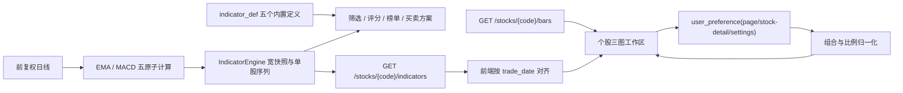

# MACD 技术指标与个股详情多图工作区开发计划

## 1. 需求来源与目标

- 需求文档：[requirement.md](./requirement.md)。
- 交互原型：[prototypes/stock-detail-macd-charts.html](./prototypes/stock-detail-macd-charts.html)。
- 阅读结论：已完整读取需求文档 683 行及其引用原型 1548 行；原型中的状态演示按钮只用于说明，不作为线上工具栏功能。
- 需求编号：严格沿用需求文档的 R1–R16，不重新编号、不改变含义。
- 功能目标：
  - 建立 EMA、MACD 数值与金叉/死叉五个原子结果的唯一后端口径。
  - 让五个原子结果进入统一指标目录，并自然贯通筛选、评分、榜单和买卖方案。
  - 在 `/stocks/:code` 把现有 K线/量能双网格升级为 K线、量能、MACD 三图联动工作区。
  - 支持辅助图选择、自动交换、隐藏、拖动/键盘调整高度，并按用户、按可见组合保存偏好。
  - 完成局部失败隔离、请求竞态、KeepAlive、主题、响应式和可访问性闭环。
- 本次不做：
  - 不实现 R10 的统一云端偏好失败告警。
  - 不实现 R11 的自定义 MACD 参数。
  - 不实现 R12 的其他周期、R13 的其他指标/无限槽位、R14 的导出分享。
  - 不新增 MACD 值表、PG DDL、菜单、资源码、默认角色授权或布局组件配置字段。
- 计划输出：`agent-works/macd-indicator-stock-detail-charts/plan.md`。
- 当前结论：不存在会改变已确认流程、数据结构、权限、接口或验收标准的阻塞项，可以进入开发。
- 当前进度：T1–T6 已完成并通过对应阶段验证；T7–T13 尚未开始，本轮未进入后续阶段。

## 2. 当前项目依据

### 2.1 指标与下游

- `backend/indicators/operators.py` 已有 MA、HHV、REF 等严格后向算子，但没有 EMA。
- `backend/indicators/compute.py` 同时维护单股 `compute_stock_indicators()` 和全市场向量化 `compute_market_indicators()` 两条路径；二者必须同步增加 MACD。
- `backend/indicators/engine.py` 通过 `_IND_COLS`、`range_frame()`、`wide_snapshot()` 和 `compute_series()` 向筛选、评分、回测、买卖方案和个股查询提供统一结果。
- `backend/indicators/registry.py`、`backend/indicators/definition.py` 已提供内置定义、分类、幂等 upsert、启停和不可删除保护。
- `GET /api/indicators/registry`、评分方案和买卖方案的目录来源都是 `IndicatorDefRepo.list()` 读取 DuckDB `indicator_def`；运行时没有回退到代码 `REGISTRY` 的分支。
- `IndicatorDefRepo.seed_builtins()` 已存在且会保留管理员调整过的 `enabled/categories`，但当前应用启动链路没有调用它，仓库内除测试外也没有其他调用点。因此现有环境若已有目录数据，只可能来自历史/人工/测试期持久化；全新数据库会出现目录为空的存量初始化缺口。
- 本次接入启动 seed 会首次持久化 `REGISTRY` 中整套内置定义，而不只是新增五个 MACD key；已有 key 会刷新代码管理的名称、类型、表达式、参数和描述，同时保留管理员的启停与分类。
- `backend/scoring/score_profile.py`、`backend/screening/engine.py`、`backend/signals/trade_profile.py` 优先读取快照同名列，新增五列后可沿用通用求值，不需要建立 MACD 专属下游分支。

### 2.2 个股接口

- `GET /api/stocks/{code}/bars` 与 `GET /api/stocks/{code}/indicators` 均受 `stocks:view` 保护。
- 指标接口已支持可选 `fields` 业务字段白名单和 `lookback=1..6000`；未传 `fields` 时仍返回旧完整指标行，传入时始终保留 `trade_date`。
- 指标序列化已统一把 pandas/NumPy 标量转换为原生 JSON 类型，并把 `NaN`、`pd.NA`、正负无穷转换为 `null`。
- `StockDetailView.vue` 已在 T6 将行情、指标序列、原始最新价和买卖评估拆为独立请求通道，分别使用取消信号与请求序号守卫；指标局部失败不再把主图链路置为整体错误。

### 2.3 页面、图表与布局

- 页面入口、路由和菜单已经存在：`/stocks/:code`、`StockDetailView.vue`、`pageKey=stock-detail`，不新增路由或菜单。
- 页面已使用 `LayoutHost` 和 `detail` 原型；`detail` 主区由 `LayoutHost` 的 `.v-scroll` 承担内部滚动，适合承载最低 650px 的图表工作区和下方顺序卡片。
- `CandleChart.vue` 继续保持单个 ECharts 实例、固定 480px、K线与量能双 grid 及原 props 契约；其 MA/VMA、格式化和主题取色已抽到 `stock-chart/chartUtils.ts`，盘感训练和回测继续复用旧组件。
- `StockChartWorkspace.vue` 已完成按面板分实例、唯一 ECharts group、共享日期轴/缩放、MACD 信号、局部状态和可访问分隔线，并已由 `StockDetailView` 正式消费；`DESIGN.md` 已登记其真实组件职责与使用规则。
- `DESIGN.md` 明确禁止页面写 `calc(100vh - Npx)`，要求金融涨跌使用 `--market-up-color` / `--market-down-color`，四态使用 `AppStateBlock`，页面设置使用 `PageSettingsDrawer`。

### 2.4 用户偏好与权限

- `usePageSettings('stock-detail', defaults)` 已落到 PG `user_preference`：
  - `scope=page`
  - `pageKey=stock-detail`
  - `prefKey=settings`
  - localStorage key 为 `ai-stocks:page-settings:stock-detail`
- `useUserPreference` 已提供递归默认值合并、localStorage 回退、300ms 远端延迟保存和 dirty-before-hydrate 保护。
- `stock-detail/settings` 已增加 `charts` 默认子树；图表类型、组合 key、按组合高度和拖动草稿由 `useStockChartPreferences` 统一归一化，远端同步仍复用 `useUserPreference`。
- PG `user_preference` 已具备 `tenant_id + owner_user_id` 归属主键、64KB JSON 限制和标准 JSON 校验；本次不新增 DDL。
- `user-preference:manage` 是登录基线自有偏好能力；即使远端请求失败，前端仍必须按既有骨架本地降级。
- 本次不新增资源码、菜单、默认角色授权或按钮权限；公共行情仍只使用 `stocks:view`。

### 2.5 测试与交付

- 后端现有指标测试：`backend/tests/test_indicators.py`、`backend/tests/test_indicator_def.py`。
- 前端现有布局、偏好和状态测试：`frontend/src/layout/__tests__/`、`frontend/src/composables/__tests__/useUserPreference.spec.ts`、`frontend/src/components/__tests__/AppStateBlock.spec.ts`。
- 页面设置和远端偏好属于现有 Playwright 覆盖路径；本次涉及真实点击、远端保存、本地 fallback、重置和可复用图表交互，必须新增稳定 E2E。
- 修改 `frontend/src` 后必须执行 `npm run build` 并同步 `frontend/dist`。

## 3. 实施范围

### 3.1 必须实现

| 需求编号 | 内容 | 开发状态 | 对应任务 |
| --- | --- | --- | --- |
| R1 | EMA 与 `macd_diff/macd_dea/macd_hist` 三个数值原子结果 | 已完成（T9 总回归待执行） | T1、T9 |
| R2 | `macd_golden_cross/macd_dead_cross` 两个可空布尔原子结果 | 已完成（T9 总回归待执行） | T1、T9 |
| R3 | 五指标注册、启动期 seed、统一目录及既有下游接入 | 已完成（T9/T13 总回归待执行） | T2、T9、T13 |
| R4 | 个股 MACD 序列查询、字段白名单、lookback 校验、日期对齐 | 部分完成（T3/T6 已完成，总回归待执行） | T3、T6、T9、T10、T11、T13 |
| R5 | 默认三图、图名、共享日期/光标/缩放、MACD 图形和信号引导线 | 部分完成（T5/T6 已完成，总回归待执行） | T5、T6、T10、T11 |
| R6 | 图表二/三选择量能、MACD、隐藏，自动交换且不留空白 | 部分完成（T4 状态模型已完成） | T4、T7、T10、T11 |
| R7 | pointer 拖动、键盘调整、最低高度、相对比例和释放后保存 | 部分完成（T4 状态模型、T5 分隔线与提交事件已完成） | T4、T5、T10、T11 |
| R8 | 按用户、按有序组合保存类型和高度，兼容旧偏好并恢复默认 | 部分完成（T4 偏好结构与兼容已完成） | T4、T7、T9、T10、T11、T13 |
| R9 | 页面四态、历史不足、MACD 局部失败、整体失败和权限分层 | 部分完成（T3/T5/T6 已完成对应部分，页面视觉总验收待执行） | T3、T5、T6、T8、T10、T11 |
| R15 | 响应式、主题、pointer/键盘可访问性和 reduced motion | 部分完成（T5 组件与关键视口已验证） | T5、T8、T10、T11、T12 |
| R16 | 接口/偏好兼容、请求竞态和 KeepAlive 生命周期 | 部分完成（T3–T6 已完成对应部分，总回归待执行） | T3、T4、T5、T6、T10、T11、T13 |

### 3.2 可选增强（建议项处理）

| 需求编号 | 建议内容 | 需求阶段处理状态 | 开发状态 | 对应任务 | 跳过原因 |
| --- | --- | --- | --- | --- | --- |
| R10 | 偏好云端同步失败时提供统一显式消息 | 后续建议 | 跳过 | - | 当前需求明确沿用本地 fallback，不在本次新增全站尚未统一的告警交互。 |
| R11 | 自定义 MACD 参数 | 后续建议 | 跳过 | - | 本次固定 12、26、9，避免图表口径与五个原子定义分叉。 |

### 3.3 暂不实现

| 需求编号 | 范围 | 开发状态 | 原因 |
| --- | --- | --- | --- |
| R12 | 分时、周线、月线等其他周期 MACD | 跳过 | 本次仅日线前复权。 |
| R13 | KDJ、BOLL、无限辅助图或自由增删槽位 | 跳过 | 本次固定 K线、量能、MACD 与三个槽位。 |
| R14 | 截图、导出、分享或第三方图表全量复制 | 跳过 | 不属于本次指标与工作区闭环。 |

## 4. 技术方案

### 4.1 总体数据流



### 4.2 后端指标口径

- 在 `operators.py` 增加严格后向 `EMA(x, n)`：
  - 使用 `x.ewm(span=n, adjust=False, min_periods=n).mean()`。
  - 输入缺失日强制输出空值，不用上一日 EMA 冒充当日结果。
- 单股路径：
  - `DIFF = EMA(close, 12) - EMA(close, 26)`。
  - `DEA = EMA(DIFF, 9)`。
  - `MACD柱 = 2 * (DIFF - DEA)`。
  - 金叉/死叉只比较当前行与同股紧邻前一行；当前或前一行任一 DIFF/DEA 无效时输出 `pd.NA`。
- 全市场路径：
  - 使用按 `code` 分组的向量化 `ewm` 与 `shift(1)`，禁止逐股 SQL/N+1。
  - 输出索引和行顺序与当前 `compute_market_indicators()` 一致。
- 同步修改 `_IND_COLS`，保证宽快照、缓存、筛选、评分和买卖方案获得同名列。
- 在 `build_params()` 增加固定算法版本标识，例如 `indicator_algo_version=macd-v1`，使 `param_hash` 能区分加入 MACD 后的新计算语义；不把 12/26/9开放为配置。
- 全局算法版本会使旧 `param_hash` 语义失效；新版本首次执行相应单股或全市场范围时会按新 hash 重算。当前缓存是进程内缓存，因此这是一次性缓存失效，不是持久化指标回填或数据库迁移。

### 4.3 指标定义与启动期 seed

- 在 `REGISTRY` 增加五个 `builtin`、`is_builtin=true`、默认启用定义。
- 主分类统一为“趋势”，`PRESET_CATEGORIES` 为“趋势”“动量”；三个数值指标 `direction=None`。
- 描述中写明 `(12,26,9)`、前复权和固定参数，不提供参数 schema。
- 在应用 DuckDB 连通性自检后执行：
  1. `init_db(client)` 确认 `indicator_def` 存在。
  2. `IndicatorDefRepo(client).seed_builtins()` 幂等 upsert。
- 该调用遍历并 upsert 整个 `REGISTRY`：全新库首次写入全部 builtin，存量库刷新全部 builtin 的代码元数据，并额外加入五个 MACD 定义。
- seed 保留管理员已调整的 `enabled/categories`；不得用静态 INSERT 覆盖管理员配置。
- 下游不新增 MACD 专属解析器；通过 `_IND_COLS` 同名列和现有通用 registry 消费自然接入。

### 4.4 个股指标接口

- 沿用 `GET /api/stocks/{code}/indicators`，不新增 MACD 专属接口。
- 新增可选逗号分隔参数 `fields`：
  - 未传时保持现有完整返回行为。
  - 传入时只允许 `_IND_COLS` 中可对外返回的字段；`trade_date` 始终返回。
  - 空字段、重复字段可归一化；未知字段返回明确 400 业务错误，不参与 SQL 拼接。
- 为 indicators 接口新增 `lookback=1..6000` 服务端上限；6000 不是该接口现状，而是对齐 `StockDetailView` 现有“全部”档给 bars 行情接口使用的加载边界，使新增整段 MACD 请求与同页行情范围一致。
- 计算仍额外读取既有暖机窗口，返回时只裁剪用户请求范围；MACD 不扩大引擎 `_max_lb`。
- 序列化前统一处理 pandas/NumPy 标量，将 `NaN`、`pd.NA`、正负无穷转成 JSON `null`，布尔值转成原生 `bool`。
- 前端一次请求字段集合包含五个 MACD 字段和“最新指标快照”当前可见字段，用同一范围响应同时供图表与快照末行消费，避免同范围重复计算。

### 4.5 前端请求与状态模型

- 把当前单个 `Promise.all` 拆为互不连带的请求流：
  - 行情流：当前复权 K线 + 不复权最新价，失败进入页面级错误。
  - 指标流：前复权指标序列，失败只进入 MACD 局部错误；最新指标快照保留已有值，初次无值时显示 `—`，不另起页面错误，不阻断 K线/量能。
  - 买卖评估流：继续独立，不阻塞主图。
- 每条请求流使用独立 `AbortController` 或请求序号：
  - 切换范围时重拉行情与指标。
  - 切换 K线复权只重拉行情，不重拉固定前复权 MACD。
  - 切换辅助图显隐只消费已加载数据，不发请求。
  - 旧请求不得覆盖新股票、新范围或新复权状态。
- 指标数据按 `trade_date` 建 Map，再与可见 `Bar.date` 对齐；缺失日保留 `null`，不按数组位置拼接。
- “重试 MACD”只重试指标流，不刷新行情、光标、缩放或高度。

### 4.6 多图工作区实现

- 新增页面域多图组件，建议路径：
  - `frontend/src/components/stock-chart/StockChartWorkspace.vue`
  - 必要的内部 panel/option helper 放在同目录。
- 不直接把 `CandleChart.vue` 改造成承载所有页面专属状态的大组件；抽取 MA/VMA、主题 token 解析和通用格式化工具，让 `CandleChart` 与新工作区共同消费，避免重复实现并保护盘感训练/回测。
- 工作区采用“每个可见面板一个 ECharts 实例 + 当前组件唯一 group id + `echarts.connect`”：
  - DOM 面板天然承载图名、局部四态和可访问分隔线。
  - group 同步 axisPointer、dataZoom 和日期索引。
  - 每个页面实例使用唯一 group id，防止不同个股标签页互相联动。
  - 最下方可见面板显示日期轴和 slider，其余面板隐藏重复日期标签。
- 面板职责：
  - K线：现有蜡烛、MA 和行情 tooltip。
  - 量能：涨跌色柱、VMA5、VMA10。
  - MACD：正负柱、DIFF、DEA、零轴、金叉/死叉。
- 图表颜色通过组件根节点 `getComputedStyle()` 解析 CSS token：
  - 上涨/金叉：`--market-up-color`。
  - 下跌/死叉：`--market-down-color`。
  - DIFF/DEA：使用预设同步覆盖的 Element Plus 语义 token，禁止页面硬编码红绿 hex。
- 金叉/死叉使用自定义 signal series：
  - 数据点的 X 值固定为事件交易日索引，Y 锚点固定为当日 DIFF。
  - 标签、竖向引导线和锚点在同一 X 坐标。
  - 密集时只分配上下 lane，不横向平移。
  - tooltip/可访问文本至少包含“金叉/死叉 + 完整日期”。
- loading、历史不足、局部错误时仍初始化基础日期轴并保留面板标题和稳定高度；只隐藏不可用 series，在面板内容层覆盖 `AppStateBlock`。

### 4.7 图表组合、高度与偏好

- 在 `detailDefaults` 增加需求文档中的 `charts` 结构，默认：
  - `slot2=volume`
  - `slot3=macd`
  - 三图 `0.6/0.2/0.2`
  - 单辅助图 `0.75/0.25`
- 新增纯函数/页面 composable 处理：
  - `volume | macd | hidden` 枚举归一化。
  - 两个可见辅助图重复时按 R6 自动交换。
  - 有序 composition key 生成。
  - 有限正数、长度、归一化和最低高度校验。
  - 非法值只回退当前组合，不清空其他有效页面偏好。
- 拖动期间高度放在工作区临时状态，不直接写 `settings`：
  - pointermove 只更新 DOM 比例和 chart resize。
  - pointerup/pointercancel/有效卸载终态只 emit 一次 commit。
  - commit 后才写 `settings.charts.heightRatios[key]`，由现有偏好骨架延迟远端保存。
- 键盘每次按键按约 2% 调整相邻面板并提交有效比例。
- 面板最低高度按实际可用高度换算：
  - K线 `>=250px`
  - 量能/MACD `>=126px`
  - 三图工作区 `min-height:650px`
- 窗口临时变小只做像素收敛和 resize，不回写用户比例。
- 重置继续使用 `PageSettingsDrawer` footer：`reset()` 恢复全部页面业务默认，`resetLayout()` 恢复布局用户层；图表自定义组合高度随默认对象替换而清除。

### 4.8 前端页面设计闭环

#### 页面定位与原型

- 页面：P1 个股详情。
- 页面类型：更新既有页面。
- 用户主流程：进入个股 → 查看三图 → 联动定位交易日 → 设置辅助图 → 调整高度 → 自动恢复个人偏好。
- 选用原型：既有 `detail`。
- 选择理由：页面仍是股票摘要、连续图表和下方分区详情的强阅读顺序，不适合 dashboard 重排。
- 新增布局原型：否。
- 原型依据：`prototypes/stock-detail-macd-charts.html`；示意数据和演示按钮不进入生产代码。

#### Slot 与组件设计

| 区域 | slotId | 组件种类 | growMain | 滚动归属 | 是否可重排 | 说明 |
| --- | --- | --- | --- | --- | --- | --- |
| action | toolbar | `toolbar` | 否 | 固定 | 否 | 返回、股票身份、行情摘要、分组、K线范围、页面设置入口；复权留在抽屉。 |
| main | detail | `detail` | 否 | `LayoutHost` 主区 `region` 内滚 | 否 | 集合导航、最低 650px 多图工作区、指标快照、买卖评估顺序排布。 |
| overlay | settings | `settings-drawer` | 否 | 抽屉正文内滚 | 否 | 复用 `PageSettingsDrawer`，即时生效，无提交按钮。 |

#### P1 页面功能点承接

| 页面功能点 | 原型区域 | ready | loading/empty | error/权限 | 关键交互与异常 | 对应需求 | 对应任务 | 验证方式 |
| --- | --- | --- | --- | --- | --- | --- | --- | --- |
| 默认三图与命名 | 原型中部连续三图工作区 | K线、量能、MACD 名称和光标值齐全 | 标题与高度稳定；无行情整体空态；历史不足只覆盖 MACD | 行情失败页面级重试；MACD 失败局部重试；无 `stocks:view` 为 permission error | 日期对齐、共享光标/缩放、信号引导线、范围切换取消旧请求 | R4、R5、R9、R15、R16 | T3、T5、T6、T8 | Vitest、Playwright、固定样本、关键视口截图 |
| 设置辅助图 | 设置抽屉“业务选项 → 图表设置” | 图表一固定；图表二/三可选量能、MACD、隐藏 | 偏好加载遵守 dirty-before-hydrate；至少保留 K线 | 远端失败或无偏好权限时本地生效 | 重复类型自动交换；隐藏移除面板和分隔线；不重复请求 | R6、R8、R9、R16 | T4、T7 | 归一化单测、抽屉 E2E、远端偏好断言 |
| 拖动/键盘调整高度 | 图表间分隔线 | pointer 拖动实时 resize；方向键约 2% 调整 | 仅 K线时不显示；偏好未完成时使用本地/默认有效值 | 非法比例回退当前组合；远端失败不影响本地 | 最低高度、相对比例、释放后一次提交、停用清监听 | R7、R8、R15、R16 | T4、T5 | 组件测试、Playwright 尺寸/ARIA 断言 |
| 恢复默认 | 设置抽屉 footer | 恢复量能/MACD和 60/20/20 | 沿用抽屉现有同步状态 | 远端失败仍完成本地重置 | 无二次确认、不重载行情、同时保持页面和布局总重置契约 | R6、R7、R8 | T4、T7 | Vitest、Playwright、PG 偏好轮询 |

#### 四态反馈

| 状态 | 页面/组件处理 | 复用组件 | 结论 |
| --- | --- | --- | --- |
| ready | 图名、核心值、图形、分隔线、共享光标和缩放可用 | ECharts + 工作区标题 | 价值态不额外加状态图标。 |
| loading | 初次行情使用页面稳定 loading；MACD 独立 loading 保留标题/高度/日期轴 | `v-loading`、`AppStateBlock state=loading` | 不用空态代替加载。 |
| empty | 无行情为整体 empty；历史不足为 MACD 局部 empty，值显示 `--` | `AppStateBlock state=empty` | 不制造零值和假交叉。 |
| error | 行情为页面 error；MACD 为局部 error；403 使用 permission variant | `AppStateBlock state=error` | 错误均有原因，允许重试的链路提供重试。 |

#### 控件、浮层、主题与排版

- 主操作不新增；“重试 MACD”使用普通 `el-button`，页面设置入口继续使用 `PageSettingsTrigger/AppIconButton`。
- 分隔线是专用交互元素，不伪装成按钮；必须提供：
  - `role="separator"`
  - `aria-orientation="horizontal"`
  - `aria-valuemin/aria-valuemax/aria-valuenow`
  - `tabindex="0"`
- 设置抽屉继续挂在 `#overlays`，由 `PageSettingsDrawer → PageDrawer` 限制在当前 `LayoutHost` 内容区；正文内滚，关闭不撤销偏好。
- 页面间距、标题和状态文本消费 `--app-space-*`、`--app-font-*`、`--app-line-height-*`；图表 canvas/tooltip 数值属于 DESIGN 允许的局部特例。
- 不调整主题底色或三套预设，不新增金色 token；只消费现有市场和 Element Plus 语义 token。
- `prefers-reduced-motion` 下关闭分隔线和面板非必要过渡。

#### 配置设计

| 类型 | 字段 | 层级 | 落点 | 说明 |
| --- | --- | --- | --- | --- |
| 布局旋钮 | `density` | page/user | 既有 `pageRegistry.editable` | 不变。 |
| 组件设置 | 无新增 | - | - | 不新增 `COMPONENT_FIELD_DEFS`。 |
| 页面记忆 | `charts.slot2/slot3/heightRatios` | `usePageSettings` | `user_preference(page/stock-detail/settings)` | 类型即时保存；高度释放后提交。 |
| 临时交互态 | 当前拖动比例、hover 日期、zoom | component memory | 不持久化 | 不进入 PG 或布局配置。 |

#### 复用与组件资产闭环

| 资产 | 处理 | 系统组件关系 | 维护结论 | 验证 |
| --- | --- | --- | --- | --- |
| `LayoutHost/detail` | 复用 | 既有 `detail` | 不改原型、slot 或滚动事实源 | `pageRegistry.spec.ts`、`layout-contract.spec.ts` |
| `PageSettingsDrawer/PageSegmented` | 复用 | 既有 `settings-drawer` | 新业务选项只进入页面记忆 | 组件测试、E2E |
| `AppStateBlock` | 复用 | 状态语义 | MACD 局部四态不得另写私有状态皮肤 | 组件测试 |
| `CandleChart` | 保留现有对外契约并抽取共享 helper | 无新增种类 | 盘感训练/回测继续消费，补回归 | Vitest、build、现有页面 smoke |
| `StockChartWorkspace` | 新增领域真实组件 | 不新增系统组件种类 | 登记到 DESIGN 真实组件清单，说明只承接股票多图联动；至少由 `StockDetailView` 实际消费 | 组件测试、Playwright |
| 图表组合归一化 helper/composable | 新增复用单元 | 不涉及布局种类 | 统一自动交换、组合 key、比例校验，页面不复制逻辑 | 单元测试 |

#### 维护清单

- `frontend/src/layout/pageRegistry.ts`：页面结构与配置字段均不变，不修改。
- `frontend/src/layout/components.ts` / `COMPONENT_CATALOG`：不新增组件种类，不修改。
- `COMPONENT_FIELD_DEFS`、`componentSchemas.ts`、后端 `layout_config.py`：不修改。
- `DESIGN.md`：
  - 登记 `StockChartWorkspace` 真实组件及使用规则。
  - `page-registry` 中 `StockDetailView` 仍为 `detail`，结构不变。
- `agent-works/e2e-automation/guide.md`：在当前基线用例中登记新增个股多图 E2E。
- RBAC：不触发新页面/新资源接入；复用 `stocks:view`、`user-preference:manage`。
- 自动化锚点：
  - 复用 `page-settings-trigger/page-settings-drawer/page-settings-reset`。
  - 新增 `stock-chart-workspace`、各 panel、slot2/slot3 segmented 和 splitter 的稳定 `data-testid`。
  - 不使用坐标、DOM 顺序或临时说明文本作为长期选择器。

#### 关键视口验收

- `1100×620`：图表工作区保持最低高度，由 `LayoutHost` 主区内滚；无整页横向滚动。
- `1366×768`：三图名称、核心值、设置入口和分隔线可用。
- `1440×900`：默认主视口完整验证三图、抽屉、下方卡片和信号标签。
- 明暗主题各覆盖至少一个关键视口；附加检查 reduced motion。

### 4.9 接口契约

| 接口 | 变更 | 权限 | 兼容性 | 异常 |
| --- | --- | --- | --- | --- |
| `GET /api/stocks/{code}/indicators` | 增加 `fields` 可选参数；新增 `lookback=1..6000` 上限并对齐同页 bars 的 6000 行加载边界；返回五个 MACD 字段 | `stocks:view` | 不传 `fields` 时外层和字段行为不变 | 非法字段明确 400；空/非有限值转 `null` |
| `GET /api/stocks/{code}/bars` | 无契约变更 | `stocks:view` | 保持现状 | 行情失败进入页面级错误 |
| `GET/POST /api/user-preferences` | 无接口/DDL变更，只增加 `settings.value.charts` JSON 子树 | `user-preference:manage` | 旧偏好递归合并默认；旧客户端忽略新字段 | 失败继续 localStorage fallback |
| `GET /api/indicators/registry` | seed 后自然出现五定义 | `indicator:registry` | 外层不变 | 管理员停用后不进入新建方案候选 |

## 5. 需求与开发内容映射和开发状态

| 范围类别 | 需求编号 | 需求内容/来源 | 计划开发内容 | 对应任务 | 状态 | 偏差判断 | 验证方式 | 说明 |
| --- | --- | --- | --- | --- | --- | --- | --- | --- |
| 必须实现 | R1 | `requirement.md §5.1`：EMA 与三个数值原子结果 | EMA、三数值列、暖机、空值、算法版本、单股/全市场一致 | T1、T9 | 已完成（T9 总回归待执行） | 一致 | 已知公式、前缀稳定、两路径容差单测 | T1 定向测试通过；固定 12/26/9，不开放参数。 |
| 必须实现 | R2 | `requirement.md §5.2`：金叉、死叉两个布尔原子结果 | 两个可空交叉列、相等穿越、缺失段和同日互斥 | T1、T9 | 已完成（T9 总回归待执行） | 一致 | 交叉边界和缺失段单测 | T1 定向测试通过；空值保留 null，下游按不成立处理。 |
| 必须实现 | R3 | `requirement.md §5.3`：统一指标目录与既有下游接入 | 五定义、分类、方向、整套 builtin 启动 seed、下游通用求值 | T2、T9、T13 | 已完成（T9/T13 总回归待执行） | 一致 | repo/API/筛选/评分/买卖方案测试 | T2 定向与完整相关文件回归通过；启动 seed 同时修复全新库目录为空的存量初始化缺口，影响面在 §7 单列。 |
| 必须实现 | R4 | `requirement.md §5.4`：个股 MACD 序列查询与日期对齐 | 字段白名单、新增 lookback 上限、null、单次指标序列、trade_date 对齐 | T3、T6、T9、T10、T11、T13 | 部分完成（T3/T6 已完成） | 一致 | API、Vitest、Playwright | 安全序列契约和页面按交易日对齐均已落地；总回归留后续任务。 |
| 必须实现 | R5 | `requirement.md §5.5`：个股详情三图联动与图表命名 | 三图、命名、共享日期/光标/缩放、MACD 与信号引导线 | T5、T6、T10、T11 | 部分完成（T5/T6 已完成） | 一致 | option/组件测试、固定样本、截图和 E2E | 工作区已由真实个股详情消费，三视口 E2E 已验证默认三图和局部重试；总回归留后续任务。 |
| 必须实现 | R6 | `requirement.md §5.6`：辅助图类型、交换与隐藏 | 两辅助槽选择、自动交换、隐藏和空间释放 | T4、T7、T10、T11 | 部分完成（T4 状态模型已完成） | 一致 | 归一化单测、抽屉 E2E | 9 种组合与自动交换已测；抽屉和实际面板留待 T7。 |
| 必须实现 | R7 | `requirement.md §5.7`：拖动与键盘调整高度 | pointer/键盘分隔线、最低高度、释放提交 | T4、T5、T10、T11 | 部分完成（T4/T5 已完成） | 一致 | 组件 ARIA/事件测试、E2E 尺寸断言 | pointermove 只发 draft，pointerup/pointercancel/停用终态只发一次 commit；页面偏好消费与 E2E 留后续。 |
| 必须实现 | R8 | `requirement.md §5.8`：组合与高度个人偏好 | 有序组合比例、PG/本地偏好、隔离、重置 | T4、T7、T9、T10、T11、T13 | 部分完成（T4 偏好结构与兼容已完成） | 一致 | 偏好 API、Vitest、跨用户 E2E | 旧值递归补默认、非法组合局部回退和 dirty-before-hydrate 已测。 |
| 必须实现 | R9 | `requirement.md §5.9`：页面状态与局部失败隔离 | 整体与局部四态、历史不足、权限语义 | T3、T5、T6、T8、T10、T11 | 部分完成（T3/T5/T6 已完成对应部分） | 一致 | 状态测试、403/失败注入 E2E | 行情错误/空态/403 与 MACD loading/insufficient/error 已分层，真实页面局部失败重试已测；页面视觉总验收留 T8。 |
| 必须实现 | R15 | `requirement.md §5.10`：响应式、主题与可访问性 | 主题 token、关键视口、pointer/键盘、reduced motion | T5、T8、T10、T11、T12 | 部分完成（T5 组件已完成） | 一致 | 样式/契约测试、build、主题截图 | T5 已验证 token、1100×620、键盘/ARIA和 reduced-motion；页面级视口总验收留后续。 |
| 必须实现 | R16 | `requirement.md §5.11`：兼容回退与竞态保护 | 接口与偏好兼容、竞态、KeepAlive 监听清理 | T3、T4、T5、T6、T10、T11、T13 | 部分完成（T3–T6 已完成对应部分） | 一致 | 竞态和生命周期测试、E2E | 行情、指标、报价和买卖评估均有独立取消/序号守卫，KeepAlive 停用取消、激活恢复已落地；总回归留后续。 |
| 建议实现 | R10 | `requirement.md §4.2`：云端同步失败统一显式消息 | 不纳入本次开发 | - | 跳过 | 一致 | 范围审查 | 需求已明确留作后续建议，本次沿用本地 fallback。 |
| 建议实现 | R11 | `requirement.md §4.2`：自定义 MACD 参数 | 不纳入本次开发 | - | 跳过 | 一致 | 范围审查 | 需求已明确留作后续建议，本次固定 12/26/9。 |
| 暂不实现 | R12 | `requirement.md §4.3`：其他周期 | 不纳入本次开发 | - | 跳过 | 一致 | 范围审查 | 仅日线前复权。 |
| 暂不实现 | R13 | `requirement.md §4.3`：其他指标/无限槽位 | 不纳入本次开发 | - | 跳过 | 一致 | 范围审查 | 固定 K线、量能、MACD 与三个槽位。 |
| 暂不实现 | R14 | `requirement.md §4.3`：导出/分享/第三方全量复制 | 不纳入本次开发 | - | 跳过 | 一致 | 范围审查 | 不扩展为图表平台能力。 |

## 6. 详细开发任务与状态

### 6.1 任务 T1：建立 EMA 与 MACD 五原子计算口径

- 状态：已完成
- 对应需求：R1、R2。
- 依赖：无。
- 涉及文件：
  - `backend/indicators/operators.py`
  - `backend/indicators/compute.py`
  - `backend/indicators/engine.py`
  - `backend/tests/test_indicators.py`
- 目标：建立五个原子结果唯一、后向、单股与全市场一致的计算事实源。
- 开发内容：
  - 新增 EMA 算子和缺失值语义。
  - 单股、全市场同步计算 DIFF、DEA、MACD柱、金叉、死叉。
  - `_IND_COLS` 纳入五字段。
  - `build_params/param_hash` 纳入算法版本。
- 产出：EMA 算子、五个动态指标列、更新后的 `_IND_COLS` 与算法 hash。
- 影响范围：所有通过 `IndicatorEngine` 计算动态指标的单股、筛选、评分、榜单、买卖方案和回测链路；新 hash 首次执行时发生一次性进程内缓存失效。
- 边界：
  - 不使用未来数据。
  - 不跨股票、不跨紧邻缺失行判断交叉。
  - 可空布尔在原始结果中保持 `pd.NA`。
- 验证方式：
  - 固定序列与 pandas 递推公式对照。
  - 暖机、相等穿越、缺失段、前缀稳定测试。
  - 单股和全市场逐行对照。
- 完成标准：R1、R2 的全部验收样本通过，现有指标列无回归。
- 实际落地情况：已完成（2026-07-23）。
  - `operators.py` 新增严格后向 EMA，采用 `adjust=False/min_periods=n`，缺失和无穷输入当天保持空值。
  - 单股与全市场路径均输出固定 12/26/9 的 DIFF、DEA、MACD柱、金叉和死叉；交叉不跨股票或缺失行。
  - `_IND_COLS` 已加入五个字段，`build_params()` 已加入 `2.1-macd-v1` 算法版本并进入 `param_hash`。
  - `backend/tests/test_indicators.py` 已覆盖 pandas 公式对照、暖机、相等后向上/向下突破、缺失段、前缀稳定、含 `NaN/+inf/-inf` 的单股/全市场一致和算法版本 hash。
  - 定向验证结果：`python -m pytest backend/tests/test_indicators.py -q` 为 `14 passed`。
  - 下游冒烟结果：筛选 `ScreenEngine.wide_snapshot`、评分 `ScoreProfileModel`、回测 `HitPrecomputer` 三条链路与指标测试合并执行为 `17 passed`，确认 `_IND_COLS` 加列不破坏既有下游。
  - 本次可复现完整命令：

    ```bash
    python -m pytest \
      backend/tests/test_indicators.py \
      backend/tests/test_screening.py::test_screen_engine_hybrid_col_and_expr \
      backend/tests/test_indicator_def.py::test_custom_indicator_in_scoring_end_to_end \
      backend/tests/test_backtest.py::test_precompute_matches_screen_engine \
      -q
    ```

    执行结果：`17 passed in 1.13s`。
  - 停服恢复结果：测试前后端运行中，已用 `./start.sh stop` 停服；测试后用 `./start.sh` 恢复，`./start.sh status` 确认 `/api/health=200`。
  - 其他验证结果：`python -m py_compile` 与 `git diff --check` 通过。
  - 静态检查限制：当前 Python 环境未安装 Ruff（`python -m ruff` 返回 `No module named ruff`），因此未执行 Ruff；未将工具缺失误记为代码失败。

### 6.2 任务 T2：注册五指标并接入启动 seed 与既有下游

- 状态：已完成
- 对应需求：R3。
- 依赖：T1。
- 涉及文件：
  - `backend/indicators/registry.py`
  - `backend/indicators/definition.py`
  - `backend/main.py`
  - `backend/tests/test_indicator_def.py`
  - `backend/tests/test_screening.py`
  - `backend/tests/test_score_profile.py`
  - `backend/tests/test_trade_profile.py`
- 目标：让五个 MACD 定义进入统一目录，并补齐全新数据库缺少 builtin 初始化的存量启动缺口。
- 开发内容：
  - 新增五个固定参数 builtin 定义和“趋势/动量”分类。
  - 启动期在 DuckDB schema 就绪后执行 `seed_builtins()`；该操作首次持久化整套 `REGISTRY`，不是只插入五个 MACD key。
  - 验证整套 builtin 在重复 seed 后幂等，并保留管理员启停/分类。
  - 用通用快照列打通筛选、评分和买卖条件，不增加专属分支。
- 产出：五个 MACD builtin 元数据、应用启动 seed 执行点、统一下游目录与求值证据。
- 影响范围：DuckDB `indicator_def` 的全部 builtin 行；全新库首次写入整套定义，存量库刷新代码管理的元数据字段并新增五个 MACD 定义，管理员 `enabled/categories` 保留。
- 边界：
  - 不新增权限、菜单或角色授权。
  - 被停用定义不进入新建候选，但已有引用不被删除。
- 验证方式：全量 REGISTRY repo seed、registry API、管理员配置保留和下游固定样本测试。
- 完成标准：五指标目录可见且下游正确求值，重复启动幂等。
- 实际落地情况：已完成（2026-07-23）。
  - `REGISTRY` 已增加五个固定 12/26/9、前复权、默认启用的 builtin；主分类为“趋势”，预设分类为“趋势/动量”，数值和布尔定义均无方向与参数 schema。
  - `seed_builtins()` 继续处理整套 REGISTRY，并改为从原始列区分 SQL `NULL` 与管理员明确清空的 `"[]"`：重复 seed 保留任意 builtin 的 `enabled/categories`，同时刷新代码管理的元数据。
  - 旧库 `enabled=NULL` 按“未初始化”处理并回退 REGISTRY 默认值，只有明确的 `TRUE/FALSE` 才作为管理员启停状态保留。
  - seed 会比较名称、分类、类型、方向、种类、表达式、参数、分类标签、启用态、内置标记和描述；11 个业务字段均未变化时跳过 `_upsert`，不刷新 `updated_at`。
  - 应用启动期在 DuckDB 连通后通过 `IndicatorDefRepo` 幂等确保 schema 并 seed 整套 builtin；PG、Redis、JWT 自检和既有任务/调度流程不变。
  - 目录 API 的启用项、全量幂等、内置不可删除、管理员停用/分类保留均已有自动化证据；停用的 MACD 定义不进入启用候选但仍保留记录。
  - 筛选通过注册指标叶子使用 `macd_golden_cross`，评分直接消费 `macd_hist/macd_golden_cross`，买卖条件直接消费金叉/死叉；三个下游均复用同名快照列和通用求值，没有新增 MACD 专属分支。
  - 真实启动验证前已在仓库外创建本地 DuckDB 备份；启动 seed 前为 38 个 builtin、0 个 MACD，启动后为 43 个 builtin、5 个 MACD，五个定义的类型、分类和启用状态对账通过。
  - 完整相关文件回归命令：

    ```bash
    python -m pytest \
      backend/tests/test_indicators.py \
      backend/tests/test_indicator_def.py \
      backend/tests/test_screening.py \
      backend/tests/test_score_profile.py \
      backend/tests/test_trade_profile.py \
      -q
    ```

    执行结果：`70 passed in 5.69s`；16 条 warning 均为项目既存 FastAPI `on_event` 弃用提示，无测试失败。
  - 真实启动幂等验证：43 个 builtin 的 `key+updated_at` SHA-256 在启动前后均为 `e6ed1db09b64a36ddd3db93dacb0d8c8e7959dee53615ac6b5e6f8ecc90c1e75`，确认无变化启动不产生 43 行无意义写入。
  - 停服恢复结果：测试和真实库对账均按 `./start.sh stop` 停服；最终用 `./start.sh` 恢复，`./start.sh status` 确认 `/api/health=200`。

### 6.3 任务 T3：扩展个股指标接口并保证兼容序列化

- 状态：已完成（2026-07-23）
- 对应需求：R4、R9、R16。
- 依赖：T1。
- 涉及文件：
  - `backend/api/stocks.py`
  - `frontend/src/api/stocks.ts`
  - `backend/tests/test_stock_indicators_api.py`
  - `frontend/src/api/__tests__/stocks.spec.ts`
- 目标：在不建立第二套接口的前提下，为详情页提供安全、兼容的整段 MACD 序列。
- 开发内容：
  - 增加 `fields` 白名单，并为 indicators 接口新增 `lookback=1..6000`；6000 对齐同页 bars 行情加载边界。
  - 保留无 `fields` 的旧返回。
  - 统一 pandas/NumPy 标量与非有限值序列化。
  - 前端定义 `IndicatorRow/IndicatorField` 类型并把字段数组稳定编码为逗号分隔参数。
- 产出：扩展后的指标接口、强类型前端 API 和接口测试。
- 影响范围：`GET /api/stocks/{code}/indicators` 的请求参数校验与响应序列化；不影响 bars、路由或权限。
- 异常：
  - 非法字段明确返回 400。
  - 无行情返回空数组。
  - 无 `stocks:view` 保持 403。
- 验证方式：旧调用、字段裁剪、边界 lookback、非法字段、null JSON 和权限测试。
- 完成标准：接口契约满足 R4，现有调用方无需改造即可继续使用。
- 实际落地情况：已完成（2026-07-23）。
  - `GET /api/stocks/{code}/indicators` 新增 `fields` 逗号参数；仅开放 `_IND_COLS` 业务指标列，排除重复身份字段 `code/trade_date` 和内部 `param_hash`，`trade_date` 始终返回。
  - 未传 `fields` 时保留旧完整指标行；空项和重复项按首次出现顺序归一化，未知或内部字段在指标计算前返回 400。
  - `lookback` 新增 FastAPI `1..6000` 校验，计算仍复用既有 520 行暖机窗口；空行情保持空数组。
  - pandas/NumPy 标量统一转为原生 JSON；`NaN`、`pd.NA`、正无穷和负无穷均转为 `null`，可空布尔保持 `bool/null`。
  - 前端在既有 `stocks.ts` 内新增 `IndicatorField`、`IndicatorRow` 和 `IndicatorParams`，字段数组按调用方顺序编码为逗号参数；没有新增请求 helper 或第二套接口。
  - 复用判断：沿用现有 `http.get(..., { params, signal })` 和项目已有短 `join(',')` 参数模式；该领域字段联合只服务个股指标契约，抽成跨 API query builder 会扩大依赖且没有第二个同变化原因的消费点，因此未新增公共 util。
  - 后端目标及相关回归：

    ```bash
    python -m pytest \
      backend/tests/test_stock_indicators_api.py \
      backend/tests/test_indicators.py \
      backend/tests/test_rbac_deps.py \
      backend/tests/test_stage4_resource_codes.py \
      -q
    ```

    执行结果：`44 passed in 4.95s`；112 条 warning 均为项目既存 FastAPI `on_event` 弃用提示。
  - 前端目标测试：`cd frontend && npm run test -- --run src/api/__tests__/stocks.spec.ts`，结果 `2 passed`。
  - 前端构建：`cd frontend && npm run build` 通过；仅有依赖注释位置和既有大 chunk 告警，无类型或构建失败。
  - 真实库冒烟：`600000.SH` 五个 MACD 字段返回 60 行（2026-04-24 至 2026-07-22），字段裁剪准确，`json.dumps(..., allow_nan=False)` 通过。
  - `python -m py_compile backend/api/stocks.py backend/tests/test_stock_indicators_api.py` 与 `git diff --check` 通过；最终按脚本恢复后端，`/api/health=200`。

### 6.4 任务 T4：实现图表偏好归一化与高度状态模型

- 状态：已完成（2026-07-23）
- 对应需求：R6、R7、R8、R16。
- 依赖：无。
- 涉及文件：
  - 新增 `frontend/src/composables/useStockChartPreferences.ts` 或同职责 util
  - `frontend/src/views/StockDetailView.vue`
  - 对应 `frontend/src/composables/__tests__/`
- 目标：形成图表类型、顺序和高度比例的唯一归一化状态模型。
- 开发内容：
  - 声明 `ChartType`、默认组合和默认比例。
  - 实现非法枚举、重复类型、自动交换、composition key 和比例校验。
  - 区分“拖动临时比例”和“释放后持久比例”。
  - 旧偏好缺少 `charts` 时递归补默认；非法组合只局部回退。
- 产出：图表偏好类型、归一化 helper/composable 和组合矩阵测试。
- 影响范围：`stock-detail/settings` 新增 `charts` 子树；不改变既有复权、导航、交易卡和指标快照偏好。
- 验证方式：
  - 两槽所有组合矩阵。
  - 隐藏/重显和顺序组合记忆。
  - 负数、零、NaN、无穷、长度/和异常。
  - dirty-before-hydrate 期间用户操作不被覆盖。
- 完成标准：任何输入都归一化为至少有 K线的合法组合，且不高频远端写高度。
- 实际落地情况：已完成（2026-07-23）。
  - 新增 `useStockChartPreferences.ts`，集中声明 `ChartType`、两个辅助槽枚举、五种有序组合 key、默认 60/20/20、75/25 和仅 K线比例。
  - 旧偏好缺少 `charts` 继续由 `usePageSettings/useUserPreference` 递归补默认；新 composable 在 hydrate 完成前只提供安全派生值，不主动回写，避免本地修复误触 dirty-before-hydrate。
  - 存量重复可见类型因无法判断最后操作槽位而回完整默认；只有一个槽位非法时保留另一个合法槽位，并为非法槽位选择不冲突的回退类型。
  - 实时类型冲突按 R6 交换；当前槽原为 `hidden` 时，另一槽随交换隐藏。隐藏不删除任何有序组合高度，重显恢复原组合最近比例。
  - 高度逐组合校验长度、有限正数与和为 1；负数、零、`NaN`、正负无穷、长度或和异常只回退该组合，其他合法组合不受影响。
  - `useStockChartPreferences` 将拖动比例保存在 draft；`updateRatioDraft()` 不写 `settings`，只有 `commitRatioDraft()`/`commitHeightRatios()` 才更新当前组合一次。
  - `StockDetailView` 的 `detailDefaults` 已增加 additive `charts` 子树，并通过可写 computed 接入归一化模型；现有复权、指标快照、导航和交易卡偏好字段不变。
  - 复用判断：
    - 已查找 `useUserPreference`、`usePageSettings`、`useDrawerPreferences` 及对应测试。
    - 已复用递归默认合并、300ms 远端保存、localStorage 降级和 dirty-before-hydrate；未复制身份、远端请求或保存状态逻辑。
    - 新增的领域 composable 只承担图表组合与高度规则，后续 T5/T7 的工作区和设置抽屉共同消费；不新增 UI 组件、样式或 DESIGN 登记。
  - 定向验证：

    ```bash
    cd frontend
    npm run test -- --run \
      src/composables/__tests__/useStockChartPreferences.spec.ts \
      src/composables/__tests__/useUserPreference.spec.ts
    ```

    执行结果：`27 passed`。
  - 前端全量回归：`cd frontend && npm test`，结果 `59 files / 387 tests passed`；输出中的 PageDrawer 容器与 Element Plus `null` prop 提示为既存用例提示，无失败。
  - 前端构建：`cd frontend && npm run build` 通过；仅有依赖注释位置和既有大 chunk 告警。
  - 本阶段未改模板、样式或真实点击入口，浏览器视觉/E2E 不适用；设置抽屉和分隔线交互分别留在 T7/T5。

### 6.5 任务 T5：开发三图联动工作区和可访问分隔线

- 状态：已完成
- 对应需求：R5、R7、R9、R15、R16。
- 依赖：T1、T4。
- 涉及文件：
  - 新增 `frontend/src/components/stock-chart/StockChartWorkspace.vue`
  - 新增或抽取 `frontend/src/components/stock-chart/*`
  - `frontend/src/components/CandleChart.vue`
  - `frontend/src/styles/global.css`（仅在确需共享图表 token/状态样式时）
  - 对应组件测试
  - `frontend/e2e/fixtures/stock-chart-workspace-preview.*`
  - `frontend/e2e/stock-chart-workspace-preview.spec.ts`
- 目标：实现可联动、可调整、可访问且能隔离局部状态的连续三图工作区。
- 开发内容：
  - 创建按面板分实例、唯一 ECharts group 的工作区。
  - 实现三图 option、共享 axisPointer/dataZoom、标题当前值和底部日期轴迁移。
  - 实现金叉/死叉自定义 series、同 X 引导线、锚点和竖向 lane。
  - 实现 pointer 与键盘分隔线、最低高度和实时 resize。
  - 处理主题切换、reduced motion、KeepAlive、隐藏/换位和销毁。
  - 抽取 `CandleChart` 可共用的 MA/VMA/主题 helper，并保持其现有 props 行为。
- 产出：`StockChartWorkspace`、共享图表 helper、信号自定义 series、可访问分隔线和组件测试。
- 影响范围：个股详情主图；共享 helper 同时影响盘感训练和回测现有 `CandleChart`，因此必须保持其对外契约并做回归。
- 验证方式：
  - option 与固定样本对照。
  - signal 的 label/line/anchor X 坐标一致。
  - role/ARIA、pointercancel、keyboard、resize 和监听清理。
  - 盘感训练/回测 `CandleChart` 回归。
- 完成标准：工作区在三种可见数量、明暗主题和 KeepAlive 往返下稳定。
- 实际落地情况：
  - 新增 `StockChartWorkspace.vue`，按 K线、图表二、图表三分别维护 ECharts 实例；group ID 由 `chartUtils.ts` 的模块级递增器生成，组件内三图同组、同时并存的不同组件实例异组，任一实例销毁不会断开另一实例。隐藏或换位会销毁/复用正确实例，最下方可见图独占日期标签和 slider，inside zoom 与 axisPointer 通过 group 联动。
  - 新增 `workspaceOptions.ts`：按 `trade_date` 对齐行情与指标，分别生成 K线、量能、MACD option；K线 formatter 保留时间、开高低收、涨幅、振幅、成交量、成交额和换手率；底部日期轴显式保留首尾标签，并将首标签左对齐、末标签右对齐，避免紧凑视口下边界交易日被画布裁切；MACD 空点不连线，正负柱消费涨跌 token，并通过 `markLine yAxis=0` 和动态 min/max 保证全正、全负数据都显示零轴；金叉/死叉只读取 R2 布尔结果，自定义 series 的标签、引导线和 DIFF 锚点共用事件日 X，密集信号只使用纵向 lane。
  - 新增 `chartUtils.ts` 并让既有 `CandleChart` 复用后向 MA、量额格式化和主题 token 解析；`CandleChart` 原 props、双 grid、K线/量能和训练/回测消费契约不变。
  - 分隔线实现 pointer、触控和键盘输入，提供 `role=separator`、水平朝向、min/max/now；K线/辅助图最低 250/126px，工作区最低 650px；pointermove 只发 draft，pointerup、pointercancel、KeepAlive 停用或卸载的有效终态只提交一次。
  - 主题切换重渲染图表，分隔线遵守 reduced-motion；MACD loading/insufficient/error 复用 `AppStateBlock` 紧凑覆盖，标题和面板高度稳定，error 只发局部 `retryMacd`。
  - 新增 15 个图表定向用例，覆盖日期对齐、完整 K线 tooltip、MACD 零轴与全正/全负范围、日期轴首尾向内对齐配置、信号同 X、双工作区 group 隔离、三/二/一图、底部轴迁移、局部状态、ARIA、pointercancel、键盘 2%、隐藏销毁、KeepAlive 往返和旧 `CandleChart` 回归；连同 T4 偏好用例定向执行为 38 passed。
  - 前端全量回归 `62 files / 402 tests passed`；正式构建通过。新增不进入生产路由的 E2E 回归夹具和 Playwright 用例，固定命令 `npm run test:e2e -- stock-chart-workspace-preview.spec.ts` 可在 1100×620、1366×768、1440×900 重放三/二/一图、夜间主题、MACD 局部错误、键盘调整、横向溢出和控制台错误检查，3 projects passed；日期轴边界修复后再次执行同一命令仍为 3 passed，并在浅色/深色实际画布中确认首日 `2026-04-01` 与末日标签完整可读。
  - 本阶段只交付可独立验证的工作区组件和共享 helper，没有提前修改 `StockDetailView` 请求/渲染链，也未进入 T6；真实页面消费与 DESIGN 真实组件登记按计划留 T6/T8。

### 6.6 任务 T6：接入个股页面并拆分请求竞态

- 状态：已完成
- 对应需求：R4、R5、R9、R16。
- 依赖：T3、T5。
- 涉及文件：
  - `frontend/src/views/StockDetailView.vue`
  - `frontend/src/api/stocks.ts`
  - 页面测试
- 目标：把三图工作区接入真实详情页，并让行情、指标和买卖评估各自收敛状态与竞态。
- 开发内容：
  - 以工作区替换详情页当前 `CandleChart` 卡片。
  - 指标请求一次返回 MACD 与快照字段，按日期 Map 对齐。
  - 拆分行情/指标/买卖评估控制器与状态。
  - 复权只刷新行情，范围刷新行情和指标，显隐不刷新数据。
  - 增加 MACD 局部重试和 403 permission 识别。
- 产出：完成数据接线和请求分层的 `StockDetailView`、局部重试入口及页面测试。
- 影响范围：个股详情的主图、最新指标快照和请求协调；集合导航、分组与买卖评估职责保持不变。
- 异常：
  - 行情失败没有 bars 时页面级错误。
  - 已有行情刷新失败时保留旧图并显示紧凑错误。
  - 指标失败只让 MACD 面板进入局部 error；最新指标快照保留已有值，初次无值显示 `—`，不阻断 K线/量能。
- 验证方式：请求 mock、延迟响应竞态、取消、局部失败和无权限测试。
- 完成标准：旧响应不会覆盖新状态，R9 分层成立。
- 实际落地情况：已完成（2026-07-23）。
  - `StockDetailView` 已用 `StockChartWorkspace` 替换原 `CandleChart` 卡片，消费 `useStockChartPreferences` 的当前槽位和组合高度；图表设置抽屉选项与高度持久化事件仍按阶段边界留给 T7。
  - 指标请求一次携带八个快照字段和五个 MACD 字段，lookback 与行情加载边界一致；工作区继续按 `trade_date` 对齐，不按数组位置拼接。`getIndicators` 使用局部错误反馈并关闭重复全局 toast，旧无参数调用的 URL/参数语义不变。
  - 行情、指标、原始最新价和买卖评估拆为四个请求通道，各自持有 `AbortController + sequence`；范围变化只刷新行情和指标，复权只刷新行情，辅助图显隐不请求数据，报价和买卖评估不被范围/复权连带刷新。
  - 快速切换范围或买卖方案时先取消旧请求，并以序号和当前方案二次校验响应；KeepAlive 停用时记录在途通道并取消，激活后只恢复原本在途的请求。
  - 行情首次失败使用页面错误态，已有行情刷新失败保留旧图并显示紧凑错误，无行情使用 empty；HTTP 403 使用 `AppStateBlock variant=permission` 且不展示旧报价。MACD 加载、历史不足和局部失败只覆盖 MACD 面板，失败保留旧快照并提供“重试 MACD”。
  - `KlineRangeSelect` 新增可选 `testId`，个股页使用稳定 `stock-detail-range` 锚点；`DESIGN.md` 已登记 `StockChartWorkspace` 的真实组件职责。通用 HTTP 状态提取收敛到 `utils/error.ts::getErrorStatus`，审计页同步复用，无第二套状态组件或错误状态解析。
  - 复用判断：
    - 已查找的同类实现：详情页原请求取消、`AuditLogView` 请求序号/403、`AppStateBlock` 四态、`useStockChartPreferences` 组合状态、项目 E2E 登录 helper。
    - 已复用：`StockChartWorkspace`、`AppStateBlock`、`useStockChartPreferences`、`getErrorMessage`、`loginAsDebugUser` 和既有 `LayoutHost`/设置抽屉。
    - 本次新增复用单元：`getErrorStatus` 作为通用 HTTP 状态提取，原审计页同步迁移；`KlineRangeSelect.testId` 作为可选稳定自动化锚点，不改变既有调用方。
    - 未抽取的重复点及理由：四个 `RequestChannel` 共享页面内小型 helper，但不抽成通用 composable；行情、指标、报价和买卖评估的触发条件、旧值保留和恢复规则只属于个股详情，跨页面抽象会泄漏领域状态。
    - 同步维护：`DESIGN.md` 真实组件清单、页面/API/错误工具测试和真实页面 Playwright。
  - 页面定向测试 `frontend/src/views/__tests__/StockDetailView.spec.ts` 为 7 passed，覆盖初始请求契约、复权/范围/显隐刷新边界、MACD 局部失败与重试、范围旧响应、买卖评估旧响应、取消信号、403 permission 和历史不足；相关 API、错误工具、工作区、偏好及审计页定向回归共 58 passed。
  - 真实页面 Playwright `npm run test:e2e -- stock-detail-chart-workspace.spec.ts` 使用 `debug_stocks_only`，在 1100×620、1366×768、1440×900 注入一次指标 503，验证三图仍在、MACD 局部重试恢复和范围切换重新请求指标，结果 3 passed。
  - 前端全量回归 `64 files / 411 tests passed`；`npm run build` 通过，仅有既有依赖注释位置和大 chunk 告警；`git diff --check` 通过。
  - 本阶段未增加图表二/三设置项、未接收高度 commit 写偏好、未修改恢复默认闭环，T7 尚未开始。

### 6.7 任务 T7：接入设置抽屉、自动保存和恢复默认

- 状态：待开始
- 对应需求：R6、R8。
- 依赖：T4、T6。
- 涉及文件：
  - `frontend/src/views/StockDetailView.vue`
  - `frontend/src/components/PageSegmented.vue`（仅复用，原则上不改）
  - `frontend/src/composables/usePageSettings.ts`（原则上只消费，不复制同步逻辑）
- 目标：在既有页面设置抽屉内完成辅助图选择、自动保存和总重置闭环。
- 开发内容：
  - 在既有“图表设置”增加固定图表一、图表二和图表三选择。
  - 为 slot2/slot3 `PageSegmented` 传稳定 testId。
  - 类型选择调用统一归一化逻辑并立即生效。
  - 高度只接收工作区 commit 后写偏好。
  - `@reset` 保持 `reset(); resetLayout()` 总重置契约。
- 产出：设置抽屉图表选项、稳定 E2E 锚点、即时生效和恢复默认链路。
- 影响范围：`stock-detail` 页面业务选项和既有“恢复默认”；不新增第二个抽屉或提交按钮。
- 验证方式：自动交换、隐藏、关闭不撤销、刷新恢复和默认重置。
- 完成标准：无第二个抽屉、无提交按钮、偏好正确保存。
- 实际落地情况：待实施。

### 6.8 任务 T8：完成页面四态、主题和关键视口设计闭环

- 状态：待开始
- 对应需求：R9、R15。
- 依赖：T5、T6、T7。
- 涉及文件：
  - `frontend/src/views/StockDetailView.vue`
  - `frontend/src/components/stock-chart/StockChartWorkspace.vue`
  - `DESIGN.md`
- 目标：让更新后的 P1 页面完整符合项目四态、布局、主题、响应式和可访问性规范。
- 开发内容：
  - 逐项落实 ready/loading/empty/error/permission。
  - 工作区最小 650px，面板纵向排列，由 `LayoutHost` 主区滚动。
  - 使用主题 token，清理本次新增路径中的红绿硬编码。
  - 保证标题在所有状态保留，短视口不压坏下方卡片。
  - 在 DESIGN 登记真实组件，不新增系统组件种类/字段。
- 产出：P1 四态和关键视口实现、DESIGN 真实组件登记、主题与可访问样式。
- 影响范围：个股详情视觉与交互；不改变 `pageRegistry` 原型、slot、组件字段或主题预设。
- 验证方式：layout contract、主题、关键视口、无横向溢出和 reduced motion。
- 完成标准：页面设计闭环维护项和视口验收全部通过。
- 实际落地情况：待实施。

### 6.9 任务 T9：补齐后端领域、接口和数据隔离测试

- 状态：待开始
- 对应需求：R1、R2、R3、R4、R8。
- 依赖：T1、T2、T3。
- 涉及文件：`backend/tests/`。
- 目标：为全部后端必须项建立可重复、能识别口径回归和初始化回归的自动化证据。
- 测试内容：
  - EMA/MACD 公式、暖机、缺失、前缀稳定和两路径一致。
  - 交叉边界与同日互斥。
  - 在全新内存库中对完整 `REGISTRY` 执行 seed，断言全部 builtin 均持久化，而非只检查五个 MACD key。
  - 重复全量 seed 后记录数和 key 集合不增长，管理员对任意存量 builtin 与 MACD builtin 的启停/分类均不被覆盖。
  - registry 元数据、内置不可删除和启动后目录 API 非空。
  - 筛选、评分、买卖条件端到端。
  - indicators API 白名单、边界、兼容、null 和 403。
  - 复用 `test_user_preference.py` 验证归属隔离和 JSON additive 保存；不新增表。
- 产出：后端领域、定义初始化、接口、下游和偏好隔离测试集。
- 影响范围：后端测试资产；不修改生产数据。
- 验证方式：执行 §8.1 定向 pytest，并按 §8.2 停服/恢复。
- 完成标准：需求后端验收项都有自动化证据。
- 实际落地情况：待实施。

### 6.10 任务 T10：补齐前端单元、组件和布局契约测试

- 状态：待开始
- 对应需求：R4、R5、R6、R7、R8、R9、R15、R16。
- 依赖：T4、T5、T6、T7、T8。
- 涉及文件：
  - `frontend/src/components/__tests__/`
  - `frontend/src/composables/__tests__/`
  - `frontend/src/views/__tests__/`
  - `frontend/src/layout/__tests__/`
- 目标：覆盖无需真实浏览器即可稳定验证的偏好、图表 option、状态、竞态和生命周期逻辑。
- 测试内容：
  - 组合归一化、自动交换、按组合比例、非法回退。
  - 工作区 panel、标题、局部状态、底部轴、signal option。
  - separator ARIA、pointer/keyboard、释放单次 commit。
  - 请求竞态、MACD 局部重试、复权不重拉指标。
  - KeepAlive 激活/停用监听数量。
  - `layout-contract.spec.ts` 拦截视口硬编码。
- 产出：composable、组件、页面和布局契约 Vitest。
- 影响范围：前端自动化测试资产及为可测性新增的稳定组件边界；不增加业务配置字段。
- 验证方式：执行 `cd frontend && npm test`。
- 完成标准：前端核心逻辑不依赖人工点击才能证明。
- 实际落地情况：待实施。

### 6.11 任务 T11：新增 Playwright 业务闭环回归

- 状态：待开始
- 对应需求：R4、R5、R6、R7、R8、R9、R15、R16。
- 依赖：T6、T7、T8、T10。
- 涉及文件：
  - 新增 `frontend/e2e/stock-detail-chart-workspace.spec.ts`
  - `frontend/e2e/helpers/auth.ts`（按需补偏好重置 helper）
- 目标：把三图、设置、拖动、远端偏好、权限和局部失败沉淀为真实点击回归。
- 场景：
  - `debug_normal` 默认三图、图名、共享日期和设置抽屉。
  - 自动交换、隐藏、重显和无无效分隔线。
  - pointer 拖动、键盘调整、最低高度、刷新/切个股恢复。
  - PG 偏好值轮询，`debug_paid` 与 `debug_normal` 用户隔离。
  - 恢复默认得到 60/20/20。
  - 路由注入指标失败，验证 MACD 局部重试而 K线/量能仍在。
  - `debug_board_only` 直达详情得到无权态；偏好 403 用 route mock 验证本地 fallback。
  - 1100×620、1366×768、1440×900，明暗主题截图和无横向溢出。
- 产出：个股三图 Playwright 用例、必要的偏好测试 helper 和关键视口截图。
- 影响范围：`frontend/e2e` 长期回归；使用本地调试账号和当前用户偏好，测试前后恢复默认避免污染后续用例。
- 选择器：只使用 data-testid、可访问名称和 helper，不使用坐标或脆弱层级；拖动按 splitter bounding box 计算相对移动属于业务动作，不用固定屏幕坐标。
- 验证方式：执行 §8.4 定向 Playwright，并检查 trace、截图和控制台。
- 完成标准：真实点击、远端偏好和局部失败有长期回归。
- 实际落地情况：待实施。

### 6.12 任务 T12：同步设计、架构、E2E 文档与前端产物

- 状态：待开始
- 对应需求：R15。
- 依赖：T8、T11。
- 涉及文件：
  - `DESIGN.md`
  - `agent-works/architecture/config-definitions.md`
  - `agent-works/architecture/stocks-and-groups.md`
  - `agent-works/e2e-automation/guide.md`
  - `frontend/dist/`
- 目标：同步稳定设计/架构事实，并让生产静态资源与源码一致。
- 开发内容：
  - DESIGN 只沉淀稳定组件复用与图表 token 规则，不复制需求流水账。
  - 架构文档同步五原子定义、启动 seed 和个股请求分层。
  - E2E guide 登记新稳定用例。
  - 执行前端 build，同步 dist。
- 产出：更新后的设计/架构/E2E 文档和 `frontend/dist`。
- 影响范围：后续 AI/开发约束、生产静态资源；不改变运行时数据。
- 验证方式：文档事实复核、`npm test`、`npm run build` 和 dist 差异检查。
- 完成标准：文档与代码事实一致，生产静态资源包含新页面。
- 实际落地情况：待实施。

### 6.13 任务 T13：发布、烟测与回滚演练

- 状态：待开始
- 对应需求：R3、R4、R8、R16。
- 依赖：T9、T10、T11、T12。
- 涉及模块：启动 seed、DuckDB `indicator_def`、PG `user_preference`、前端 dist。
- 目标：验证部署顺序、全量 builtin seed 影响、核心 smoke 和可执行回滚。
- 开发内容：
  - 按第 9 章顺序执行发布。
  - 验证整套 builtin seed、五个 MACD 定义、接口字段、三图默认、偏好保存和下游候选。
  - 演练前端回滚和定义停用。
- 产出：发布 smoke 结果、seed 对账结果和回滚演练结论。
- 影响范围：部署过程中的 DuckDB `indicator_def` 全部 builtin 元数据、前端 dist 和测试用户页面偏好。
- 验证方式：执行 §9.1 发布顺序、§7.3 对账 SQL 和 §9.2 回滚检查。
- 完成标准：发布后核心 smoke 通过，回滚不会留下“定义可选但旧引擎无法计算”的不一致。
- 实际落地情况：待实施。

## 7. 数据库、SQL、seed 与配置计划

### 7.1 变更清单

| 类型 | 路径/对象 | 执行时机 | 影响范围 | 回滚方式 |
| --- | --- | --- | --- | --- |
| DuckDB DDL | 无新增；复用 `backend/storage/ddl.py::DDL_INDICATOR_DEF` | 无额外执行 | 不新增指标值表，不修改 `daily_bar` | 无 DDL 回滚 |
| DuckDB seed | `backend/indicators/registry.py`、`backend/indicators/definition.py::seed_builtins`、`backend/main.py` 启动链路 | 首次部署前备份 `indicator_def`；新版本后端每次启动时在 DuckDB schema 就绪后幂等执行 | 首次启用会持久化整个 `REGISTRY`：全新库写入全部 builtin，存量库刷新全部 builtin 的代码元数据并新增五个 MACD key；重复执行保留管理员 `enabled/categories` | 回滚前停用五个 MACD 定义；非 MACD builtin 默认保留，避免破坏既有目录；只有要求精确恢复部署前状态时才使用预部署备份 |
| PG DDL | 无新增；复用 `backend/storage/pg_ddl.py::DDL_USER_PREFERENCE` | 无额外执行 | 只在既有 `value` JSON 增加 `charts` 子树 | 旧前端会忽略未知子树；无需删行或改表 |
| 菜单/资源/角色 seed | 无变更；复用 `stocks:view`、`indicator:registry`、`indicator:def-manage`、`user-preference:manage` | 无 | 不影响菜单和默认角色 | 无 |
| 应用配置 | 不修改 `config/settings.yaml` 或 PG `app_config` | 无 | MACD 固定 12/26/9；算法版本在代码参数哈希中 | 代码回滚 |
| 前端本地 fallback | `ai-stocks:page-settings:stock-detail` | 用户进入页面和修改偏好时 | 当前浏览器、当前用户页面偏好降级 | 恢复旧代码后未知 `charts` 字段被默认合并逻辑忽略 |

### 7.2 SQL 文件结论

- 本次不新增 SQL 文件。
- 原因：
  - `indicator_def` 表已存在，整套 builtin 由现有 repository 幂等 seed，五个 MACD key 随 `REGISTRY` 一并进入。
  - `user_preference` 表、归属主键、权限资源均已存在。
  - 没有菜单、资源码、角色授权、配置表或初始化数据结构变更。

### 7.3 seed 验证与回滚 SQL

发布验证：

```sql
SELECT count(*) AS builtin_count
FROM indicator_def
WHERE is_builtin = TRUE;

SELECT key, name_cn, dtype, category, categories, enabled, is_builtin
FROM indicator_def
WHERE key IN (
  'macd_diff',
  'macd_dea',
  'macd_hist',
  'macd_golden_cross',
  'macd_dead_cross'
)
ORDER BY key;
```

需要回滚旧引擎时，先阻止新方案继续选择五指标：

```sql
UPDATE indicator_def
SET enabled = FALSE, updated_at = CURRENT_TIMESTAMP
WHERE is_builtin = TRUE
  AND key IN (
    'macd_diff',
    'macd_dea',
    'macd_hist',
    'macd_golden_cross',
    'macd_dead_cross'
  );
```

- 不执行 `DELETE`：内置定义不可删除，且删除会破坏已有方案的可解释性。
- 首次部署前应导出或备份 `indicator_def`；如果必须精确恢复 seed 前状态，只能在确认无上线后新增引用后使用该备份，不用宽泛 DELETE 猜测历史来源。
- 如果上线后已有方案引用 MACD，后端旧版本不能单独回滚；应优先回滚前端或保留新后端计算能力，待引用盘点后再处理。
- 不对 `user_preference` 做批量清理；新 `charts` 字段是兼容的 additive JSON。

## 8. 测试与验证计划

- 计划：按后端领域/接口、前端单元/契约、Playwright 真实点击、关键视口和发布 smoke 五层执行；任何访问项目 DuckDB/FastAPI 的后端测试严格遵守停服与恢复规则。
- 具体完成情况：
  - T1 已完成：指标测试通过（14 passed），其中相等后向上/向下突破均有独立断言，双路径一致性覆盖正常值、`NaN`、正无穷和负无穷。
  - T1 下游冒烟已完成：筛选、评分、回测三条真实 `wide_snapshot/_IND_COLS` 链路与指标测试合计 17 passed；完整命令记录在 T1“实际落地情况”，按停服规则恢复后 `/api/health=200`。
  - T2 已完成：五个 MACD builtin、全量启动 seed、目录 API 和筛选/评分/买卖通用求值均有自动化证据；`enabled=NULL` 回退与无变化 `updated_at` 稳定均有回归，五个相关测试文件完整回归为 70 passed。
  - T2 真实启动对账已完成：builtin 从 38 增至 43，MACD 从 0 增至 5；仓库外备份可用于本地精确恢复，最终 `/api/health=200`。
  - T3 已完成：字段白名单、旧完整行兼容、lookback 1/6000 边界、非法字段 400、空行情、严格 null JSON 和 `stocks:view` 权限均有自动化证据；相关后端回归 44 passed，前端 API 测试 2 passed。
  - T3 真实库五字段序列冒烟返回 60 行且严格 JSON 通过；前端正式构建通过，最终 `/api/health=200`。
  - T4 已完成：9 种槽位组合、自动交换、隐藏/重显、五种有序组合高度、非法比例局部回退、draft/commit 和 dirty-before-hydrate 均有自动化证据；定向 27 passed。
  - T4 前端全量回归 `59 files / 387 tests passed`，正式构建通过；本阶段无模板、样式或点击入口变更，不执行浏览器视觉验收。
  - T5 已完成：三/二/一图、日期对齐、完整 K线 tooltip、MACD 零轴与单边范围、日期轴首尾向内对齐、信号同 X、双工作区 group 隔离、底部轴迁移、局部状态、ARIA、pointercancel、键盘 2%、隐藏销毁、KeepAlive 往返和旧 `CandleChart` 回归定向 15 passed；连同 T4 偏好模型为 38 passed。
  - T5 前端全量回归 `62 files / 402 tests passed`，正式构建通过；可重复 Playwright 夹具在 1100×620、1366×768、1440×900 三项目覆盖明暗主题、三种可见数量、局部错误、键盘调整、横向溢出和控制台错误，日期轴边界修复后复跑仍为 3 passed；浅色/深色实际画布确认首日 `2026-04-01` 和末日标签完整。
  - T6 已完成：真实详情页消费三图工作区；行情/指标/报价/买卖评估独立取消与序号守卫；复权、范围和显隐刷新边界；MACD 局部失败/重试、历史不足、行情错误/空态/403 均有自动化证据，相关定向回归 58 passed。
  - T6 前端全量回归 `64 files / 411 tests passed`，正式构建通过；真实页面 Playwright 使用最小 `stocks:view` 账号在三关键视口完成指标 503 注入、局部重试和范围刷新验证，3 passed。
  - `python -m py_compile` 与 `git diff --check` 通过。
  - Ruff 未执行：当前环境没有 `ruff` 命令且未安装 Python Ruff 模块。
  - T7–T13 尚未开始；设置抽屉、高度持久化、页面视觉总验收和发布 smoke 均保留到对应阶段，不提前执行。

### 8.1 后端测试矩阵

| 维度 | 重点 | 主要文件 |
| --- | --- | --- |
| 算子 | EMA 递推、暖机、缺失日 null | `test_indicators.py` |
| 防未来 | 前缀稳定、无负 shift | `test_indicators.py` |
| 两路径一致 | 单股与全市场逐行容差、交叉日一致 | `test_indicators.py` |
| 定义 | 整套 REGISTRY 首次持久化、全量幂等、启停/分类保留、五个 MACD 元数据、不可删除 | `test_indicator_def.py` |
| 下游 | 筛选、评分、买卖条件求值 | `test_screening.py`、`test_score_profile.py`、`test_trade_profile.py` |
| API | fields、lookback、null、旧调用、403 | `test_stock_indicators_api.py` 或 `test_api.py` |
| 偏好 | 用户/租户隔离、JSON additive、64KB/非法 JSON 既有约束 | `test_user_preference.py` |

建议命令：

```bash
python -m pytest \
  backend/tests/test_indicators.py \
  backend/tests/test_indicator_def.py \
  backend/tests/test_screening.py \
  backend/tests/test_score_profile.py \
  backend/tests/test_trade_profile.py \
  backend/tests/test_stock_indicators_api.py \
  backend/tests/test_user_preference.py -q
```

若接口测试最终合入 `test_api.py`，命令同步替换为实际文件。

### 8.2 DuckDB 服务状态红线

1. 先执行 `./start.sh status` 记录测试前状态。
2. 上述测试会初始化/访问 DuckDB 和 FastAPI，若服务运行必须执行 `./start.sh stop`。
3. 测试结束后按测试前状态执行 `./start.sh` 恢复。
4. 最后执行 `./start.sh status`，确认 `/api/health=200`。
5. 不裸杀进程，不在后端持有 DuckDB 锁时硬跑测试。

### 8.3 前端测试矩阵

| 维度 | 重点 |
| --- | --- |
| 偏好纯函数 | 自动交换、隐藏、composition key、比例校验、局部回退 |
| 图表组件 | panel/标题、MACD series、信号 X 对齐、底部日期轴、局部四态 |
| 分隔线 | pointer、keyboard、ARIA、最低高度、释放单次 commit |
| 页面请求 | 行情/指标隔离、重试、取消、旧响应、复权/范围差异 |
| 生命周期 | theme、window resize、KeepAlive、unmount 监听清理 |
| 布局契约 | 无 `calc(100vh - Npx)`、无私建页面外壳/抽屉 |
| 兼容回归 | `CandleChart` 在训练/回测的现有 props 和渲染不变 |

命令：

```bash
cd frontend && npm test
cd frontend && npm run build
```

### 8.4 Playwright 与视觉验收

前置：

```bash
./start.sh
python -m backend.cli dev-users --list
cd frontend && npm run test:e2e:install
cd frontend && npm run test:e2e -- stock-detail-chart-workspace.spec.ts
```

账号：

- `debug_normal`：主业务与偏好保存。
- `debug_paid`：同租户不同用户隔离。
- `debug_board_only`：无 `stocks:view` 直达详情权限态。
- `debug_system`：技术指标管理页可见五定义、可停用/分类验证。

关键断言：

- 三图默认名称和顺序。
- 光标/日期/缩放联动。
- 金叉/死叉日期、颜色 token 语义和常驻引导线截图。
- 自动交换、隐藏、重显。
- pointer/键盘高度调整和最低高度。
- 刷新、切个股、重新登录后的偏好恢复。
- MACD 局部失败不影响 K线/量能。
- 1100×620、1366×768、1440×900；light/dark；无控制台 error/warning。

### 8.5 完成门槛

- R1–R9、R15、R16 每项至少有一条自动化验证证据。
- R10–R14 只做范围审查，不得因实现便利被带入。
- 后端定向测试、前端全量 Vitest、build 和新增 Playwright 均通过。
- `frontend/dist` 与源码同步。
- 关键视口和明暗主题截图无重叠、无横向溢出、无视口高度硬编码。

## 9. 发布与回滚计划

### 9.1 发布顺序

1. 合并后端指标计算、接口、seed 和测试。
2. 按 AGENTS 要求停服务执行后端测试，再恢复服务。
3. 首次启用启动 seed 前备份 DuckDB `indicator_def`，记录 builtin 总数和现有管理员启停/分类。
4. 启动新后端：
   - `init_db` 确认 schema。
   - `seed_builtins()` 持久化/刷新整套 builtin，并加入五个 MACD 定义。
5. 查询 `indicator_def`，对账整套 builtin 数量，并验证五个 MACD 定义的类型、分类、启用状态。
6. 验证 indicators 接口：
   - 旧调用不传 `fields`。
   - 新调用传五 MACD 字段。
   - 非法字段和边界 lookback。
7. 部署已完成 `npm run build` 的 `frontend/dist`。
8. 用 `debug_normal` smoke：
   - 默认三图。
   - 设置辅助图和拖动高度。
   - 刷新恢复偏好。
9. 用 `debug_system` smoke 五定义在技术指标管理可见。
10. 用固定样本验证筛选/评分/买卖方案各至少一次。

### 9.2 回滚

- 前端回滚：
  - 可独立回滚旧 dist。
  - 新 `charts` 偏好字段会被旧默认合并逻辑忽略，不需要数据清理。
- 后端接口回滚：
  - `fields` 是可选 additive 参数；前端必须与后端版本一起回滚，避免旧后端不识别新参数。
- 指标引擎回滚：
  - 先执行第 7.3 节 scoped UPDATE 停用五定义，阻止新方案继续选择。
  - 不删除定义、不清理偏好。
  - 若已有方案引用五指标，优先保留新后端计算能力；不能直接切到缺少列的旧引擎。
- 数据：
  - 无指标值表、无行情写入、无 PG schema 变更，因此不需要回滚行情或用户资产。

### 9.3 发布后观察

- 后端日志：启动 seed 数量、指标动态计算耗时、非法 fields、接口异常。
- 前端：MACD 局部失败率、控制台 ECharts warning、重复监听或 disposed instance warning。
- 偏好：`value` 大小、远端保存失败、本地 fallback，不新增 R10 的显式全站告警。

## 10. 风险、推断决策与非阻塞待办

### 10.1 风险与控制

| 风险 | 影响 | 控制 |
| --- | --- | --- |
| 多 ECharts 实例同步循环或跨标签串联 | 光标/缩放抖动、不同股票互相影响 | 每个工作区唯一 group id；销毁时 disconnect；组件和 E2E 验证。 |
| 信号密集导致标签遮挡 | 无法判断事件交易日 | X 固定、只做竖向 lane、保留引导线/锚点、固定样本和截图验收。 |
| 启动 seed 首次写入/刷新整套 builtin | 影响面超过五个 MACD key，可能暴露历史目录初始化缺口或刷新存量元数据 | 部署前备份并对账 `indicator_def`；全新库和存量库分别测试；断言全量幂等且不覆盖任意 builtin 的 enabled/categories。 |
| 全局算法版本改变 `param_hash` | 新版本首次相关计算不能复用旧语义缓存 | 明确一次性进程内缓存失效；用固定范围记录首次和后续耗时，不做持久化回填。 |
| 指标接口长范围响应过大 | “全部”模式加载变慢 | `fields` 白名单只取 MACD+快照字段；最大 6000；一次请求复用。 |
| 拖动过程触发偏好高频写 | PG 写放大、交互卡顿 | 临时比例不进 settings；仅释放/键盘有效动作 commit。 |
| 短视口最低高度与下方卡片冲突 | 图表压缩或页面外层滚动 | 工作区 min-height 650px；由 `LayoutHost` 主区内滚；禁止视口减法。 |
| 后端回滚后 definition 仍可选 | 方案可保存但无法求值 | 回滚先停用五定义；已有引用时保留新计算后端。 |
| 重构共享图表 helper 影响训练/回测 | 存量图表回归 | 保持 `CandleChart` props；补现有消费页 smoke 和 build。 |

### 10.2 已采用的非阻塞技术决策

- `fields` 采用逗号分隔字符串，前端 helper 接收强类型数组后统一编码。
- indicators 接口新增 `lookback=6000` 上限；该值对齐前端“全部”档给 bars 行情接口使用的 6000 行加载边界，不是 indicators 接口既有能力。
- 多图采用独立 ECharts 实例 + 唯一 group 连接，以便 DOM 分隔线、局部状态和高度调整；不改变需求的共享日期/光标/缩放语义。
- 高度按有序可见组合保存，不按槽位像素保存。
- MACD 固定前复权；K线复权切换不触发指标重算。
- 不新增金色 token，金叉用上涨红、死叉用下跌绿。

### 10.3 非阻塞待办

- 开发时根据最终组件拆分决定内部文件名，但不得改变 R5–R8 的状态与偏好语义。
- 如果 ECharts `connect` 在自动化中出现不可控循环，可改为显式转发 `dataZoom/updateAxisPointer`；这属于实现替换，不改变接口或验收标准。
- R10、R11 保留为后续独立需求，不在本次顺手实现。
