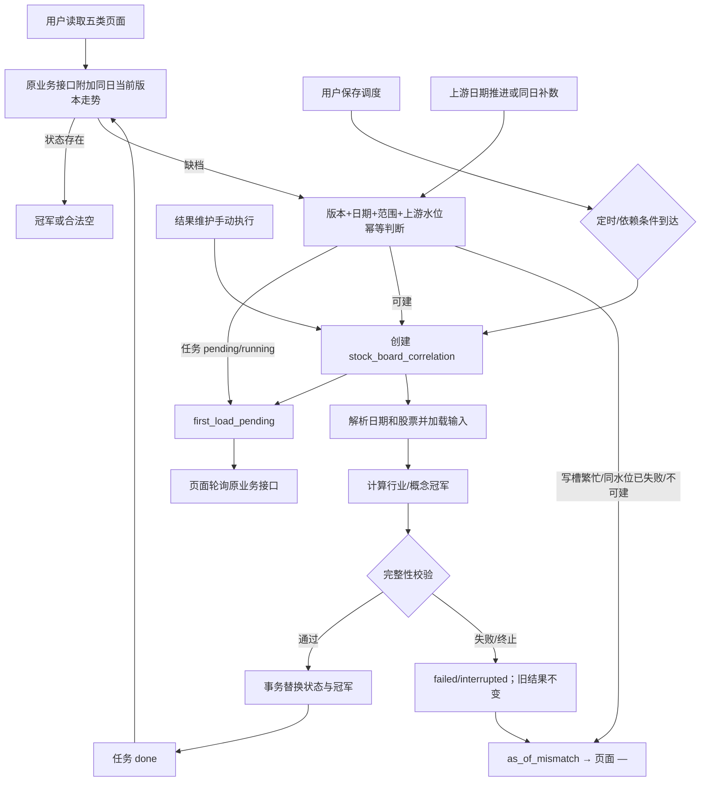
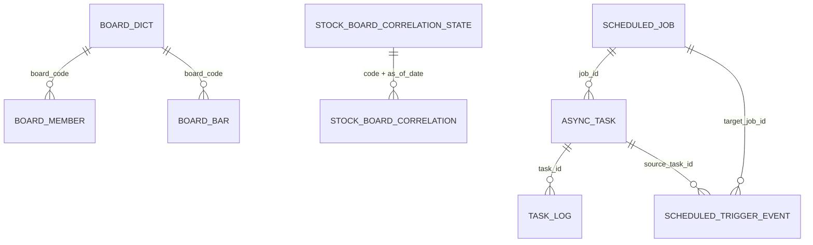

# 个股走势关联板块闭环分析快照（2026-09-02）

归档状态：已归档

## 一、文档范围与结论摘要

本文记录 2026-09-02 源码与定向测试所支持的“个股走势关联板块”业务闭环，覆盖上游事实数据、三类触发入口、异步计算与原子发布、五类业务消费、页面轮询、权限、数据表、调度支链和异常降级。代码范围为 `backend/api/`、`backend/services/`、`backend/indicators/`、`backend/scheduler/`、`backend/storage/` 及 `frontend/src/` 中相关实现。

不包含板块数据的外部采集细节、榜单评分算法、策略表达式算法和连板天梯主体快照算法。走势相关只在股票截至业务日已收录的行业、概念候选中各选一个近期走势冠军，不改变行业归属、榜单评分、筛选结果或天梯层级，也不表示因果关系。

- 起点：页面读取指定业务日结果，或系统管理员手动/按调度触发 `stock_board_correlation`。
- 成功终点：目标范围全部计算和校验通过，状态与冠军快照在一个事务内发布；页面优先显示当日冠军；当日样本不足时可沿用此前最近有效冠军并标“历史”，其余合法空结果显示为 `—`。
- 提前终止点：参数/日期非法、共同事实源不完整、计算或校验失败、任务被终止；均不发布本次不完整结果。
- 只读终点：缺少当前日、当前版本快照且任务未真实创建时，页面显示 `—`，不轮询。

结论：三类入口共用同一任务、算法、发布与读取服务，五个页面不各自计算。仅真实 `pending/running` 的首次任务对应 `first_load_pending/计算中`；合法空和其他缺失统一显示 `—`。采集或普通数据变化不直接失效/重算。首次任务失败后，同一版本、日期、范围和上游水位不重复创建；日期推进或补数改变水位后，后续读取才可再次尝试。

证据截止到 2026-09-02 的工作区源码、DDL、配置与定向测试，未进行浏览器或生产验证。下文状态、数值、源码入口和缺口保留当时分析，不持续同步为当前实现；现行算法、发布、读取及轮询机制统一见 [走势关联架构](../architecture/stock-board-correlation.md)，通用执行机制见 [任务运行态](../architecture/task-runtime.md)。

## 二、参与者、权限与使用场景

| 参与者/系统身份 | 身份来源 | 入口 | 可执行操作 | 可见数据范围 | 产生或接收的任务 | 证据 |
|---|---|---|---|---|---|---|
| 个股用户 | `AuthContext.resources` | 个股查询/详情 | 查看走势 | 已获准股票、公共走势 | 缺档时可间接产生首次任务 | `backend/api/stocks.py` |
| 分组用户 | `tenant_id + user_id`、`stock-group:view` | 个股分组 | 查看分组走势 | 仓库已过滤的分组成员 | 同上 | `backend/api/stock_groups.py`、`backend/groups/stock_group.py` |
| 榜单用户 | `board:view`、方案可见性 | 每日榜单 | 查看榜单走势 | 已授权方案结果 | 同上 | `backend/api/board.py` |
| 筛选用户 | `screen:run`、方案可见性 | 策略筛选 | 运行筛选、查看走势 | 已授权方案命中结果 | 同上 | `backend/api/profiles.py`、`backend/services/screen_score.py` |
| 天梯用户 | `limit-ladder:view` | 连板天梯/导出 | 查看历史日走势和热点 | 所选日公共快照 | 同上 | `backend/api/limit_ladder.py`、`backend/services/limit_ladder_query.py` |
| 板块查看者 | `sectors:view` | 走势单元格链接 | 进入板块详情 | 公共板块 | 无 | `RelatedBoardCell.vue`、`backend/api/sectors.py` |
| 结果维护人员 | system 身份、`data-task:manage` | 结果维护 | 手动创建重算任务 | 平台公共数据 | 创建/查看/终止任务 | `IngestView.vue`、`data_tasks.py` |
| 调度管理员 | system 身份、`data-schedule:manage` | 任务调度 | 保存、启停、触发规则 | 平台任务定义 | 定时/依赖/重试任务 | `ScheduleView.vue`、`data_admin.py` |
| 首次补算服务 | 业务读取内部 | 五类服务 | 缺档判断、幂等建任务 | 请求内缺档代码 | 只报告真实等待任务 | `StockBoardCorrelationService` |
| 调度器/执行器 | 后台进程 | 调度与任务线程 | 分发、计算、发布 | 任务参数范围 | 接收并执行任务 | `scheduler.py`、`async_task.py` |

系统没有人工审核人、处理部门或派单角色；后台执行器接收任务，原业务页面接收结果。

## 三、总体闭环链路

| 环节 | 参与者 | 操作 | 状态 | 主写表 | 下一处理人/系统 |
|---|---|---|---|---|---|
| 读取 | 业务用户/API | 读主体并附加走势 | 已计算/缺档/等待 | 无 | 读取或补算服务 |
| 首次补算 | 领域服务 | 幂等判断并尝试建任务 | pending 或不等待 | `async_task` | 执行器 |
| 手动执行 | 系统管理员 | 提交日期和范围 | pending/失败 | `async_task` | 执行器 |
| 调度 | 系统管理员/调度器 | 保存规则并在条件到达时分发 | 启停/等待/已触发 | `scheduled_job`、`scheduled_trigger_event`、`async_task` | 执行器 |
| 计算发布 | 执行器/领域服务 | 加载、计算、校验、事务发布 | running→done/failed/interrupted | 两张走势快照、任务日志 | 原业务读取 |
| 页面等待 | 前端 | 仅等待真实任务 | 计算中→结果/`—`/超时 | 无 | 用户 |
| 回退循环 | 上游补数+后续读取 | 水位改变后重新判断 | 新事件可再试 | 可新增 `async_task` | 执行器 |

## 四、状态机与流转规则

### 4.1 异步任务

| 当前状态 | 触发操作/条件 | 业务结果或提交状态 | 下一状态 | 创建/更新的数据 | 允许执行者 | 失败或重复处理 |
|---|---|---|---|---|---|---|
| 不存在 | 手动、调度或首次补算创建成功 | 已提交 | `pending` | 新 `async_task` | 管理 API、调度器、补算服务 | `trigger_event_id` 相同则复用；写槽忙不新增 |
| `pending` | 后台线程启动 | 执行中 | `running` | 状态、进度、日志 | 执行器 | 重启遗留任务转 `interrupted` |
| `running` | 完整发布成功 | 正式提交 | `done` 终态 | 快照、任务结果 | 执行器 | 显式新任务仍可重算 |
| `running` | 输入/运行/校验失败 | 未发布半成品 | `failed` 终态 | 失败消息/日志 | 执行器 | 走势 `can_resume=false`；新水位或显式执行才新建 |
| `pending/running` | 终止在检查点生效 | 不完整结果不发布 | `interrupted` 终态 | 状态/审计 | 系统管理员 | 不可续跑，需重建完整任务 |

### 4.2 结果与页面

| 当前状态 | 触发操作/条件 | 业务结果或提交状态 | 下一状态 | 创建/更新的数据 | 允许执行者 | 失败或重复处理 |
|---|---|---|---|---|---|---|
| 当前日/版本缺档 | 真实任务 pending/running | 等待 | `first_load_pending` | 仅任务 | 补算服务 | 页面轮询 |
| 当前日/版本缺档 | 未建任务、写槽忙或同水位失败 | 无结果 | `as_of_mismatch` | 无 | 补算服务 | 页面 `—`，不轮询 |
| 计算中 | 全范围校验通过 | 正式发布 | 已计算 | 状态行；有冠军才有冠军行 | 计算服务 | 原子替换 |
| 已计算 | 某类型无合格冠军 | 合法空 | 仍为已计算 | `has_*_champion=false` | 计算服务 | 后续不触发首次计算；仅样本不足可沿用最近历史冠军，其余 `—` |
| 已计算 | 日期或版本不同 | 不匹配 | 对目标键视为缺档 | 旧记录保留 | 读取服务 | 缺档不回退；仅同日已计算的样本不足可向前取当前版本冠军 |
| 页面计算中 | 结果/合法空/任务失败 | 等待结束 | 名称或 `—` | 无 | 页面 | 停止轮询 |
| 页面计算中 | 120 秒到期或上下文变化 | 本轮结束 | 降级/新上下文 | 无 | 页面 | 清理计时并忽略迟到响应 |

### 4.3 调度事件

| 当前状态 | 触发操作/条件 | 业务结果或提交状态 | 下一状态 | 创建/更新的数据 | 允许执行者 | 失败或重复处理 |
|---|---|---|---|---|---|---|
| 不存在 | 上游终态匹配条件 | 已持久化 | `waiting` | 新事件 | 调度终态监听 | 来源任务+轮次+目标+类型+重试序号去重 |
| `waiting` | 到达 due_at | 抢占分发 | `dispatching` | 事件消息 | 分发器 | 分发前重读状态 |
| `dispatching` | 创建任务成功 | 已触发 | `dispatched` | `task_id` | 分发器 | 事件 ID 防重 |
| `dispatching` | 写槽繁忙 | 暂未触发 | `waiting` | 等待原因 | 分发器 | 后续继续分发 |
| 等待/分发中 | 停用、耗尽或异常 | 链路结束 | `cancelled/exhausted/failed` | 终态原因 | 调度服务 | 不再推进 |

保存 `scheduled_job` 只是保存触发规则，不等于提交计算；手动执行或实际触发才创建任务。走势结果只有完整校验后才提交。DuckDB 写任务单槽互斥，页面不得把“等待写槽”显示成“计算中”。

## 五、各环节运行机制

### 5.1 业务读取与首次补算

1. **目标与前置条件**：为调用方已授权的股票附加同业务日、当前版本走势；缺状态时只异步补算。
2. **参与者、入口和页面**：五类业务用户进入原页面，无单独计算操作。
3. **前端/API**：调用原业务 API；最终进入 `get_related_boards()`/`attach_related_boards()`。
4. **处理与校验**：代码规范化，日期精确匹配；缺档事件键含版本、日期、范围及四类上游表行数/最大日期。
5. **读写与赋值**：读状态、冠军、板块字典和任务；创建成功才写 `async_task`，响应赋 `related_boards`。
6. **状态与下一处理人**：真实任务 pending/running 才返回 `first_load_pending` 给页面和执行器，否则 `as_of_mismatch`。
7. **权限与范围**：沿用原接口权限和资产过滤，只处理返回行中的代码。
8. **成功/失败/重试**：同水位失败不重建；水位变化可再试；写槽忙不建任务、不轮询。
9. **代码证据**：`StockBoardCorrelationService.get_related_boards()`、`_enqueue_first_load_tasks()`、`_first_load_trigger_event_id()`。

### 5.2 手动执行与调度

1. **目标与前置条件**：把何时重算交给用户；参数必须能解析为合法日期和范围。
2. **参与者、入口和页面**：系统管理员在结果维护手动执行，或在任务调度保存规则。
3. **前端/API**：任务使用 `/api/data/tasks`；调度使用 `/api/data/schedules` 相关端点。
4. **处理与校验**：统一 `normalize_correlation_task_params()`；支持最新/固定日、全市场/指定股、force；依赖校验存在性、条件与无环。
5. **读写与赋值**：手动写 `async_task`；配置写 `scheduled_job`；依赖/重试写 `scheduled_trigger_event`。
6. **状态与下一处理人**：手动提交进入 pending；保存调度不执行，条件到达后交给执行器。
7. **权限与范围**：system-only，分别使用 `data-task:manage`、`data-schedule:manage`。
8. **成功/失败/重试**：定时遇忙本次跳过；依赖遇忙保持 waiting；失败重试次数/延迟由用户配置。
9. **代码证据**：`IngestView.vue`、`ScheduleView.vue`、`data_tasks.py`、`data_admin.py`、`scheduler.py`。

### 5.3 计算、校验与发布

1. **目标与前置条件**：目标范围全部计算后一次发布；需个股、板块、指数、日历共同可用。
2. **参与者、入口和页面**：后台执行器；管理员可看日志或请求终止。
3. **前端/API**：任务中心读任务 API；处理器为 `_h_stock_board_correlation()`。
4. **处理与校验**：目标日取三类行情最大日的最小值再对齐开市日；固定日必须精确成立。取 61 个开市日，个股后复权、板块/指数原始价，市场中性化、缩尾、Pearson；20/60 权重 0.6/0.4，最低样本 15/40，行业/概念分别决胜。
5. **读写与赋值**：读日历、股票、三类行情、板块字典/成员；先写进度日志，校验后事务替换状态和冠军。
6. **状态与下一处理人**：pending→running→done；失败/终止为 failed/interrupted；下一处理人是原业务读取。
7. **权限与范围**：公共市场派生数据；指定代码由服务端规范化并校验上市/退市日期。
8. **成功/失败/重试**：合法空也是成功；异常整体不发布且保留旧结果；走势任务不可续跑。
9. **代码证据**：`async_task.py::_h_stock_board_correlation`、`stock_board_correlation.py::compute_and_replace()`、`indicators/stock_board_correlation.py`。

### 5.4 页面展示与轮询

1. **目标与前置条件**：不整页闪烁、不无限刷新地呈现最终摘要。
2. **参与者、入口和页面**：五类业务用户停留在原页面即可。
3. **前端/API**：四个表格后台重请求原接口且只合并 `related_boards`；天梯重请求天梯接口。
4. **处理与校验**：公共轮询器管理绝对超时、串行请求、上下文、迟到响应和卸载清理；表格固定 1.5 秒，天梯用阶段键和指数退避。
5. **读写与赋值**：前端不写表；单元格读取冠军与 `unavailable_reason`，天梯另做热点聚合。
6. **状态与下一处理人**：仅 first_load_pending 显示计算中；冠军显示名称；合法空/其他缺失显示 `—`。
7. **权限与范围**：轮询仍调用原受保护接口；详情链接另需 `sectors:view`。
8. **成功/失败/重试**：结果出现、失败或 120 秒超时即停；主动刷新重新判断，但后端同水位幂等。
9. **代码证据**：`RelatedBoardCell.vue`、`useAsyncResultPolling.ts`、`useRelatedBoardFirstLoad.ts`、`LimitLadderView.vue`、`polling.ts`。

## 六、数据权限运行机制

权限链为：认证中间件生成 `AuthContext` → 原业务 `require_perm` 精确校验 → 私有资产按 `tenant_id + owner_user_id + visibility` 过滤 → 走势服务只装饰已授权股票 → system-only 管理接口通过 `require_system_perm` → API、任务和调度审计分别落账。system-only 资源码用于路由扫描/审计，普通角色即使获得同码也不能绕过 system 身份。

| 对象/动作 | 功能/操作权限 | 行级/租户范围 | 任务归属 | 审计与缺口 |
|---|---|---|---|---|
| 个股/分组 | `stocks:view` / `stock-group:view` | 分组先按租户 owner 过滤 | 首次任务为平台任务 | API 审计；快照不记录触发分组 |
| 榜单/筛选 | `board:view` / `screen:run` | 方案按 private/tenant/public 与 owner 解析 | 平台任务 | 走势不扩大方案范围 |
| 天梯/板块 | `limit-ladder:view` / `sectors:view` | 公共快照 | 平台任务 | 无详情权限只显示名称 |
| 手动重算 | system + `data-task:manage` | 平台全局 | 表无 tenant/owner | API+任务审计；发起人需关联审计日志 |
| 调度管理 | system + `data-schedule:manage` | 平台全局 | 表无 tenant/owner | API+调度审计；同上 |

字段级权限、人工处理人/部门不适用。走势快照是公共市场衍生数据，不含租户；安全前提是始终“先过滤主体、后附加走势”。

## 七、数据模型、表关系与字段赋值

| 表/存储 | 业务角色 | 基数与关联键 | 关键状态/权限/审计字段 | 创建时机 | 主要更新时机 |
|---|---|---|---|---|---|
| `board_dict`/`board_member` | 板块与累计候选 | `board_code`；成员键 `(board_code, code)` | `board_type/first_seen_date` | 板块采集 | 成员只增 |
| `daily_bar`/`board_bar`/`index_bar`/`trade_calendar` | 四类事实源 | 代码+日期 | 收盘、复权、开市标志 | 上游采集 | 增量/补数 |
| `stock_board_correlation_state` | 已计算/合法空事实 | `(code, as_of_date)` | 版本、基准、两个冠军标志 | 成功发布 | 范围内原子替换 |
| `stock_board_correlation` | 实际冠军 | `(code, board_type, as_of_date)` | score、corr、sample、confidence、版本 | 有冠军时发布 | 同上 |
| `async_task`/`task_log` | 运行台账 | task id、task_id+seq | 五态、来源、链路、事件键、进度 | 建任务/运行 | 启动、日志、终态 |
| `scheduled_job`/`scheduled_trigger_event` | 配置与分发台账 | job id、event id | 触发/依赖/重试/启用/事件状态 | 保存规则/匹配条件 | 启停、分发、终态 |
| PG 分组/评分/筛选资产表 | 下游权限事实 | tenant+owner+资产 id | visibility、版本 | 用户维护 | 发布/复制/修改 |
| PG `audit_log` | 身份审计 | 审计 id/目标 | actor、tenant、resource、result、context | 请求/任务事件 | 追加与保留期清理 |

| 业务字段 | 存储位置 | 值来源/首次赋值 | 后续更新条件 | 主要消费者 | 兜底口径 |
|---|---|---|---|---|---|
| 业务日 | task params、`as_of_date` | `resolve_target_date()` | 新任务重解析 | 五类页面 | 固定日不回退 |
| 股票范围 | task params | `resolve_target_codes()` | 每任务独立 | 计算发布 | 规范化、去重、点时校验 |
| 候选 | `board_member` | 板块采集 | 只增 | 算法 | NULL 首见日兼容为历史存在 |
| 基准 | 状态/冠军表 | 市场映射 | 重算覆盖 | 页面/诊断 | fallback 标志明示回退 |
| corr/score/sample | 冠军表 | 算法首次发布 | 重算替换 | 页面说明 | 无冠军不写伪零 |
| 合法空 | 状态表 `has_*` | 发布阶段 | 重算替换 | 读取/页面 | false+状态存在=算过但无冠军 |
| 算法版本 | 两张快照 | `ALGORITHM_VERSION` | 新算法新任务 | 读取/幂等 | 旧版本不作当前值 |
| 任务状态 | `async_task.status` | `create()` | 执行器更新 | 任务中心/读取判断 | `pending/running/done/failed/interrupted` |
| 事件键 | `trigger_event_id` | 首次补算或调度事件 | 不更新 | 去重 | 手动任务可为空 |
| 页面原因 | API 响应 | `_assemble_related_boards()` | 每次读取 | 单元格/轮询 | pending 显示计算中；已记录空原因时“—”可悬浮/聚焦解释 |

## 八、支链路、外部协同与自动任务

| 支链路 | 触发/读写对象 | 是否推进主状态 | 失败影响 | 重试/去重 |
|---|---|---|---|---|
| 定时 | 到点读 job、写 task | 是 | 非交易日/写槽忙本次跳过 | 下个计划点再触发 |
| 依赖/失败重试 | 上游终态写 event，再写 task | 是 | 写槽忙保持 waiting | 持久事件+事件键；次数由用户配置 |
| 首次补算 | 缺档读水位、可写 task | 是 | 同水位失败后页面 `—` | 版本+日期+范围+水位去重 |
| 页面轮询 | pending 时只读原 API | 只观察 | 失败/120 秒即停 | 串行、上下文隔离 |
| 人工终止 | 更新 task/审计 | 终止 | 不发布半成品 | 不可续跑，须新建 |
| 上游采集 | 更新事实表 | 不直接推进 | 缺数使计算失败 | 不隐式重算；补数后可再判断 |
| 导出 | 读当前筛选/天梯结果 | 否 | 不影响快照 | 无自动重试 |
| 通知、外部同步、导入 | 当前证据未发现 | 不适用 | 不适用 | 不适用 |
| 超期 | 前端 120 秒观察超时 | 不改变任务 | 页面停止等待、任务可继续 | 后续刷新读取 |
| 删除级联 | 当前无用户删除结果入口 | 不适用 | 不适用 | 重算是原子替换，不是业务删除 |

## 九、查询、台账、统计与口径一致性

| 消费点 | 范围/日期/状态 | 权限 | 字段来源与口径差异 |
|---|---|---|---|
| 个股查询/详情 | 当前页或单股；精确业务日/版本 | `stocks:view` | 只装饰，不改排序分页；详情缺省取个股最新行情日 |
| 分组 | 当前页成员；逐行最后交易日 | `stock-group:view`+归属 | PG 主体与 DuckDB 摘要在服务层合并，不跨库 JOIN |
| 榜单 | 本次结果；run_date | `board:view`+方案权限 | 不参与评分排名 |
| 筛选页面/CSV | 本次命中；run_date | `screen:run`+方案权限 | 不参与表达式/评分；CSV 保留名称、真实来源日期及状态；空值为空串，页面为 `—` |
| 天梯页面/热点/导出 | 所选日整份快照 | `limit-ladder:view` | 非当前卡片懒算；有效冠军（含样本不足时的历史回退）用于热点及筛选，热点黄色状态点的悬浮说明提示历史数量；无冠军为未分类，导出保留来源日和状态并复用查询服务 |
| 任务中心 | 真实五态 | system-only | `async_task/task_log`，不把页面态当任务态 |
| 调度台账 | job 启用态+event 状态 | system-only | 定时繁忙“跳过”、依赖繁忙“等待”是明确差异 |
| 外部统计/同步 | 当前证据未发现 | 不适用 | 不适用 |

结果优先级是：请求业务日+当前版本状态表判定“已计算” → 同键冠军优先 → 仅 `insufficient_samples` 且无当日冠军时按类型取此前最近有效冠军并附 `history` → 其余为空。历史回退只改变读模型，不替代当日计算事实；旧版本、未来日期、缺档和任务消息不能作为冠军。行业和概念可能沿用不同日期，指标和基准按各自历史来源解释。

## 十、关键源码与配置索引

| 职责 | 文件 | 类/方法/配置 |
|---|---|---|
| 参数、日期、范围、读取、补算、发布 | `backend/services/stock_board_correlation.py` | normalize、resolve、compute_and_replace、get/attach、enqueue/assemble |
| 算法 | `backend/indicators/stock_board_correlation.py` | 收益、市场中性、相关度、冠军 |
| 任务状态机 | `backend/services/async_task.py` | `TASK_CAPABILITIES`、`create()`、`_run()`、handler |
| 调度 | `backend/scheduler/scheduler.py` | `ScheduledJobService`、`_fire_job()`、`dispatch_due_events()` |
| API/鉴权/审计 | `backend/api/data_tasks.py`、`data_admin.py`、`backend/auth/deps.py`、`backend/services/audit_service.py` | 端点守卫和事件审计 |
| 五类消费 | `stocks.py`、`stock_group.py`、`board.py`、`screen_score.py`、`limit_ladder_query.py` | 摘要附加与天梯聚合 |
| 前端展示/轮询 | `RelatedBoardCell.vue`、`useAsyncResultPolling.ts`、`useRelatedBoardFirstLoad.ts`、`LimitLadderView.vue`、`polling.ts` | 统一展示、生命周期与差异化间隔 |
| 管理页面 | `IngestView.vue`、`ResultMaintenanceTaskFields.vue`、`ScheduleView.vue` | 手动执行与配置调度 |
| DDL | `backend/storage/ddl.py`、`backend/storage/pg_ddl.py` | 走势、任务、调度、资产、审计表 |

## 十一、风险、证据缺口与待确认项

| 类型 | 事项 | 证据状态 | 影响 | 建议 |
|---|---|---|---|---|
| 实现风险 | 首次补算遇写槽忙时不持久候补 | 已确认 | 释放后不会主动唤醒原页面 | 若需自动候补，应建持久事件，不能恢复无限轮询 |
| 实现风险 | 页面 120 秒观察上限与后台实际耗时独立 | 已确认 | 页面可能先停止等待 | 可做统一可配置项，但不得等同任务失败 |
| 数据口径风险 | `board_member` 无移出日期 | 已确认 | 历史候选是累计近似 | 严格点时需求下增加生效/失效区间 |
| 数据口径风险 | 历史未重算合法空没有具体原因 | 已确认 | 页面仍统一 `—`，但无悬浮解释 | 按需重算补齐，不从布尔状态推测 |
| 权限风险 | 任务/调度表无 tenant、owner、created_by | 已确认 | 当前仅依赖 system-only；发起人需查审计 | 若开放普通用户，先补归属字段和行级守卫 |
| 权限风险 | 公共走势快照无租户字段 | 已确认 | 必须始终先过滤主体再装饰 | 用服务和权限测试锁定调用顺序 |
| 外部依赖 | 依赖四类事实源且采集不自动重算 | 已确认 | 缺数快速失败，补齐后需读取/手动/调度 | 保留明确任务失败原因，触发权交给用户 |
| 证据缺口 | 未做浏览器实机验证 | 缺失 | 不证明最终视觉和网络时序 | 遵从本次要求；需要时仅测最小路径 |
| 证据缺口 | 生产调度恢复与真实规模 SLA 未验证 | 缺失 | 不能承诺生产耗时 | 上线前做代表性规模和重启验证 |
| 证据缺口 | 榜单导出走势列与布局可见列的逐项一致性未定位 | 推断 | 可能有页面/导出口径差异 | 补导出字段一致性测试 |
